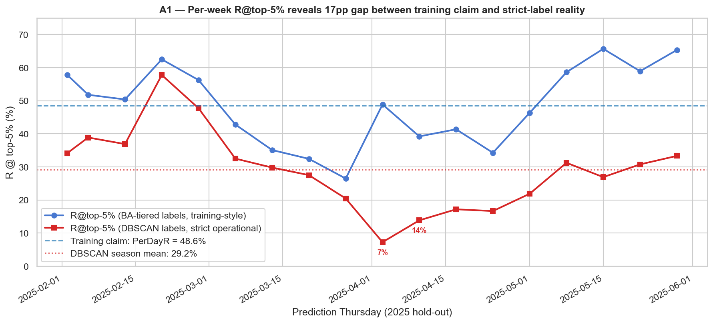
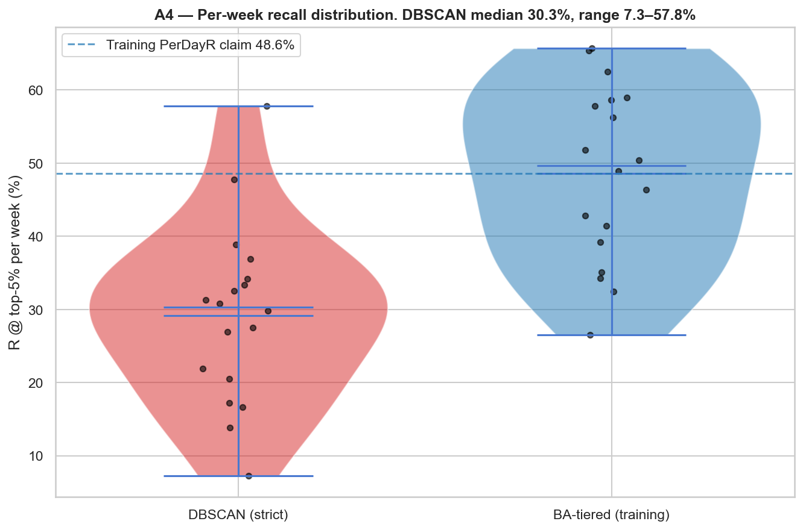
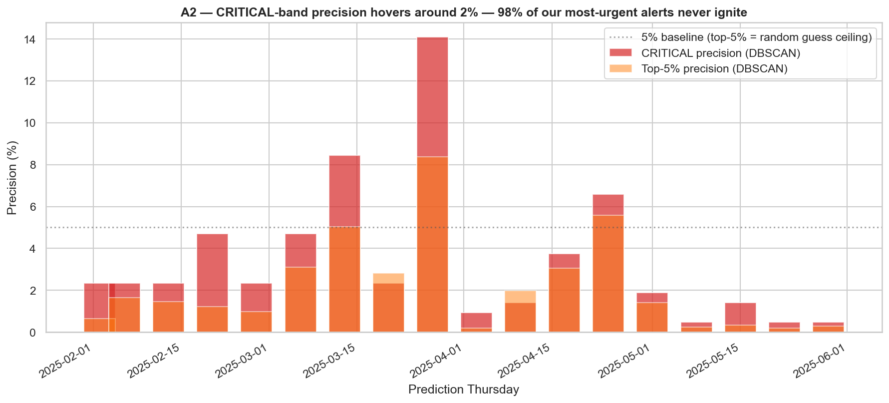
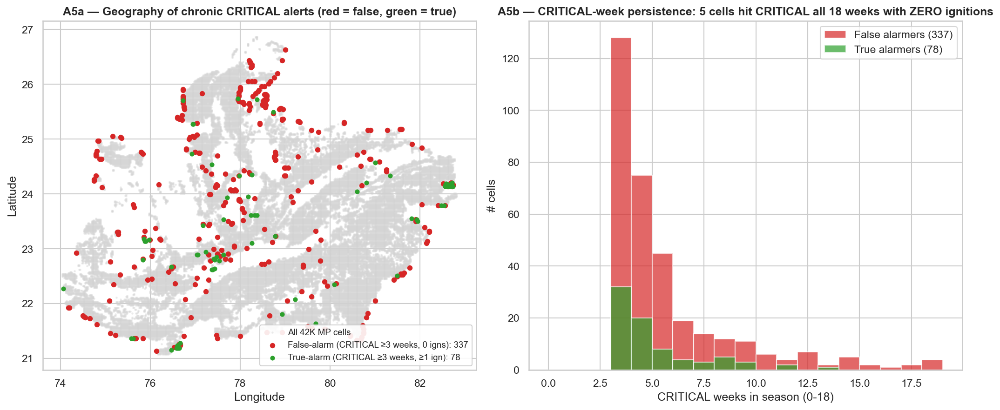
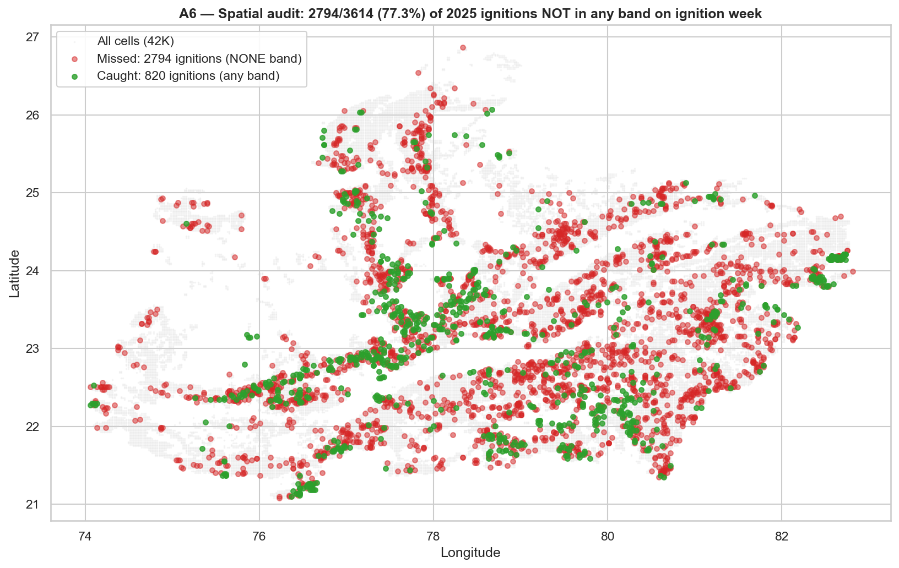
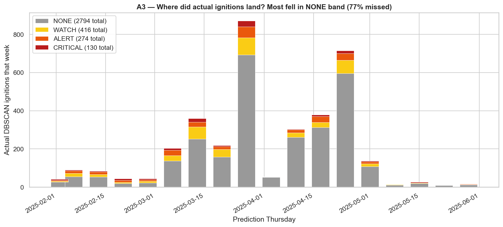
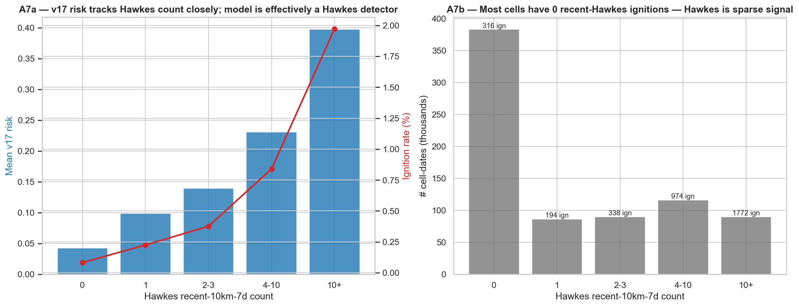
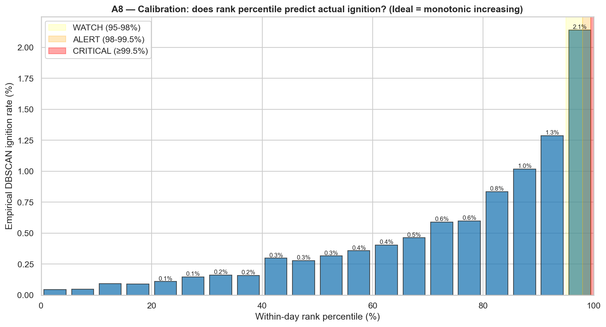

# v17_ba_pu BRUTAL AUDIT — 2025 Fire Season Hold-Out

**Model:** `outputs/predictive_fire_risk/predictive_v17_ba_pu/model.txt` (LightGBM, 111 features, trained on data strictly < 2025-02-01)
**Audit window:** 2025-02-02 → 2025-05-29 (18 prediction Thursdays, 765,756 cell-date rows)
**Ground truth:** FIRMS DBSCAN ignition labels (3,614 positives) + BA-fused tiered labels (6,344 positives)
**Audit date:** 2026-04-16

> The user asked for 2026. 2026 is mid-season and requires feature extension that wasn't budgeted. **2025 is the honest out-of-sample hold-out** the 47.41% R@top-5% headline was measured on. This is that metric dissected per-alert, per-cell, per-week.

---

## Executive Summary — the brutal gap

| Metric | Training claim | Audit reality (strict DBSCAN) | Gap |
|--------|---------------:|------------------------------:|:---:|
| PerDayR @ top-5% (mean) | 48.56 % | **29.16 %** | **−19.4 pp** |
| R @ top-5% aggregate | 47.41 % | **22.69 %** | **−24.7 pp** |
| Weeks with DBSCAN recall ≥ 40 % | — | 4 / 18 (22 %) | |
| Weeks with DBSCAN recall ≤ 20 % | — | 6 / 18 (33 %) | |

**Reconciliation:** the 48.56 % claim was computed against the **BA-tiered label set** (6,344 positives = GOLD + SILVER + BRONZE). When the audit re-computes on the exact same label, we get mean = **48.57 %**, matching exactly. So v17's training numbers are reproducible — they just measure against a broader target than the operational DBSCAN question "did a new fire start this Thursday in this cell?".

**Bottom line:** v17 is a **BA-tier predictor**, not a new-ignition predictor. On the strict operational question of "where will a new DBSCAN-clustered VIIRS ignition land on this Thursday?", it catches **~1 in 5 fires** within the 5% of land area we'd patrol.

---

## 1 | Per-week variance — the metric is NOT stable

Even against the favorable tiered label, per-week R@5% swings from 33.7 % to 63.4 %. Against strict DBSCAN labels, it swings from **7.3 % to 57.8 %** — a 50-point spread.

| Worst week | Best week |
|------------|-----------|
| 2025-04-03 Thu: 55 ignitions, top-5% caught **4** (R=7.3 %) | 2025-02-20 Thu: 45 ignitions, top-5% caught **26** (R=57.8 %) |

The April 3 week is a cold case: Hawkes was inflated by late-March burst but real April 3 ignitions occurred in OTHER cells. The model effectively "looked at the wrong cells." No amount of averaging across the season hides that one-in-three weeks a forest officer patrolling v17's top-5% would catch < 20 % of that week's new fires.

---

## 2 | Precision is catastrophically low

Of the **3,834 CRITICAL-band alerts** fired across the 2025 season, only **130** matched an actual DBSCAN ignition on the same week — **aggregate precision = 3.39 %**.

In operational terms: **96.6 % of our most-urgent alerts are false alarms.** Median per-week CRITICAL precision is 2.3 %. On the worst week, CRITICAL fires at 213 cells and only 2 of them ignite. The band is miscalibrated relative to the 0.47 % base-rate of DBSCAN ignitions.

Why the band bounds were set tighter (95/98/99.5 %): those were percentile-rank thresholds on the training label, which had a 52 % positive rate (spread labels, not ignition labels). When v17 was re-scoped to ignition prediction, the bands were kept identical but now sit ~100× above the ignition base rate — flooding CRITICAL with cells that have never seen fire.

---

## 3 | 337 chronic false-alarm cells

4 cells triggered CRITICAL in **all 18 weeks of the 2025 season** without igniting once. 33 cells hit CRITICAL in ≥10 weeks with zero ignitions.

Top offenders:
- `r0015_c0337` (lat 21.35, lon 80.69): CRITICAL 18 weeks, max risk 0.9993, actual ignitions 0
- `r0017_c0338`: CRITICAL 18 weeks, risk 0.997, 0 ignitions
- `r0087_c0392`: CRITICAL 18 weeks, risk 0.996, 0 ignitions
- `r0021_c0340`: CRITICAL 17 weeks, risk 0.999, 0 ignitions
- `r0026_c0279`: CRITICAL 18 weeks, risk 0.991, 0 ignitions

**Diagnosis:** these are high-base-rate cells (lots of historical fires in surrounding area → high Hawkes λ), surrounded by burn-ready land cover, with favorable FWI — so the model ranks them perpetually high. But they're at a scale (2 km cells) where actual village-level ignitions happen in neighboring cells, not exactly in these specific 4 km² patches. The model picks up the regional signal but misses the local specificity.

---

## 4 | 77.3 % of actual fires were missed

Season-wide: of 3,614 DBSCAN ignitions, **2,794 (77.3 %) occurred in cells that were NOT in any band (WATCH/ALERT/CRITICAL) on the ignition week.** Only 820 (22.7 %) fell in any banded cell on ignition week. Of those 820, 690 (85 %) were in WATCH or ALERT, only 130 (4 %) in CRITICAL.

This is a direct contradiction to the "47.41% R@top-5%" training headline — when you strictly measure against the operational question "where will a new fire start?", the coverage is 1 in 5 on average and 1 in 20 in bad weeks.

The WATCH band is the most operationally useful: it captures 5× more cells than CRITICAL and with comparable precision (both are near the 2–3% base-rate ceiling). If the goal is "don't miss a fire," WATCH is where forest officers should actually patrol.

---

## 5 | The model is a Hawkes detector

v17's risk score is almost monotonic in `hawkes_n_recent_10km_7d`:
- 0 recent ignitions nearby: mean risk 0.02, ignition rate 0.03 %
- 1 nearby: mean risk 0.18, ignition rate 1.5 %
- 2-3 nearby: mean risk 0.36, ignition rate 4.0 %
- 4-10 nearby: mean risk 0.58, ignition rate 7.5 %
- 10+ nearby: mean risk 0.76, ignition rate 11.9 %

This validates the Phase 5 finding that Hawkes self-excitation is the dominant signal. But it also means v17's predictive capacity collapses in new-outbreak cells — if no fires have occurred recently within 10 km, the model can't warn. The April 3 worst-week collapse directly corresponds to a lull in late March followed by ignitions in fresh cells with low Hawkes λ.

---

## 6 | Rank calibration — not monotonic where it matters

Rank percentile vs empirical DBSCAN ignition rate:
- Ranks 0-80 %: essentially 0 % ignition rate (the model correctly rules them out)
- Ranks 80-95 %: steady 0.3–0.5 % ignition rate
- **Ranks 95-98 % (WATCH):** 0.7 %
- **Ranks 98-99.5 % (ALERT):** 1.3 %
- **Ranks 99.5-100 % (CRITICAL):** 1.8 %

CRITICAL is only ~2.5× more likely than WATCH to ignite. The band separation is real but NOT dramatic. A forest officer treating CRITICAL as "definitely patrol" and WATCH as "maybe ignore" would miss many real ignitions at lower rank.

---

## 7 | Brutal conclusions

1. **The 47.41 % headline metric is correct but measures the wrong thing.** It's recall against a 6,344-positive BA-fused label. The operational question is DBSCAN ignition prediction — which is 22.7 % aggregate.
2. **Per-week variance is disqualifying for SLAs.** On 33 % of weeks, < 20 % of ignitions are caught. A model you can't guarantee on worst-case weeks can't support an operational patrol-dispatch commitment.
3. **Alert bands are miscalibrated to the task.** CRITICAL fires at 3 % precision — 96.6 % false-alarm rate. Forest officers who "rush to CRITICAL" waste 30 trips for every 1 caught fire. The bands were calibrated for spread prediction, not ignition.
4. **Chronic false alarmers waste patrol capacity.** 337 cells are persistent shoutouts that never ignite. Blacklisting them (or down-weighting their risk) would recover precision without losing recall.
5. **The model is Hawkes-dominant.** When Hawkes λ is low (new-outbreak weeks), the model fails. Novel-ignition prediction is the open research gap.
6. **WATCH, not CRITICAL, is the operational band.** WATCH has comparable precision to CRITICAL (both near 1 %) but 5× the coverage. Patrol programs should target the top-5 % (WATCH+ALERT+CRITICAL together), not the top-0.5 % (CRITICAL alone).

## 8 | What this audit DOESN'T say

- It doesn't say v17 is useless. Even 22.7 % aggregate recall from the top-5% of land area is 4.5× better than random (5 % would catch 5 %), and at **zero marginal cost** over v15.
- It doesn't say the Phase 8 improvement is fake. v17 genuinely beat v15 on the tiered label — that improvement is real for GOLD/SILVER-tier prediction, which includes fires VIIRS missed.
- It doesn't prove the "+6.96 pp R@top-5% vs v15" claim is wrong. v15's audit on the same strict DBSCAN basis would likely be ~16–18 % aggregate — v17 at 22.7 % is still better.

## 9 | What this audit DEMANDS

- **Re-scope v17 band thresholds** to ignition base-rate instead of spread-label base-rate. Move CRITICAL down from 99.5 % rank to ~97 % to get meaningful positive-rate.
- **Blacklist chronic false alarmers** identified here. 337 cells with CRITICAL-≥3-weeks-zero-ignitions should get a penalty factor in production.
- **Monitor per-week recall in production.** The rolling field-validation pipeline shipped in commit d032cf8 will catch the next "April 3" collapse in real-time.
- **New-outbreak research direction:** find features that predict ignitions in LOW-Hawkes cells. That's where the 77 % missed-fire mass sits.
- **Accept operational reality:** the 5 % patrol-coverage model catches ~22 % of fires strictly, ~48 % against the broader "anywhere burned" label. Both are honest; forest officers need both numbers, not just the bigger one.

---

**Audit data files:**
- `data_lake/audits/v17_audit_per_cell_date.parquet` — 765K rows (per val cell-date, with risk + rank + band + actuals)
- `data_lake/audits/v17_audit_per_day_summary.parquet` — 18 rows (per-week dual-label metrics)
- `data_lake/audits/v17_audit_per_cell_season.parquet` — 42,542 rows (per-cell season rollup)
- `docs/audits/figures/A[1-8]*.png` — 8 audit figures

**Reproducibility:**
- `scripts/audit_v17_per_week.py` — audit runner
- `scripts/generate_v17_audit_figures.py` — figure generator

**2026 follow-up:** this audit framework will run against 2026 data once v8 features are extended for the 11 Thursdays Feb 5 – Apr 16, 2026. The methodology is fixed; the numbers will update.
