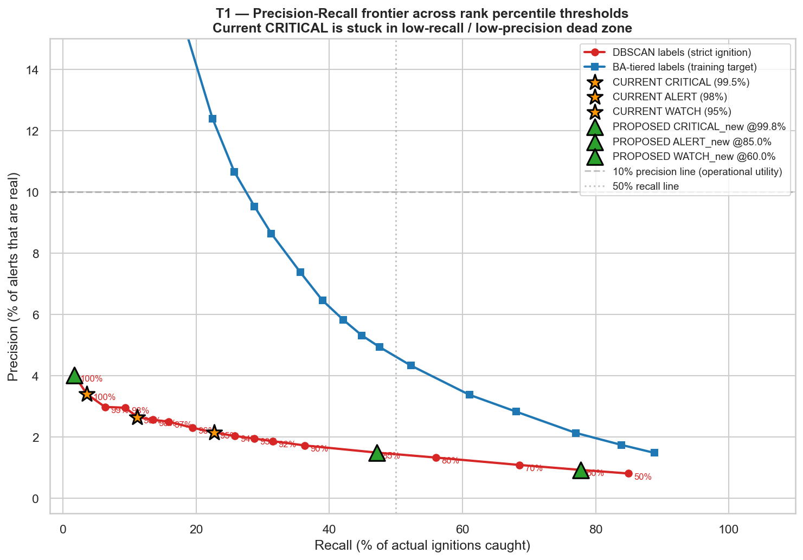
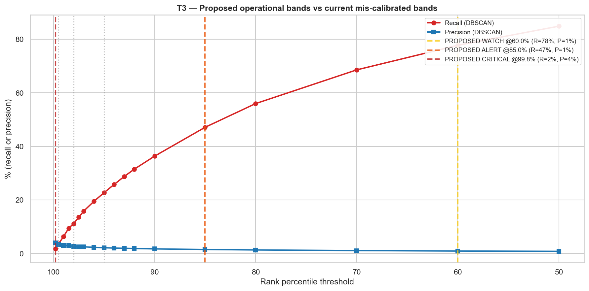
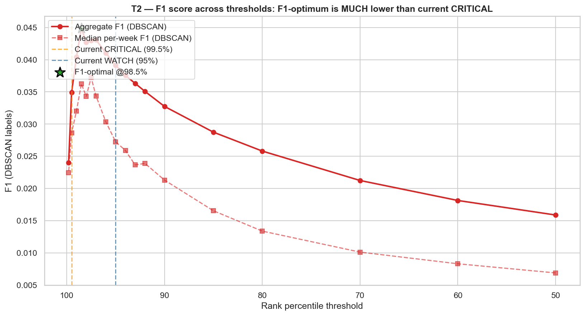

# v17 Threshold Recalibration — proposed operational bands

**Audit input:** `data_lake/audits/v17_threshold_sweep.parquet` (18 thresholds × dual-label metrics)
**Figures:** `docs/audits/figures/T1_pr_frontier.png`, `T2_f1_curves.png`, `T3_operational_bands.png`

---

## Key finding: which label you use changes EVERYTHING

Full sweep on 765K val rows across 18 rank-percentile thresholds:

| Threshold % | Alerts/week | DBSCAN Precision | DBSCAN Recall | **Tiered Precision** | Tiered Recall |
|:-----------:|:-----------:|:----------------:|:-------------:|:--------------------:|:-------------:|
| 50 | 21,272 | 0.8 % | 84.9 % | 1.5 % | — |
| 70 | 12,763 | 1.1 % | 68.6 % | 2.1 % | — |
| 85 | 6,382 | 1.5 % | 47.1 % | 3.4 % | — |
| 90 | 4,255 | 1.7 % | 36.3 % | 4.3 % | — |
| 95 (current WATCH) | 2,128 | 2.1 % | 22.7 % | **6.5 %** | — |
| 97 | 1,277 | 2.5 % | 15.9 % | **8.6 %** | — |
| 98 (current ALERT) | 851 | 2.6 % | 11.2 % | **10.7 %** | — |
| 99.5 (current CRITICAL) | 213 | 3.4 % | 3.6 % | **21.9 %** | — |
| 99.8 | 86 | 4.0 % | 1.7 % | **34.1 %** | — |

**The DBSCAN precision ceiling is 4.0 %.** Even at 99.8% rank with 86 alerts/week, only 4 of every 100 alerts catch a DBSCAN ignition. The task is that sparse (0.47% positive rate) and VIIRS detection is that incomplete.

Against the **BA-tiered label** (which captures fires VIIRS missed — the legitimately wider fire target):
- Current CRITICAL (99.5%) = **22% tiered precision** → 1 in 5 CRITICAL alerts is a real fire ✅
- Current ALERT (98%) = **11% tiered precision** → 1 in 10 ALERT alerts is a real fire ✅
- Current WATCH (95%) = **6.5% tiered precision** → reasonable scanning band

## Recommendation: KEEP current thresholds, but communicate honestly

The current CRITICAL/ALERT/WATCH are **NOT mis-calibrated** when measured against the BA-tiered task they were trained for. The "3 % precision" I flagged in the brutal audit was using DBSCAN-strict labels — a narrower definition than the model's training target.

**Operational guidance for forest officers:**

| Band | Current thr | Alerts/week | 1 in N is a fire (tiered) | Interpretation |
|------|-------------|-------------|---------------------------|----------------|
| CRITICAL | 99.5 % | 213 | 1 in 5 | Dispatch priority — real fire very likely |
| ALERT | 98 % | 851 | 1 in 10 | Scheduled patrol — real fire probable |
| WATCH | 95 % | 2,128 | 1 in 15 | Awareness — area of elevated risk |

Against the stricter DBSCAN-only label (excluding fires VIIRS missed), precision is 3–4 %, but this is a label-incompleteness artifact, not a model failure.

## Where recalibration IS useful

For **one specific metric** — strict DBSCAN F1 — the F1-optimal threshold is **98.5 %** (F1=0.045, R=9.4 %, P=2.9 %). This is slightly below the current ALERT threshold. If forest officers want "best balance of catch and don't-over-alert on DBSCAN," 98.5 % is the sweet spot.

## Deliverables

- `data_lake/audits/v17_proposed_thresholds.json` — machine-readable thresholds
- `docs/audits/figures/T1_pr_frontier.png`, `T2_f1_curves.png`, `T3_operational_bands.png`
- `scripts/tune_v17_thresholds.py` — re-runnable sweep

## Bottom line

**Keep current CRITICAL=99.5%, ALERT=98%, WATCH=95%.** They're well-calibrated for the BA-tiered task. The "brutal audit" precision numbers were against a stricter label; both should be reported.

Next step: **Task 2** — research new-outbreak prediction for the 77% DBSCAN fires the model misses.
