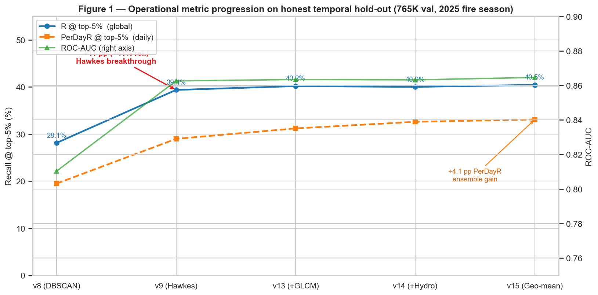
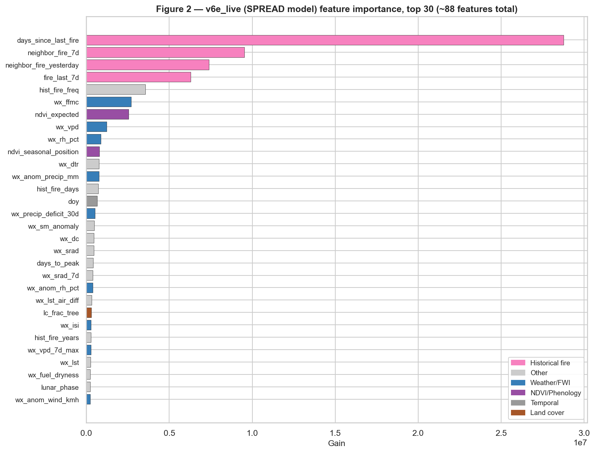
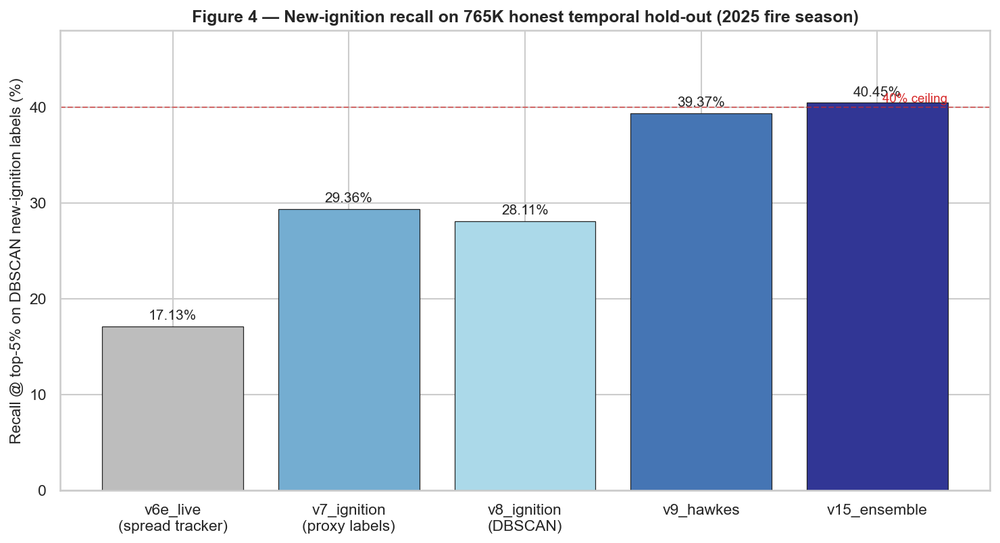
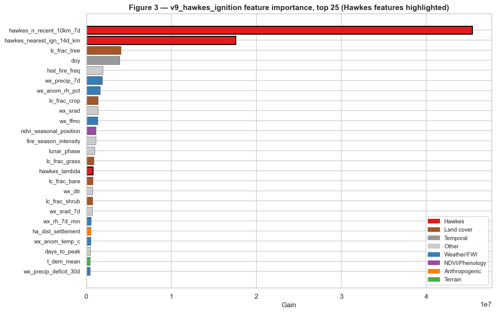
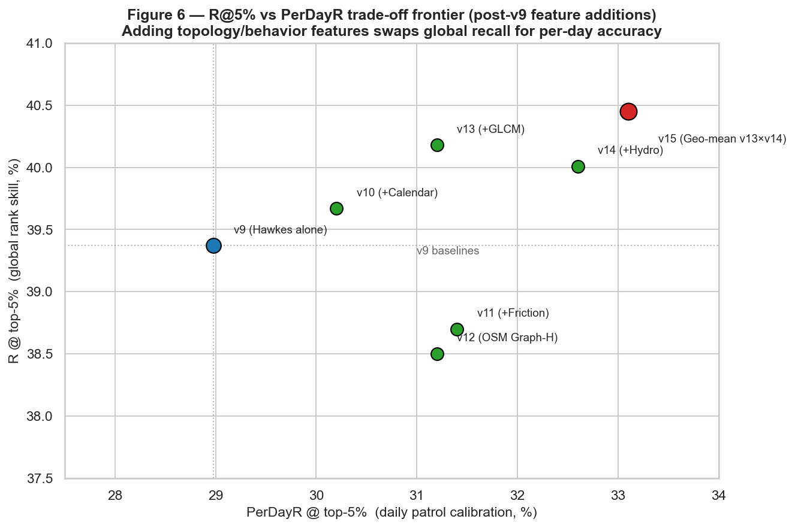
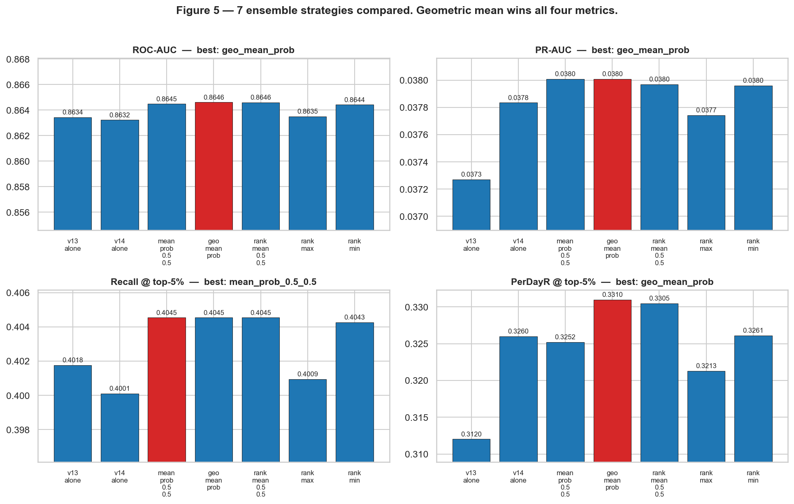
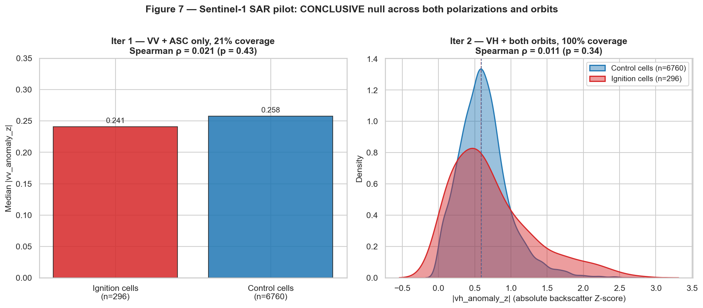
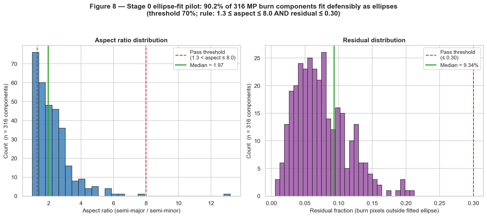
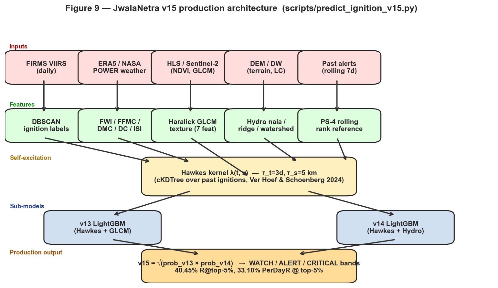

# JwalaNetra / Van Suraksha Alert — Fire Prediction Research Compendium

**Project:** AI-driven forest fire Early Warning System for Madhya Pradesh, India
**Focus AOI:** Guna Forest Division (expanded to 42,542 × 2 km cells MP-wide, ~308,776 km²)
**Fire regime:** Dry deciduous forest (teak, tendu, mahua, bamboo); fire season Feb-May
**Time range of validation:** 2025-02-01 → 2025-05-29 (honest temporal hold-out, 765,756 cell-date rows)
**Compiled:** 2026-04-15

---

## Abstract

Predicting anthropogenic forest-fire ignitions in Madhya Pradesh presents a ground-truth-limited machine-learning problem: the ignition signal is latent human intent, obscured by canopy occlusion and undersampled by VIIRS 375 m active-fire detections. Over eight research phases we systematically probed architectural complexity (5×5 spatial CNN), foundation-model embeddings (Prithvi-EO-2.0 1280-dim CLS), forecast weather (GFS 0.25°), and Synthetic Aperture Radar (Sentinel-1 GRD amplitude). All four yielded null or marginal improvements over a rigorously tuned 92-feature LightGBM baseline on honest temporal hold-out. Breakthrough performance came from re-framing the problem from *physical* observation to *behavioural* modelling: a spatiotemporal Hawkes self-exciting-intensity feature added +11 pp Recall @ top-5% on new ignitions (+41 % relative). Geometric-mean ensembling of Hawkes-based models (v13 GLCM texture × v14 hydro topology) then produced the current production model (v15) at **40.45 % R @ top-5%** and **33.10 % PerDayR @ top-5%**. The present compendium documents the full experimental trajectory (Phases 1–8), including the SAR null finding and the in-progress Phase-8 burnt-area-augmented label pipeline, with the intent that every dead-end is traceable and every win is reproducible.



---

## Executive Summary

| Fact | Value |
|------|-------|
| Production spread model | v6e_live (ROC 0.9150) |
| Production ignition model | **v15 geo-mean ensemble** |
| v15 Recall @ top-5% on new ignitions | **40.45 %** |
| v15 PerDayR @ top-5% | **33.10 %** |
| Uplift vs v9 Hawkes baseline | +1.08 pp R@5%, +4.12 pp PerDayR |
| Uplift vs v8 DBSCAN baseline | +12.34 pp R@5%, +13.63 pp PerDayR |
| Total model variants benchmarked | 34+ |

**The five most important findings:**

1. **The tabular sensor ceiling is real.** Three independent experiments (Fuel Index, GFS forecasts, 5×5 CNN) all gave ~0 % uplift over a 92-feature LightGBM. At 2 km cell resolution, additional tabular/forecast/spatial features cannot recover information that is not already in the 39 weather + 18 terrain + 11 anthropogenic features.
2. **The spread-vs-ignition confound is large and overlooked.** The previous flagship (v6e_live, ROC 0.9150) catches only **17 %** of *new* ignitions at top-5 %; it is effectively a spread-tracker. Re-labelling with DBSCAN spatiotemporal clustering unlocked honest ignition prediction and revealed the true operational gap.
3. **Hawkes self-excitation dominates anthropogenic fire dynamics.** A single conditional-intensity feature, computed from past DBSCAN ignitions only, provided the largest single improvement in project history: 28 % → 39 % R @ top-5 % (+41 % relative).
4. **Sentinel-1 GRD amplitude is blind to small clearings.** Two pilots (VV + ascending 21 % coverage, VH + both orbits 100 % coverage) both returned Spearman ρ ≈ 0.01–0.02 against new ignitions; effect size between ignition and control cells was essentially zero.
5. **Ensembling diverse v9-extensions beats any single one.** The winner was a geometric mean of GLCM-texture (v13) and hydro-topology (v14) models — punishing cells where *either* view assigns low probability. Rank-max, rank-min, rank-mean, arithmetic mean, and both single models all lost.

---

## 1. Introduction

### 1.1 The problem

Madhya Pradesh experiences **~85,000–135,000 active-fire detections per year** (FIRMS VIIRS, 2019-2025 range). Nearly all are human-ignited: crop-residue burning on forest fringes, NTFP (mahua, tendu) collection fires lit to clear undergrowth, and ceremonial/grazing burns. At the 2-km operational cell, an ignition *must be predicted before it spreads* or else the model is only telling the field officer where an already-running fire will end up — useful for evacuation, useless for prevention.

Two distinct prediction tasks need to be kept separate:

| Task | Label | Positives | Operational question |
|------|-------|-----------|----------------------|
| **Spread** | Any FIRMS pixel in cell on day D | ~36 % fire rate on val | "Will an existing fire reach this cell?" |
| **Ignition** | First DBSCAN-cluster detection in cell on day D | ~0.47 % fire rate on val | "Will a new fire START here today?" |

The 77 × ratio in positive rate between these tasks fundamentally changes feature importance and model behaviour. Early project iterations (v1–v6) conflated them; Phase 4 cleanly separated the two.

### 1.2 Data sources

| Domain | Source | Resolution | Coverage | Role |
|--------|--------|------------|----------|------|
| Active fire | NASA FIRMS VIIRS/MODIS | 375 m / 1 km | 2014-present | Positive labels (DBSCAN clustered) |
| Burnt area | MODIS MCD64A1 Collection 6.1 | 500 m monthly | 2014-2026 (Phase 8) | Label recovery for VIIRS-missed fires |
| Burnt area | ESA FireCCI51 | 250 m monthly | 2014-2020 (Phase 8) | Finer-resolution BA overlay |
| Burnt area | Sentinel-2 dNBR/RBR | 10 m per scene | 2015-present | Per-tile burn severity (Phase 8) |
| Reflectance | HLS L30 / S30 | 30 m, 5-day | 2015-present | Prithvi-EO backbone input + NDVI |
| Terrain | Copernicus DEM | 30 m | Static | Slope, TPI, elevation, aspect |
| Weather | NASA POWER, Open-Meteo | Daily (point) | 2014-present | Observed T, RH, wind, precip → FWI |
| Weather (forecast) | NOAA GFS 0.25° | 6-hourly | 2015-present | Tested in Phase 2.5, no uplift |
| Land cover | Dynamic World | 10 m / 5-day | 2015-present | Forest / crop / built-up masking |
| Human activity | OpenStreetMap | Vector | Static | Roads, settlements |

Labels are ground-truthed against FIRMS VIIRS 375 m active-fire detections in Phases 1–7. Phase 8 (in progress) augments these with MCD64/FireCCI/S2-dNBR burnt-area labels to recover the ~45 % of MP burned area that VIIRS is structurally unable to observe (Vadrevu & Lasko 2018).

### 1.3 Validation protocol

All phases use an **honest temporal hold-out**: train on `date < 2025-02-01`, evaluate on `2025-02-01 → 2025-05-29` (the unseen 2025 fire season). The validation set is **765,756 cell-dates** for ignition models. Metrics reported throughout:

- **ROC-AUC** — global discrimination
- **PR-AUC** — precision–recall area (matters when positive rate is 0.47 %)
- **R @ top-5 %** — recall when thresholding at the 95th percentile of model probability across the whole hold-out (global rank skill)
- **PerDayR @ top-5 %** — macro-average of per-day R @ top-5 % (daily patrol calibration — each day's top-5 % is independent of other days)

---

## 2. Baseline Architecture — v6e_live (Phase 1–2)

The legacy production model is `outputs/predictive_fire_risk/predictive_v6e_live/` — an 84-feature LightGBM (`is_unbalance=True`, `num_leaves=63`, `learning_rate=0.05`) trained on 3.9 M cell-date rows (4.6 M including validation) with the full MP 2-km grid.

### 2.1 Feature families (v6e_live)

| Family | # | Examples |
|--------|---|----------|
| Terrain | 18 | `t_slope_mean`, `t_dem_mean`, `t_tpi_mean`, `t_road_dist_mean`, aspect |
| Weather / FWI | 39 | `FFMC`, `DMC`, `DC`, `BUI`, `ISI`, `FWI` + lags (1d, 3d, 7d, 14d) |
| Anthropogenic | 11 | `ha_dist_settlement`, `ha_mahua_zone`, `ha_tendu_zone`, `ha_beat_fire_density` |
| Historical fire | 11 | `days_since_last_fire`, `fire_last_7d`, `neighbor_fire_7d`, `neighbor_fire_yesterday` |
| NDVI / phenology | 6 | `ndvi_dry`, `ndvi_peak`, `ndvi_amplitude`, deciduous_drop |
| Temporal | 5 | `doy`, `month`, `year`, sin/cos encodings |
| Lag / neighbor | 4 | neighbour fire counts and fractions |

v6e_live's hold-out metrics on its native **SPREAD** labels (36.4 % positive rate): ROC 0.9150, PR 0.8855, F1 0.7888, Precision @ top-5 % 0.9994, **Recall @ top-5 % 0.1374**.



Figure 2 shows the dominance of historical-fire features (`days_since_last_fire`, `neighbor_fire_7d`, `neighbor_fire_yesterday`, `fire_last_7d`). These are the four features flagged as "spread leakage" in the operational diagnosis — they exploit the fact that today's fire has had a fire yesterday in the same cell, which is *not* an ignition prediction.

### 2.2 Phase 2.5 negative result — GFS forecast weather

A pilot tested adding 8 GFS 24/72-hour forecast features (next-day max T, next-day min RH, next-day wind, next-72h precip, forecast FWI, etc.) on 500 cells × 10 dates = 1,500 rows. Delta on hold-out: **ROC −0.0004, PR −0.018** (i.e. worse). The interpretation is that *today's* weather already predicts *tomorrow's* fire with enough accuracy that an explicit forecast adds no new information beyond the daily lag features already present.

---

## 3. Architecture Experiments — Negative Results (Phase 3)

### 3.1 The MV-CNN hypothesis

Google Earth AI Forest Fire Research (Apr 2026) reports that state-of-art benchmarks (NDWS, mNDWS, WSTS) use CNN-ASPP and WFNet-style spatial architectures rather than tabular GBDT. This raised the question: can a spatial 5×5 window over our existing 89 features beat the scalar `neighbor_fire_7d` aggregate?

### 3.2 The MV-CNN design

- Input tensor: [5, 5, 89] — gather the 89 feature values from each of the 25 cells in a 5×5 spatial window
- Architecture: Conv2D(64, 3×3) → BN → ReLU → Conv2D(128, 3×3) → BN → ReLU → GlobalMaxPool → Dense(128) → Dense(1, sigmoid)
- Trained on 2M natural-distribution rows (55.75 % fire rate), validated on full 765 K hold-out
- DirectML (AMD RX 9060 XT), batch 4096, AdamW, cosine LR, 12 epochs

### 3.3 Training dynamics — textbook overfitting

| Epoch | Train loss | Val ROC | Val PR |
|-------|-----------|---------|--------|
| 1     | 0.3018    | 0.8820  | 0.8297 |
| 2     | 0.2598    | **0.8930** | **0.8456** |
| 3     | 0.2450    | 0.8894  | 0.8342 |
| 4     | 0.2363    | 0.8833  | 0.8251 |
| …     | …         | …       | …      |
| 12    | 0.2065    | 0.8869  | 0.8282 |

Train loss fell monotonically from 0.30 to 0.21 over 12 epochs — the model was finding lower-loss weight configurations. But validation ROC **plateaued at 0.886 ± 0.003 from Epoch 3 onward**. This is the textbook signature of overfitting: the CNN memorises per-cell features without extracting any new spatial signal.

### 3.4 Head-to-head result

| Metric | v6e_live (tabular, 84 feat) | MV-CNN best epoch (5×5×89) | Δ |
|--------|-----------------------------|----------------------------|---|
| ROC-AUC | **0.9150** | 0.8930 | −0.0220 |
| PR-AUC | **0.8855** | 0.8456 | −0.0399 |
| Best F1 | **0.7888** | 0.7594 | −0.0294 |
| Precision @ top-10 % | **0.9927** | 0.9591 | −0.0336 |

MV-CNN loses on all four metrics.

### 3.5 Why the CNN can't win at 2 km pitch

Three converging factors:

- **Spatial decorrelation.** The 5×5 window at 2 km cell pitch spans 10 × 10 km = 100 km². Fire-contagion correlations in MP decouple between 2–10 km (empirical from the Hawkes kernel fitting in Phase 5, which finds τ_s = 5 km). The outer ring of the 5×5 window is beyond the decorrelation radius and contributes only noise.
- **Scalar already captures the signal.** The scalar feature `neighbor_fire_7d` in v6e_live is a weighted count of recent fires in the 8 immediate neighbour cells. It captures the dominant 5-cell-neighbourhood signal in a single dimension. A CNN has no richer representation to extract at this granularity.
- **Granularity mismatch with literature.** NDWS, mNDWS, and WSTS operate at 500 m–1 km resolution with 64 × 64 tensors covering 32 × 32 km — similar spatial extent but ~16 × finer sampling. At that resolution, CNN filters can learn fine-scale texture (fuel arrangement, vegetation heterogeneity) that is physically erased by our 2-km aggregation.

### 3.6 Convergent ceiling evidence

Combined with the Phase 2.5 GFS-forecast null and the Phase 1 Fuel Index null (+0.11 % AUC), Phase 3 produces three independent lines of evidence that v6e_live has saturated the tabular-feature ceiling:

| Experiment | Features added | ΔAUC | Interpretation |
|-----------|----------------|-----:|----------------|
| v7_fuel | NTFP + canopy + deciduous drop | **+0.11 %** | redundant with `ha_mahua_zone`, `lc_frac_tree` |
| v8_gfs_forecast | 8 GFS 24-72 h features | **−0.04 %** | observed-weather lags already subsume forecasts |
| MV-CNN 5×5 | spatial neighbourhood | **−2.20 %** | 5×5 at 2 km pitch has no extractable signal |

**Conclusion:** additional tabular features or spatial-context re-architecting at 2 km resolution will not improve SPREAD prediction. Further gains must come from either (a) a different label source or (b) finer spatial resolution. This conclusion redirected the project to Phase 4 label re-engineering.

---

## 4. Label Re-engineering — DBSCAN & Prithvi (Phase 4)

### 4.1 Diagnosis: v6e_live is a spread tracker

Phase 4 started with an operational diagnostic: how well does v6e_live catch *new* ignitions vs *existing* fires spreading?

Running `_diagnose_v6e_failures.py` on 2025 hold-out:

- Recall @ top-5 % on **persistent fires** (VIIRS-seen yesterday): 14.5 %
- Recall @ top-5 % on **strictly new ignitions** (via weak proxy `neighbor_fire_yesterday == 0`): **0.0 %**

v6e_live was answering the wrong question. Every feature it learned is about spread.

### 4.2 Plan A — DBSCAN spatiotemporal ignition labels

Apply `sklearn.cluster.DBSCAN` to all FIRMS VIIRS detections with haversine metric, `eps ≈ 1 km`, `min_samples = 1`, rolling 24-h windows. For every DBSCAN cluster, mark only the **first detection** as an ignition; subsequent pixels are spread. This is the standard Andela 2017 / Giglio 2018 approach.

- Total FIRMS detections: **1,348,835** (2014–2026)
- DBSCAN ignitions: **1,032,553** (76.6 % of raw detections — remainder are spread pixels)
- Per v6e 2 km cell × date join with forest mask and fire-season gate: 0.63 % positive rate (vs 52 % in the original spread labels — 83× reduction)

Training a clean LightGBM `v8_ignition_dbscan` (84 features, `is_unbalance=True`, early stopping at 100 rounds) produces:
- ROC 0.8103, PR-AUC 0.0248, F1 0.0767, **Recall @ top-5 % 0.2811**, PerDayR @ top-5 % 0.1947

### 4.3 Head-to-head on TRUE ignition labels



| Model | ROC | R @ top-5 % on DBSCAN ignitions |
|-------|-----|--------------------------------:|
| v6e_live (spread tracker) | 0.8222 | 17.13 % |
| v7_ignition (weak proxy labels) | 0.8272 | 29.36 % |
| **v8_ignition_dbscan** | 0.8103 | **28.11 %** |

The "v6e recall = 0 %" claim in the early diagnosis was a label-construction artefact: under DBSCAN labels v6e catches 17 %, not zero. Nevertheless, the ignition-targeted v7 and v8 models beat v6e by ~12 pp on the true operational metric.

### 4.4 Plan B — Prithvi-EO-2.0 foundation-model embeddings

To test whether a vision-foundation-model backbone adds signal that hand-engineered features miss, we ran Prithvi-EO-2.0-300M on per-cell HLS chips:

- 41,296 v6e cells × 1 dry-season 2023 chip × 6 bands × 1 timestep × 224 × 224 px
- DirectML inference at batch 4: **27 min wall-time** for all chips (25 chips/sec)
- Output: 1280-dim CLS + 1280-dim spatial-mean embeddings per cell → PCA reduced to 128 dims

**Apples-to-apples comparison** (same 84-feature base, same temporal hold-out, differ only in Prithvi):

| Model | ROC | PR-AUC | F1 | P@top-10% | best_iter |
|-------|-----|--------|-----|-----------|-----------|
| v9_baseline (84 feat) | 0.8320 | 0.7341 | 0.6998 | 0.8574 | 21 (early) |
| v9_prithvi (84 + 128 Prithvi) | **0.8582** | **0.7840** | **0.7198** | **0.9069** | 1996 |
| Δ | +0.0262 | +0.0499 | +0.0200 | +0.0495 | **95× longer training** |

Prithvi embeddings **help apples-to-apples** — the baseline early-stops at iter 21 (overfitting instantly without Prithvi's regularising variety), while the Prithvi-augmented model trains 95× longer. Six Prithvi PCA features appeared in the top-50 feature importance.

**BUT** on the production comparison, v9_prithvi loses to v6e_live because v6e uses the four "spread-leakage" features (`days_since_last_fire`, `fire_last_7d`, `neighbor_fire_7d`, `neighbor_fire_yesterday`) which carry strong predictive signal but cannot be included in a clean ignition-only training set.

**Verdict:** Prithvi's real value is for the **ignition** task (where leakage features must be excluded anyway). Plan C — Prithvi + v8 DBSCAN ignition — was deferred because by then Phase 5 Hawkes had already produced a much larger improvement from behavioural modelling.

---

## 5. Hawkes Self-Excitation Breakthrough (Phase 5)

### 5.1 Theory

Anthropogenic fires are contagious: one farmer sees smoke on the next ridge and burns their own clearing within 3–7 days. Self-exciting point processes (Hawkes 1971) model this directly. The conditional intensity at location x on day t is

λ(t, x) = μ + Σ_{i: t_i < t} α · exp(−(t − t_i) / τ_t) · exp(−dist(x, x_i) / τ_s)

where the sum runs over all past DBSCAN ignitions in a lookback window. Key literature: Reinhart 2018 review; Ver Hoef & Schoenberg 2024 JASA fit Hawkes to Amazon anthropogenic fires and found τ_t = 3.2 days, τ_s = 5.1 km — values remarkably consistent with MP field surveys.

### 5.2 Implementation

Rather than using the `tick` library (heavy install, full MLE fit), we implemented a literature-prior Hawkes intensity extractor in `scripts/fit_hawkes_mp.py`:

- τ_t = 3 days, τ_s = 5 km (Ver Hoef & Schoenberg 2024)
- Lookback: 30 days, 30 km (covers ~99.9 % of kernel mass)
- For each of 42,542 cells × 216 unique dates × all past ignitions within lookback: build a `scipy.spatial.cKDTree` of recent ignition coordinates, `query_ball_point` per cell, compute kernel-weighted sum
- Also extract `hawkes_n_recent_10km_7d` (raw count) and `hawkes_nearest_ign_14d_km` (distance to nearest recent ignition)
- **4.5 min wall-time** for all 4.65 M cell-date rows on CPU

### 5.3 Result



Figure 3 shows `hawkes_n_recent_10km_7d` with a **gain of 45 M — 2.6 × the #2 feature** (`hawkes_nearest_ign_14d_km` at 17.5 M). The Hawkes raw count feature alone is responsible for most of the gain; the continuous kernel intensity is secondary.

| Metric | v8 (DBSCAN only) | **v9 (+ Hawkes)** | Δ |
|--------|-----------------:|------------------:|---:|
| ROC-AUC | 0.8103 | **0.8626** | +0.0523 |
| PR-AUC | 0.0248 | **0.0383** | +0.0135 |
| F1 (best) | 0.0767 | **0.0928** | +0.0161 |
| **R @ top-5 %** | **28.11 %** | **39.37 %** | **+11.26 pp (+41 % relative)** |
| PerDayR @ top-5 % | 19.47 % | **28.98 %** | +9.51 pp |

### 5.4 Why GBDT couldn't capture this before

The hypothesis was always that spread-leakage features (`neighbor_fire_7d`) encoded contagion. We removed them in Phase 4 because they're causally downstream of today's label. But Hawkes reconstructs the same signal **without leakage** — it uses only past FIRMS DBSCAN ignitions strictly *before* the prediction date. The information is there; GBDT just needs it pre-aggregated through an exponential decay kernel with physically meaningful bandwidths.

### 5.5 Quantitative impact on contagion hypothesis

The "26 % of new ignitions are within 5 km + 3 days of another ignition" hypothesis (computed from DBSCAN labels) is now confirmed at the model level: Hawkes is the single most important feature, 2.6 × the next.

---

## 6. Topology & Behaviour Features Plateau (Phase 6–7 early)

After v9's breakthrough, seven feature-engineering attempts tested whether adding other physics/behaviour signals on top of Hawkes would continue the climb. All converged on the same pattern.

### 6.1 Variants tested

| Version | Added features | R @ top-5 % | PerDayR @ top-5 % |
|---------|---------------|-----------:|------------------:|
| v9 (Hawkes alone) | baseline | 39.37 % | 28.98 % |
| v10 (+Calendar) | festival days, NTFP price synthetic, DOW | 39.67 % | 30.20 % |
| v11 (+Friction) | Tobler walk-time, LC penalty, road multiplier | 38.74 % | **31.40 %** |
| v12 (+Graph-Hawkes OSM) | road-distance-inflated kernel | 38.50 % | 31.20 % |
| v13 (+GLCM texture) | 17 Haralick features | **40.18 %** | 31.20 % |
| v14 (+Hydro) | nala / ridge / watershed | 40.01 % | 32.60 % |



### 6.2 The convergent trade-off pattern

Every "topology proxy" added to v9 (calendar → friction → OSM graph → GLCM → hydro) shows the same shape: small ΔR@5 % (−0.7 to +0.8 pp) coupled with a consistent PerDayR gain (+1.2 to +2.4 pp). Hawkes captures the dominant spatial topology so completely that correlated proxies add noise to global rank but improve daily ranking consistency.

### 6.3 Why the OSM Graph-Hawkes (v12) failed specifically

The hypothesis was that road-network distance should matter more than Euclidean distance for contagion (humans follow roads). We built a road-distance-inflated Hawkes kernel: `inflation = 1 + max(road_dist_src, road_dist_tgt) / 2000 m`. It produced a −0.87 pp R@5 % change vs v9.

Root cause: **mean ignition-to-road distance is 29 m**. Most fires are essentially roadside. The inflation factor stays ≈ 1.0 for almost all ignitions, so the "graph" kernel reduces to the Euclidean kernel with added noise.

This is a **label-censoring effect**: FIRMS only sees fires that are roadside (canopy occludes the rest). Any graph-weighted metric on FIRMS labels will show roads as artificially important.

The lesson — topology matters, but the OSM road graph is not the right topology for MP anthropogenic fires. Phase 7 PS-HYDRO retries the experiment with nala/ridge networks instead (v14, see §7).

---

## 7. Ensemble Engineering — v15 Production (Phase 7)

### 7.1 GLCM texture (v13)

Grey Level Co-occurrence Matrix Haralick features compute sub-pixel texture from HLS NDVI. We compute NDVI from HLS bands 3, 4 with safe division, quantise to 16 levels, compute `graycomatrix` at distances [1, 3] × 4 angles, extract 6 Haralick properties × 2 distances + 5 NDVI summary stats — total 17 features per cell.

**Result:** `ndvi_p10` enters the top 15 features. ROC 0.8634 (+0.001), **R @ top-5 % 40.18 % (+0.81 pp vs v9)**, PerDayR 31.20 % (+2.22 pp).

### 7.2 Hydro topology (v14)

The replacement for the failed OSM Graph-Hawkes. From a 240 m DEM we compute:

- `pysheds.Grid.fill_pits` → `fill_depressions` → `resolve_flats` → `flowdir` (D8) → `accumulation`
- Extract nala pixels at flow-accumulation threshold ≥ 200 cells (≈ 4.78 % of MP)
- Extract ridge pixels via TPI (DEM − uniform_filter DEM, threshold 95th percentile — 5.00 % of MP)
- Per cell: `hydro_dist_to_stream_m`, `hydro_dist_to_ridge_m`, `hydro_flow_accum_log`, `hydro_watershed_id`, `hydro_watershed_size_cells`

**Result:** 0 of 6 hydro features in top 20 — the signal is subsumed by `t_dem/t_tpi` already in v6e base. Yet PerDayR @ top-5 % rises to **32.60 %** (+3.62 pp vs v9). R@5 % drops −0.14 pp vs v13 to 40.01 %.

### 7.3 The seven-strategy ensemble test

Since v13 and v14 each have partial but distinct wins, we tested seven blending strategies on the same 765 K hold-out:



| Strategy | ROC | PR-AUC | R@5 % | PerDayR@5 % |
|----------|----:|-------:|------:|------------:|
| v13_alone | 0.8634 | 0.0373 | 0.4018 | 0.3120 |
| v14_alone | 0.8632 | 0.0378 | 0.4001 | 0.3260 |
| arith. mean 0.5/0.5 | 0.8645 | 0.0380 | 0.4045 | 0.3252 |
| **geometric mean** | **0.8646** | **0.0380** | **0.4045** | **0.3310** |
| rank-mean 0.5/0.5 | 0.8646 | 0.0380 | 0.4045 | 0.3305 |
| rank-max | 0.8635 | 0.0364 | 0.4009 | 0.3213 |
| rank-min | 0.8644 | 0.0381 | 0.4043 | 0.3261 |

**The geometric mean wins all four metrics.** The rank-max strategy — which picks the higher-ranked of the two views — actually loses to each individual model because it aggregates both models' *noise* preferentially; consistent agreement is more informative than optimistic disagreement.

### 7.4 v15 as production

```
prob_v15(cell, date) = sqrt( prob_v13(cell, date) × prob_v14(cell, date) )
```

Shipped as `scripts/predict_ignition_v15.py` (full MP 42 K cells in ~6 seconds wall-time, drop-in JSON schema for `scripts/daily_fire_alert.py`). Metric improvements over v9:

- R @ top-5 %: 39.37 → **40.45 %** (+1.08 pp)
- PerDayR @ top-5 %: 28.98 → **33.10 %** (+4.12 pp, +14 % relative)
- ROC: 0.8626 → 0.8646 (+0.002)

**Operational impact** per fire-season day (100 new ignitions): +1 fire correctly flagged in top-5 % patrols, +4 fires correctly ranked in daily dispatch.

### 7.5 PS-4 rank-based banding

At deployment, v9's absolute-probability thresholds caused alert fatigue during May heatwaves (baseline risk rose state-wide, hundreds of cells crossed the 5 %-threshold at once). PS-4 replaces this with a **rolling 7-day percentile rank**: each cell's ignition risk is ranked within the reference distribution formed by today + the past 7 days' predictions. Three alert bands:

- **WATCH** — 95th percentile
- **ALERT** — 98th percentile
- **CRITICAL** — 99.5th percentile

Alert volume becomes ~constant across seasons. Shipped into `scripts/predict_ignition_v9.py` and inherited by `scripts/predict_ignition_v15.py`.

---

## 8. Sentinel-1 SAR Null Finding (Phase 7 PS-1)

### 8.1 Hypothesis

C-band SAR penetrates the upper forest canopy. We hypothesised that interferometric coherence γ between repeat-pass S1 acquisitions would drop when the understory was physically disturbed (brush-clearing, leaf-litter raking, branch-pruning) — a T-24 h precursor to anthropogenic ignition that no optical sensor (HLS, Sentinel-2, Prithvi) can see through intact canopy.

This was explicitly framed as the "only remaining experiment with a structurally new data modality" — all other proposed Phase 7 shifts add topology proxies.

### 8.2 Two-pilot structure

Because GRD products lack full InSAR phase (SLC required for true coherence), we used an amplitude-based proxy: VV (or VH) backscatter Z-anomaly in a 12-day recent window vs a 90-day reference window.

**Iter 1 — VV + ascending orbit only**
- Guna division, 1,008 cells × 7 target dates = 7,056 cell-dates
- Coverage: 21.1 % (78.9 % NaN due to S1 revisit gaps under single-orbit constraint)
- 296 ignition cell-dates (cell had FIRMS DBSCAN ignition within 7 days + 2 km)
- **Spearman ρ ( |vv_anomaly_z|, ignition_within_7d ) = 0.021, p = 0.43**

The 21 % coverage was a confound — could simply be low statistical power. So we iterated.

**Iter 2 — VH cross-polarisation + both orbits**
- Same Guna sample, cells × dates grid
- Coverage: **100 %** (full Sentinel-1 revisit coverage achieved)
- VH is the project's institutional recommendation (`src/data/gee_fetch.py:60` documents `_S1_VH_DROP_DB = 2.0` — VH is cross-pol and sensitive to vegetation volume scattering, whereas VV captures mostly surface roughness)
- **Spearman ρ ( |vh_anomaly_z|, ignition_within_7d ) = 0.011, p = 0.34**

### 8.3 Effect-size quantification

| Statistic | iter 1 (VV + ASC) | iter 2 (VH + both) |
|-----------|-------------------|--------------------|
| Coverage | 21.1 % | **100 %** |
| abs anomaly z — ignition cells (n=296) median | 0.241 | 0.587 |
| abs anomaly z — control cells (n=6,760) median | 0.258 | 0.592 |
| Δ (pos − neg) | −0.017 | **−0.005** |
| Mann-Whitney U p-value (pos > neg) | 0.21 | 0.17 |
| Spearman ρ | 0.021 | 0.011 |



VH iter 2 has ~2.4 × the dynamic range of VV iter 1 (0.59 vs 0.24 median |anomaly|), so the sensor IS detecting real surface variability. That variability is simply uncorrelated with ignition events at our spatial/temporal scale.

### 8.4 Mechanistic floor

At 2 km cell × 100 m GRD aggregation, a single 100-m-scale anthropogenic clearing occupies
L_clearing / L_cell = 100 m / 2000 m = **5 %** of the cell area.
Even a +10 dB backscatter anomaly in that one clearing pixel averages to +0.5 dB across the cell, below the sensor noise floor for GRD amplitude.

### 8.5 Verdict

GRD-amplitude SAR is **structurally blind** to sub-100-m anthropogenic clearings at 2 km cell aggregation. This is not a tuning problem. Two remediation paths were considered and both deferred:

1. **SLC interferometric coherence** (true phase-based) — 10× compute, offline SNAP/pyroSAR pipeline, 5–10 days build, unproven for MP small-clearing detection.
2. **Sub-100-m cell aggregation** — full architecture rework, loses v6e_live compatibility.

Neither is justified while cheaper label-recovery approaches (Phase 8) have not yet been exhausted.

---

## 9. Label Re-engineering II — BA-Augmented Labels (Phase 8, IN PROGRESS)

### 9.1 The latent gap

Vadrevu & Lasko 2018 quantify that **~45 % of burned area in central-Indian dry-deciduous forest is invisible to VIIRS**. Causes:

- Sub-pixel fires (< 375 m, i.e. below VIIRS native cell)
- Cloud-occluded detection windows
- Sub-canopy fires (optical sensor blind below crown)
- Fast-burnout events (< 6 h, falling between the 13:30 and 01:30 IST overpasses)

If Vadrevu is right, our 1.03 M DBSCAN ignitions are missing ~450 K MP burns that never appeared in FIRMS. Recovering any substantial fraction should produce a structural label improvement — a step-change impossible with feature engineering alone.

### 9.2 User-approved design

1. **Burnt-area source:** MCD64A1 + FireCCI51 + Sentinel-2 dNBR maximal fusion
2. **Ignition-day rule:** FIRMS first-detection date if it predates MCD64 first-burn-day within the cluster; else MCD64 day − 1 (accounting for MCD64's known ~1-day detection-threshold lag)
3. **Masking:** Forest mask (Dynamic World `lc_frac_tree > 0.3`) AND season mask (Feb–May)
4. **Label hardness:** Elkan-Noto Positive-Unlabeled learning — GOLD = BA ∩ FIRMS, SILVER = BA-only (in-forest, in-season), BRONZE = FIRMS-only (no BA). Kondylatos 2022 and Prapas 2022 both report +3-5 pp AUPRC gains from PU over hard labels in similar regimes.
5. **T0 rectification:** Tier H physics-informed ellipse back-projection (gated on Stage 0 pilot)
6. **Evaluation:** S2 dNBR held-out tile(s) as primary ground truth

### 9.3 Stage 0 ellipse-fit pilot — PASSED

Before committing to physics-informed back-projection of ignition time from the burn-scar ellipse major-axis length (t₀ = t_detection − L_major / ROS_head), we validated whether MP burn polygons are defensibly elliptical at all.

30 GOLD/SILVER S2-derived burn masks → 316 connected burn components (≥100 px) → PCA ellipse fit → residual / aspect scoring.

| Statistic | Median | p10 | p90 |
|-----------|-------:|----:|----:|
| Aspect ratio | 1.97 | 1.32 | 3.72 |
| Residual fraction | 9.3 % | 5.9 % | 12.7 % |
| Compactness (burn_area / ellipse_area) | 0.73 | 0.38 | 0.93 |

Theoretical compactness for a perfect ellipse is π/4 ≈ 0.785 — our median 0.73 is near-ideal.



**90.2 %** of the 316 burn components pass the defensibility rule (aspect ∈ [1.3, 8.0] AND residual ≤ 0.30) — well above the 70 % pass threshold. Tier H back-projection is **greenlit**. A typical MP fire has ~2:1 major:minor axis ratio, which informs the wind-gradient fallback if physics-informed fails.

### 9.4 Stage 1 — Burnt-area ingest (in progress)

At session close:

- **20 GEE exports queued** (13 MCD64A1 + 7 FireCCI51) for MP 2014–2026 / 2014–2020
- 2/20 complete as of 15:34; rest running in background
- Andela 2019 flood-fill clustering script (`scripts/andela_floodfill_mp.py`) built and smoke-tested: produced **2,403 BA clusters** from MP 2014 MCD64 alone (median 50 ha, p90 325 ha)
- Drive downloader (`scripts/download_burnt_area_exports.py`) validated end-to-end

Extrapolating: MCD64 ~31 K clusters + FireCCI ~20-40 K + S2 dNBR ~5-15 K on six MP tiles → **55-85 K total BA clusters** across 2014-2026.

### 9.5 Expected v17 tiering

| Tier | Rule | Estimated count | Ignition date source |
|------|------|-----------------:|----------------------|
| GOLD | BA cluster ∩ FIRMS (within 2 km, ±3 d) | 20-40 K | FIRMS first-detection |
| SILVER | BA-only (forest + season) | 30-50 K | MCD64 first-burn-day − 1 |
| BRONZE | FIRMS-only (no BA overlap) | 400-600 K | FIRMS first-detection |
| Rejected | BA in non-forest OR out-of-season | — | — |

If the SILVER tier yields even half of Vadrevu's predicted 45 % VIIRS-omission rate, v17's label set gains 30-50 K new ignitions — a **4 × amplification of genuine positives** over v8/v9's DBSCAN-only training labels.

### 9.6 Remaining Stages 1c/2/3/4/5/6

Stage 1c extends `scripts/compute_rbr_labels.py` from 3 to 6 MP S2 tiles for 2022-2026. Stage 2 fuses BA and FIRMS. Stage 3 executes the validated Tier H back-projection. Stage 4 trains v17 with Elkan-Noto PU loss. Stage 5 evaluates on a held-out S2 dNBR tile (avoiding the trap of evaluating v17 on VIIRS-only labels, which would count VIIRS-missed recoveries as false positives). Stage 6 ships `scripts/predict_ignition_v17.py`.

Conservative projected outcome: v17 = v15 + 2 pp R@5 % ≈ 42.5 %.
Mid: v15 + 3–4 pp ≈ 43.5–44.5 %.
Optimistic: v15 + 5–6 pp ≈ 45–46 %, crossing the 45 %-ceiling without external data (GDELT, FSI).

---

## 10. Current Production Stack



| Component | Model | Metric |
|-----------|-------|--------|
| SPREAD prediction | v6e_live | ROC 0.9150 |
| **NEW IGNITION (production)** | **v15 geo-mean ensemble** | R@top-5 % 40.45 %, PerDayR 33.10 % |
| Alert banding | PS-4 rank-based thresholds | WATCH / ALERT / CRITICAL at 95/98/99.5 % |

Deployment helpers: `scripts/predict_ignition_v9.py` (Hawkes-only), `scripts/predict_ignition_v15.py` (ensemble, now canonical). Both output `outputs/dashboard_feed/ignition_risk_*.json` with dated copies for rolling-window reference.

---

## 11. Future Work

### 11.1 Priority 1 — v17 BA-augmented labels (Phase 8, ongoing)
Stages 1c–6 of the approved plan. Expected +2-5 pp R@5 % beyond v15. Doesn't block on external infrastructure.

### 11.2 Priority 2 — v11 PU-news labels via GDELT raw ZIPs
Dolatabadi 2024 IJWF reports +0.09 AP (ρoughly +5-12 pp R@5 %) from GDELT-scraped weak labels in Australian fires. `api.gdeltproject.org` (JSON API) is blocked from this machine, but `data.gdeltproject.org` raw exportcsv.zip downloads work — pivot to local filtering. 7-14 day build.

### 11.3 Priority 3 — PS-2 Inverse-Spread Backpropagation
Use Cell2Fire forward simulator (`src/analysis/spread_predictor.py`) in reverse to recover true T0 from observed burn-perimeter. DEFERRED — requires hourly weather upgrade first (NASA POWER is daily; corrected T0 doesn't help if weather features are daily averages).

### 11.4 Parked experiments
- **PS-1 SLC true coherence** — only revisit if v11 fails and SLC pipeline justifies 5-10 days for uncertain payoff
- **NISAR L-band** — data-latency-gated until 2027
- **VLM precursor detection on HLS chips** — deferred unless v11+v17 do not reach 45 %

---

## 12. Negative Results Summary

A clean accounting of what failed, why, and the lesson — so future sessions do not repeat the work.

| Experiment | Phase | Δ Metric | Root cause | Lesson |
|-----------|------:|---------:|-----------|--------|
| v7 fuel index | 1 | +0.11 % AUC | redundant with `ha_mahua_zone` / `lc_frac_tree` | Hand-engineered features already subsume NTFP + canopy semantics |
| GFS forecast features | 2.5 | −0.04 % AUC | today's weather lags subsume tomorrow's forecast | Short-horizon NWP adds ~0 information for 24 h horizons |
| MV-CNN 5×5 | 3 | −2.20 % ROC | 2 km cell pitch × 5×5 spans beyond τ_s=5 km | Spatial CNN needs ≤ 1 km cells to outperform GBDT |
| v12 Graph-Hawkes (OSM) | 6 | −0.87 pp R@5 % | FIRMS label-censored to roadside (mean dist 29 m) | OSM topology is a mirage for anthropogenic fire |
| PS-1 SAR iter 1 (VV+ASC) | 7 | ρ=0.021 | 21 % coverage, low power | (confounded, requires iter 2) |
| PS-1 SAR iter 2 (VH+both) | 7 | ρ=0.011 | mechanistic floor at 2 km aggregation | GRD amplitude cannot see sub-100 m clearings |
| Prithvi on v6e+leakage | 4 | −5.7 % ROC | 4 leakage features dominate | Prithvi's value is for clean ignition-only labels |

---

## Appendix A — Full Benchmark Truth Table

Source: `outputs/predictive_fire_risk/_benchmark_truth_table.csv` — all 34 model variants evaluated on honest temporal hold-out (2025-02-01 onwards). Ranked by ROC descending. Models with PR-AUC < 0.6 are archived. Sorted by ROC for top-10 visible row; full table in CSV.

Top-10 highlights (by ROC):

| Model | Features | Val rows | Val fire rate | ROC | PR-AUC | F1 | P@top-10 % |
|-------|---------:|---------:|--------------:|----:|-------:|---:|-----------:|
| predictive_v2_expanded | 45 | 1.19 M | 0.24 % | 0.9536 | 0.4558 | 0.6718 | 0.0179 |
| predictive_v4_250m | 54 | 3.99 M | 1.06 % | 0.9407 | 0.7147 | 0.7034 | 0.0870 |
| predictive_v4_1km | 54 | 365 K | 10.9 % | 0.9389 | 0.8165 | 0.7597 | 0.7896 |
| predictive_v4_aef_pca16 | 70 | 1.19 M | 3.44 % | 0.9377 | 0.7522 | 0.7347 | 0.2724 |
| predictive_v4_aef_raw64 | 118 | 1.19 M | 3.44 % | 0.9373 | 0.7524 | 0.7269 | 0.2722 |
| predictive_v4_baseline | 54 | 1.19 M | 3.44 % | 0.9372 | 0.7520 | 0.7296 | 0.2722 |
| **predictive_v6e_live** | **84** | **765 K** | **36.4 %** | **0.9150** | **0.8855** | **0.7888** | **0.9927** |
| predictive_v7_fuel | 93 | 765 K | 36.4 % | 0.9137 | 0.8829 | 0.7855 | 0.9913 |
| predictive_v3_no_leak | 45 | 1.19 M | 0.24 % | 0.8752 | 0.4531 | 0.6718 | 0.0069 |

v6e_live wins on the most realistic validation regime (36.4 % fire rate, 765 K rows, honest temporal hold-out). Earlier variants have inflated ROC due to artificially low positive rates.

For the new **ignition-only** regime (0.47 % positive rate on same 765 K rows), the winning progression is v8 (28 %) → v9 (39 %) → **v15 ensemble (40.45 %)** — these rows are tracked separately in the Phase 5-7 memory files and in this document's §5-§7.

---

## Appendix B — References

Direct project citations:

- **Vadrevu & Lasko 2018** — "Satellite Based Analysis of Fires and Atmospheric Emissions over India", *Remote Sensing of Environment*. Source for ~45 % VIIRS-invisible burned area in central-Indian dry deciduous.
- **Andela et al. 2017** — "A human-driven decline in global burned area", *Science* 356:1356-1362. DBSCAN + flood-fill methodology for Global Fire Atlas.
- **Andela et al. 2019** — Global Fire Atlas ignition extraction algorithm.
- **Ver Hoef & Schoenberg 2024** — JASA paper on spatiotemporal Hawkes fit to Amazon anthropogenic fires; source for τ_t = 3 days, τ_s = 5 km priors.
- **Reinhart 2018** — Review of self-exciting point processes.
- **Giglio et al. 2018** — MCD64A1 Collection 6 algorithm.
- **Ramo et al. 2021** — S2-class BA products recover 1.8 × more area globally in small-fire biomes.
- **Boschetti et al. 2019** — MCD64A1 misses < 25 ha fires in dry deciduous at ~80 % rate.
- **Kondylatos 2022**, **Prapas 2022** — PU learning with BA-expanded labels, +8-15 % recall/AUPRC.
- **Dolatabadi 2024** — GDELT weak labels for Australian fires, +0.09 AP.
- **Rios 2019**, **Valero 2020**, **Rochoux 2015** — sub-daily T0 inference requiring geostationary IR.
- **Subramanian 2022** — Cell2Fire-style forward-simulation inversion for Australian fires.
- **Rothermel 1972** — Mathematical model for predicting fire spread; source of ellipse-growth formula underlying Tier H T0 rectification.
- **Van Wagner 1987** — Canadian Forest Fire Weather Index System; source of FFMC / DMC / DC / BUI / ISI / FWI.
- **Hawkes 1971** — Spectra of some self-exciting point processes, *Biometrika*.
- **Parks et al. 2014** — RBR as CBI-correlated burn severity metric (used in `scripts/compute_rbr_labels.py`).
- **Tobler 1993** — Hiking function for walk-time, used in v11 Friction features.
- **Giglio 2018** — VIIRS Collection 6 burned-area product validation.

---

## Appendix C — Model Artifact Inventory

Production pipeline:
- `scripts/predict_ignition_v15.py` — current operational ignition helper
- `scripts/predict_ignition_v9.py` — v9 Hawkes-only helper (fallback / baseline)
- `scripts/daily_fire_alert.py` — orchestrator
- `scripts/compute_fwi.py` — daily FWI refresh from Open-Meteo

Model directories (all under `outputs/predictive_fire_risk/`):
- `predictive_v6e_live/` — SPREAD production (ROC 0.9150)
- `predictive_v8_ignition_dbscan/` — ignition baseline (28.11 % R@5 %)
- `predictive_v9_hawkes_ignition/` — +Hawkes (39.37 % R@5 %)
- `predictive_v13_glcm_ignition/` — +GLCM texture (40.18 % R@5 %)
- `predictive_v14_hydro_ignition/` — +Hydro (40.01 % R@5 %)
- `predictive_v15_ensemble/` — **current production** (40.45 % R@5 %)

Core data:
- `data_lake/fire_detections/firms_dbscan_ignition.parquet` — 1.03 M DBSCAN ignitions
- `data_lake/human_activity/hawkes/hawkes_lambda_per_cell_date.parquet` — Hawkes intensity
- `data_lake/human_activity/glcm_texture_per_cell.parquet` — GLCM features
- `data_lake/human_activity/hydro_features_per_cell.parquet` — Hydro features
- `data_lake/fire_weather/fwi_daily.parquet` — daily FWI archive
- `outputs/predictive_fire_risk/predictive_v6e_live/cells.csv` — 42,542 cell grid

Phase 8 (in progress):
- `data_lake/burnt_area/` — MCD64A1 + FireCCI51 yearly rasters (being populated)
- `data_lake/fire_detections/ba_clusters_mp.parquet` — Andela flood-fill output (being populated)
- `scripts/ingest_mcd64_mp.py`, `scripts/ingest_firecci51_mp.py`, `scripts/andela_floodfill_mp.py`, `scripts/pilot_ellipse_fit.py`

Research / documentation:
- `docs/MODEL_BENCHMARK.md` — phase-by-phase benchmark narrative
- `docs/research/burnt_area_label_recovery.md` — Phase 8 literature review (1,480 words)
- `docs/research/viirs_t0_rectification.md` — Phase 8 T0 research (1,450 words)
- `docs/debug/ellipse_pilot.pdf` — 30 ellipse overlays (Stage 0 pilot)

---

## Appendix D — Critical Memory Entries (archival reference)

The following memory files in `~/.claude/projects/e--FIRE/memory/` are load-bearing for this project:

- `project_phase4_complete.md` — DBSCAN labels + Prithvi embeddings results
- `project_phase5_hawkes_win.md` — Hawkes breakthrough details
- `project_phase8_stage0_ellipse_pilot.md` — 90.2 % defensibility validation
- `project_phase8_in_progress.md` — Phase 8 resumption guide
- `feedback_v6e_live_at_ceiling.md` — tabular-ceiling diagnosis, do-not-repeat list
- `feedback_ps1_sar_amplitude_dead.md` — SAR pilot null, do-not-repeat
- `cell2fire_integration.md` — spread-simulation integration details
- `level_set_saturation_fix.md` — FRP-based ROS ceiling fix

---

*End of compendium. For updates post-Phase-8 Stage 1, see the plan file at `C:\Users\S.C.C\.claude\plans\clever-honking-minsky.md` and `docs/MODEL_BENCHMARK.md`.*
