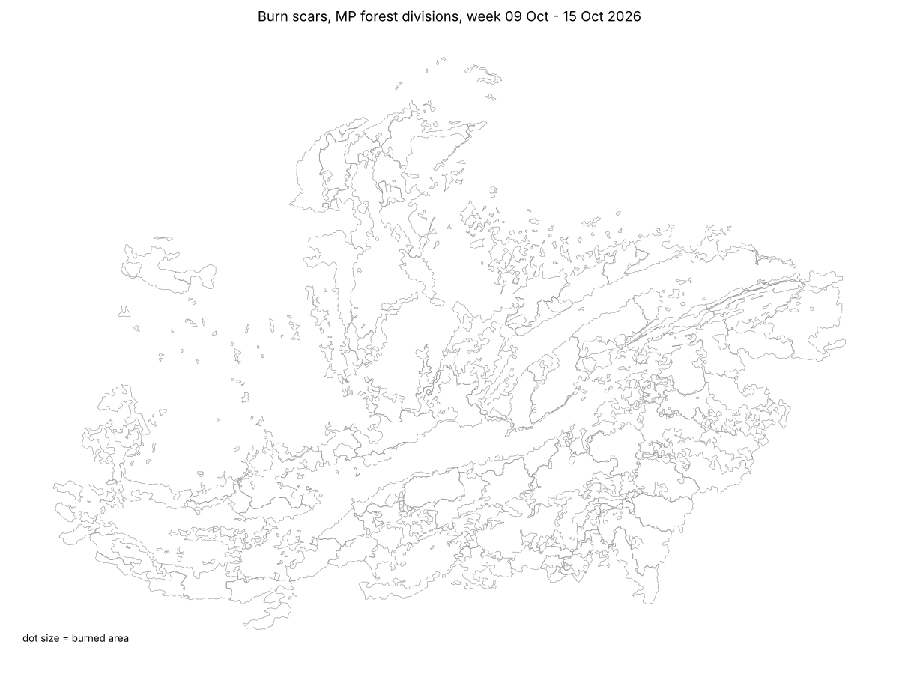

# Forest fire burn scars, Madhya Pradesh: week 09 Oct to 15 Oct 2026

_Outside the fire season (15 Feb to 15 Jun). Season figures are for 2026._

- **0 forest fires** were alerted this week. **0** already show a burn scar on satellite photos, covering **0 ha**. **0** are still waiting for a clear photo (usually 3 to 10 days).
- Season so far (from 15 Feb): **0 ha** burned. The normal for this date will appear once the 2017-25 history run is finished.
- Not counted above: **109** burns before the season (Oct to 14 Feb, mostly planned burning, 1,495 ha) and **0** small daytime 15-28 Feb burns that look planned (0 ha). They are listed in planned_burns.csv.
- A fire with no scar is **not** a false alert: small fires and fires under thick canopy often leave no visible scar.
- Areas are from 20-30 m satellite photos: typically about 9% of an outline is not burned and about 20% of nearby burned ground is missed.

## By division

| Division | Fires this week | Scars | Burned ha this week | Burned ha this season | Normal by this date | Season vs normal |
|---|---|---|---|---|---|---|

## Largest fires this week

| Date | Division | Range | Beat | Burned ha | Location |
|---|---|---|---|---|---|
| | No scars confirmed yet for this week's fires | | | | |
