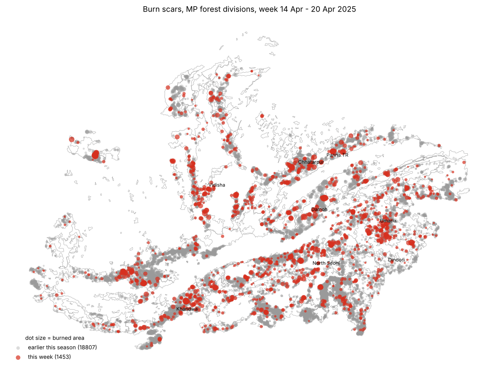

# Forest fire burn scars, Madhya Pradesh: week 14 Apr to 20 Apr 2025

- **1,593 forest fires** were alerted this week. **1,453** already show a burn scar on satellite photos, covering **59,512 ha**. **0** are still waiting for a clear photo (usually 3 to 10 days).
- Season so far (from 15 Feb): **895,544 ha** burned. The normal for this date will appear once the 2017-25 history run is finished.
- A fire with no scar is **not** a false alert: small fires and fires under thick canopy often leave no visible scar.
- Areas are from 20-30 m satellite photos: typically about 9% of an outline is not burned and about 20% of nearby burned ground is missed.

## By division

| Division | Fires this week | Scars | Burned ha this week | Burned ha this season | Normal by this date | Season vs normal |
|---|---|---|---|---|---|---|
| Vidisha | 75 | 70 | 4,121 | 18,235 | - | - |
| North Seoni | 58 | 57 | 2,881 | 12,934 | - | - |
| Khandwa | 53 | 50 | 2,729 | 59,957 | - | - |
| Damoh | 31 | 30 | 2,390 | 45,978 | - | - |
| Dindori | 53 | 44 | 2,350 | 9,776 | - | - |
| Chhatarpur | 44 | 40 | 2,330 | 30,126 | - | - |
| Panna TR | 26 | 26 | 1,907 | 15,782 | - | - |
| Umaria | 50 | 50 | 1,721 | 16,421 | - | - |
| Guna | 54 | 49 | 1,663 | 8,810 | - | - |
| South Panna | 24 | 24 | 1,617 | 19,783 | - | - |
| Shivpuri | 42 | 35 | 1,602 | 14,501 | - | - |
| Barwah | 28 | 26 | 1,575 | 10,865 | - | - |
| Satna | 33 | 32 | 1,575 | 20,683 | - | - |
| Neemuch | 20 | 15 | 1,525 | 13,182 | - | - |
| West Mandla | 35 | 31 | 1,475 | 12,246 | - | - |
| East Chhindwara | 41 | 38 | 1,440 | 17,963 | - | - |
| Anuppur | 41 | 32 | 1,411 | 6,705 | - | - |
| South Balaghat | 40 | 40 | 1,329 | 35,816 | - | - |
| South Seoni | 21 | 21 | 1,288 | 27,530 | - | - |
| Narsinghpur | 45 | 43 | 1,166 | 27,887 | - | - |
| West Betul | 28 | 26 | 1,147 | 9,539 | - | - |
| North Betul | 32 | 28 | 1,055 | 10,793 | - | - |
| North Panna | 8 | 8 | 1,035 | 9,899 | - | - |
| Noradehi | 16 | 15 | 1,007 | 9,770 | - | - |
| Bhopal | 21 | 19 | 990 | 6,187 | - | - |
| Katni | 12 | 12 | 917 | 10,440 | - | - |
| West Chhindwara | 60 | 50 | 885 | 14,049 | - | - |
| South Sagar | 39 | 36 | 883 | 10,150 | - | - |
| South Chhindwara | 23 | 21 | 878 | 33,277 | - | - |
| Harda | 31 | 26 | 869 | 7,259 | - | - |
| South Betul | 34 | 30 | 842 | 9,156 | - | - |
| Indore | 19 | 17 | 794 | 12,290 | - | - |
| Burhanpur | 19 | 18 | 738 | 27,623 | - | - |
| North Shahdol | 19 | 17 | 736 | 8,747 | - | - |
| SANJAY DUBRI | 33 | 29 | 734 | 11,340 | - | - |
| North Sagar | 24 | 24 | 726 | 19,544 | - | - |
| Jabalpur | 22 | 21 | 699 | 7,150 | - | - |
| BTR | 34 | 32 | 642 | 6,292 | - | - |
| FDC Khandwa | 6 | 6 | 579 | 4,810 | - | - |
| Satpura TR | 17 | 17 | 557 | 4,801 | - | - |
| Umaria Project | 18 | 18 | 541 | 4,673 | - | - |
| Kundam Proj Katni | 12 | 12 | 500 | 4,119 | - | - |
| North Balaghat | 23 | 19 | 462 | 27,469 | - | - |
| Dewas | 16 | 14 | 440 | 41,175 | - | - |
| Sheopur | 8 | 8 | 397 | 13,580 | - | - |
| Kanha Tiger Reserve | 19 | 15 | 373 | 4,066 | - | - |
| Sehore | 19 | 16 | 327 | 26,548 | - | - |
| Ashok Nagar | 18 | 15 | 319 | 9,099 | - | - |
| Gwalior | 11 | 9 | 284 | 4,368 | - | - |
| Singrauli | 10 | 9 | 182 | 13,445 | - | - |
| East Mandla | 10 | 9 | 181 | 6,301 | - | - |
| Rewa | 6 | 6 | 167 | 7,661 | - | - |
| Barghat Project | 2 | 2 | 165 | 17,345 | - | - |
| Khargone | 13 | 11 | 164 | 4,530 | - | - |
| Madhav National Park | 3 | 2 | 159 | 3,231 | - | - |
| Dhar | 11 | 9 | 151 | 4,797 | - | - |
| South Shahdol | 11 | 11 | 150 | 7,307 | - | - |
| Hoshangabad | 11 | 11 | 148 | 9,728 | - | - |
| Mohgaon Proj West Mandla | 6 | 5 | 134 | 9,366 | - | - |
| Sehore Project | 3 | 3 | 97 | 7,842 | - | - |
| PTR MP | 7 | 6 | 93 | 1,028 | - | - |
| Kuno Palpur | 3 | 3 | 69 | 4,255 | - | - |
| Tikamgarh | 2 | 2 | 66 | 461 | - | - |
| Obedullahganj | 2 | 2 | 46 | 353 | - | - |
| Kundam Proj Jabalpur | 2 | 2 | 46 | 2,666 | - | - |
| Sendhwa | 8 | 4 | 41 | 1,952 | - | - |
| Rajgarh | 1 | 1 | 37 | 56 | - | - |
| Alirajpur | 8 | 7 | 30 | 7,887 | - | - |
| Sidhi | 4 | 3 | 30 | 945 | - | - |
| Sidhi FDCM | 1 | 1 | 28 | 939 | - | - |
| Ratlam | 4 | 4 | 28 | 1,707 | - | - |
| Raisen | 1 | 1 | 21 | 66 | - | - |
| Jhabua | 1 | 1 | 17 | 1,086 | - | - |
| Barwani | 3 | 2 | 11 | 275 | - | - |
| Mohgaon Proj East Mandla | 1 | 1 | 10 | 1,145 | - | - |
| Lamta Proj N Balaghat | 2 | 2 | 10 | 5,276 | - | - |
| Mohgaon Proj Dindori | 1 | 1 | 9 | 807 | - | - |
| Rampur Bhatodi Proj | 1 | 1 | 6 | 6,238 | - | - |
| Chhindwara Project | 0 | 0 | 0 | 579 | - | - |
| Datiya | 0 | 0 | 0 | 66 | - | - |
| Lamta Proj S Balaghat | 0 | 0 | 0 | 7,957 | - | - |
| Mandsaur | 0 | 0 | 0 | 2,558 | - | - |
| Morena | 0 | 0 | 0 | 34 | - | - |

## Largest fires this week

| Date | Division | Range | Beat | Burned ha | Location |
|---|---|---|---|---|---|
| 20 Apr | Katni | Bahoriband | Rakseha | 618 | [23.8213, 79.9087](https://www.google.com/maps?q=23.82131,79.90874) |
| 20 Apr | South Panna | Raipura | Ratangaon | 618 | [23.8274, 79.8937](https://www.google.com/maps?q=23.8274,79.8937) |
| 20 Apr | South Panna | Raipura | Ratangaon | 618 | [23.8309, 79.9097](https://www.google.com/maps?q=23.83086,79.90967) |
| 20 Apr | South Panna | Raipura | Adharad | 618 | [23.8325, 79.9303](https://www.google.com/maps?q=23.83245,79.93028) |
| 20 Apr | South Panna | Raipura | Adharad | 618 | [23.8316, 79.9199](https://www.google.com/maps?q=23.83165,79.91988) |
| 15 Apr | Neemuch | Manasa | Shyopuria | 585 | [24.5919, 75.3423](https://www.google.com/maps?q=24.5919,75.34233) |
| 15 Apr | Neemuch | Manasa | Shyopuria | 585 | [24.6193, 75.3366](https://www.google.com/maps?q=24.61929,75.33659) |
| 15 Apr | Neemuch | Manasa | Shyopuria | 583 | [24.6036, 75.3320](https://www.google.com/maps?q=24.60363,75.33199) |
| 14 Apr | Neemuch | Manasa | Shyopuria | 583 | [24.6027, 75.3335](https://www.google.com/maps?q=24.60273,75.33347) |
| 14 Apr | Neemuch | Manasa | Shyopuria | 583 | [24.6136, 75.3333](https://www.google.com/maps?q=24.61362,75.33325) |
| 14 Apr | Neemuch | Manasa | Shyopuria | 583 | [24.6088, 75.3468](https://www.google.com/maps?q=24.6088,75.34681) |
| 14 Apr | Neemuch | Manasa | Shyopuria | 582 | [24.5974, 75.3478](https://www.google.com/maps?q=24.59743,75.34784) |
| 19 Apr | Khandwa | Aonliya | West_Tawkhedi | 505 | [21.9377, 77.1480](https://www.google.com/maps?q=21.93771,77.14799) |
| 18 Apr | Khandwa | Aonliya | West_Tawkhedi | 505 | [21.9574, 77.1407](https://www.google.com/maps?q=21.95744,77.14066) |
| 18 Apr | Khandwa | Aonliya | West_Tawkhedi | 505 | [21.9528, 77.1496](https://www.google.com/maps?q=21.95279,77.14956) |
