# Van Agni: forest fire prediction for Madhya Pradesh — the full project report

**Owner:** Akkshay · **Period covered:** 13-20 October 2026 (every thread in the "fire" project) · **Written:** 20 October 2026, ~19:30 UTC
**Pilot area:** Ratapani Tiger Reserve · **Scale reached:** all of Madhya Pradesh, 87 forest divisions, 8,973 beats, 430,776 squares of 500 m

> **How to read this file.** Every image and link is relative to `/mnt/project-files/project-report/`. Figures named `figures/m..` (maps) and `figures/c..` (charts) were made for this report from the project's own data. Every other figure is shown from the folder where its thread left it; nothing was copied. Each section ends with a **Backup** line naming the README, table or script that holds the full numbers. Numbers marked *in progress* were still moving when this was written. No keys, passwords or tokens appear anywhere in this file.

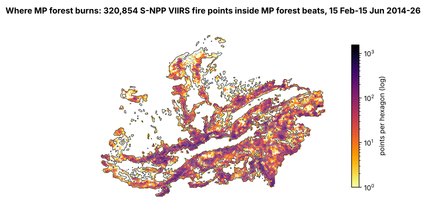

*Map 1. Every S-NPP VIIRS fire point that fell inside an MP forest beat in the fire season (15 Feb-15 Jun), 2014-26: 320,854 points. This is the ground the whole project works on.*

---

## Contents

1. [The project on one page](#1-the-project-on-one-page)
2. [Timeline](#2-timeline)
3. [The question, the data and the scoring rules](#3-the-question-the-data-and-the-scoring-rules)
4. [What we built as data: nine seasons of burn scars for all of MP](#4-what-we-built-as-data-nine-seasons-of-burn-scars-for-all-of-mp)
5. [The 2-day prediction: from Ratapani to all of MP](#5-the-2-day-prediction-from-ratapani-to-all-of-mp)
6. [Big fires: which square, which alert](#6-big-fires-which-square-which-alert)
7. [Fire behaviour from orbit: timing, speed, spread, direction](#7-fire-behaviour-from-orbit-timing-speed-spread-direction)
8. [Fuel load: fuel map, heat, Prithvi](#8-fuel-load-fuel-map-heat-prithvi)
9. [Prevention: fire lines, control burning and the joint plan](#9-prevention-fire-lines-control-burning-and-the-joint-plan)
10. [What the satellite record says about each division](#10-what-the-satellite-record-says-about-each-division)
11. [The live alert system and field app](#11-the-live-alert-system-and-field-app)
12. [Patrol pilot protocol for 2027](#12-patrol-pilot-protocol-for-2027)
13. [What failed, and why](#13-what-failed-and-why)
14. [Corrections log](#14-corrections-log)
15. [Still in progress (20 Oct)](#15-still-in-progress-20-oct)
16. [Decisions only Akkshay can take](#16-decisions-only-akkshay-can-take)
17. [Code, repositories and pull requests](#17-code-repositories-and-pull-requests)
18. [Data catalogue](#18-data-catalogue)
19. [Figure index](#19-figure-index)

---

## 1. The project on one page

**The goal.** Tell the MP Forest Department, every evening, which 500 m squares of forest are most likely to burn in the next two days, and give officials and guards what they need to act on each live alert. The fire season is **15 February to 15 June**. Nearly every fire is a **surface fire in teak or sal leaf litter**, lit by people, and crews put most of them out fast.

**What was achieved, with the evidence behind each line.**

| # | Achievement | Headline number | Evidence (what it was checked against) | Backup |
|---|---|---|---|---|
| 1 | **A burn scar for every forest fire in MP, 2017-25** | 168,449 forest fire events, 86% with a clear scar; 0.2-1.2 M ha burnt per season | 84% of real fires get a scar vs 4% of fake points 3 km away (2,905 fires, 76 divisions); 81% of "yes" scars confirmed on 0.3-0.5 m Esri Wayback imagery | `fire-alert-scars/mp/README.md` |
| 2 | **A 2-day fire list for all of MP, one model per division** | **~82% of scar-confirmed fires** flagged 1-2 days ahead on about a fifth of the ground | 73,050 scar-confirmed fires 2022-25; simple rules reach 44-65% on the same ground | `research/ceiling/README.md` §8 |
| 3 | **A live daily rule with no hindsight** | All / brand-new / beats: **71 / 46 / 83%** (2023-24), **68 / 48 / 82%** (2026) | Matches a hindsight yardstick (72 / 42 / 81) and beats it on brand-new fires | `research/ceiling/DAILY_RULE_SPEC.md` |
| 4 | **The list runs from the cloud, no PC needed** | 87 models; 92% the same squares as the PC; catch 60.5% vs 60.1% | Five 2026 check days, every input from public cloud sources | `field-system/docs/cloud_scoring/README.md` |
| 5 | **A big-fire layer for officials** | 200 ha+ fires in the top 1% of squares: **53% vs 40.5%** (2025) and **56% vs 43%** (2026) | two unseen seasons on burn scars: 768 and 368 big fires; 95% CI +8.5 to +16.5 and +7.1 to +18.5 | `research/large-fires/README.md` |
| 6 | **Which new alert becomes big** | AUC **0.87**; 52% of big fires in the day's top 10% of new fires (vs 42%) | 2026 replay, fitted on 2025 | `research/large-fires/README.md` |
| 7 | **A field app wired for eNetra** | Guards, range officers, control room, daily brief, weekly scar check, 24 h spread map | Full 2026 season dry run (13,676 alerts); 94-problem audit, every critical and high fixed | `field-system/README.md`, `field-system/docs/audit/SUMMARY.md` |
| 8 | **A measured prevention plan** | First programme: **43k ha/yr not burnt + 38k ha/yr turned to cool Feb burns, Rs 2.3 crore/yr** | Patches chosen on 2017-21, scored on 2022-25 | `ratapani/fsi/scouting/joint_plan.md`, `report/joint_plan_mp.pdf` |
| 9 | **Fire behaviour measured from orbit alone** | Fronts move ~24 m/h; flames ~0.5 m, 46-56 kW/m; litter 2.4-3.5 t/ha | 331-352 mid-fire Sentinel-2/Landsat images; published teak litter 2.4-3.9 t/ha | `fuel-map/ratapani/README.md` |
| 10 | **A 24 h "likely burnt" map per alert and an honest stop chance** | Overlap 0.460 vs 0.447 rule; stop AUC 0.80, calibrated | 818 fires never seen in training | `ratapani/spread/unseen_validation/README.md` |
| 11 | **A division-by-division picture nobody had** | Rewa/Kuno fires survive the night 2x as often as expected; Ratlam fires start at night 53%; Satpura TR burning down 13%/yr | Odd-vs-even-year stability 0.85-0.93; permutation tests | `research/division-insights/README.md`, `ratapani/fsi/scouting/new_questions.md` |
| 12 | **A clear list of what does not work** | 40+ ideas tested and closed with numbers | Section 13 | this report |

**The three things to remember.**

1. **Where the next fire starts is predictable only up to a ceiling, and the project has reached it.** Fires next to recent fires are mostly caught (79-83%). Brand-new fires are the hard part (39-48% caught); even a perfect hindsight map of this season's burning would only reach 44% of them, because a human start has no day signal.
2. **When and where crews look matters more than any model tweak.** In Ratapani, letting the forecast set each day's number of checks raised the catch from 29% to 63% at the same season effort. Statewide, letting busy divisions borrow checks from quiet ones won back 6-8 points at the same daily workload.
3. **Prevention has a hard cap.** Fire lines and early burning of the 3,867 repeat-burn patches can keep about 6% of MP's burnt forest from burning at all, and turn up to 15% more into cool February burns. The other 80% of burning lands on ground that burns about once in 28 years, so it can only be met by detection and fast response.

---

## 2. Timeline

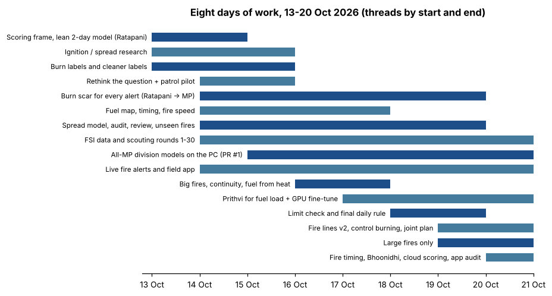

*Chart 1. Threads by start and end day. Most work ran in parallel; the PC on Akkshay's desk (RX 9060 XT GPU, 64 GB RAM) ran the all-MP division models and the Prithvi fine-tune through Remote Control.*

| Date | What happened |
|---|---|
| 13 Oct | Question fixed: which 500 m cells newly burn in the next 2 days. Ratapani chosen as pilot; scars as truth; 5 checks per beat per day as the scoring budget. A "fire memory" model beat India's FWI in all 9 MP tiger reserves (AUC 0.81-0.92). |
| 14 Oct | Lean 2-day model reaches 29-31% (2x random) and Akkshay calls the ceiling. "Rethink the question" finds the time-shift result (29 -> 63%). Burn-scar-per-alert, fuel map, spread model and field app threads start. |
| 15 Oct | Patrol pilot protocol v2. All-MP dryness for 373,681 cells. Independent audit of the spread model (8 findings, all fixed). Frozen scar reference v1. First full project report. |
| 16 Oct | Big fires (146 fires, direction of new burning 68%), fire continuity maps, fuel-from-heat, Earth Engine catalogue scan, frozen scar reference v2. |
| 17 Oct | Unseen-fire validation of spread (818 fires), Meteosat and ECOSTRESS dead ends, big-fire chance at alert, Prithvi fuel tests. |
| 18 Oct | Limit check: scar-key scoring (~82%), oracle ceiling (44% brand-new), statewide crew budget, FILDA-2 dead end, pre-season outlook dead end; division insights; full 2026 dry run of the app; daily brief and weekly scar check built. |
| 19 Oct | Final live daily rule adopted ("ok go ahead", 07:42Z). MP scar history 2017-25 finished. Prithvi GPU fine-tune (10.5 h). Fire lines v2, control burning, joint plan PDF. Large-fires model. Dynamic burn cut-offs. |
| 20 Oct | Cloud scoring complete (no PC needed). Fire timing by division; small-division fallback rejected on the live rule. Bhoonidhi and EOS-04 dead ends. Department burns Jan-Feb captured. App robustness audit (94 problems, all critical/high fixed). Quiet-share 75% rejected. PR #1 out of draft. |

---

## 3. The question, the data and the scoring rules

### 3.1 The question

> **Which 500 m squares of forest will have a fire in the next two days?**

- Ratapani first (3,614 cells, 94 beats), then all of MP (430,776 division squares; 373,681 beat cells).
- **Truth.** In Ratapani the truth is the burn scar, because many small litter fires never trigger VIIRS. Statewide the main score uses VIIRS fire points (three satellites), and from 18 Oct also a burn-scar key (73,050 scar-confirmed fires 2022-25).
- **Akkshay's standing choices.** Calibrated % chances, not only rankings. January fires are out of scope. Field data and a 2027 field trial are off the table for now: squeeze satellite physics first, then GIS, then machine learning. Every gain must be checked against an honest baseline, and small-sample gains must pass the live rule on 2026 before they are adopted.

### 3.2 The satellites

| Sensor | Look times (IST) | Pixel | Use in the project |
|---|---|---|---|
| VIIRS on S-NPP, NOAA-20, NOAA-21 | ~13:30 and ~01:30 (all three within ~50 min) | 375 m | Fire points: the core input and the main truth |
| MODIS Terra / Aqua | ~10:30 / ~15:15 | 1 km | Extra looks; FSI's MODIS alerts are Aqua only |
| Sentinel-2, Landsat 8/9 (HLS) | ~10:30 | 10-30 m | Burn scars, dryness, mid-fire images |
| Sentinel-3 SLSTR | ~10:30, ~22:00 | 1 km | Narrower burn dates (+1% dated burns) |
| Meteosat IODC, ECOSTRESS, Sentinel-1, EOS-04, AWiFS | various | 4 km / 70 m / 10-56 m | Tested; dead ends (section 13) |

**Latency of a fire alert after the pass:** Bhuvan VIIRS ~1 h; FSI SMS 0.75-1.75 h; FSI portal ~1-2 h; NASA FIRMS 1.7-6 h. **A pass misses a still-burning fire 44% of the time.** FSI receives its data straight from NRSC's Shadnagar ground station, which is why it is faster than NASA.

### 3.3 How we score

| Term | Meaning |
|---|---|
| **Caught** | A fire counts as caught if its square, or a square next to it, was flagged 1 or 2 days before. Each fire counts once ("strict"). |
| **Brand-new fire** | No VIIRS point within 5 km in the 7 days before. 16-22% of fires. |
| **Ground** | Flagged squares plus their neighbours, as a share of all forest squares. Every comparison is made at equal ground. |
| **Held out** | Trained on some seasons, scored on others never seen (LOSO = leave one season out; "forward" = trained on the past, scored on 2025 or 2026). |
| **Recall at 5 per beat** | Ratapani only: share of newly burnt cells that were in their beat's top 5 checks that day. |
| **Leak** | Any input that would not exist at forecast time. A 25-day rule was added on 15 Oct: a scar can only be used 25 days after its window ends. |

**Backup:** `ratapani/scoring/SCORING.md`, `research/ceiling/README.md` §8.

---

## 4. What we built as data: nine seasons of burn scars for all of MP

### 4.1 Method

For each fire alert, a before and an after Sentinel-2/Landsat image are compared. The connected patch of darkened ground that touches a 200 m circle around the alert becomes the scar. Scars are **grown** into burnt ground seen by the next clear image (fires keep spreading), **split** where two fires burned into each other, and labelled *confirmed*, *provisional*, *faint* ("possible scar"), *none visible* or *waiting*. "None visible" is never shown as a false alert, because small and light fires often leave no visible scar.

### 4.2 Coverage and accuracy

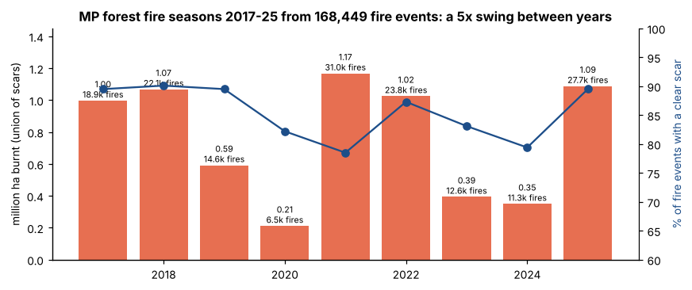

*Chart 2. Burnt ground per season (union of grown outlines, all MP, 15 Feb-15 Jun) and the share of fire events with a clear scar. Neighbouring fires share ground, so summing each fire's own scar would give about 2.3x more.*

| Year | Fire events | Clear scar | Any scar | Burnt ha (each patch once) |
|---|---|---|---|---|
| 2017 | 18,898 | 89.5% | 94.4% | 996,692 |
| 2018 | 22,139 | 90.1% | 94.4% | 1,067,774 |
| 2019 | 14,614 | 89.5% | 94.0% | 591,727 |
| 2020 | 6,477 | 82.2% | 89.7% | 210,798 |
| 2021 | 30,983 | 78.5% | 89.1% | 1,167,136 |
| 2022 | 23,762 | 87.3% | 92.2% | 1,024,731 |
| 2023 | 12,570 | 83.1% | 90.0% | 393,488 |
| 2024 | 11,318 | 79.4% | 88.5% | 349,166 |
| 2025 | 27,688 | 89.5% | 93.3% | 1,087,652 |

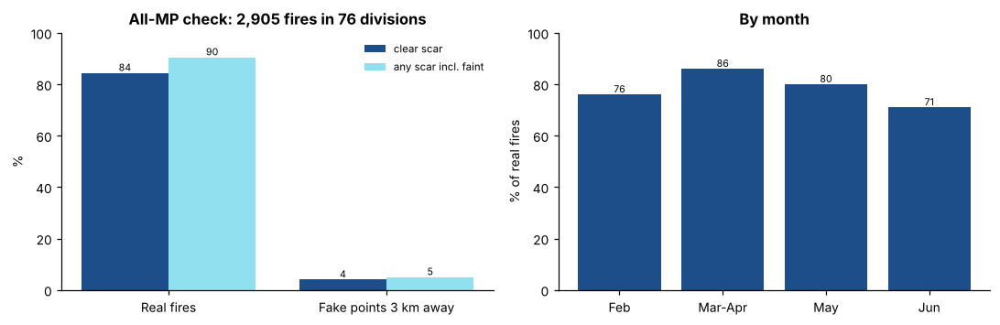

*Chart 3. All-MP check: up to 40 fires per division (2,905) and 1,472 control points in forest 3 km away with no alert. A scar is found on 84% of real fires and on 4% of controls.*

| Check | Result |
|---|---|
| Real fires vs fake points (all MP) | 84.4% vs 4.0% clear scar; 90.5% vs 5.0% including faint |
| By division | median 85% (10th-90th percentile 72-95%); lowest Shajapur 33%, Morena 50%; Kanha 72% (moist sal canopy hides surface burns) |
| By month | Feb 76%, Mar-Apr 86%, May 80%, Jun 71% |
| Blind check on 0.3-0.5 m Esri Wayback imagery (231 scars + 41 decoys) | "yes" scars darker 81% (image 0-3 days after), 76% (4-15 d), 58% (16-40 d); decoys about 1 in 10 |
| FSI Large Forest Fire archive | 98% matched in Ratapani; 84% in the 8 other tiger reserves |
| Measured errors (frozen reference v1) | ~9% of outline edge too much; ~22% of burnt area missed; small fires miss most |
| Wider search radius (450 m, block edge +250 m) | finds 10-13 more fires per 100 but gives a "scar" to 9-15 more controls per 100: **kept at 200 m** |

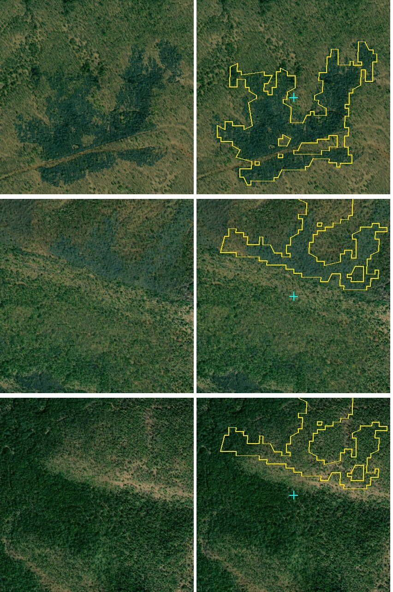

*Top row: a fresh burn matching its outline. Bottom rows: the same outline on its real fire, and moved 3 km as a decoy onto unburnt forest.*

*Ratapani season burn rasters 2017-2026 (20 m), the original scoring key for the pilot. Precision 0.83, area recall ~0.71. These rasters miss big fires (fire 942: 743 ha of burnt ground, 112 ha in the raster), so from 15 Oct grown outlines are the truth for fire sizes, spread and fuel.*

### 4.3 Other data built

| Data | Size | Where |
|---|---|---|
| All-MP VIIRS archive, Jan-Jun: S-NPP 2014-26, NOAA-20 2018-26, NOAA-21 2023-26, plus MODIS | ~200 MB | `fire-alert-scars/alerts_mp/` |
| 500 m grid for MP, 373,681 beat cells, 10-day HLS dryness 2017-26 | | `ratapani/mp_grid/` |
| Static GIS per square (terrain, land cover, roads, villages, forest edge, population) | | `ratapani/mp_grid/static_gis_v1.parquet` |
| FSI portal alerts with beat and compartment (since Nov 2025); 7,535 MP large fires 2019-25 | | `ratapani/fsi/` |
| Frozen scar references v1 (15 Oct) and v2 (16 Oct) with checksums | | `fire-alert-scars/reference/` |
| Every Jan-Feb burn in MP forest 2014-26 sorted into department-like and wildfire-like | 22,500 VIIRS clusters, 4,193 scar fires | `ratapani/fsi/scouting/code/dept_burns/out/` |
| Fire lines v2: 7,704 practical lines, 4,986 km | | `ratapani/fsi/scouting/fire_lines_v2.md` |

**Backup:** `fire-alert-scars/README.md`, `fire-alert-scars/mp/README.md`, `fire-alert-scars/reference/v1_2026-10-15/USE_AND_LIMITS.md`.

---

## 5. The 2-day prediction: from Ratapani to all of MP

### 5.1 Ratapani pilot: the "where" model and its ceiling

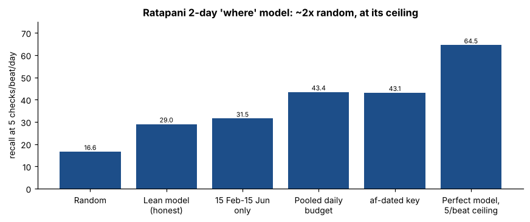

*Chart 4. Ratapani 2-day model, 94 real beats, leave-one-season-out 2017-24. The lean model (LightGBM classifier + ranker) roughly doubles random. A perfect model with 5 checks per beat per day could only reach ~64-65%, because busy beats burn more cells on peak days than 5 checks can cover.*

| Model and key | LOSO 2017-24 | 2025-26 test | Random |
|---|---|---|---|
| Lean, main key, honest (after 25-day leak fix) | **29.0%** | **28.6%** | 16.6 / 15.3 |
| Lean, scored 15 Feb-15 Jun only | 31.5% | 29.2% | 17.6 / 15.4 |
| Shared daily budget (same total, pooled across beats) | 43.4% | 40.3% | |
| Fire-pixel-dated burns as the answer key (honest) | 43.1% | 39.7% | ~21 |
| True-lead labels v2 (fires truly ahead of VIIRS), ensemble | 40.7% | | 20.0 |

**What decides "where":** per-cell dryness from Sentinel-2/Landsat (about 4 points), the season's fire activity so far, and the cell's position (interior cells ignite about 2x as often as cells near villages). **Weather decides "when", not "where".** Fire risk rises about tenfold 51-100 days after a cell's canopy is half green-down.

### 5.2 When to check matters more than where

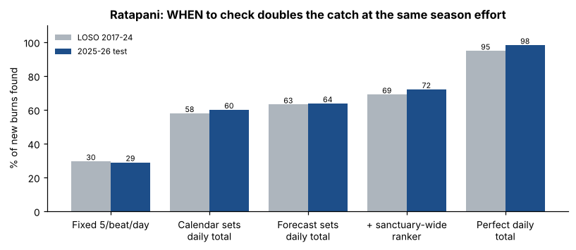

*Chart 5. Same season total of checks in Ratapani, moved onto the days the calendar and forecast say will be busy.*

| Rule (same season total) | LOSO 2017-24 | 2025-26 |
|---|---|---|
| Fixed 5 per beat per day | 29.5% | 28.9% |
| Calendar sets the daily total | 57.9% | 60.0% |
| **Forecast sets the daily total** | **63.1%** | **63.7%** |
| + sanctuary-wide ranker (dryness + recent fires) | 69% | 72% |
| Perfect forecast of the daily total | 94.8% | 98.2% |

"Is the next 2 days a big fire day?" is predictable at **AUC 0.88** (calendar alone 0.83), with calibrated chances. The ranker's extra gain sits mostly next to fires already seen, so it is a response tool, not an ignition predictor (on true-lead labels it moves only 79.9 -> 81.4%).

### 5.3 All of MP: one model per division

The PC pipeline (Slllyio/van-suraksha-alert PR #1) trained a LightGBM model for each of the **87 divisions** on 2019-24 cell-days, with GFS weather of the issue day, HLS dryness, MODIS, fire history since 2014, AlphaEarth (PCA-16), terrain, land cover, roads, villages and population. Weak divisions borrow neighbours' data. Each model is calibrated on the previous season (isotonic).

| Setup (9-division test, train 2019-21, test 2022-24, VIIRS key) | Fire points caught (top 10%) |
|---|---|
| Model from another division (cold start) | ~77% |
| Pooled model | ~81% |
| Own-division model | ~83% |
| Own-division + dryness | 83.6% |
| **+ NOAA-20 / NOAA-21 training points (three satellites)** | **84.6%** |

Full 87-division test with weather on the PC (train 2019-21, test 2022-24, 246,790 test fires):

| Model | All MP: all / brand-new | Early divisions (7) | Mid (71) | Late (9) |
|---|---|---|---|---|
| **Own-division (live)** | **80.5 / 46.8** | 77.7 / 37.8 | 81.0 / 47.4 | 78.8 / 59.3 |
| Statewide | 79.7 / 41.5 | 76.3 / 31.7 | 80.4 / 42.0 | 78.2 / 56.7 |
| One model per calendar group | 79.6 / 42.0 | 76.3 / 33.2 | 80.2 / 42.1 | 80.5 / 60.3 |

**Decision (20 Oct): each division keeps its own model.** Pooling costs ~5 points on brand-new fires. A fallback to calendar-group models for 10 small divisions looked like +5.5 points on a clean check, but on the live rule it lost (2026: 60.9 -> 58.0%; brand-new 46.9 -> 42.7%), so it was rejected as chance on ~1,200 fires.

### 5.4 The honest headline: the scar key

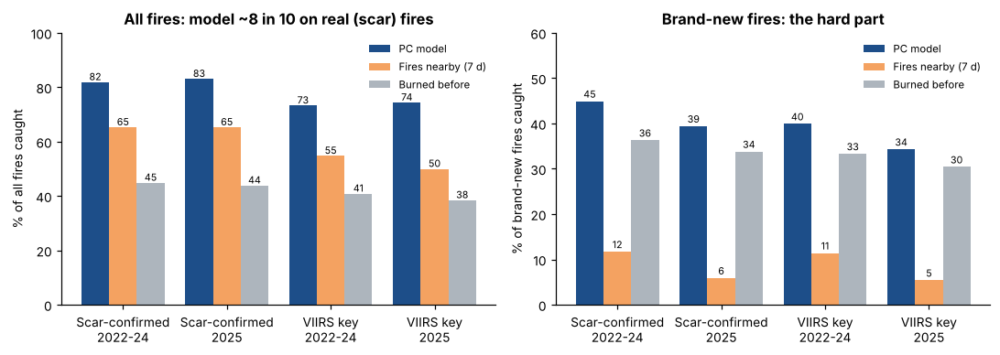

*Chart 6. Model against the two best simple rules, strict scoring, about a fifth of the ground for every rule.*

| Key | Period | **PC model** (all / brand-new) | Fires nearby, 7 days | Burned before |
|---|---|---|---|---|
| Scar-confirmed | 2022-24 | **81.8 / 44.9** | 65.2 / 11.7 | 44.8 / 36.3 |
| Scar-confirmed | 2025 | **83.0 / 39.4** | 65.2 / 5.9 | 43.8 / 33.8 |
| VIIRS | 2022-24 | 73.2 / 39.9 | 54.7 / 11.4 | 40.8 / 33.3 |
| VIIRS | 2025 | 74.3 / 34.3 | 49.9 / 5.4 | 38.4 / 30.4 |

> **About 82% of scar-confirmed fires, and 40-45% of brand-new ones, are flagged 1-2 days ahead on about a fifth of the ground.** That is 17-18 points above the best simple rule.

### 5.5 The live daily rule

The officials' evening list uses the division models' calibrated % per square, then:
1. sets each division's danger-scaled daily count and adds them up to a statewide total (same workload as before);
2. **floor:** every division keeps at least 50% of its own count;
3. **quiet-square reserve:** 25% of the day's flags go to quiet squares (no VIIRS point within 5 km in 7 days);
4. **statewide pool:** the rest go to the highest-% squares anywhere in MP;
5. calibration is fitted on the previous season only and refitted once a year before 15 Feb.

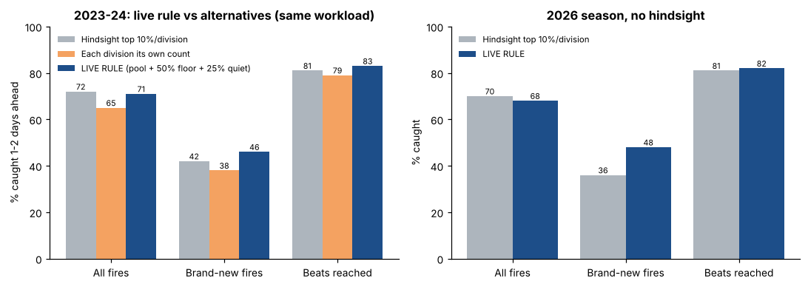

*Chart 7. The live rule against the hindsight yardstick and the earlier per-division count.*

| Rule | All fires (2023-24 / 2026) | Brand-new | Beats |
|---|---|---|---|
| Hindsight top 10% per division (not usable live) | 72 / 70% | 42 / 36% | 81 / 81% |
| Each division sets its own daily count | ~65% | ~38% | ~79% |
| **Live rule: pool + 50% floor + 25% quiet** | **71 / 68%** | **46 / 48%** | **83 / 82%** |

By fire size the live rule catches **~75% of fires, ~90% of burnt hectares, and 93% of 200 ha+ fires**. The app reproduces the PC's flags on 99.8-99.9% of squares. Per-division % chances are a little overconfident, but the order is right.

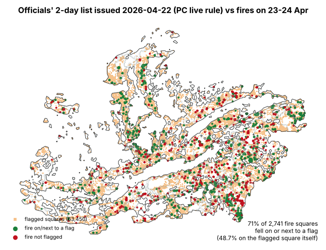

*Map 2. The real list for 22 April 2026, the busiest day of the 2026 season (63,450 flagged squares in light orange), with the fires of the next two days. 71% of the 2,741 fire squares fell on or next to a flag; 48.7% on the flagged square itself.*

### 5.6 Where the "where" ceiling is

| Ceiling test (2025-26, strict, each fire once) | Brand-new | All fires | Ground |
|---|---|---|---|
| Burn history 2019-24 | 30.5 | 38.4 | 22% |
| Hindsight: other fires this season (own 11 days removed) | 27.1 | 42.9 | 19% |
| **Hindsight: every fire this season, the fire itself included** | **44.3** | 63.0 | 18.5% |
| PC model (forward) | 34.4 | 72.3 | 21% |

**Verdict:** even a perfect map of this season's burning reaches only 44% of brand-new fires. Any new "where" layer (fuel, people, Prithvi, terrain) could add at most ~10 points on brand-new fires, which is about 1.6 points on all fires. The rest of the gap is *which day*, and a human start has no day signal we could find (no weekday effect, Holi eve 1.4x).

There is also **no useful pre-season outlook**: placing crews by each division's long-run average is already within 4 points of a perfect pick, and the statewide total swings 6x between years mostly with March-April rain, which is not known in January.

### 5.7 Fire calendar by division

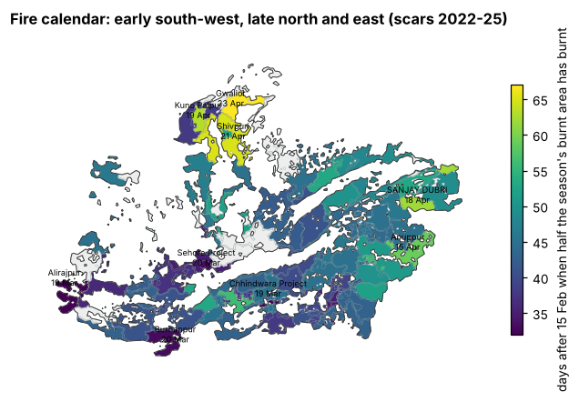

*Map 3. Days after 15 Feb by which half of each division's season burnt area has burnt (scars 2022-25). Early south-west (Alirajpur, Burhanpur, Sehore, Dewas, Dhar: 19-24 Mar); most of MP 28 Mar-8 Apr (71% of area); late north and east (Panna TR, North Betul, Dindori, Anuppur, Kuno, Shivpuri, Gwalior: 9-23 Apr). The whole season also shifts ~8 days between years.*

**Use:** alert start dates by group (early ~20 Feb, mid early March, late from late March). **Not used:** training by timing group (it does not beat own-division models).

**Backup:** `research/ceiling/README.md`, `research/ceiling/DAILY_RULE_SPEC.md`, `research/fire-timing/README.md`, `research/reframe/README.md`, `ratapani/scoring/SCORING.md`, PR #1 `mp/results/officer/live_*`.

---

## 6. Big fires: which square, which alert

### 6.1 Why big fires matter

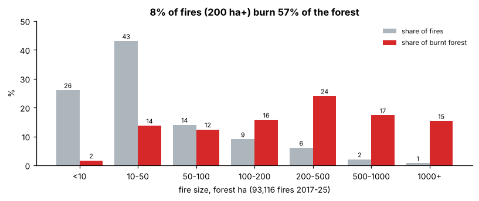

*Chart 8. 93,116 forest fires 2017-25, ~796,000 forest ha a year. Fires of 200 ha and more are 8% of fires and 57% of burnt forest.*

| Fire size (forest ha) | Fires per year | Share of fires | Share of burnt forest |
|---|---|---|---|
| under 10 | 2,718 | 26% | 1.6% |
| 10-50 | 4,434 | 43% | 13.7% |
| 50-100 | 1,401 | 14% | 12.4% |
| 100-200 | 892 | 9% | 15.7% |
| 200-500 | 621 | 6% | 24.0% |
| 500-1,000 | 202 | 2% | 17.3% |
| 1,000+ | 77 | 0.7% | 15.3% |

### 6.2 A list for big fires only

A LightGBM model trained only on the first look of 200 ha+ fires (90,447 multi-day scar fires 2017-25) was compared with the all-fire list and the PC's real models.

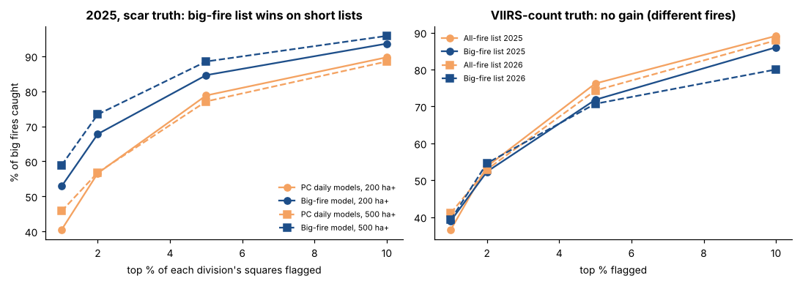

*Chart 9. Left: 2025 with burn-scar truth, PC models re-run on every square-day. Right: VIIRS hot-spot truth, where the gain disappears because "big" there means many hot-spot cells, not burnt forest (only 35% of 2025's 200 ha+ scar fires are also 200 ha+ by VIIRS).*

| Flagged squares (2025, scar truth) | PC models, 200 ha+ | **Big-fire model** | Gain (95% CI) | PC, 500 ha+ | **Big-fire, 500 ha+** |
|---|---|---|---|---|---|
| top 1% | 40.5 | **52.9** | +12.4 (8.5-16.5) | 45.8 | **58.9** |
| top 2% | 56.6 | **67.8** | +11.2 | 56.8 | **73.4** |
| top 5% | 78.8 | **84.6** | +5.9 | 77.1 | **88.5** |
| top 10% | 89.7 | **93.6** | +3.9 | 88.5 | **95.8** |

- The bigger the fire, the bigger the gain: +8.6 points for 200-500 ha, +23.5 for 500-1,000 ha, +26.1 for 1,000 ha+ (26% -> 52%).
- Every test season gains (2022 +15.3, 2023 +10.9, 2024 +8.7, 2025 +12.0); 40 of 48 divisions better (Sehore +30, Khandwa +27, Chhatarpur +22).
- Big fires start in remote, often-burnt blocks on active days in busy divisions; the all-fire list instead rewards squares next to fires already burning.
**Second unseen season, 2026, on burn scars (finished 20-21 Oct).** 2026 scars were built with the same method: 19,019 events, 87% with a clear scar, chained into 12,117 fires, 368 of 200 ha+ and 84 of 500 ha+ (a quiet year). Models trained 2018-24.

| Top of each division's squares (2026) | All-fire list, 200 ha+ | **Big-fire model** | Gain (95% CI) | All-fire, 500 ha+ | **Big-fire, 500 ha+** | Gain (95% CI) |
|---|---|---|---|---|---|---|
| top 1% | 43.2 | **56.3** | +13.0 (7.1-18.5) | 40.5 | **64.3** | +23.8 (11.9-33.4) |
| top 2% | 59.2 | **67.9** | +8.7 (3.8-13.3) | 59.5 | **73.8** | +14.3 (6.0-22.6) |
| top 5% | 78.8 | 81.8 | +3.0 (-0.8-6.8) | 82.1 | 83.3 | +1.2 |
| top 10% | 88.6 | 91.0 | +2.4 (-0.3-5.2) | 91.7 | 94.1 | +2.4 |

The watch list holds: a clear gain at its own size (top 1-2%), only about +2 at the daily list's size (top 10%). The earlier 2026 tie came from counting big fires by VIIRS hot spots, not from the model.

- Even the top 1% sees a big fire on only about 1 square-day in 95-175, so this is a **watch list for readiness**, not a dispatch list.
- The **season map** for big fires ties the all-fire map (66.6 vs 67.0% of 200 ha+ burning in the top 10%): where big fires burn over a season is where fires burn.

**In the app:** the big-fire watch list (`research/large-fires/watch/big_watch.py`) is a separate officials-only top 1-2% layer, rank only. The daily list is unchanged.

### 6.3 Which new alert becomes a big fire

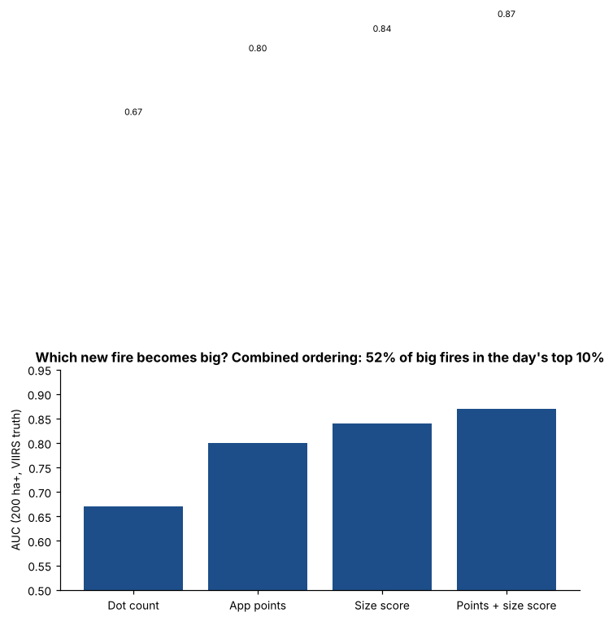

*Chart 10. At the first look of a new fire: how well each score ranks the fires that will pass 200 ha (2026 replay, VIIRS truth, fitted on 2025).*

| Score at first look | AUC 2025 | AUC 2026 | Big fires in the day's top 10% of new fires (2026) |
|---|---|---|---|
| Dot count | 0.68 | 0.67 | |
| App big-fire points | 0.78 | 0.80 | 42% |
| Size score (chance a start here reaches 200 ha) | 0.80 | 0.84 | 39% |
| **Points + size score (live ordering)** | | **0.87** | **52%** |

**On burn-scar truth, 2026 (7,461 fires matched to the app replay's own points):** app points AUC 0.73 (28% of 200 ha+ fires in the day's top 10%), size score **0.87** (43%), points + size score **0.87** (45%); for 500 ha+ 0.70 / 0.88 / 0.88. On scar truth the size score does nearly all the work; on VIIRS truth the points do well and the combination is best. The combined order the app uses is best or equal both ways, so **it stays**.

Simple calibrated flag from the heat thread: **3+ dots at the first alert = about 1 in 3 becomes big; 5+ dots = more than half.** Guards see "may become a big fire" at 12+ points (2.9-6.4 fires a day statewide, 19-25% of which pass 200 ha).

*The officials' "Big-fire watch" on a replay of 23 Apr 2025.*

### 6.4 How big fires grow

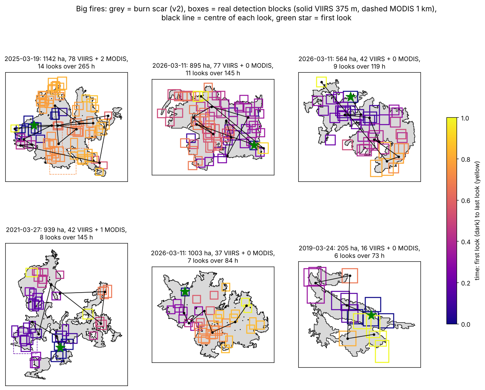

*146 big fires (scar 200 ha+, 4+ looks, 10+ VIIRS alerts; median 451 ha, 20 alerts over 5 looks). They burn on several fronts at once; the first look covers a median 18% of the final outline; half the outline burns by ~24 h and 90% by ~71 h.*

| Pattern | Result |
|---|---|
| Direction of *new* burning carries on | 68% within 90° of the previous look's (random 50%); 73% with MODIS and S2/Landsat hot pixels |
| Centre-to-centre moves | zig-zag, no direction (34% within 90°) |
| Wind (ERA5 daily) / upslope | 50% / 53%: no steering |
| First detection sits in the back third of the scar | 64% of big fires |
| Narrow end of the scar = start | 49%: a coin flip |
| Burning part of a 375 m block at the look | 0.1-1% (a thin line of fire) |
| Fires stop where tree cover thins | outside the edge 52% trees vs 64% inside (p < 10^-11) |

**Backup:** `research/large-fires/README.md`, `research/big-fires/README.md` and `figures/big_fires_atlas.pdf`, `research/fire-continuity/README.md` and `figures/growth_atlas.pdf`, `field-system/docs/big_fire_replay/README.md`.

---

## 7. Fire behaviour from orbit: timing, speed, spread, direction

### 7.1 Timing and speed (measured on mid-fire images)

Akkshay's point that a VIIRS alert is a 375 m pixel, not a point, was tested against 331-352 Sentinel-2/Landsat images taken while fires burned, each showing what had burnt at that minute.

| Fact | Value | How measured |
|---|---|---|
| Alert point lags the real fire edge | ~380 m; ~130 m using the far side of the pixel | mid-fire images |
| Share of final scar burnt 6-12 h / 12-24 h after first alert | 61% / 87% | mid-fire images |
| Front speed | median **24 m/h** (10-56); 20-30 m/h on all checks | 169 fires fitted; outline growth 20 m/h |
| Start before an afternoon first detection | ~3 h (half the fires already burning at 10:30) | photos 3 h before a 13:30 detection |
| Fires first seen at night (01:30) | 29-33%; mostly started that afternoon or evening | |
| VIIRS points are fire, not smoke | 79% within 200 m of the scar (median 45 m); SWIR hot line under the points on fire 797 | 1,223 fires, 3,504 points |
| Same fire, two satellites 50 min apart | points a median 290 m apart | position noise = ~12 h of spread |

*Fire 797, 2 Apr 2019: SWIR hot pixels along the north-west edge, with the VIIRS points on that same line although the smoke drifts west. VIIRS sees at 4 µm, where smoke is transparent.*

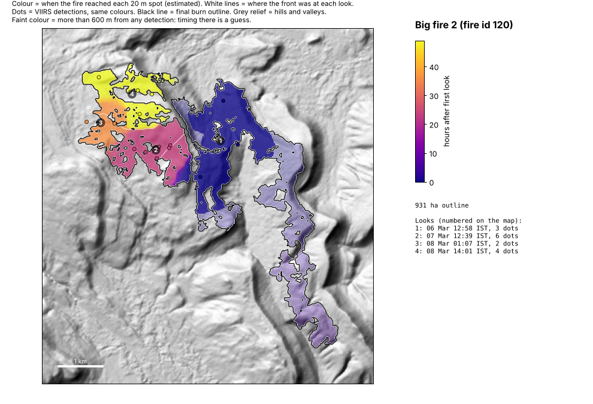

*A continuous "when did the fire reach this spot" map at 20 m (the blend map), drawn for all 146 big fires. It is right on 84% of pixels on 340 mid-fire photos, 82% where there is a look before and after. Terrain did not improve it.*

### 7.2 Spread models

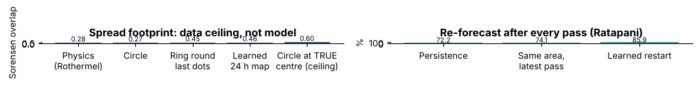

*Chart 11. Left: overlap of the forecast footprint with the real scar. Physics (Rothermel/Albini, the C-DAC design) ties a circle; learned maps beat the simple ring by about 0.01-0.02; a circle placed at the true centre with the true size would reach only 0.60, which is the ceiling set by two looks a day and ~300 m position error. Right: re-forecasting after every pass.*

| Model | Result | Verdict |
|---|---|---|
| Physics simulator (Rothermel, hourly fuel moisture, terrain, roads as barriers), 1,398 fires | 0.275 vs circle 0.268 (after the audit removed a start-on-the-scar leak); size 1.9x the scar | no better than a circle |
| Learned footprint (fuel, dryness, roads, earlier burns, terrain) | 0.498-0.502 vs circle 0.453 on grown outlines; points within 45° of the real run in 55% of fires (circle 37%) | real, small |
| **Learned restart** (re-forecast after every pass) | **85.9% of next-pass dots inside vs 72.2% persistence** (74.1% vs same area at latest pass); gain only at gaps of 9 h+ | holds; audit reproduced it |
| Unseen-fire test (818 fires never used): 24 h map | 0.460 (learned area) vs 0.447 (fixed 24 ha per active front) | small; shipped in app |
| Stop chance per front, retrained on all 3,460 fires | AUC 0.80, calibrated (said 51% -> 52% stopped) | **kept** |
| "Burned by morning" | AUC 0.83-0.84 = distance to nearest dot | at the ceiling |
| Model built on the 146 big fires only, applied to unseen fires | 2.5x too much growth (12x on fires under 50 ha) | rejected (selection bias) |

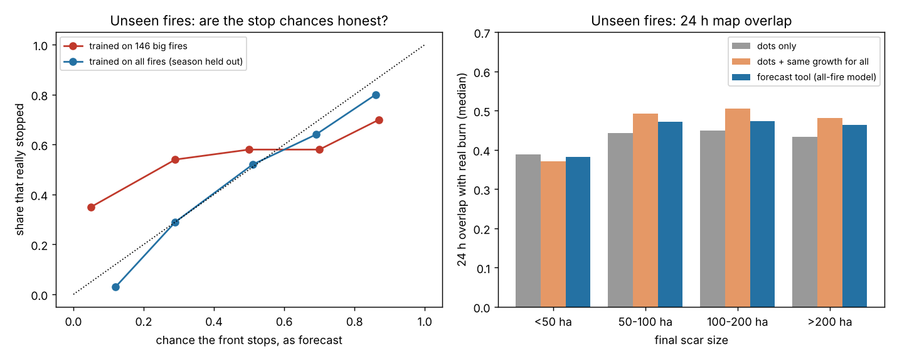

*Spread on 818 unseen fires: the honest stop chance (left) is the part worth keeping.*

*Learned restart on fire 971 (2019): each pass re-seeds the forecast.*

### 7.3 Direction of spread

| Cue (765 fires with a clear run; random 25% within 45°) | Right within 45° |
|---|---|
| Shape of the first-pass cluster | ~random |
| Hottest pixel / brightness | 29-30% |
| FRP-weighted centre | 38% |
| Wind (ERA5) | 26% |
| Downslope | 22% |
| **Move from first to second pass** | **63-65%** |

**Runway hint (all 9 MP tiger reserves, 4,104 fronts, other reserves held out):** a model of terrain + the hot side of the dots names the side that burns farther **67-68%** of the time (chance 50%); the named side burns past 500 m 20% of the time vs 8-9% for the least likely side. Drivers: local height within 300 m (20%), slope direction (11%), hot side of the dots (10%). It is an officials-only hint in the app.

**30 m scene arrow:** a mid-fire Sentinel-2 scene looked 65% right vs 47% for VIIRS dots, but the scene arrives online ~16:00-17:00 IST, after the 13:30 VIIRS look. Live, it is 58% vs 56% for dots with the afternoon look: about no gain. Kept as a hint.

*The runway hint on an official's card: "Likely to burn farther toward the NW (forest, uphill); least toward the E (forest edge 180 m)".*

### 7.4 Barriers and stop chances

| Line a fire reaches | Share of fires that stop |
|---|---|
| Railway | ~75% |
| Roads (OSM) | 0.69 (0.78 for fires started 1 km+ away); 30-78% by width |
| Big streams | 0.72-0.83 |
| Ridges | never |
| Division / range / beat boundaries | ~16% / ~14% / ~8% (about random) |

From fire lines v2 (7,704 lines): stop odds are 3.3x at a road, 2.1x where the line leaves forest, 1.8x at crop edges.

**Backup:** `ratapani/spread/README.md`, `ratapani/spread/unseen_validation/README.md`, `research/spread-review/README.md` and `HONEST_TESTS.md`, `research/spread-audit/README.md`, `research/runway-statewide/README.md`, `research/fire-continuity/README.md`, `fuel-map/ratapani/timing/README.md`.

---

## 8. Fuel load: fuel map, heat, Prithvi

There is **no field fuel data** (FSI never published its 15,114 plot values), so every fuel number was inferred from the fires themselves.

### 8.1 Fuel map and fuel from fire speed

*10 m layers for Ratapani: canopy, teak probability (AUC 0.81), leaf-fall fraction, peak fuel per season 2018-26, FSI strata and Rothermel fuel layers.*

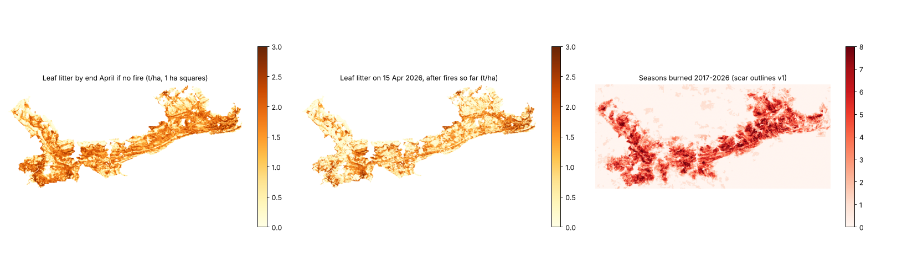

*Fuel map v3 (litter, grass, teak).*

| Finding | Value |
|---|---|
| Loose litter needed for Rothermel to match the observed speed | **2.4-3.5 t/ha** (literature-based guess was 1.5; published teak litter 2.4-3.9) |
| Fire intensity / flame length | **46-56 kW/m, ~0.5 m** (up to ~170 kW/m, 0.8 m on fast days). Beater crews can attack up to ~350 kW/m, so **these fires can be beaten out by hand** and a cleared 2-3 m line should stop them |
| Speed in teak vs other deciduous vs grass | the same, so speed cannot map forest type |
| Fuel in the 2-day model | adds nothing (28.8 vs 29.1) |

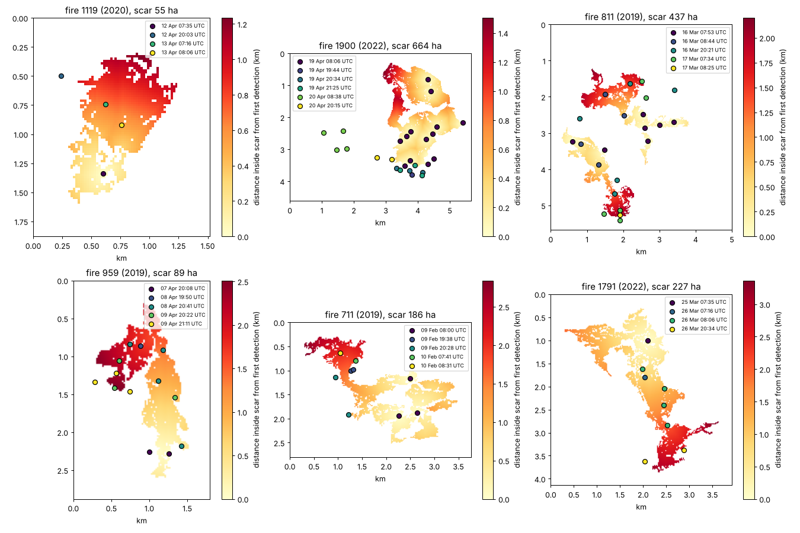

### 8.2 Fuel from heat (FRP)

Fuel burnt per ha = 0.368 kg/MJ x the fire's total radiated energy / its burnt area. After correcting view angle, crown shading, the night clock and swath overlap:

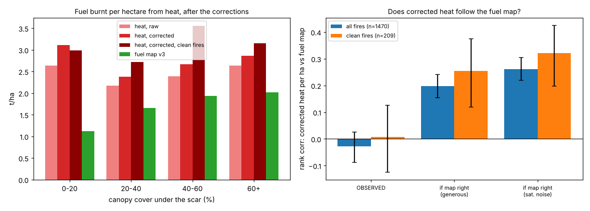

| Result | Value |
|---|---|
| Average fuel burnt | **2.4-3.2 t/ha**, matching the fuel map (~2) and Indian litter values (2.3-4.5) |
| Heat vs fuel map, clean fires | rank correlation +0.01 (a correct map would give 0.25-0.32) |
| Why | polar satellites catch energy as **area^0.45**, not area: small fires look heavy, big fires light (6.7 vs 1.9 t/ha). That 3.5x error swamps the 1.8x fuel difference looked for |
| Meteosat every 15 min | sees 2% of VIIRS fires and ~9% of their heat; needs ~100 MW, teak litter fires burn 5-20 MW |

**Verdict:** the average level is right; a heat-based fuel *map* is not possible with these satellites.

### 8.3 Prithvi (NASA/IBM foundation model)

Akkshay was "very certain" Prithvi would show fuel load. It was tested on every use, frozen and fine-tuned on his GPU (10.5 h).

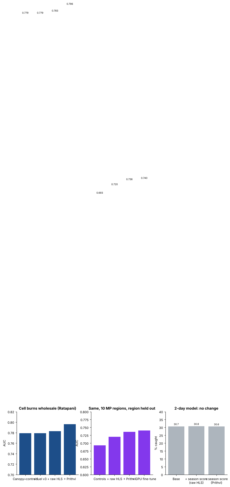

*Chart 12. Prithvi helps one thing a little (which cells burn wholesale in a season) and nothing on the 2-day list.*

| Use (held out) | Without | Raw HLS pixels | With Prithvi | Verdict |
|---|---|---|---|---|
| Fuel load | no truth exists | | | not a fuel map |
| Big fire at first alert (AUC, with access controls) | 0.708 | 0.721 | 0.707 | no |
| Cell burns wholesale this season, Ratapani | 0.779 | 0.783 | **0.796** | small yes |
| Same, 10 MP regions, region held out | 0.693 | 0.720 | **0.736** (+0.016, 9/10 regions) | small yes |
| + GPU fine-tune (last 8 of 24 blocks) | | | 0.740 (fine-tuned vs frozen 0.000) | no extra |
| 2-day model, 10 MP regions (top 10%) | 30.7% | 30.8% | 30.6% | no |
| Which ground near the first dots burns (pixel AUC) | 0.795 | 0.808 | 0.821 | small yes |
| Cold start, fire-prone ground with no history | 0.760 | 0.809 | 0.775 | no |
| Mid-March image in the season model | | | +0.003 AUC | no |

The small gain is a stand or landscape pattern, not litter: it does not grow with years since the last burn and it goes the wrong way with leaf-fall amount. It is already in the best season map; Prithvi is **finished**.

**Backup:** `fuel-map/ratapani/README.md`, `fuel-map/ratapani/inversion/README.md`, `research/fuel-from-heat/README.md`, `fuel-map/prithvi/README.md`, vanagni PR #8.

---

## 9. Prevention: fire lines, control burning and the joint plan

### 9.1 Fire lines

| Finding (held out: chosen on 2017-21, scored on 2022-25, 82 divisions, 93,116 fires) | Value |
|---|---|
| Forest saved per km of line per year (stop chance 0.70, robust choice) | **10-12 ha/km/yr** for the first 1,000 km; 5-6 at 5,000 km |
| Share of burnt forest saved | 1,000 km 1.4%; 2,000 km 2.2%; 5,000 km 3.9%; every cut in every repeat patch (19,000 km) ~8% |
| Hindsight ceiling (cuts chosen on the fires themselves) | 12-15% at 5,000 km |
| Burning is concentrated | the 10% of 5 km squares that burnt most in 2017-21 held 51% of 2022-25 burnt forest and 72% of big-fire burning |

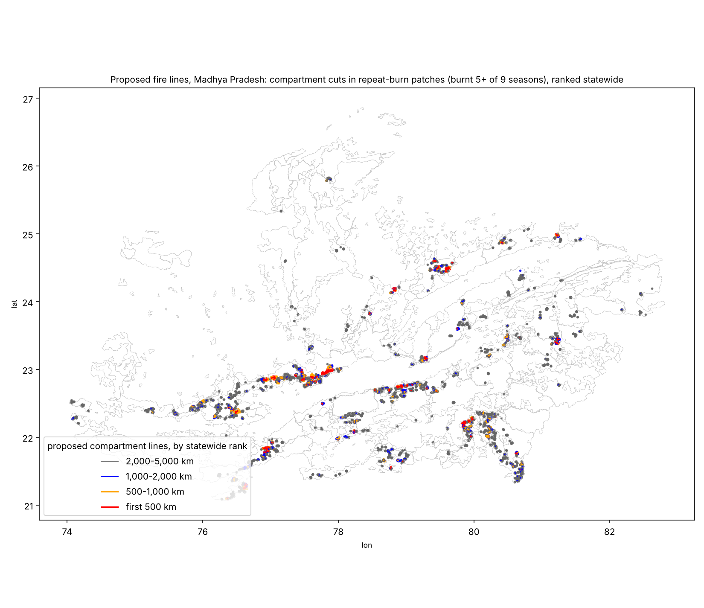

*Practical fire lines v2 (7,704 lines, 4,986 km) following nalas, ridges, roads and forest edges.*

### 9.2 Control burning: what the burn record says

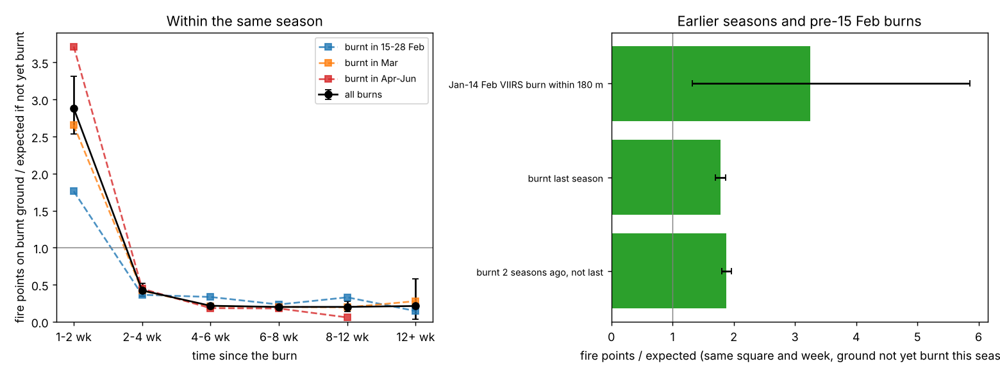

*The fuel clock: VIIRS fire on already-burnt ground relative to unburnt forest in the same 5 km square and week.*

| Time since the burn | Re-burn ratio (95% CI) |
|---|---|
| 1-2 weeks | 2.88 (the fire itself) |
| 2-4 weeks | **0.42** (0.34-0.52) |
| 4-6 weeks | **0.22** |
| 6-8 weeks | **0.20** |
| 8-12 weeks | **0.20** |
| burnt **last season** | **1.78** (more fire, not less) |
| burnt two seasons ago | 1.88 |

- **A burn protects its own ground for the rest of that season only.** Deep inside a scar (180 m), fire after the first month is almost absent (18 points where 338 were expected). The litter is fully back after one monsoon, so a control burn must be **repeated every year**.
- **When to burn:** a block burnt on 15 Feb avoids 70% of the burning it would otherwise have had that season; 1 Mar 68%; 15 Mar 55%; 1 Apr 34%. 46% of the season's forest hectares burn in 22 Mar-4 Apr.
- **Early fires are cooler:** median FRP 4.6 MW in 15-28 Feb vs 6.6-7.3 MW in April-May. **Burn severity seen from orbit is the same** for Feb and April fires (RdNBR 0.127 vs 0.131; 99.2% "low").
- **It pays only on repeat patches.** Ordinary forest burns 3.6% a season, so a burn there prevents 0.03 ha per ha. The 3,867 repeat patches (419k ha) burn 53-63% of seasons.
- **Five checks (20 Oct):** displacement to the next block is small and uncertain (net -0.12 ha per early ha, CI spans zero); why protection differs between divisions follows nothing visible; the programme **can be audited from orbit** (except in sal, 58% in February); escape risk is mapped per patch; the patch map goes stale and must be rebuilt yearly. 182 of the 465 first-programme patches need a real edge boundary.

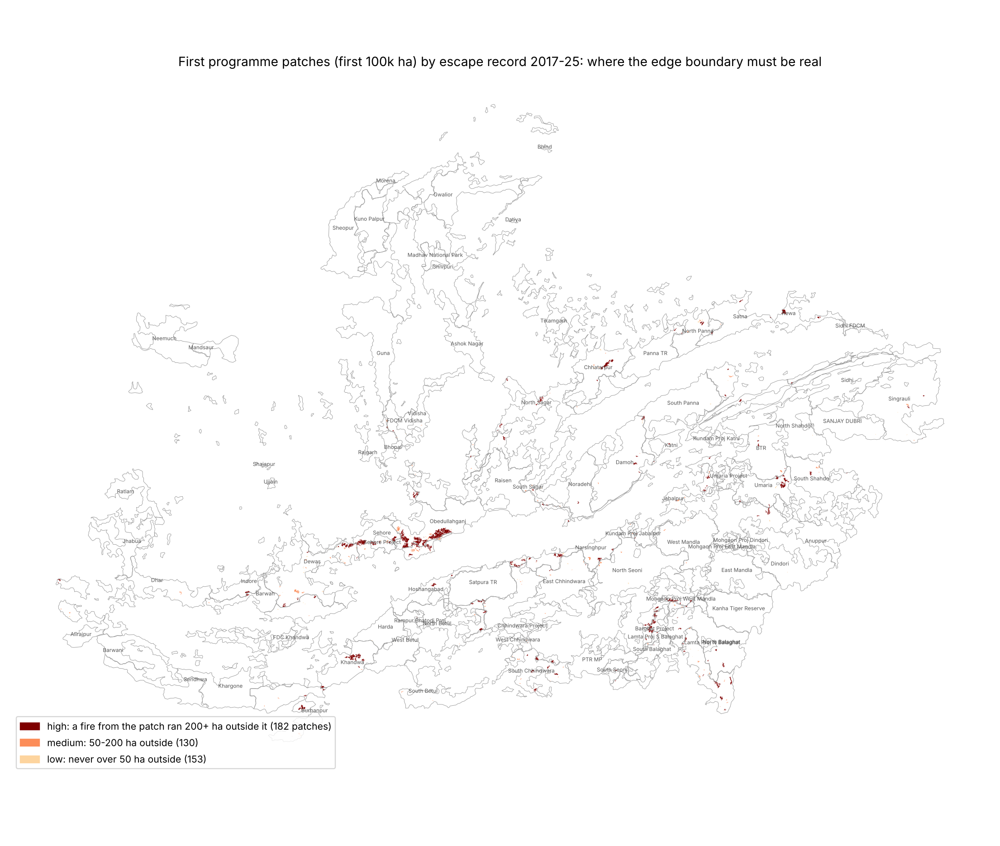

*Large escapes go uphill or toward neighbouring repeat-burn forest (61%), not downwind (53% vs 50% random).*

### 9.3 The joint plan

**Rule:** burn every repeat patch that a crew can hold, 15-28 Feb, every year, block by block inside its practical fire lines (the lines are the burn-block boundaries, cleared Dec-Jan). Where a patch cannot be burnt, the same lines stay as breaks. Watchers on the ranked squares from 8 March. 97% of practical line km lie inside repeat patches, so it is one programme.

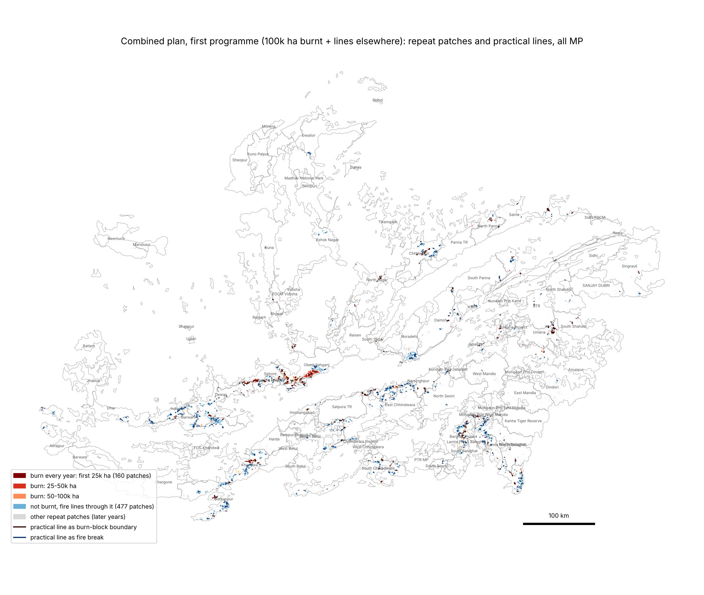

*The plan map for MP.*

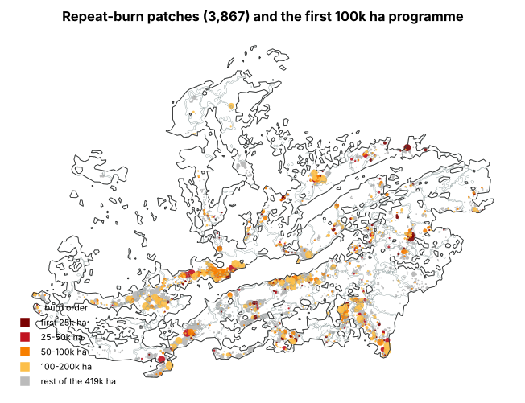

*Map 4. The 3,867 repeat-burn patches by burn order; dot size = forest area.*

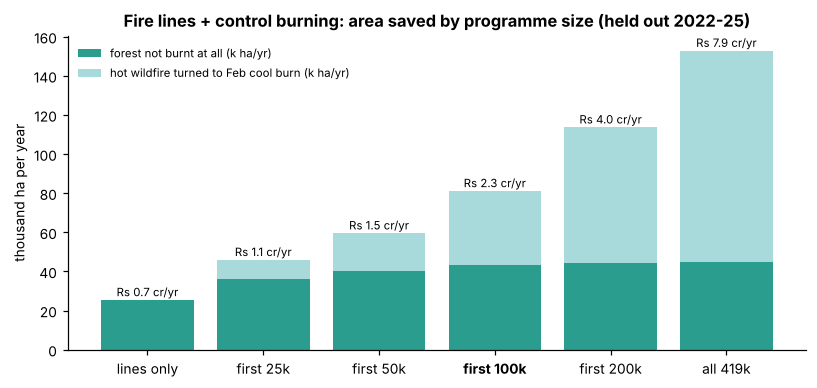

*Chart 13. Area saved per year by programme size (MP burnt forest 718.7k ha/yr).*

| Programme | Patches | Forest not burnt at all (ha/yr) | Hot burn turned to cool Feb burn (ha/yr) | Total (% of MP) | Rs crore/yr | Rs per ha not burnt |
|---|---|---|---|---|---|---|
| Lines only, 4,986 km | 0 | 25,351 | 0 | 3.5% | 0.7 | 267 |
| Burn first 25k ha | 160 | 36,295 | 9,578 | 6.4% | 1.1 | 301 |
| **First 100k ha (recommended, 55 divisions, 3 years)** | **465** | **43,179** | **37,894** | **11.3%** | **2.3** | 540 |
| All 419k ha | 3,867 | 44,901 | 107,878 | 21.3% | 7.9 | 1,763 |

[inference] The first programme needs ~6,700 crew-days in 12 working days, ~560 crews of five. **Ceiling:** forest not burnt at all tops out near 45k ha/yr (6%) under any mix, because the patches carry 20% of MP's burnt forest; the other 80% burns on ground that burns once in 28 years.

### 9.4 What the department does now (from orbit and its own budget)

| Finding | Value |
|---|---|
| Cool daytime department-like burns before 15 Feb | 1,000-2,700 per season |
| First-programme ground the department already burns early | ~30% yearly; 45% never (South Balaghat, Umaria, Barghat, Narsinghpur, Hoshangabad, Chhindwaras) |
| January burns vs 15-28 Feb burns | hold as well (0.30x) |
| Early department burning inside repeat patches | only ~10% |
| CAMPA 2025-26 fire-line budget vs burning (Spearman) | 0.10 (lines), 0.24 (watchers): nearly flat. Khandwa (44,800 ha/yr) and Mandsaur (392 ha/yr) both get Rs 25 lakh of lines |
| Satpura TR | the one clear improver (-13%/yr relative to the state) after its pre-15 Feb burning rose from 4% to 23%: the natural pilot |

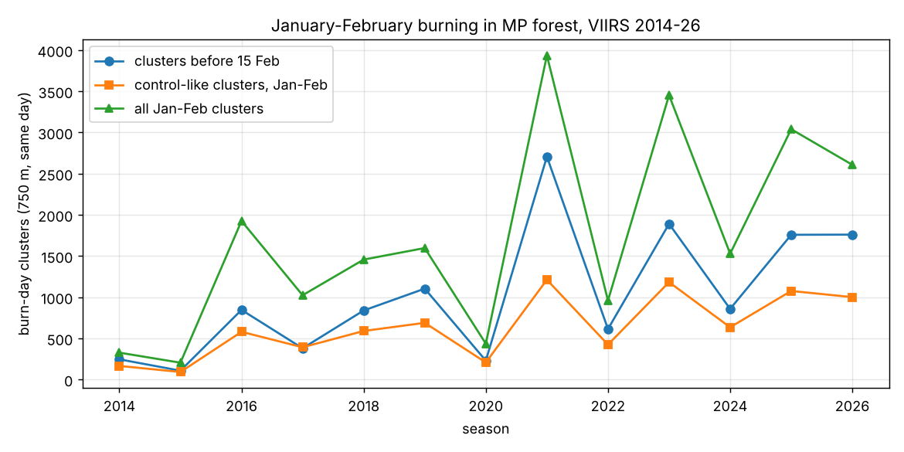

**Other prevention ranked from the record:** watchers placed by a square-week ranking cover 76% of burning vs 43% spread evenly; burning rises 5x from the hamlet edge to 3 km inside; new fires cluster 3.25x within 0.5 km and 12 h of a fire; Holi eve 1.4x. The World Bank "95% fewer fires" claim for mahua-net villages is not visible from orbit (DiD 0.92).

**Backup:** `ratapani/fsi/scouting/fire_lines_v2.md`, `control_burning.md`, `joint_plan.md`, **`report/joint_plan_mp.pdf` (26 pages, 15 figures)**, `department_records.md`, `dept_burns_jan_feb.md`, `new_questions.md`, `code/joint_plan/out/j1_patches.csv/.geojson`, `j1_by_division.csv`.

---

## 10. What the satellite record says about each division

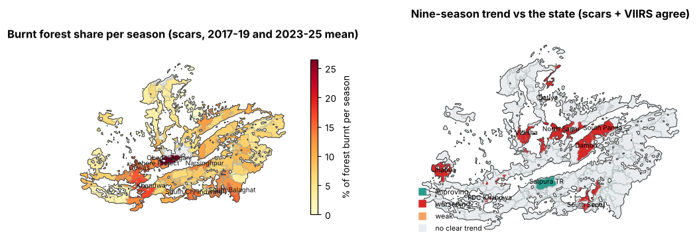

*Map 5. Left: share of each division's forest burnt per season. Right: nine-season trend relative to the state, counted only where the scars and the VIIRS series agree. One clear improver (Satpura TR); a worsening Bundelkhand dry belt (Damoh, South Panna, North Sagar, Vidisha) plus FDC Khandwa.*

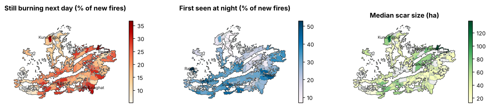

*Map 6. Three traits that stay put year to year (odd vs even years 0.85-0.92): fires still burning next day, fires first seen at night, and typical scar size.*

| # | Finding | Numbers | Stability |
|---|---|---|---|
| 1 | Fires still burning next day | Rewa 37%, Kuno 34% vs Kanha 11%, Pench 9% (state 22%), after adjusting for forest, month and density | 0.91 (adjusted 0.83) |
| 2 | Fires first seen at night | Ratlam 53%, Barwah 48%, Dindori 46% vs Ashok Nagar 7%, Gwalior 8% (state 30%) | 0.92 (adjusted 0.93) |
| 3 | Typical fire size | median scar Rewa 138 ha, Kuno 119 vs Ratlam 13, Sendhwa 13 (state 38) | 0.85 |
| 4 | Burnt last year -> burns again | 47% vs 6% for never-burnt 1 km cells (all 19%) | every year |
| 5 | Beat edges act as firebreaks | 45% of fires within 250 m of an edge vs 49% random; edge fires 0.71x the size | 68 of 72 divisions |
| 6 | Bursts | worst 10% of days carry 62% of a division's fires; the north runs on its own calendar (sync 0.31-0.37) | |
| 7 | Same ground every year | only 16.5% of 2025 fires on 1 km ground unburnt in 2017-24 | |

Division habits were tested as big-fire inputs and add nothing beyond the shuffled null; they stay as briefing facts for DFOs.

**Backup:** `research/division-insights/README.md`, `research/dynamic-cutoff/README.md`, `ratapani/fsi/scouting/new_questions.md` §2.

---

## 11. The live alert system and field app

**Flow:** Bhuvan, FSI portal and NASA FIRMS alerts -> mapped to MP beats -> forest filter -> guard visit with photo and GPS proof -> range officer review -> burn scar per alert for officials. It plugs into MP's **eNetra** through a documented API (`field-system/INTEGRATION.md`).

### 11.1 What is built

| Layer | Who sees it | What it does |
|---|---|---|
| Live alerts | guards, range officers, control room | Bhuvan, FSI, NASA in that order; auto "reached" from phone position; route line; geotagged photos; fire yes/no, area, cause, fire-out time; 7% random re-check |
| Officials' 2-day list | officials | the live daily rule (section 5.5), each square tagged "division", "quiet square" or "statewide" |
| Big-fire watch + combined new-fire order | officials | section 6; guards see "may become a big fire" at 12+ points |
| Runway hint, 30 m arrow, still-burning line | officials | section 7 |
| 24 h "likely burnt" map | officials | learned area model, overlap 0.460 |
| Daily brief at 16:00 IST | officials | one page per division + state table; 4 pm list gives ~4 h more warning than 8 pm |
| Weekly scar check | officials | per range, a week's alerts with a scar and hectares; raises "visited, said no fire, but clear scar" for a second look |
| Patrol pilot tasks | guards | "check this square" tasks, burn-age question, crew logs, chance finds, 2-photo inspection proof |
| Nightly cloud runner | system | 17:15 IST (after afternoon VIIRS ~16:30), retries to 19:15; health check flags a missing list from 19:45 |

 

*The 16:00 IST statewide brief for 22 Apr 2026, the busiest day.*

*Weekly scar check for South Balaghat, 24-30 Mar 2025: 473 alerts, 92% with a scar, 19,560 ha.*

More screens: [guard alerts](../field-system/docs/demo-2026-04-15/1_guard_phone_field_alerts.png), [range officer review](../field-system/docs/demo-2026-04-15/3_range_officer_review.png), [control room 15 Apr 2026](../field-system/docs/demo-2026-04-15/4_control_room_all_alerts.png), [cell tasks](../field-system/docs/pilot/1_guard_cell_tasks.png), [pilot report](../field-system/docs/pilot/8_dashboard_report_v3.png), [direction hint](../field-system/docs/pilot/13_direction_hint.png), [guard big-fire flag](../field-system/docs/pilot/12_guard_big_fire_flag.png), [scar confirmed](../field-system/docs/scars/1_dashboard_confirmed.png), [scar dashboard](../fire-alert-scars/ui_preview/0_dashboard_today.png).

### 11.2 Full-season dry run, 2026

Every FIRMS point of 12 Feb-15 Jun 2026 (323,207 points) went through the app's live intake, pass by pass.

| Load (15 Feb-15 Jun 2026) | Value |
|---|---|
| Alerts reaching a beat | 13,676 (11,168 new fires) |
| Alerts per day, statewide | median 69; top 10% of days 273+; peak 382 (22 Apr) |
| Per beat per day | at most 3; 99% of beat-days 2 or fewer |
| Per division per day | at most 35; 99% of division-days 15 or fewer |
| Guard big-fire flags | 289 in the season, median 1 a day, peak 15 (17 Mar) |
| Officials' list, peak day | 27 min before the fix; **0.44 s** after |

### 11.3 Cloud scoring: no PC needed

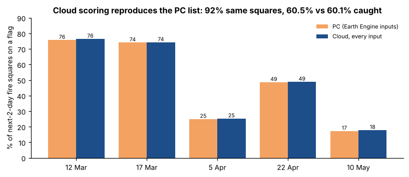

*Chart 14. The officials' list rebuilt with every input from the cloud (GFS from NOAA, ERA5 soil mapped to ERA5-Land, MODIS, HLS from NASA LP DAAC) on five 2026 days.*

| Input ages | Caught | Same squares as PC |
|---|---|---|
| model's own | 60.5% | 92.2% |
| real-life ages (MODIS 21 d, soil 15 d, HLS 10 d late) | 58.5% | 78.1% |
| PC | 60.1% | |

Full-season rescore puts the real-age cost at about 1 point (66.7 / 47.3 / 82.1 vs 67.5 / 47.6 / 82.3), so **no retrain**. AlphaEarth for 2027: a stale map costs nothing; keep the 2025 map until 2026 is published.

### 11.4 Robustness audit (20 Oct)

| Part | Found (crit / high / med / low) | Fixed |
|---|---|---|
| Evening cloud runner | 3 / 8 / 8 / 7 | all critical and high, most medium |
| Live fire ingest | 1 / 6 / 9 / 12 | 21 of 28 |
| Field visits and eNetra | 3 / 9 / 10 / 10 | 30 of 32 |
| Officials' layers | 1 / 4 / 8 / 9 | 19 of 22 |

Worst fixed: database lock in peak hours dropped guards' reports; the phone silently dropped refused reports; unlimited PIN guessing and empty PINs; one failing hint took down the whole list; duplicate alerts +22% (now +2%). Three calls are waiting for Akkshay (section 16). The app is **not hosted live yet**.

**Backup:** `field-system/README.md`, `INTEGRATION.md`, `docs/dry_run_2026/README.md`, `docs/cloud_scoring/README.md`, `docs/audit/SUMMARY.md` (and `runner.md`, `ingest.md`, `field.md`, `officials.md`), `docs/brief/README.md`, `docs/scar_check/README.md`, `docs/spread24/README.md`, `pc_models/README.md`.

---

## 12. Patrol pilot protocol for 2027

A three-arm pilot (fixed 5 per beat, calendar-led, forecast-led) at equal staff-hours, 15 Feb-15 Jun 2027, everything locked by 1 Feb 2027 (`research/reframe/pilot/PROTOCOL.md` v2, arms in `beat_arms.csv`). Cells within 1.5 km of a VIIRS point in the last 3 days are never ignition tasks; they go to the response stream, the same in every arm.

| Dry run (frozen model 2017-24) | Not near a recent fire, 2025 / 2026 | Near an active fire, 2025 / 2026 |
|---|---|---|
| Fixed 5 per beat | 30 / 30% | 27 / 29% |
| Calendar sets the daily total | 53 / 56% | 65 / 62% |
| Forecast sets the daily total | 54 / 56% | 68 / 70% |

| Rate ratio (95% interval) | 2025 | 2026 |
|---|---|---|
| Calendar vs fixed | 2.05 (1.57-2.78) | 1.90 (1.39-2.62) |
| Forecast vs fixed | 2.53 (1.89-3.54) | 1.88 (1.39-2.63) |
| Forecast vs calendar | 1.23 (0.97-1.57) | 0.99 (0.72-1.34) |

About 85-93% of checks find no burn within 2 days under every rule. One season can show calendar or forecast beats fixed, not forecast vs calendar. (Field data is currently off the table; the protocol and app support are ready if that changes.)

---

## 13. What failed, and why

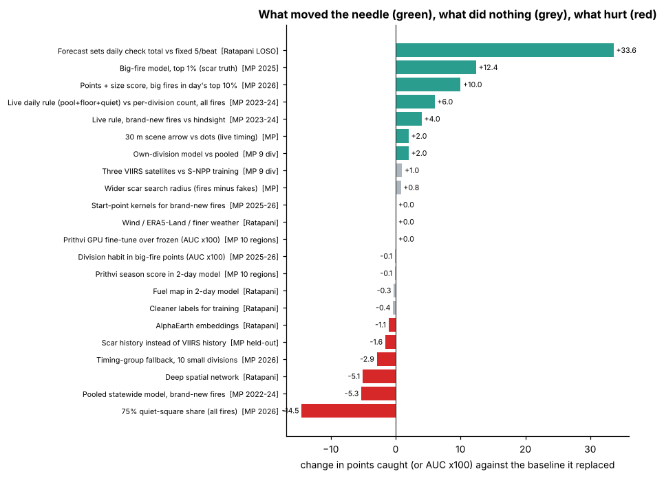

*Chart 15. A sample of tested ideas, each against the baseline it would have replaced. Units are points caught unless marked AUC x100; the set and season are in brackets.*

### 13.1 Prediction inputs and models

| Idea | Result | Why it failed |
|---|---|---|
| Wind, ERA5-Land, finer weather, WeatherNext, FWI/KBDI | +0 to 2 points at most | Weather drives *how many* fires a day, which recent fire activity already captures; 33 ERA5-Land points across Ratapani differ by ~1.5 °C |
| AlphaEarth embeddings (as a new input) | 26.4 vs 27.5 | duplicates dryness and land cover |
| NDVI/LST, GHSL, OSM, MCD64A1, Sentinel-1, GEDI | no gain | nothing new about "where" beyond history and dryness |
| Deep spatial network | 24.4 vs 29.5 | too little signal for a big model |
| Prithvi in the 2-day model / fine-tune | 30.6 vs 30.7; fine-tune = frozen | stand pattern, not next-2-day risk |
| Fuel map in the 2-day model | 28.8 vs 29.1 | fires are lit by people where they walk, not where fuel is heaviest; litter regrows yearly everywhere |
| Cleaner labels for training | under 1 point | label noise is not what limits the model (it does change the honest score: 1.8x -> 2.15x random) |
| Scar history instead of VIIRS history | 2-7 points worse | VIIRS dots mark where fires start and return; scars also cover ground that burnt once |
| Pooled start-point kernels for brand-new fires | ties burn history per unit of ground | no hidden "village habit" beyond cell history |
| Pooled or timing-group daily models | -5 points on brand-new fires | division-specific patterns matter |
| Small-division timing-group fallback | 2026: 60.9 -> 58.0% | the clean-check gain was chance on ~1,200 fires |
| Per-division new-fire model; fire-regime clusters | within ±0.5 | the quiet-square reserve gives the same |
| **75% quiet-square share** | 2026 all fires 67.5 -> 53.0 (brand-new 47.6 -> 65.0) | too many flags leave the busy squares; live stays at 25% |
| Pre-season outlook | no better than long-run averages | the 6x year swing comes from March-April rain |
| Weekday, market day, tendu/mahua fortnights | 0 of 68 divisions show a weekday effect | |
| Season big-fire map | ties the all-fire map | big fires burn where fires burn |
| Division habit in big-fire points | AUC 0.784 -> 0.782 | already in the points' division item |

### 13.2 Satellites and imagery

| Source | Result | Why |
|---|---|---|
| Geostationary (Meteosat IODC, GK2A, Himawari, INSAT) | Meteosat sees 2% of fires; Himawari cannot see Ratapani | 4-5 km pixels need ~100 MW; litter fires burn 5-20 MW |
| ECOSTRESS 70 m | ~11 useful passes a season; dead end | too few, unknown cloud and coverage |
| FILDA-2 night pixels | +2.8% (2025), +9% (2026) and misses a third of FIRMS | flame-light test does not help weak fires |
| Raw VIIRS masks ("looked, saw no fire"), cleaning | no gain | |
| Sentinel-3 SLSTR | +1% dated burns | |
| Landsat mid-fire, 30 m scene as first sighting | no live gain | arrives after the afternoon VIIRS look |
| Faster Sentinel-2 via Copernicus | L2A online ~6 h after the pass | no faster in practice |
| Bhoonidhi (AWiFS, LISS-III/IV, Cartosat, EOS-04) | AWiFS keeps ~1/4 of S2's value; LISS/Cartosat paid and rarely over a fire; EOS-04/C-band sees 3% of scars | AWiFS lacks the 2.2 µm band; radar sees the standing canopy, not the litter |
| Planet | not pursued | paid, and the "where" ceiling caps any imagery gain (a perfect burn map lifts brand-new only 34 -> 44%) |

### 13.3 Fire behaviour

| Idea | Result | Why |
|---|---|---|
| Physics spread (Rothermel, C-DAC-like) | ties a circle | wind under canopy is not measured; fuel, speed and start time cannot be separated from two looks a day |
| Wind or slope as direction | 26% / 22% (random 25%) | litter fires under canopy are not steered by them |
| Heat as fuel | 0.01 vs 0.25-0.32 expected | area^0.45 sampling bias |
| Direction from one pass | random | a single pass has no memory of where the fire came from |
| Scar shape tells the start | 49% | |
| Burn-map threshold tuning, per-pixel burn dates | no gain | S2/Landsat cannot date a burn inside the image gap |

### 13.4 Prevention

| Idea | Result | Why |
|---|---|---|
| Fuel burns outside the repeat patches | 0.03 ha saved per ha | ordinary forest burns 3.6% a season |
| Wind-ordered block burns | random for escapes | escapes go uphill and toward repeat fuel |
| Division-level burn-protection correction | follows nothing visible | |
| Mahua targeting / nets | DiD 0.92 | no village-scale effect from orbit |
| Placement tricks to get 10% from 500 km of lines | impossible | best patches are few; per-km return falls |

---

## 14. Corrections log

Numbers that changed after a check, with both values and the reason.

| What | Before | After | Why |
|---|---|---|---|
| Ratapani lean model | 29.5% LOSO | **29.0%** | "scars already seen" input leaked; 25-day rule added |
| True-lead labels | 38.9% | **39.5% (ensemble 40.7%)** | 1 in 5 burns dated a day late |
| Fire sizes | rasters, median 28.5 ha | **grown outlines, median 96 ha** | raster rule misses big fires |
| Front speed | 37 m/h | **24 m/h** | pixel jitter |
| Physics vs circle | 0.348 vs 0.345 | **0.275 vs 0.268** | runs started on the mapped scar |
| Learned footprint | 0.516 | **0.498-0.502** | earlier-burn input leaked ~25 days |
| "NOAA-20/21 double the passes" | claimed | **wrong**: they pass 25-50 min after S-NPP | |
| Ignition to detection | 15 h / 6 h | **~3 h for afternoon detections** | unstable fits |
| Big-fire model from 146 fires | 0.53 overlap; "within 2x 70%" | **0.47 on unseen; 39% vs 23%** | selection bias; a scoring bug counted under-forecasts as hits |
| Big-fire points vs size score | size score alone wins (0.84 vs 0.70) | **combination wins (0.87 vs 0.80)** | the cloud rebuild of the points under-scored the app's real points |
| Big-fire watch list, 2026 | tie with the daily list (VIIRS truth) | **56 vs 43% at top 1% on 2026 burn scars (+13; 500 ha+ +24)** | the tie came from counting by VIIRS hot spots; the two truths are mostly different fires (35% overlap) |
| Small-division fallback | +5.5 points | **-2.9 on the live rule** | chance on few fires |
| Quiet-square share 75% | looked good on a simplified test | **too costly on the exact live rule** | |
| Recent-fire ranker 63 -> 69% | "improvement" | mostly near known fires | response, not ignition |
| Fire peak time | 4:30 pm | noon-1 pm IST, and not checkable directly | no sensor measures the peak |

---

## 15. Still in progress (20 Oct)

| Item | Status at ~19:00 UTC, 20 Oct | What it decides |
|---|---|---|
| ~~2026 MP burn scars~~ **done** (Large fires thread) | finished: 19,019 events, 87% clear scar, 12,117 fires (368 of 200 ha+) | watch list holds on 2026 (top 1%: 56 vs 43%); size score AUC 0.87 vs 0.73 for points; combined order stays (section 6). One lead left: late-season fires after 15 Apr (37% caught) |
| **Quiet-square share curve** (Prithvi PC session) | testing 35% and 50% in the exact live rule on the PC | Akkshay picks 25 / 35 / 50%. **Live stays at 25%** until he confirms; app, runner and spec unchanged meanwhile. 75% is already rejected |
| **Three open calls from the app audit** | waiting for Akkshay | section 16 |
| PR #1 (division models + results) | out of draft, ready for review | merge is Akkshay's call |
| Burn scars, daily all-MP run | continues 1 Feb-31 Jul, with the Monday officials' report | |

---

## 16. Decisions only Akkshay can take

1. **The app audit's three calls:** staff-number sign-in (recommended: keep), FSI-only alerts through the mines/industry mask (recommended: yes), keep opening tasks when the forest map cannot be read (recommended: yes).
2. **Quiet-square share:** 25% (live now), 35% or 50%, once the PC curve is in.
3. **Merge PR #1** on Slllyio/van-suraksha-alert.
4. **Hosting:** the app is not live yet; it needs a machine with a restart policy.
5. **Prevention programme:** whether to propose the first 100k ha joint plan (465 patches, 55 divisions, 3 years), with Satpura TR as the natural pilot, and the CAMPA re-allocation by burning.
6. **Official FSI feed for eNetra** (as Odisha has) and fire registers / compartment maps from DFOs, if field data comes back on the table.
7. **Credentials:** keys pasted in chat do not work and should be regenerated (EUMETSAT, FIRMS, LSA SAF, Earthdata, Bhoonidhi); only environment secrets are used.

---

## 17. Code, repositories and pull requests

| Repository | What | State |
|---|---|---|
| Slllyio/vanagni | canonical repo | draft PR #7 (SYSTEM.md), #8 (Prithvi fine-tune), #9 (scar key spec) |
| Slllyio/van-suraksha-alert | MP division-model pipeline and results (`mp/results/officer/*`) | **PR #1 ready for review**; draft PR #2 (GEDI) |
| Slllyio/jwala_gemini, wildfire-prediction, wildfire | early copies | consolidation planned; weekly drift check on Mondays |
| `/mnt/project-files/field-system/` | the live alert engine and field app | not in git |

System description: [docs-draft/SYSTEM.md](../docs-draft/SYSTEM.md). The earlier report, kept as it is: [report/PROJECT_REPORT.md](../report/PROJECT_REPORT.md).

---

## 18. Data catalogue

| Group | Files (under `/mnt/project-files/`) |
|---|---|
| Grids and boundaries | `ratapani/grid_500m.geojson`, `ratapani/mp_grid/` (`mp_cells.parquet`, `mp_grid.json`, `static_gis_v1.parquet`, `dryness/`), `ratapani/beats/mp_beats.geojson`, `field-system/data/beats_mp.geojson` |
| Fire points | `fire-alert-scars/alerts_mp/` (VIIRS 3 satellites + MODIS 2014-26), `fire-alert-scars/alerts/`, `ratapani/fsi/` FSI portal |
| Burn scars | `fire-alert-scars/mp/out/` (`scars_mp_hist.csv`, outlines via `scripts/read_geom.py`, `history_by_year.csv`, tiger reserves), `fire-alert-scars/reference/v1_2026-10-15/`, `research/ratapani-burn-labels/rasters/` |
| Scoring keys | `research/ceiling/scar_key/`, `ratapani/labels_v3/`, `ratapani/scoring/` |
| Live models | `field-system/pc_models/` (87 models, calibration, `static_inputs.parquet`, `fire_celldays.parquet`, `modis_clim.parquet`, `live_score.py`, `daily_run.py`) |
| PC check days | `field-system/pc_check/live_flags_2026-*.parquet`, `division_counts.csv` |
| Big fires | `research/large-fires/results/`, `research/big-fires/results/`, `field-system/docs/big_fire_replay/` |
| Spread | `ratapani/spread/results/`, `ratapani/spread/unseen_validation/` |
| Fuel and timing | `fuel-map/ratapani/` (10 m layers, `inversion/`, `timing/`, `v3/`), `fuel-map/prithvi/results/` |
| Prevention | `ratapani/fsi/scouting/code/fire_lines_v2/out/`, `code/control_burn/out/`, `code/joint_plan/out/` (patches, lines, programmes, by division), `code/dept_burns/out/`, `code/newq/out/` |
| Divisions | `research/division-insights/*.csv`, `research/fire-timing/results/`, `research/dynamic-cutoff/results/` |
| App outputs | `field-system/docs/` (dry run tables, brief, scar check, audit, screenshots) |

---

## 19. Figure index

**Made for this report** (`figures/`, 21 files, ~2 MB; scripts in this thread's scratch, data as cited):

| File | What |
|---|---|
| `m01_fire_density_mp.png` | Map 1: VIIRS fire density in MP forest beats 2014-26 |
| `m02_burnt_share_and_trend.png` | Map 5: burnt share and nine-season trend by division |
| `m03_fire_calendar.png` | Map 3: half-burnt date by division |
| `m04_division_traits.png` | Map 6: still burning, night starts, scar size |
| `m05_daily_list_2026-04-22.png` | Map 2: the real 2-day list on 22 Apr 2026 vs the next 2 days' fires |
| `m06_patches.png` | Map 4: repeat-burn patches by burn order |
| `c01`-`c15` | charts: timeline, daily rule, scar key, burnt area by year, fire sizes, big-fire curves, what was tried, when-not-where, cloud vs PC, Prithvi, joint plan, scar check, spread, big fire at alert, Ratapani model |

**Shown from their own folders:** scar validation (`fire-alert-scars/wayback/`), burn rasters (`research/ratapani-burn-labels/`), big fires (`research/big-fires/figures/`, atlas PDF), growth maps (`research/fire-continuity/figures/`, atlas PDF), heat (`research/fuel-from-heat/figures/`), spread (`ratapani/spread/examples/`, `unseen_validation/`, atlases of 146 and 818 fires), fuel (`fuel-map/ratapani/`), prevention (`ratapani/fsi/scouting/figs_r28/`, `figs_r29/`, `figs_r30/`, `report/joint_plan_mp.pdf`), app (`field-system/docs/`).

---

*Every number in this report comes from a README, table or script in the shared folder; where a number is an inference rather than a measurement, the source marks it. Nothing in the project has been checked on the ground yet: every result is from satellites.*
