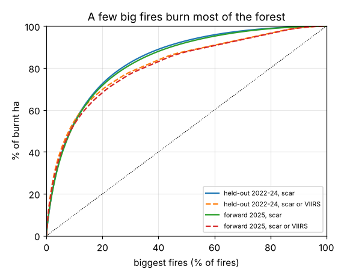
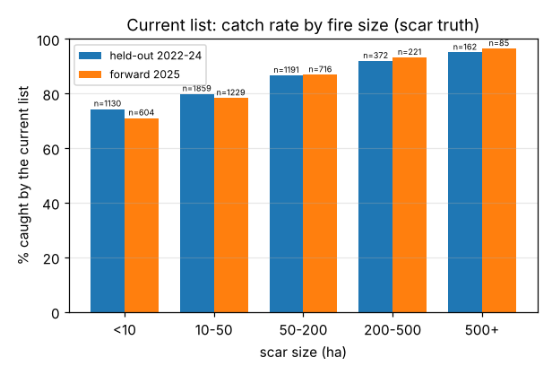
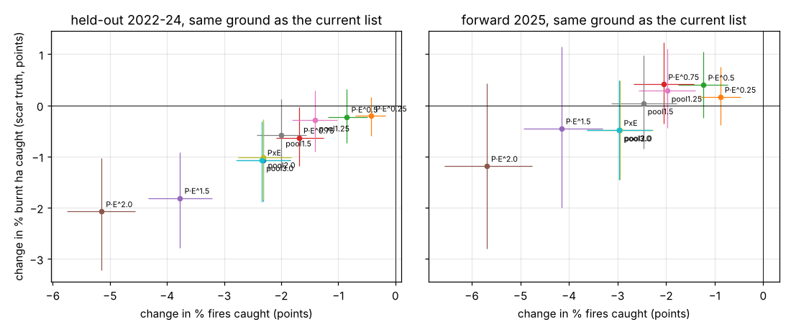

# Can the 2-day list catch more burnt area, not just more fires? (round 24, 18 Oct 2026)

Question: a few big fires burn most of the forest, and officials care most about those. Can the daily "watch these squares" list be reordered so that, on the same ground, it catches more **burnt hectares** and more **200 ha+ fires**? This note uses only data we already have.

**Short answer: no.** Today's list already catches **about 90% of the burnt area** and **93-94% of the 200 ha+ fires**. That is much more than its 74-76% of fires. Adding a size model ("how big would a fire here get") and reordering on chance × size gives **no gain that holds up**:
- On held-out 2022-24, every reordering loses fires and also loses a little burnt area.
- On forward 2025, the best mixes gain +0.2 to +0.4 points of burnt area. The 95% CI includes zero, and they lose 0.9 to 2 points of fires.

**Keep the current list.** The area that is still missed sits mostly in brand-new fires, which a size term cannot find.

## 0. Set-up

- **Same set-up as round 22** (`system_rebuild_satellite_gis_ml.md`):
  - the same 10 divisions;
  - the kept model: B0 + static GIS + the separate brand-new head;
  - the strict officer rule: each fire counts once, and a fire is caught if one of its first-day squares is flagged or next to a flag on day -1 or -2;
  - the per-division top-10% cut, and matched ground.
- **Test periods.**
  - Held-out: train 2019-21, test 2022-24.
  - Forward: train 2019-24, test **2025 only**, because there are no scars for 2026.
  - The current list reproduces round 22 exactly: 75.8% of fires, 42.2% of brand-new fires, 20.0% ground (held-out).
- **Burnt area per fire.** I use the scar answer key of the "Is the project at its limit" thread (`research/ceiling/scar_key/`). The method is the same: scar-thread forest events, the all-MP scar runs and outlines. I extended it back to 2019 because the size model needs training seasons, and the scar runs now hold those years.
  - A scar event is joined to a VIIRS fire when its alert square, or a square next to it, is part of that fire on the same date. Otherwise the day before or after is used.
  - A fire's area is the **union** of all its matched outlines. So a multi-day fire whose daily scars overlap is not counted twice.
  - About **45% of fires have a scar** (44% held-out, 47% forward). Another 5-6% were checked and showed no scar. The other ~49% have no scar event at all: they are VIIRS fires outside beat forest or not in the scar thread's set (e.g. farm-edge fires).
  - **Second truth (VIIRS):** where no scar exists, area = 16.5 × (squares lit)^0.99 ha. That law is fitted on fires that have a scar, and its Spearman with scar area is only 0.49.
  - Every number names its truth: **"scar"** = fires with a scar only; **"best"** = scar where it exists, VIIRS otherwise.
- **Noise.** 95% CIs come from resampling fires. Differences from the current list use a paired bootstrap on the same fires.

## 1. How concentrated is burnt area?

| | Fires | Median size | Biggest 1% of fires hold | Biggest 10% hold | Biggest 20% hold | 200 ha+ fires: share of fires / share of ha |
|---|---|---|---|---|---|---|
| Held-out 2022-24, scar | 4,714 | 29 ha | 12% | **54%** | 72% | 11% / 57% |
| Forward 2025, scar | 2,855 | 29 ha | 12% | **54%** | 72% | 11% / 56% |
| Held-out, best (scar or VIIRS) | 10,611 | 17 ha | 15% | 55% | 70% | 6% / 44% |

**The premise holds.** The biggest tenth of fires burn more than half the forest, and fires of 200 ha or more (about 1 in 9 scar fires) burn 56-57% of it.

## 2. The current list already favours big fires

| Current list (same ground 20.0-20.2%) | % fires | % brand-new fires | **% burnt ha (scar)** | % burnt ha (best) | **% of 200 ha+ fires (scar)** |
|---|---|---|---|---|---|
| Held-out 2022-24 | 75.8 (75.0-76.6) | 42.2 | **90.4 (89.0-91.7)** | 87.0 | **92.9 (90.7-94.9)**, n = 534 |
| Forward 2025 | 74.4 (73.3-75.5) | 37.6 | **90.8 (89.0-92.3)** | 86.8 | **94.1 (91.2-96.5)**, n = 306 |

Catch rate by scar size (held-out; forward is within 3 points):

| Scar size | <10 ha | 10-50 | 50-200 | 200-500 | 500+ |
|---|---|---|---|---|---|
| % caught | 74 | 80 | 87 | 92 | **95** |

**Why big fires are already caught.** [inference, backed by the counts below]
- Big fires mostly start near fires that are already burning, which is what the list keys on: 97% of big "old" fires are caught.
- They light more first-day squares (median 2-3 against 1-2), so they get more chances to touch a flag.
- Only 6-11% of big fires are brand-new, against 12-23% of all fires.
- **What is missed:** 9-10% of the scar area. On held-out, 62% of that missed area is in brand-new fires (36% on forward). Of the 38 big fires missed on held-out, 26 were brand-new.

## 3. Size model: E(size) if a fire starts here

- **Model.** A LightGBM gamma model (log link, so its output is expected hectares). It is trained only on fires that happened, in the training seasons. Each row is a fire's first-day square on issue day -1 or -2.
- **Inputs (all known at issue time):**
  - the round-22 square features: forest continuity (forest within 5 km, distance to forest edge), forest type and land cover, terrain, roads and villages, burn history, day of year, recent fires 0.5-50 km, HLS dryness, division activity, division id;
  - big-fire history from earlier seasons: the division's share of 200 ha+ fires, the division's median log size, and the mean log size of past fires starting within 5 km.
- **Target:** burnt area (scar where it exists, else VIIRS).

| Test (fires that happened) | Spearman, predicted vs actual size | Biggest-predicted 10% of fires hold | 200 ha+ rate in that top 10% vs all |
|---|---|---|---|
| Held-out, scar | 0.43 | 22% of ha | 29% vs 11% |
| Forward 2025, scar | 0.44 | 27% of ha | 37% vs 11% |
| Held-out, best | 0.36 | 28% of ha | 23% vs 6% |

- **The size model is real but modest.** Its top tenth holds 2-3 times its share of area.
- Its top inputs are the division (22% of gain), day of year, forest within 5 km, past fire size within 5 km, beat cover, and today's division activity.

## 4-5. New rankings at the same ground

P is the kept model's chance, isotonic-calibrated so it is a true probability before multiplying: on 2022 for held-out, and on 2026 for the 2025 test. E is the size model. Each ranking's flag share is set so that its ground matches the current list. Differences are against the current list on the same fires, with 95% CIs.

**Held-out 2022-24** (current: 75.8% fires, 90.4% ha, 92.9% big fires, 42.2% brand-new; median distance from a flag to a road 1.12 km)

| Ranking | Δ % fires | Δ % burnt ha (scar) | Δ % 200 ha+ fires | Δ % brand-new | Median km to road / village | Flags >2 km from a road |
|---|---|---|---|---|---|---|
| P (current) | – | – | – | – | 1.12 / 2.06 | 28% |
| P × E^0.25 | -0.4 (-0.7 to -0.2) | -0.2 (-0.6 to +0.2) | -0.2 (-0.9 to +0.4) | -0.2 | 1.12 / 2.12 | 29% |
| P × E^0.5 | -0.9 (-1.2 to -0.5) | -0.2 (-0.7 to +0.3) | 0.0 (-0.9 to +1.0) | -1.0 | 1.12 / 2.24 | 30% |
| P × E (expected burnt ha) | -2.3 (-2.8 to -1.8) | **-1.1** (-1.9 to -0.3) | -0.9 (-2.3 to +0.4) | -2.0 | 1.12 / 2.24 | 32% |
| P × E^2 | -5.2 | -2.1 (-3.2 to -1.0) | -1.5 | -3.8 | 1.41 / 2.50 | 34% |
| Top 1.25×k by P, then reorder by P×E | -1.4 (-1.8 to -1.0) | -0.3 (-0.9 to +0.3) | +0.2 (-0.8 to +1.2) | -1.5 | 1.12 / 2.24 | 30% |
| Top 2×k by P, then reorder | -2.3 | -1.0 (-1.8 to -0.3) | -0.9 | -2.0 | 1.12 / 2.24 | 31% |
| E only (size, no chance) | -23.8 | -13.2 | -10.5 | -9.8 | 1.58 / 2.83 | 41% |

**Forward 2025** (current: 74.4% fires, 90.8% ha, 94.1% big fires, 37.6% brand-new; median 1.12 km to road)

| Ranking | Δ % fires | Δ % burnt ha (scar) | Δ % 200 ha+ fires | Δ % brand-new | Median km to road / village | Flags >2 km from a road |
|---|---|---|---|---|---|---|
| P (current) | – | – | – | – | 1.12 / 2.12 | 30% |
| P × E^0.25 | -0.9 | +0.2 (-0.4 to +0.8) | 0.0 (-1.3 to +1.3) | -0.5 | 1.12 / 2.24 | 31% |
| P × E^0.5 | -1.2 | +0.4 (-0.2 to +1.1) | +0.3 (-1.0 to +1.7) | 0.0 | 1.41 / 2.24 | 32% |
| P × E^0.75 | -2.0 | +0.4 (-0.4 to +1.2) | +0.7 (-1.2 to +2.5) | -0.5 | 1.41 / 2.24 | 32% |
| P × E | -3.0 | -0.5 (-1.5 to +0.5) | 0.0 (-1.9 to +2.0) | -1.0 | 1.41 / 2.50 | 33% |
| P × E^2 | -5.7 | -1.2 | +0.3 | -0.7 | 1.41 / 2.50 | 34% |
| Top 1.25×k by P, then reorder | -2.0 | +0.3 (-0.4 to +1.0) | +0.3 (-1.3 to +2.0) | -1.5 | 1.41 / 2.24 | 32% |
| E only | -21.5 | -10.3 | -7.5 | -6.0 | 1.58 / 2.69 | 39% |

- **Lead time does not change.** Every ranking catches 91-93% of its caught fires 2 days ahead (mean lead 1.9 days), and 95-97% of caught big fires 2 days ahead.
- **Remote core forest.** Area weighting pushes flags slightly away from roads. The median flag moves from 1.1 to 1.4 km from a road, and the share of flags more than 2 km from any road rises from 28-30% to 30-34%. "E only" goes to 39-41%.
  - So the mixes do move flags a little toward less reachable forest, for no gain.
- **Swap count** (P × E against the current list, scar fires). Held-out: 4 big fires gained and 9 lost, 74 smaller fires gained and 172 lost. Forward: 5 gained and 5 lost, 57 gained and 127 lost.
  - The size term mostly drops small fires next to villages and does not find new big ones.

## 6. Verdict

- **No gain. Keep ranking by chance alone.** On the same ground, no mix of chance and expected size catches more burnt area or more 200 ha+ fires in a way that holds on both tests. Every mix costs fires: 0.4-5.7 points, more as the weight on size grows.
- **The reason is that the current list is already area-weighted in effect.** It catches about 90% of burnt hectares and 93-94% of 200 ha+ fires, against 74-76% of fires.
  - Big fires start beside live fires and light several squares, so the list already sees them.
  - Of the ~10% of area still missed, much is in brand-new fires (36-62%), where neither chance nor size has much signal.
- **For officials, quote both numbers:** "the list covers about 3 in 4 fires but about 9 in 10 hectares burnt, and more than 9 in 10 of the 200 ha+ fires."
- **Where size does help:** after the alert, not before it. The round-21 big-fire chance at alert time (AUC 0.80 on scar truth) is the right tool to rank which new alerts to chase. It should not reorder the 2-day watch list.

**Limits.**
- 10 divisions, not all of MP.
- Scar truth covers about 45% of fires: those inside beat forest. Fires without a scar use a weak VIIRS size (Spearman 0.49 with scars).
- Tiger-reserve scars drawn on older, smaller chips stop near 420 ha, so the biggest fires there are under-measured.
- Ratapani's v2 outlines were not swapped in, so one method is kept across divisions.
- Calibrating P for the 2025 test used 2026 (only to make P a probability; it does not change the current list's order).
- The CIs resample fires, not seasons.

**Files.**
- Code: `code/area_weighted/`
  - `a1_scars.py`: scar table 2019-25;
  - `a2_events.py`: fire events and burnt area;
  - `a3_size_model.py`: E(size);
  - `a4_rank.py`: rankings and scoring;
  - `a5_figs.py`;
  - `a6_diag.py`;
  - and `aw_common.py`.
- Small outputs: `code/area_weighted/out/`. Ranking tables are `rank_held.csv` and `rank_fwd.csv`. The rest are `concentration.csv`, `catch_by_size_*.csv`, `size_model_*.json`, `size_imp_*.csv`, `diag_*.json`, `current_ci_*.json`, `viirs_area_law.json` and the figures.
- Big intermediates (events, size rows, E cubes, hits) are in scratch `r24/` only.
