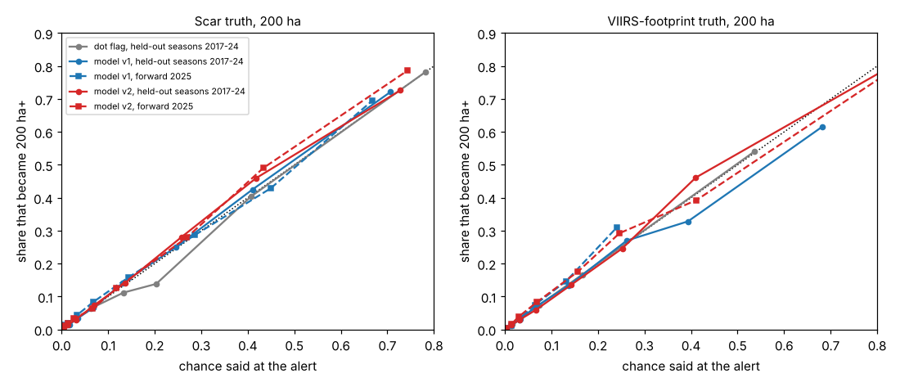
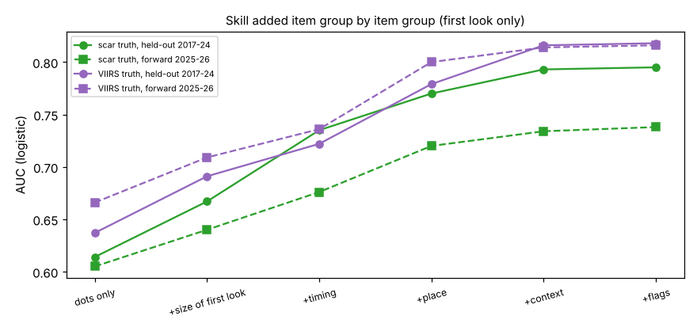
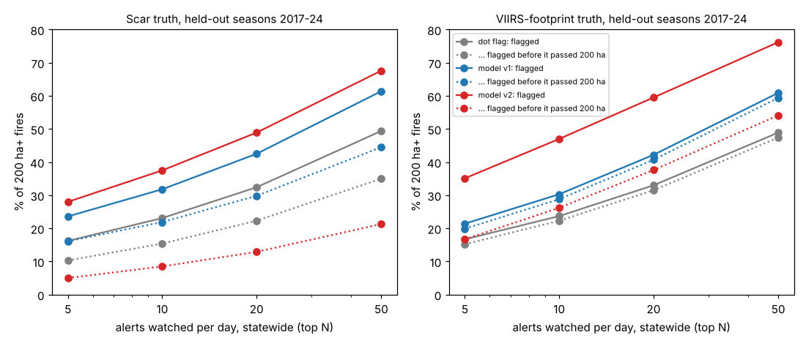
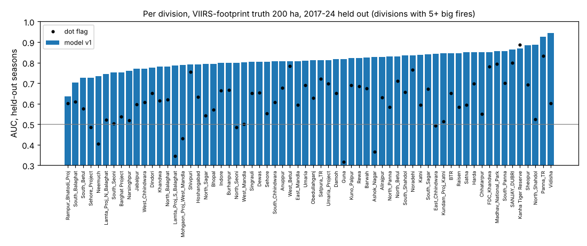

# Will this alert become a big fire? A calibrated chance at alert time, all MP (scouting round 21, 17 Oct 2026)

**Question.** When a new VIIRS alert comes in, what is the chance that the fire grows to 200 ha or more (also 50 and 500 ha)? The chance must use only what is known at the first satellite look (version 1), or by the first look + 15 h (version 2). It should work for all of MP, be honest when tested on seasons it never saw, and be readable by senior officials.

**Starting point.** The existing big-fire flag (`research/fuel-from-heat/README.md`, "Big-fire early warning", Ratapani only): "3+ dots at the first alert = about 1 in 3 becomes a big fire; 5+ dots = more than half". It covers 13% of alerts and catches 34% of the big fires.

**Code and outputs.** `code/big_fire_chance/` (scripts `b1`-`b10`); tables and figures in `code/big_fire_chance/out/` (540 kB). Large intermediate files stay in the session scratch folder `r21_big`. No credential was used or written. No other thread's files were edited. The all-MP scar files were still being written by the scar run, so they were copied once to scratch and read from that copy.

**Terms.**
- **alert**: one group of VIIRS dots, within 1.2 km of each other, in one satellite pass, that starts a new fire (no dot within 1.2 km in the 30 h before).
- **fire**: dots linked within 1.2 km and 30 h (the spread thread's rule), followed for 7 days.
- **AUC**: the chance that a random big fire is ranked above a random small one (0.5 = coin toss).
- **PR-AUC**: average precision. It is low when big fires are rare.
- **calibrated**: when the model says 20%, about 20% happen.
- **held out**: the season being scored was never used to fit anything.
- **[inference]**: my reasoning, not a measurement.

---

## Bottom line

1. **There is no breakthrough, but there is a clear, honest gain over the dot count.** The dot count alone ranks fires poorly across all MP: AUC 0.61 on scar truth and 0.63 on VIIRS truth. A model using about 45 items known at the first look reaches AUC **0.80** (scar truth, seasons 2017-24 held out) and **0.74** on the forward test (frozen on 2017-24, scored on 2025). On VIIRS truth it reaches **0.84**, and **0.82 / 0.85** forward on 2025 / 2026. Its chances are well calibrated (fig. 1).
2. **What officials get.** Officials watch the top 10 alerts per day statewide. About 110 alerts arrive per day in 2017-24, and about 150-190 in 2025-26.
   - **VIIRS truth (seasons held out):** the model flags **30%** of the 200 ha+ fires, against 24% for the dot count. 29% are flagged before they pass 200 ha, with a median of **~24 h** to spare.
   - **Scar truth:** the model flags **32%** against 23%.
   - **Forward 2025 (scar truth):** only **15%** against 12%. 2025 was a busy three-satellite season with ~186 alerts per day.
   - **Top 20 per day:** 42% (VIIRS truth) and 43% (scar truth) of big fires are flagged.
3. **Half of all big fires start as a single dot.** 51% of the fires that end with a 200 ha+ scar showed only one dot at their first look. Nothing in the first look marks them out. This is the main ceiling.
4. **The old flag holds in Ratapani but is weaker statewide.** In Ratapani (Obedullahganj + Raisen, scar truth), 3-4 dots give 35% and 5+ dots 55%, which repeats the earlier result. Across MP, 3-4 dots give **19%** and 5+ dots **45%**. "3+ dots" marks 9% of alerts and catches 26% of the scar-big fires.
5. **Waiting for the second look (version 2) ranks much better, but mostly too late.**
   - AUC rises to 0.85 (scar truth) and 0.92 (VIIRS truth).
   - Top-10 capture rises to 47% (VIIRS truth).
   - But by first look + 15 h, 22-65% of the big fires have already passed 200 ha. So the share flagged *before* 200 ha is no better than version 1: 26% against 29%.
   - Use version 2 to confirm and re-rank, not as the early warning.
6. **Where the skill comes from.** Adding item groups one at a time on scar truth (held out): dots 0.61, then size of the first look (extent, FRP) 0.67, then timing (date, hour, night) 0.74, then place (division history, forest type, terrain) 0.77, then context (fires nearby in the last 3 days, statewide activity) 0.79.
   - Items that add nothing measurable:
     - the 50 km day-speed map: −0.000 to +0.002 AUC;
     - the control-burn flag;
     - the Terra/MODIS "seen before".
   - Division history is worth only 0.005-0.01 AUC once place and type are in.
7. **A points table officials can read** (section 6) reaches AUC 0.77 held out (scar truth) and 0.68 forward 2025. It stays calibrated: on 2025 it said 8.9% and 9.6% happened. It is a little weaker than the model and much better than dots alone.
8. **Where it fails.**
   - **Kuno, Sheopur, Katni and Madhav:** the model says too little there. In Kuno it said 12% and 31% happened. [inference] Kuno's block burns, `managed_early_burns.md` item 5, look like ordinary small first looks.
   - **A few divisions with almost no ranking skill on scar truth,** each with only 5-10 big fires, so the AUC is very uncertain:
     - Dindori AUC 0.44;
     - South Sagar 0.51;
     - Lamta North Balaghat 0.52.
   - **The 2026 forward test says too much:** mean said 2.0% against 1.4% happened. 2026 was a quiet season, and the model has no weather to know that.

---

## 1. Data and the two truths

**Alerts.** The all-MP FIRMS SP archive (S-NPP 2017-26, NOAA-20 2018-26, NOAA-21 2023-26) was restricted to points inside MP beats, using the forest-type thread's file `code/mp_types/out/viirs_vtm.parquet`, with type 0 only and dates 15 Feb-15 Jun.
- That leaves 582,085 points, 99.2% matched back to their SP rows for scan, track and brightness.
- Linked into 157,849 fires (`b1`, `b2`).
- Scored population: alerts with at least one dot on forest, scrub or grass (VTM forest-type map, not farmland or settlement), first seen by 8 Jun so that 7 days of growth fit inside the data.
- That gives **136,761 alerts on 135,896 fires**. 1% of fires had two separate first-look groups, and each counts as an alert.

**Truth A: scar.** The scar is the union of the burn-scar outlines of all the fire's scar events within 7 days (`b3`).
- **Sources:**
  - all-MP scar runs: tiger reserves 2017-25, rest of MP 2023-25 so far, and the check sample;
  - inside Ratapani, the v2 outlines (`reference/v2_2026-10-16`) replace them.
- **Inclusion:** a fire counts only if every forest event it touches has a finished scar check. That gives 41,057 fires, of which 36,745 alerts fall in the population, all in 2017-25.
- **Base rates:** 200 ha+ is 8.9% (50 ha+ 32%, 500 ha+ 2.2%).
- **Coverage bias:** the set leans toward tiger reserves before 2023 and toward rest-of-MP in 2023-25.
- **Size cap:** tiger-reserve outlines were drawn on the older ~4 km chips. They stop near 420 ha and 30% touch the chip edge. So **500 ha scar truth is weak in the reserves**, and 200 ha is mostly fine there.

**Truth B: VIIRS footprint (covers all MP and 2026).** It counts the distinct 375 m cells the fire lit in 7 days and turns them into hectares with a log-log power law. The law is fitted on scar-measured fires with an uncut outline, separately per number of VIIRS satellites (`out/truth_law.json`):

| Seasons (VIIRS satellites) | ha = a · cells^b | Fires | Spearman with scar | Scatter (×) |
|---|---|---|---|---|
| 2017 (1) | 20.1 · c^0.94 | 1,042 | 0.40 | 3.2 |
| 2018-22 (2) | 13.1 · c^1.02 | 5,146 | 0.51 | 3.0 |
| 2023-26 (3) | 10.9 · c^1.01 | 29,264 | 0.58 | 2.9 |

- About 11-20 ha per lit cell, almost linear.
- Base rates: 200 ha+ is 2.7%, 50 ha+ 18.6%, 500 ha+ 0.64%.
- **The two truths disagree a lot.** On the same alerts, kappa is 0.46. 92% of VIIRS-big fires are scar-big, but only 33% of scar-big fires are VIIRS-big. VIIRS truth is strict: it catches big fires that are seen burning on several looks, and misses big scars that burned unseen.
- **Every number below names its truth.**

**When the fire passed the threshold (for lead times).** Taken from the VIIRS growth of the fire.
- VIIRS truth: the first look at which the law applied to the cells so far gives ≥ the threshold.
- Scar truth: final scar × (cells so far / final cells)^b.
- On the scar clock, 28% of scar-big fires are already "past 200 ha" at their first look. Their footprint never grows, so no warning can come early. That is a limit of the clock, not a result about the fires.
- **Lead time is counted from the satellite overpass.** [inference] Alerts reach users about 3 h later, so subtract that.

## 2. Items known at alert time (`b4`)

**Version 1 (first look):**
- **The look itself:**
  - dot count;
  - block extent (longest span of the block centres + one block, which stands in for fire-line length, `squares_v3_per_fire.md`);
  - FRP sum and max, block size, brightest band-I4 value;
  - share of night dots, hour (IST), satellite;
  - days since 15 Feb, satellite era.
- **Place:**
  - VTM forest type under the dots, and grass/scrub, teak, sal, forest and farmland share within 1 km;
  - slope, elevation and terrain roughness from the SRTM-based 140 m grid (`r19_pool/dem_mp.npz`);
  - the 50 km day-speed map (`squares_v3/a/results/a4_cells_50km.csv`). The alert's season is never in it: an even season reads the odd-season map, and an odd season the even one.
- **Division big-fire history:** VIIRS-truth 200 ha share in the division's other training seasons, shrunk toward the MP share.
- **Context:**
  - VIIRS dots within 10 km and within 3 km in the previous 3 days;
  - dots within 2 km earlier this season (burned before);
  - statewide dots in the last 24 h.
- **Flags:**
  - the live control-burn flag from `control_burn_rule.py` (15-28 Feb, day-only, ≤2 dots, ≤5 MW);
  - Terra or Aqua MODIS fire within 1.5 km in the 12 h before.

**Version 2 (by first look + 15 h)** adds the following. Fires are re-linked using only the dots known by then, so later dots cannot join them.
- dots, cells and extent so far;
- number of looks, and seen again (yes/no);
- later dots, and night dots later;
- FRP so far;
- growth ratios of dots and extent;
- a Terra 22:30 look in between.

Not used: weather. No all-MP daily weather was prepared on disk for this. It is the obvious next item.

## 3. Models and testing (`b6`-`b9`)

**Models.**
- **Dot flag:** big-fire share per dot class (1 / 2 / 3-4 / 5-8 / 9+), refitted all-MP on the training seasons. This is the baseline.
- **Logistic regression.**
- **LightGBM + isotonic:** the calibration map is fitted on out-of-fold scores from inner season groups.

**Tests.**
- **Held-out seasons:** leave one season out over 2017-24.
- **Forward:** frozen on 2017-24, scored once on 2025 (both truths) and 2026 (VIIRS truth only; no all-MP scars yet).
- **Ranges:** 95% bootstrap over fires.

**200 ha, version 1 (first look).** AUC and PR-AUC with 95% ranges; base = share that became big.

| Truth, test | Alerts (big) | Base | Dot flag AUC | Logistic AUC | LightGBM AUC | LightGBM PR-AUC |
|---|---|---|---|---|---|---|
| Scar, held out 2017-24 | 21,073 (1,780) | 8.4% | 0.61 (0.59-0.63) | 0.80 (0.78-0.80) | **0.81 (0.80-0.82)** | 0.35 (0.33-0.38) |
| Scar, forward 2025 | 15,672 (1,497) | 9.6% | 0.61 (0.59-0.62) | 0.74 (0.72-0.75) | **0.74 (0.73-0.75)** | 0.26 (0.24-0.28) |
| VIIRS, held out 2017-24 | 98,786 (2,807) | 2.8% | 0.63 (0.62-0.65) | 0.82 (0.81-0.83) | **0.84 (0.83-0.84)** | 0.19 (0.18-0.20) |
| VIIRS, forward 2025 | 21,228 (659) | 3.1% | 0.67 (0.64-0.69) | 0.80 (0.78-0.81) | **0.82 (0.80-0.83)** | 0.20 (0.17-0.23) |
| VIIRS, forward 2026 | 16,747 (241) | 1.4% | 0.66 (0.62-0.69) | 0.83 (0.81-0.85) | **0.85 (0.82-0.87)** | 0.16 (0.12-0.21) |

**AUC gain of LightGBM over the dot flag** (paired, bootstrap over fires; `out/auc_gain_over_dots.csv`):
- scar truth: +0.19 (0.17-0.21) held out, +0.14 (0.12-0.15) forward 2025;
- VIIRS truth: +0.20 (0.19-0.21) held out, +0.15 and +0.19 forward 2025 and 2026.

**Version 2 (first look + 15 h).** LightGBM AUC:

| Truth | Held out | Forward 2025 | Forward 2026 |
|---|---|---|---|
| Scar | 0.85 (0.85-0.86) | 0.83 (0.82-0.84) | - |
| VIIRS | 0.92 (0.92-0.93) | 0.91 | 0.93 |

The VIIRS figure is flattered, because the lit cells so far are part of the same count the VIIRS truth uses.

**Other thresholds, version 1.** LightGBM AUC (dot flag in brackets):

| Threshold | Scar, held out | Scar, forward 2025 | VIIRS, held out | VIIRS, forward 2025 / 2026 |
|---|---|---|---|---|
| 50 ha | 0.78 (0.59) | 0.74 (0.60) | 0.83 (0.70) | 0.80 / 0.82 |
| 500 ha | 0.78 (0.63) | 0.76 (0.62) | 0.85 (0.60) | 0.84 / 0.84 |

- 500 ha has few cases: 396 scar fires and 717 VIIRS fires.
- Version 2 at 500 ha: 0.87 on scar truth and 0.92 on VIIRS truth, held out.

**Calibration** (fig. 1, `out/reliability.csv`). LightGBM, version 1, 200 ha, said → happened:

| Chance said | Scar, held out | Scar, forward 2025 | VIIRS, held out | VIIRS, forward 2026 |
|---|---|---|---|---|
| 1-2% | 1.6 → 1.5% | 1.3 → 2.0% | 1.4 → 1.2% | 1.4 → 0.5% |
| 5-10% | 6.8 → 6.6% | 6.9 → 8.4% | 6.9 → 7.1% | 6.4 → 5.9% |
| 10-20% | 13 → 14% | 14 → 16% | 14 → 13% | 13 → 7.6% |
| 20-35% | 25 → 25% | 29 → 29% | 26 → 27% | 22 → 26% |
| 35-50% | 41 → 43% | 45 → 43% | 39 → 33% | (6 alerts) |
| 50%+ | 71 → 72% | 67 → 70% | 68 → 62% | (8 alerts) |

- 2025 runs slightly under (busy year).
- 2026 runs over in the 10-20% band (quiet year).

**Which items matter** (`out/ablation.csv`, logistic regression, version 1, 200 ha, AUC):

| Items | Scar, held out | Scar, forward 2025 | VIIRS, held out | VIIRS, forward 2025-26 |
|---|---|---|---|---|
| dots only | 0.61 | 0.61 | 0.64 | 0.67 |
| + size of first look | 0.67 | 0.64 | 0.69 | 0.71 |
| + timing | 0.74 | 0.68 | 0.72 | 0.74 |
| + place | 0.77 | 0.72 | 0.78 | 0.80 |
| + context | 0.79 | 0.73 | 0.82 | 0.81 |
| + flags (control burn, MODIS before) | 0.79 | 0.74 | 0.82 | 0.82 |
| all minus place | 0.77 | 0.70 | 0.78 | 0.76 |
| all minus division history | 0.79 | 0.73 | 0.81 | 0.80 |
| all minus speed map | 0.79 | 0.74 | 0.82 | 0.82 |

**Reading:**
- Block extent, the date in the season and the fires nearby in the last 3 days are the strongest single items. They are also LightGBM's top items by gain, together with division history.
- Place (forest type, farmland share, terrain roughness) is the most valuable group.
- The day-speed map and the control-burn and MODIS flags add nothing measurable.
- **Caveat [inference]:** on scar truth, "timing" also carries the satellite era. The scar-measured set changes make-up in 2023 (rest-of-MP added), so part of that step may be bookkeeping rather than fire behaviour. The VIIRS-truth columns do not have this problem and show the same order.

## 4. The officials' view: top N alerts per day, statewide (`out/officials_topN.csv`)

**How the test works.** Every day, all population alerts statewide are ranked by their chance; officials watch the top N.
- **Version 1:** each alert is ranked on the day of its first look.
- **Version 2:** each alert is ranked on the day it is issued, first look + 15 h.
- **Flagged:** a big fire counts as flagged if one of its alerts is in that day's top N.
- **Before it passed 200 ha:** flagged with lead > 0 on the VIIRS-growth clock.
- **Lead:** the median among those flagged early.

Held-out seasons 2017-24 have about 109 alerts per day.

| Truth (big fires) | N/day | Dot flag: flagged / before 200 ha | Model v1: flagged / before 200 ha (median lead) | Model v2: flagged / before 200 ha | Of model v1's flagged alerts, became big |
|---|---|---|---|---|---|
| VIIRS (2,530) | 5 | 17% / 15% | **21% / 20%** (24 h) | 35% / 17% | 12% |
| VIIRS | 10 | 24% / 22% | **30% / 29%** (24 h) | 47% / 26% | 9% |
| VIIRS | 20 | 33% / 32% | **42% / 41%** (25 h) | 60% / 38% | 7% |
| Scar (1,703) | 5 | 16% / 10% | **24% / 16%** (11 h) | 28% / 5% | 29% |
| Scar | 10 | 23% / 15% | **32% / 22%** (12 h) | 38% / 9% | 22% |
| Scar | 20 | 32% / 22% | **43% / 30%** (12 h) | 49% / 13% | 16% |

**Forward tests**, top 10 per day, version 1, flagged by dot flag → model:
- VIIRS 2025 (608 big fires, 186 alerts/day): 18% → **24%**.
- VIIRS 2026 (228 big fires, 147 alerts/day): 20% → **33%**.
- Scar 2025 (1,427 big fires): 12% → **15%**.

**Reading.**
- On busy days a fixed top 10 is a smaller share of all alerts, so 2025 is harder.
- [inference] A budget that grows with the day's alert count would hold the share better.
- Lead times are short: about one VIIRS cycle (12 h) on the scar clock, and one day on the VIIRS clock.

**Other thresholds**, top 10 per day, version 1 held out, dot flag → model:
- 500 ha: 22% → 32% (VIIRS truth) and 27% → 37% (scar truth), median lead about 2 days.
- 50 ha: 23% → 25% (VIIRS truth). Most 50 ha fires reach that size at the first look.

## 5. Per division (`out/division_v1.csv`; held out 2017-24, version 1, divisions with 5+ big fires)

**VIIRS truth, 64 divisions.**
- Model AUC: median 0.81, range 0.64-0.94. The dot flag's median is 0.62.
- Weakest:
  - Rampur Bhatodi Project 0.64;
  - South Balaghat 0.70;
  - South Betul 0.73;
  - Sehore Project 0.73.
- Best:
  - Vidisha 0.94;
  - Panna TR 0.93;
  - North Shahdol 0.89;
  - Sheopur 0.89.

**Scar truth, 53 divisions.**
- Model AUC: median 0.75.
- Weakest:
  - Dindori 0.44 (8 big fires);
  - South Sagar 0.51 (5);
  - Lamta North Balaghat 0.52 (8);
  - North Panna 0.59;
  - Guna 0.61.
- Large divisions do well:
  - Obedullahganj 0.76 (359 big);
  - BTR 0.80 (144);
  - Noradehi 0.80 (171);
  - Sanjay-Dubri 0.81.

**Under-said divisions** (said → happened):

| Division | Truth | Said | Happened |
|---|---|---|---|
| Kuno | scar | 12% | 31% |
| Sheopur | scar | 3.5% | 13% |
| Katni | scar | 10% | 19% |
| Madhav | VIIRS | 6% | 14% |
| Kuno | VIIRS | 5.5% | 9% |

[inference] These are the north-west dry-forest and grass divisions, plus Kuno's managed block burns. Their first looks are small, but the ground carries fire far. A per-division correction, or a grass-fuel layer, is the fix to try next.

## 6. A points table for officials (`b8_points.py`; `out/points_table_S200.csv`, `points_chance_S200.csv`, `division_history_groups.csv`)

**How it was built.** A logistic regression on 15 yes/no items, fitted on scar truth 200 ha. 1 point = 0.25 on the log-odds scale, so each point multiplies the odds by about 1.3. The chance for each points total is read from the 2017-24 seasons. The same procedure was tested held out:
- scar truth: AUC **0.77** held out, **0.68** forward 2025;
- VIIRS truth: 0.79 held out, 0.74 / 0.78 forward 2025 / 2026;
- calibration on 2025 scar truth: said 8.9%, happened 9.6%.

**Add up the points for a new alert:**

| At the first look | Points |
|---|---|
| 2 dots / 3-4 dots / 5-8 dots / 9+ dots | +1 / +3 / +7 / +12 |
| dots spread over 1 km or more | +3 |
| hottest dot 20 MW or more | +3 |
| first seen at night | +2 |
| first seen 15 Mar-15 Apr / 16 Apr-15 May / after 15 May | +2 / −1 / −3 |
| division with many big fires / few big fires (lists in `division_history_groups.csv`) | +3 / −3 |
| 10+ VIIRS dots within 10 km in the last 3 days | +3 |
| mostly farmland around (over half within 1 km) | −3 |

**Chance of a 200 ha+ scar:**

| Total points | ≤0 | 2 | 4 | 6 | 8 | 10 | 12 | 14 | 16 | 18 | 20+ |
|---|---|---|---|---|---|---|---|---|---|---|---|
| Chance | ≤3% | 4% | 6% | 10% | 15% | 21% | 30% | 41% | 52% | 64% | 74%+ |

**Example.** A 4-dot night alert on 1 April in a high-history division, with 12 dots nearby in the last 3 days, scores 3 + 2 + 2 + 3 + 3 = 13 points: about a 35% chance.

## 7. Caveats

- **Scar coverage is uneven.** Seasons 2017-22 are mostly Ratapani, the tiger reserves and the check sample. Scar-truth numbers lean toward reserves. VIIRS truth covers all MP, but it is a narrower idea of "big": burning seen on several looks.
- **Linking.** Single linkage at 1.2 km / 30 h can chain separate fires on busy landscapes; some chains last 40 days. Growth was capped at 7 days to limit this.
- **Positions.** SP archive positions were used. Live alerts use NRT positions, which differ (only 34% of Ratapani NOAA-21 points matched exactly). [inference] Live skill may be slightly lower.
- **Season edges.** Truth ends 15 Jun, and alerts after 8 Jun were dropped.
- **No weather.** A dry, windy week is the one clear item missing from these models.

## 8. What to do with it

1. **Put the chance on each new alert in the senior-officials view.** Use version 1 (LightGBM + isotonic, or the points table where a transparent rule is wanted). Sort each day statewide. Rank by chance, not by dot count alone: at the same 10 alerts per day it catches about a third more big fires (24% → 30% VIIRS truth, 23% → 32% scar truth, held out).
2. **Re-rank at the second look (version 2) to confirm.** Do not count on it for early warning: most of its extra catches have already passed 200 ha.
3. **Scale the watch list with the day's load.** 2025-26 have 40-70% more alerts per day than 2017-24.
4. **Next experiments:**
   - add weather;
   - add a grass-fuel layer and per-division corrections for Kuno, Sheopur, Katni and Madhav;
   - rescore on scar truth once the rest-of-MP run reaches 2017-22.
