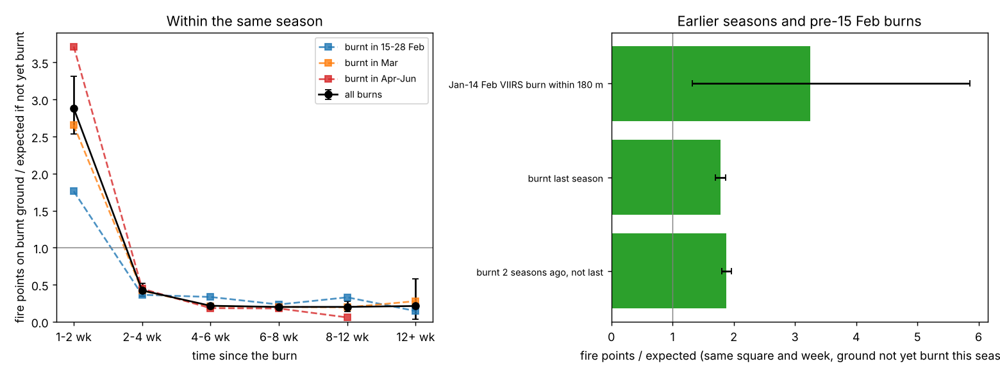
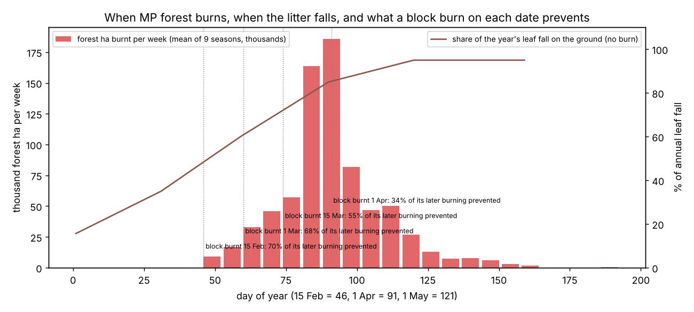
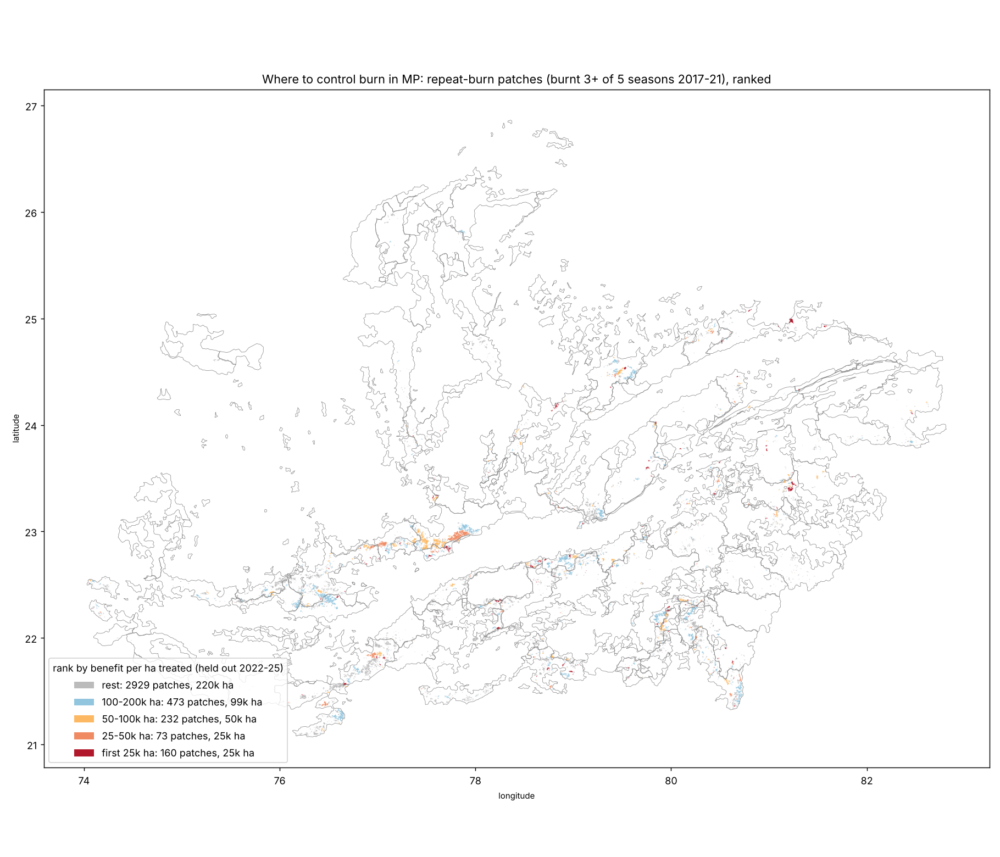
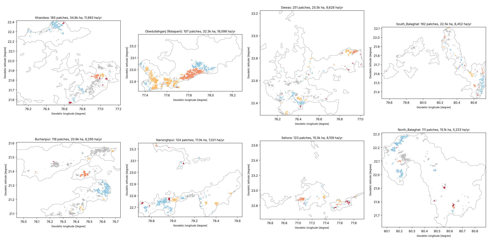

# Control burning to cut the fuel load: what the burn record says (scouting round 29, 19 Oct 2026)

**Akkshay's ask (19 Oct 16:00Z):** "Now lets move to next thing of control burning to lessen the fuel load. Deeply analyse."

**Short answer.** A burn protects its own ground for the rest of that season and for nothing more. Ground burnt two weeks or more earlier gets fire at **0.2-0.4 times** the rate of unburnt forest in the same 5 km square and week (0.05-0.2 once 180 m inside the scar, after the first month), with no recovery through May, whatever month it was burnt in. Ground burnt last season gets **1.8 times** more fire, not less: the litter is back in full by the next season, so a control burn is a one-season tool and must be repeated every year. At landscape scale each hectare burnt in 15 Feb-15 Mar takes **0.19 ha** (CI 0.12-0.26) off the later burning of its square. That low "leverage" is not because burnt ground re-burns; it is because most early-burnt ground would not have burnt later anyway (ordinary forest burns 3.6% a season). So control burning pays only where ground would burn anyway: the repeat patches, which burn 53-63% of seasons. Burning them early turns 170-220 thousand ha a year of hot-season wildfire into early cool burns (about 30% cooler by VIIRS heat) and stops a further 10-13 outside ha per 100 ha treated, about 4-6% of MP's burnt forest. That is the programme worth proposing. It does not reduce fuel in any lasting sense, and nothing in the record supports burning ground that rarely burns.

Everything below is computed from our own files (DATA) unless marked **[inference]**. Code `code/control_burn/` (`cb0`-`cb7`), tables `code/control_burn/out/`, figures `figs_r29/`.

---

## 1. What "control burning" is in MP, and what the data can test

Three things go by the name:
1. **Fire-line burning.** The 6-12 m strips along compartment lines, roads and boundaries, cleared and burnt every winter (MP CAMPA 2025-26: 139,364 km, Rs 1,356 per km; `fire_management_practice.md`). This is the fire-line question, answered in `fire_lines_v2.md`: about 10 forest ha saved per km per year at a stop chance of 0.70, saturating at 2-4% of burnt forest.
2. **Planned block burns before 15 Feb.** Meadows and blocks in Kanha, Bandhavgarh, Satpura and Kuno, and whatever the territorial divisions burn before the season (Akkshay, 16 Oct: "many control burnings in all over mp forest"). Seen from orbit as the Jan-14 Feb VIIRS points; no scar outlines exist for them (the scar history starts 15 Feb).
3. **Early burning of the repeat patches** as a substitute for fire lines (`fire_lines_v2.md` section 5): burn in February the ground that burns in March-April most years.

The record can answer four things: how long a burn protects (section 2), whether that matches the litter calendar (section 3), what early burning does to a landscape's later burning (section 4), and what a programme would save and cost (section 5).

**How the clock is measured.** A second fire on already-burnt ground leaves no second scar (the scar method needs a fresh darkening), so the scar record cannot see re-burning. VIIRS heat can. For every division, season (2017-25), 5 km square and week, forest cells on the 60 m lattice are classed by what the scar record says about them at that week: not yet burnt this season; burnt but within 7 days or at the scar edge (the fire itself; not reported); or deep inside a scar (the cell and its 8 neighbours all burnt) at a given age and month of burn. The re-burn ratio of a class is the VIIRS points that fell on it divided by the points expected if it burnt at the rate of the not-yet-burnt forest of the same square and week. Bootstrap CI over division-seasons. 11.8 million class-rows, 64.6 million forest cells.

## 2. The fuel clock (DATA, `out/cb2_*.csv`, fig 1)

### 2.1 Within the season

| time since the burn | VIIRS points on it | expected | ratio | 95% CI |
|---|---|---|---|---|
| 1-2 weeks | 5,039 | 1,749 | 2.88 | 2.53-3.31 |
| 2-4 weeks | 927 | 2,192 | **0.42** | 0.34-0.52 |
| 4-6 weeks | 271 | 1,255 | **0.22** | 0.19-0.25 |
| 6-8 weeks | 104 | 520 | **0.20** | 0.16-0.24 |
| 8-12 weeks | 61 | 304 | **0.20** | 0.14-0.28 |
| 12+ weeks | 6 | 28 | 0.21 | 0.03-0.58 |

- The first two weeks are the fire itself and its neighbours (3x): not a re-burn.
- From two weeks on, burnt ground gets fire at 0.2-0.4 times the rate of unburnt forest next to it, and the ratio does not climb back toward 1 as the weeks pass. The protection lasts the whole season.
- The ratio is the same whichever month the ground burnt: 15-28 Feb burns 0.36 / 0.34 / 0.23 / 0.33 at 2-4 / 4-6 / 6-8 / 8-12 weeks; March burns 0.42 / 0.21 / 0.20 / 0.20; April-June burns 0.45 / 0.18 / 0.18 / 0.06.
- By calendar week the ratio falls through the season: 0.3-0.5 in late March and early April, 0.15-0.25 from late April (`cb2_age.csv`, kind "by week"). **[inference]** The last of the litter has fallen by mid-April; ground burnt before that gets a little fresh litter, ground burnt after gets none.
- Across the 38 divisions with enough points the 2-12 week ratio has median 0.30 (IQR 0.21-0.39, range 0.05-0.71; `cb2_by_division.csv`). Not a Ratapani quirk.
- **It is at least this strong.** The 1-2 week row shows that fires burn around fresh scars, and a VIIRS point sits a median 230 m from its source, so some of the points counted "deep inside" old scars come from fires at their edge. Requiring 180 m inside the scar instead of 60 m (20 busiest divisions): see 2.4.
- **And stronger still against its own propensity.** The ground that just burnt is fire-prone ground (section 2.2 shows such ground normally gets 1.8x the fire of its neighbours). Against that baseline a burn removes about 1 - 0.3/1.8 = 83% of the hazard. A fair statement: a burn removes 70-85% of the chance that the same ground burns again that season.

### 2.2 Across seasons: no carry-over at all

| ground not yet burnt this season, and ... | points | expected | ratio | CI |
|---|---|---|---|---|
| burnt last season | 21,394 | 12,010 | **1.78** | 1.70-1.87 |
| burnt two seasons ago, not last | 19,625 | 10,429 | **1.88** | 1.81-1.97 |

Last season's burn gives no protection; the ground gets 1.8x the fire of ground unburnt in the last two seasons, and a burn two seasons back looks exactly the same. That is a place effect (fire-prone ground stays fire-prone) with no fuel effect on top. The same thing was seen in the heat record (fuel-from-heat: FRP at the same place is the same the season after a burn, ±4%) and in the repeat-patch work (`fire_lines_v2.md`: the same patches burn 5-7 seasons of 9). **The litter is fully back after one monsoon. A control burn is a one-season tool.**

### 2.3 The pre-15 Feb burns

Ground within 180 m of a Jan-14 Feb VIIRS point gets **3.2x** (CI 1.3-5.9) the later-season fire of other unburnt ground in its square. This does not say the planned burns fail: a 375 m fire pixel marks only roughly where they were, and the places chosen for winter burning (meadows, village edges, blocks that burn every year) are fire-prone places. The within-cell test in `managed_early_burns.md` (same 500 m cell, its own other seasons as control) found one-third lower odds of later burning after a pre-15 Feb burn. Both are true at once: relative to its own history a winter-burnt cell burns less; relative to its neighbours it still burns more. The clean measure of protection is section 2.1, which needs a scar outline and so starts on 15 Feb.

### 2.4 Sensitivity: 180 m inside the old scar

Same count on the 20 divisions with most re-burn points, but a cell counts as "inside" only if every cell within 180 m (a 7 x 7 block) burnt, so a mislocated point from a fire at the scar edge cannot reach it (`out/cb1_classes_fs7.parquet`):

| time since the burn | 60 m inside (same 20 divisions) | 180 m inside |
|---|---|---|
| 2-4 weeks | 0.40 (0.29-0.53) | 0.39 (0.20-0.62) |
| 4-6 weeks | 0.18 (0.15-0.23) | **0.07** (0.02-0.12) |
| 6-8 weeks | 0.19 (0.15-0.25) | **0.05** (0.01-0.10) |
| 8-12 weeks | 0.21 (0.12-0.32) | **0.00** (0 of 43 expected) |
| 2-12 weeks pooled | 0.29 (0.24-0.36) | **0.20** (0.11-0.33) |

Deep inside an old scar, fire after the first month is almost absent: 18 points where 338 were expected. The 0.2 that survives at 60 m is mostly edge leakage. So the protection is about 60% in weeks 2-4 (part of which is the same fire's own late flare-ups inside its outline) and 90-95% after a month. The design numbers in section 5 use the 60 m ratios and are therefore conservative.

## 3. Does the litter calendar agree? (DATA + [inference], `out/cb6_physics.csv`, fig 2)

The published litter-fall curve for a central Indian teak stand (`fuel_load_values.md`: Nov 5%, Dec 10%, Jan 20%, Feb 25%, Mar 25%, Apr 10% of the year's fall) says a burn on 15 Feb removes 48% of the year's litter and leaves 43% of the normal 1 April load on the ground; 1 March removes 61% and leaves 29%; 15 March leaves 15%; 1 April nothing. The measured protection is flatter than that: a late-February burn keeps 65-75% protection, not 57%, and the protection does not fade as the fresh litter lands. **[inference]** Two reasons fit: a fire needs a continuous bed, and a third to a half of the normal load does not carry it well (the spread work found fronts die where the bed thins); and the re-burn points that do occur are mostly in the last weeks of March, before the fall is complete, which is what the by-week ratios show. Either way the data say: burning in the second half of February costs little protection compared with burning in March, and is far safer (section 5.3).

MP forest burns on a tight calendar (`out/cb3_weekly.csv`): 46% of the season's forest hectares burn in the two weeks 22 Mar-4 Apr, 85% by mid-April, 2.3% after 15 May. A block burnt on 15 Feb has 100% of its later burning ahead of it; on 1 March 96%; on 15 March 86%; on 1 April 57%. Weighting the clock by that calendar, a block burnt on 15 Feb avoids 70% of the burning it would otherwise have had that season, 1 March 68%, 15 March 55%, 1 April 34%.

Early fires are also cooler. Daytime S-NPP fire pixels have a median FRP of 4.6 MW in 15-28 Feb against 6.1 MW in late March and 6.6-7.3 MW in April-May (upper quartile 6.8 vs 9.3-12.0). **[inference]** Less litter and higher humidity; the early burn is the "cool burn" the reserves describe.

## 4. Landscape leverage: what early burning does to a square's later season (DATA, `out/cb5_leverage.csv`)

Per division, season and 5 km square (69,939 square-seasons with at least 200 forest ha, zeros filled in): forest ha burnt in 15 Feb-15 Mar, forest ha burnt 16 Mar-15 Jun, Jan-14 Feb VIIRS points. Two-way fixed effects (the square's own average over nine seasons, and the division-season's average, so weather years and fire-prone squares are netted out). CI by bootstrap over divisions.

| | slope | 95% CI |
|---|---|---|
| later forest ha per ha burnt 15 Feb-15 Mar ("leverage") | **-0.19** | -0.26 to -0.12 |
| later share per unit of early share | -0.22 | -0.27 to -0.15 |
| later forest ha per Jan-14 Feb VIIRS point | -0.9 | -5.0 to +0.3 |
| later share per Jan-14 Feb point per 100 ha | -0.014 | -0.050 to +0.001 |
| without fixed effects: squares with 5%+ early burn vs none, same division-season | **+8.0 points** later share (4.5% base) | +7.2 to +8.9 |

- Each hectare burnt in the first month of the season takes about a fifth of a hectare off the later burning of its square. Price et al. 2015 predict leverage 0.039 x (mean annual % burnt); MP forest burns about 8% a year, so 0.31 is the global-line expectation and 0.19 is below it, between eucalypt forest (0.25) and chaparral (0).
- The pre-15 Feb points carry a smaller, uncertain effect: about one later hectare per winter fire pixel, with a CI that includes zero.
- Without fixed effects the sign flips: squares that burn early are the squares that burn late. Any before/after or across-places comparison of control burning in MP will show that and should not be trusted.
- The two measurements agree with each other. Burnt ground keeps 70-85% of its protection (section 2), but ordinary forest burns only 3.6% a season (0.32 seasons per cell in nine), and even the ground people burn early would mostly not have burnt later: 0.19 = roughly 0.75 x a 25% propensity. **Leverage is set by what the burnt ground would have done, not by how well the burn holds.**

**Reserves (DATA, `out/cb5_reserves.csv`).** Satpura's later-season burnt share was 4.7-6.0% in 2017-19, 2021-22, then 1.3% (2023), 0.3% (2024), 3.0% (2025) after its early-burning jump; but 2023-24 were low years everywhere (MP burnt forest 281k and 243k ha against 740-820k), and in 2025, a normal year, Satpura was 36% below its own 2017-22 mean. Kuno burnt 275 winter pixels in 2025 (its most ever) and its later share was 1.5% against a 3.2% 2017-22 mean. Consistent with leverage of the measured size, not proof: two reserves, one to two years.

## 5. What a programme would save, and what it would cost (DATA + [inference], `out/cb6_design.csv`)

### 5.1 Where burning pays: only ground that burns anyway

| ground | forest ha | burnt seasons per cell, of 9 | chance of burning in a season |
|---|---|---|---|
| all forest (82 divisions) | 23.2 M cells = 8.4 M ha | 0.32 | 3.6% |
| tr3 repeat patches (burnt 3+ of the 5 seasons 2017-21) | 416 k | 4.8 | 53% over 2017-25; 37% on 2022-25 alone (section 14) |
| all5 repeat patches (burnt 5+ of 9 seasons) | 268 k | 5.65 | 63% |

With 70-85% protection (more, deep inside the block), a control burn on ordinary forest prevents 0.03 ha of wildfire per ha burnt; on an all5 patch 0.45-0.55 ha, plus what it stops outside the patch. The programme is the patches, nothing else.

### 5.2 The repeat-patch programme, by burn date (from the m5 patch table, re-weighted by the clock and the calendar)

Patches are ranked on 2017-21, scored on 2022-25. "Outside ha stopped" are forest ha outside the patch burnt by fires that started inside it, times the share prevented; "inside ha converted" are the patch's own wildfire hectares (fires starting inside; fires entering from outside are not counted, so the inside figure is a floor).

| patch forest treated | burnt on | outside ha stopped per 100 ha | outside ha/yr stopped | inside ha/yr converted | outside saving as % of MP burnt forest |
|---|---|---|---|---|---|
| 10,000 | 15 Feb | 12.9 | 1,290 | 750 | 0.18% |
| 50,000 | 15 Feb | 12.5 | 6,200 | 4,300 | 0.86% |
| 100,000 | 15 Feb | 13.3 | 13,200 | 11,200 | 1.8% |
| 200,000 | 15 Feb | 12.3 | 24,600 | 25,500 | 3.4% |
| 416,000 (all tr3) | 15 Feb | 10.6 | 44,200 | 50,600 | 6.1% |
| 100,000 | 1 Mar | 12.4 | 12,300 | 10,900 | 1.7% |
| 100,000 | 15 Mar | 9.6 | 9,500 | 8,700 | 1.3% |

Counting every fire in the patches (not only those that start there), the all5 patches alone carry 268k x 63% = **170 thousand ha** of wildfire a year and the tr3 patches **220 thousand** (23-31% of MP's burnt forest). Burning them in late February converts that to cool burns and stops a further 44 thousand ha outside (6%). **[inference]** Whether the conversion is worth anything depends on whether a February burn hurts the forest less than an April one. The record says it is about 30% cooler (section 3); it cannot say what that does to regeneration or wildlife.

The gain per 100 ha is flat with scale (10-13 outside ha), unlike fire lines, where the first 500 km are worth 2x the next 4,500. Ranking patches barely matters; coverage does.

### 5.3 The cost of waiting: escapes

Fires that start in 15-28 Feb reach 50 ha 29% of the time and 200 ha 6.8% of the time (median 26 ha); in 1-15 Mar 39% and 12%; in 16-31 Mar 42% and 15% (`out/cb3_sizes.csv`, 3,855 / 9,180 / 27,503 fires; these are all fires, planned and not). A planned burn in a repeat patch that runs away in late February is still a smaller fire than the same ground would have in late March, and it runs into ground that would have burnt anyway.

### 5.4 Cost, against fire lines

- **Fire lines** (`fire_lines_v2.md`): about 10 forest ha saved per km per year at the first 500-1,000 km; a 12 m line burns 1.2 ha per km, so about 8 ha saved per ha burnt, at Rs 1,356 per km (CAMPA rate) = about Rs 140 per ha saved. They saturate: 1,000 km 1.4%, 5,000 km 3.9%.
- **Patch burning**: 0.5-0.6 ha of wildfire prevented or converted per ha burnt. MP has no published per-hectare rate for block burning. **[inference]** At watcher wages (Rs 320 per day) a 5-person crew burning 10-20 ha of litter a day costs Rs 80-160 per ha burnt, so Rs 150-300 per ha prevented or converted, plus supervision. Comparable to lines per hectare, two to three times more expensive if only the outside hectares count, but it scales to 10x the hectares.
- **Both together**: the practical line set (section 9 of `fire_lines_v2.md`) and the patch programme overlap in place (both sit on the repeat patches). Lines inside a patch that is burnt early are redundant that season; lines are the right tool where a patch cannot be burnt (steep ground, mahua or tendu collection, wildlife constraints).

### 5.5 Recommended design **[inference, from the measurements above]**

1. Burn the repeat patches (all5 first, then tr3) between 15 and 28 February, once every year. Earlier is safer and costs almost no protection; later than 15 March loses a third of the gain and the fires are 2x the size.
2. Burn whole patches, not strips: the gain is the converted ground inside plus the 10-13 outside ha per 100 ha. A strip around a patch is a fire line and is worth 10 ha per km.
3. Expect, per 100 ha treated and year: 60-65 ha of April wildfire turned into February cool burn, 10-13 ha of forest outside the patch not burnt at all. Do not expect any carry-over to next year.
4. Do not burn ground outside the patches "to reduce fuel": it would not have burnt (3.6% a season), and the fuel is back next year.
5. Where a patch cannot be burnt, put the practical fire line through it instead.

## 6. What this does not settle

- **Displacement of ignitions.** If people light the patches in April because they are easy to light, an early burn may send them to the next block. The square-level leverage nets out displacement within 5 km; displacement beyond that is unmeasured (the earlier beat-level test found slightly more later fire in beats with more early burning, +0.09 elasticity, `managed_early_burns.md`).
- **Ecology.** Nothing here says what a February burn does to teak regeneration, mahua, tendu or ground-nesting wildlife, compared with the April wildfire that the same ground gets now. The 30% lower FRP is the only intensity measure we have.
- **The pre-15 Feb planned burns** have no outlines, so their own protection cannot be measured the way section 2 does; it is bracketed between the within-cell -33% and the within-season clock.
- **Grass and sal.** The clock pools all forest types; the sal belt sheds late (`mp_forest_types.md`) and its re-burn window may differ. Per-division ratios run 0.05-0.71 and that spread is not yet explained.

## 7. Files

- `code/control_burn/cb0.py` settings; `cb1_clock.py` cell classes x VIIRS points (scratch `cb/clock_
.parquet`, `out/cb1_classes.parquet`); `cb2_ratios.py` ratios + bootstrap (`out/cb2_age.csv`, `cb2_cross.csv`, `cb2_early.csv`, `cb2_by_division.csv`); `cb3_squares.py` square-season hectares, weekly calendar, fire sizes (`out/cb3_squares.parquet`, `cb3_weekly.csv`, `cb3_sizes.csv`); `cb5_leverage.py` (`out/cb5_leverage.csv`, `cb5_reserves.csv`); `cb6_design.py` (`out/cb6_physics.csv`, `cb6_design.csv`); `cb7_figs.py`.
- Figures: `figs_r29/r29_fig1_clock.png`, `figs_r29/r29_fig2_calendar.png`.

## 8. Where to burn: the map (Akkshay, 17:03Z "show me maps where control burning or fuel load lessening we have to do")

`code/control_burn/cb8_map.py`. Every tr3 repeat patch (burnt 3+ of the 5 seasons 2017-21, at least 10 forest ha; 3,867 patches, 419k forest ha, 74 divisions) with, from the held-out seasons 2022-25: the share of the patch burnt per season, the hot-season hectares a late-February burn would convert (forest ha x share x 0.70), the outside hectares it would stop (fires that started inside, x 0.70), and the benefit per 100 ha treated. Patches are ranked on that benefit and tiered by cumulative treated area. `core_all5` marks patches that also burnt 5+ of 9 seasons.

- `code/control_burn/out/control_burn_patches_mp.geojson` (WGS84 polygons, 10.9 MB) and `control_burn_patches_mp.csv` (rank, tier, division, forest ha, burnt share, converted and outside ha/yr, benefit per 100 ha, centroid lat/lon); `control_burn_by_division.csv`.
- Maps: `figs_r29/r29_fig3_map.png` (all MP) and `figs_r29/r29_fig4_divisions.png` (eight divisions with most patch area).

| treat the first | patches | divisions | hot-season ha/yr converted to cool burns | outside ha/yr stopped | benefit per 100 ha treated |
|---|---|---|---|---|---|
| 25k ha | 160 | 42 | 9,600 | 13,900 | 95 |
| 50k ha | 233 | 50 | 19,500 | 20,000 | 79 |
| 100k ha | 465 | 60 | 37,900 | 28,200 | 66 |
| 200k ha | 938 | 65 | 69,600 | 37,600 | 54 |
| all 419k ha | 3,867 | 74 | 107,900 | 44,400 | 36 |

The first 100k ha by division: Ratapani 21.9k ha (26 patches), Sehore 8.6k, Dewas 5.9k, Khandwa 5.1k, South Balaghat 4.4k, Barghat Project 3.9k, Narsinghpur 3.8k, Umaria 3.6k, Chhatarpur 3.1k, Hoshangabad 2.8k, Burhanpur 2.4k, South Chhindwara 2.2k. By total patch area: Khandwa 34.8k ha, Ratapani 32.3k, Dewas 25.5k, South Balaghat 22.5k, Burhanpur 20.9k, Narsinghpur 17.0k, Sehore 15.3k, North Balaghat 15.1k.

## 9. Other preventive actions, ranked from our own results (Akkshay, 17:33Z "what else preventive actions we can do")

| rank | action | what the record says | status |
|---|---|---|---|
| 1 | **Put the fire watchers where and when the fire is** | 45-day watcher window from 8 Mar covers 84% of burnt forest; from 15 Feb only 68% (`out/cb9_windows.csv`). Held out 2022-25: 30,000 watcher-weeks (MP funds 4,730 watchers x ~45 days) placed by a square-week ranking made on 2017-21 cover 76% of the burning; spread evenly (every forest square for 2 weeks) 43%; 10,000 square-weeks cover 52% (`out/cb9_budget.csv`). Per-square list with peak weeks: `out/cb9_squares.csv`. What a watcher prevents is not measured here; brigades cut fires 35-42% where dense enough (`patrol_effectiveness.md`). | done, section 9.1 |
| 2 | Early burning of the repeat patches | sections 5 and 8 | done |
| 3 | Practical fire lines | `fire_lines_v2.md` section 9 | done |
| 4 | Prevention aimed at forest-interior users in collection season, not at village edges | burning rises 5x from the hamlet edge to 3 km inside (`access_paths.md`); mahua/tendu flusher cells burn more (+0.27) and earlier (`mahua_tendu_mapping.md`); the peak (22 Mar-4 Apr) is mahua collection time. The World Bank / MP FD claim of 95% fewer fires in eight net-using villages (Budhni, next to Ratapani) has never been checked on satellite; we can. | next candidate |
| 5 | Put out the first fire of a square fast | new fires cluster 3.25x within 0.5 km and 12 h of a fire (`fire_jumps_and_nearby_starts.md`); the live alert system is the tool | field thread |
| 6 | Holi-eve alert | 1.38x starts on Holi eve, 1.88x on the night pass (`mp_calendar_effects.md`); one day a year | small |
| - | Grazing rules, litter raking, village payments, enforcement | no satellite test possible; payments: one randomised trial found nothing; arrests cut repeat fires in Galicia | untestable here |

### 9.1 Watcher plan (DATA, `code/control_burn/cb9_watch.py`)

Forest ha burnt and fires started per 5 km square and week, 2017-25 (`out/cb9_sqweek.parquet`), 21,204 forest squares, 17,178 with 200+ forest ha.

| 49-day watcher window | share of burnt forest (2017-25) |
|---|---|
| 15 Feb - 4 Apr | 68% |
| 22 Feb - 11 Apr | 77% |
| 1 Mar - 18 Apr | 81% |
| **8 Mar - 25 Apr** | **84%** |
| 15 Mar - 2 May | 81% |
| 29 Mar - 16 May | 54% |

| plan (one watcher = one 5 km square for one week) | watcher-weeks | share of 2022-25 burnt forest covered |
|---|---|---|
| top 10,000 square-weeks, ranked on 2017-21 | 10,000 | 52% |
| top 20,000 | 20,000 | 68% |
| **top 30,000 (MP's budget: 4,730 watchers x 6-7 weeks)** | 30,000 | **76%** |
| top 2,500 squares x peak 4 weeks (15 Mar-11 Apr) | 10,000 | 53% |
| every forest square, 2 weeks from 22 Mar | 34,356 | 43% |
| every forest square, 7 weeks from 8 Mar | 120,246 | 86% |

The top ten squares are six in Ratapani (1,090-1,350 forest ha burnt a year each, peak weeks 8-29 Mar) and one each in Burhanpur, Khandwa and Dewas. A watcher is only as good as what he does when he sees smoke, so this is "where to look", not a measured saving.

### 9.2 The mahua-net villages, checked on satellite (DATA, `code/control_burn/cb10_nets.py`, `out/cb10_nets.csv`, `cb10_series.csv`)

The World Bank feature (7 Dec 2022) says free mahua-collection nets went to eight MP villages from 2020, names three (Kupwa in North Betul, Khatpura and Budhni in Sehore), and quotes the DFO North Betul: fire incidents "reduced by almost 95%", "some 18,000 hectares" prevented over two years. No method is given. Our units are the beats that carry those names (Budhani and Khatpura_Dabari in Sehore's Budhni range; Kuppa in North Betul's Bhaura range), their ranges and their divisions. Outcomes: S-NPP fire points per beat-season (15 Feb-15 Jun, 2014-26, one satellite so the series is consistent) and scar ha per beat-season (2017-25). Before = 2014-19, after = 2021-26, 2020 dropped. Difference-in-differences ratio = (treated after / before) / (control after / before); 0.05 would be the claim.

| unit | control | fire points: treated ratio | control ratio | **DiD** | scar ha DiD |
|---|---|---|---|---|---|
| Budhani beat (2.3 points a season before) | other Sehore beats | 0.50 | 1.42 | 0.35 | 2.4 (0.7 -> 3.9 ha) |
| Khatpura_Dabari beat | other Sehore beats | 1.34 | 1.41 | 0.95 | 0.53 |
| Kuppa beat | other North Betul beats | 0.66 | 0.77 | 0.86 | 0.96 |
| the three beats together | other beats of the two divisions | 1.01 | 1.10 | **0.92** | 0.67 |
| Budhni range (21 beats) | other Sehore ranges | 1.14 | 1.54 | 0.74 | 2.3 |
| Bhaura range (29 beats) | other North Betul ranges | 0.92 | 0.72 | 1.27 | 0.78 |
| North Betul division (141 beats) | rest of MP | 0.77 | 1.20 | **0.64** | 0.56 |
| Sehore division | rest of MP | 1.41 | 1.19 | 1.19 | 1.04 |

- The named villages' beats burn about as much after 2020 as before, relative to their neighbours (DiD 0.92 on points, 0.67 on scar ha; Budhani's 0.35 rests on 2.3 points a season and its scar hectares went up). Among 125 placebo beats in the two divisions, 13% show a DiD of 0.3 or lower by chance alone (median 0.93), so no single beat here is unusual.
- North Betul as a division did fall about 35-45% relative to the rest of MP (points 0.64, scar ha 0.56), with 2023-24 very low (153 and 61 points against 800-1,000 in 2017-18 and 1,044 in 2021). That is a division-wide change, not one concentrated in the net village, so it cannot be credited to nets in a few villages; division-scale patrol, early burning or weather would all fit it.
- **Verdict:** the 95% is not visible from orbit. Nets may help the families who got them; the record cannot show a fire effect at the village scale, and the division-scale fall in North Betul has other candidate causes. Not a reason to map mahua for net targeting; the interior-user lever (item 4) stays open but unproven.

## 10. Displacement: does early burning push fire to the next block? (20 Oct, Akkshay "what else"; `cb11_displace.py`, `cb12_displace_start.py`)

Section 4's leverage (-0.19 later ha per early ha) was measured inside one 5 km square. If people light the next block instead, the saving leaks out of the square. Test: later burning (16 Mar-15 Jun) in a square against early burning in the square itself, in the 8 squares around it (ring 1, 5-10 km) and the 16 beyond (ring 2, 10-15 km), with square and division x season fixed effects, bootstrap over divisions. An early hectare sits in the ring-1 sum of 8 squares and the ring-2 sum of 16, so the total moved to the rings per early hectare is 8 x ring-1 slope + 16 x ring-2 slope.

| early burning counted as | own square | moved to rings per early ha | net per early ha |
|---|---|---|---|
| cells burnt 15 Feb-15 Mar (cb11, fires split at the date) | -0.27 (-0.31..-0.21) | +0.40 (0.29..0.67) | +0.13 (0.01..0.46) |
| fires STARTED 15 Feb-15 Mar, whole fire (cb12) | -0.20 (-0.25..-0.15) | +0.51 (0.41..0.72) | +0.30 (0.21..0.56) |
| fires STARTED 15 Feb-1 Mar, later = started 16 Mar on (cb12, two-week gap) | **-0.27 (-0.33..-0.20)** | **+0.16 (-0.01..0.65)** | **-0.12 (-0.28..+0.35)** |

(17,178 forest squares of 200+ ha x 9 seasons = 154,602 square-seasons.)

- Counted to 15 March, the rings burn more: +0.4-0.5 ha later within 15 km per hectare burnt early, enough to cancel the own-square saving. But that signal comes from fires started 1-15 March: a square whose neighbours burn in early March burns in late March itself. That is a local hot fortnight (weather, activity) shared by neighbours, not an ignition moving: with a two-week gap between the early and the later fires it falls to ring 1 = 0.00 (-0.04..+0.02 per neighbour) and ring 2 = +0.016 (0.002..0.043) per neighbour.
- For burning in the programme window (15-28 Feb), the leak to neighbours is **+0.16 ha per early ha (CI -0.01 to +0.65)** against the own-square saving of -0.27: net -0.12 with a CI that spans zero. Displacement of ignitions from a February burn to the next block is small, uncertain and cannot be ruled out; it is not the large effect that would make the programme pointless.
- **What it changes in the plan.** The "outside ha stopped" (44k ha at all patches) is measured on the fires themselves (fires starting in a patch and spreading out), which this test does not touch. What it bounds is the extra, landscape-wide effect: between about zero and the full own-square leverage. The plan's 6% ceiling stands; the first-year scar checks (section 6 of the joint plan: later burning in the rings around burnt patches, with the same fixed effects) are the way to pin it down.
- Jan-14 Feb VIIRS points as the early measure give nothing usable (net -2.2, CI -11 to +6).

## 11. Why protection differs between divisions: it does not follow anything we can see (20 Oct, `cb13_division_ratio.py`)

Per-division re-burn ratio (2-12 weeks after the burn, deep inside the scar), 46 divisions with 20+ expected points, bootstrap over division-seasons (`out/cb13_division.csv`). Range 0.05 (Sanjay Dubri) to 0.71 (North Betul); the extremes' intervals do not overlap, so part of the spread is real.

- Against the division master table (`code/mp_types/out/division_types_final.csv`): no covariate correlates with it. Spearman with sal share -0.06, teak -0.07, leaf-fall half-date -0.12, greenness left on 15 Feb +0.14, fire density -0.05, median fire size -0.12, scar detection rate -0.01, burnt share -0.21 (the strongest, p 0.15). By dominant type the pooled ratios are all alike: teak 0.30, dry mixed 0.30, sal 0.32, degraded 0.33, moist mixed 0.37, north dry 0.25 (`out/cb13_groups.csv`).
- The late-litter idea for sal (ground burnt in February gets fresh litter in March and burns again) cannot be tested: sal divisions have 3 expected points on February-burnt ground in nine seasons; sal has almost no February fire. Sal ground burnt in March re-burns 0.27x, the same as teak (0.32).
- **What it means for the plan:** use the statewide clock (0.2-0.4x, 0.05-0.2 deep inside) everywhere; no division-level correction is justified by the record. The per-division spread is mostly sampling noise (3-100 points per division) plus something the forest-type, leaf, density and size tables do not carry.

## 12. Can the programme be audited from orbit? Yes, except in sal (20 Oct, `cb14_audit_escape.py`, `out/cb14_audit.csv`)

Share of forest fire events with a scar seen in the next clear Sentinel-2 or Landsat pass, by the fortnight the fire started (2017-25, scar + faint):

| started | fires | scar seen | of which faint | median scar ha |
|---|---|---|---|---|
| 15-28 Feb | 5,193 | 89% | 7% | 28 |
| 1-15 Mar | 15,600 | 91% | 7% | 46 |
| 16-31 Mar | 51,721 | 93% | 6% | 55 |
| 1-15 Apr | 44,276 | 93% | 7% | 42 |
| 16-30 Apr | 23,800 | 93% | 5% | 33 |

- A late-February burn is seen 89% of the time against 93% for a late-March fire; the gap is small. In divisions with 30%+ sal, February burns are seen only **58%** of the time (227 fires; March 79-88%): sal still holds a green canopy in February (section 4 of `mp_forest_types.md`) and hides the ground. In divisions with under 10% sal, 91%.
- **For the plan:** every burnt block outside the sal belt can be checked from the next clear pass (the live-alert system already draws the scar); the department's claim of hectares burnt can be audited block by block. In the sal belt (South and North Balaghat, Dindori, Umaria, Shahdol, Singrauli, Sanjay Dubri) about four in ten February blocks will not show, and a VIIRS or MODIS heat point on the burn day is the check instead.

## 13. Escape risk by patch (20 Oct, `cb14_audit_escape.py`, `out/cb14_escape_summary.csv`, `out/cb14_escape_patches.csv`)

Fires 2017-25 that started inside a repeat patch, by start fortnight: how far they ran outside the patch.

| started | fires | median forest ha | left the patch (10+ ha outside) | 50+ ha outside | 200+ ha outside | mean ha outside |
|---|---|---|---|---|---|---|
| 15-28 Feb | 897 | 39 | 43% | 16% | 4% | 36 |
| 1-15 Mar | 2,027 | 62 | 55% | 24% | 7% | 56 |
| 16-31 Mar | 4,396 | 73 | 65% | 33% | 12% | 88 |

- A February fire starting in a patch leaves it 43% of the time and runs 50+ ha outside 16% of the time, against 65% and 33% in late March. These are unplanned fires with nobody at the line; a planned burn inside its boundary should do better, and the February wildfire record is the worst case for an escape.
- Per patch (`cb14_escape_patches.csv`, every patch with its February and March escape record and a flag): of the 465 patches in the first programme, 182 have had a fire run 200+ ha outside them at some time in nine seasons (flag "high"), 130 a 50-200 ha run, 153 none over 50 ha. The high-flag patches are where the edge boundary must be real and the burn done in the first week of the window; the GeoJSON plan files carry the flag through `key` and `patch`.

## 14. How fast the patch map goes stale (20 Oct, `cb15_stale.py`, `cb16_refresh.py`)

- The tr3 patches were picked on 2017-21, where by construction they burnt 66% of seasons (ha-weighted). On 2022-25 the same ground burnt **37%** of seasons; only 24% of the patch area still burns 2+ of the 4 held-out seasons at the patch mean, and 85 thousand ha of new repeat ground (3+ of the 4 seasons 2022-25) appeared outside the patches, 20% of their area (`out/cb15_stale.csv`, per division). Some divisions cooled almost completely (Noradehi, South Betul, Barwah, Dindori, Indore, West Chhindwara: 0-3% of patch area still repeating), others held (Ratapani 69%, Sehore 72%, Umaria 60%, Chhatarpur 54%). Part of this is regression to the mean (ground picked for burning often then burns less often), part is real cooling.
- Tested on 2024-25, by selection rule (`out/cb16_refresh.csv`; 60 m forest cells, no patch-size filter):

| repeat rule | forest ha selected | burnt ha per 100 ha selected per year, 2024-25 | share of 2024-25 burnt forest on the set |
|---|---|---|---|
| 3+ of 2017-21 (tr3, five seasons old at test) | 362 k | 33.7 | 17% |
| 3+ of 2019-23 (fresh five seasons) | 249 k | 38.2 | 14% |
| 4+ of 2017-23 | 279 k | 37.4 | 15% |
| 2+ of 2021-23 (fresh three) | 511 k | 29.8 | 22% |
| 2 of 2022-23 (fresh two) | 131 k | 34.7 | 7% |
| 1 of 2023 (last season only) | 384 k | 26.2 | 14% |
| 2+ of 2017-23 (any seven) | 1,432 k | 24.6 | 50% |

- A map rebuilt on the latest five seasons burns about 13% more per selected hectare than one five seasons old (38 vs 34 ha per 100 ha a year), and picks a third less ground. Last season alone is a poor rule (26). Longer windows cover more of the burning at a lower rate per hectare: there is no rule that gets both.
- **For the plan:** rebuild the patch set every year on the latest five seasons (for the 2027 season, 2022-26, with the 2026 scars already run by the scar thread's daily job); expect roughly a tenth more per hectare than the 2017-21 map used here, and move crews off patches that have cooled (section 6 of the joint plan already says to re-rank yearly; this gives the size of the gain). The programme figures in the plan already use the held-out 37%, not the 66%.
