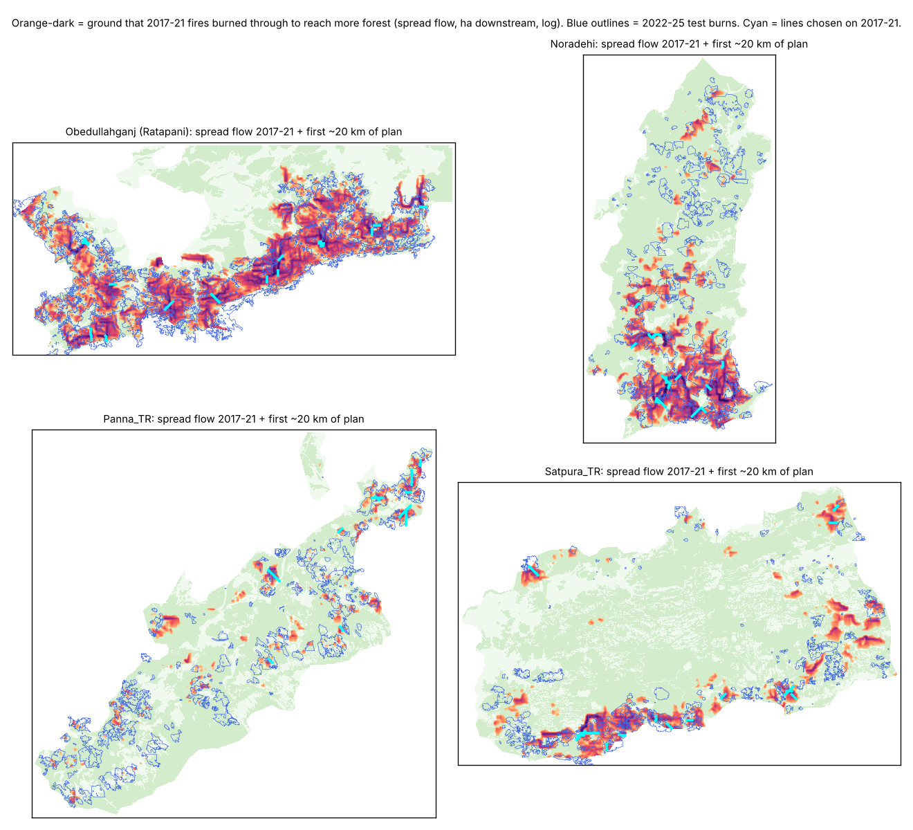
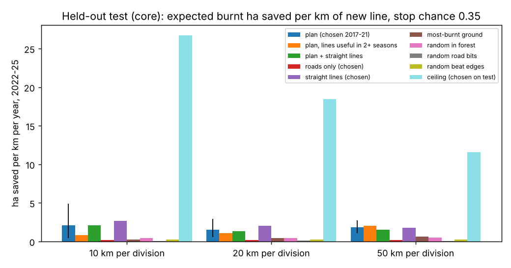
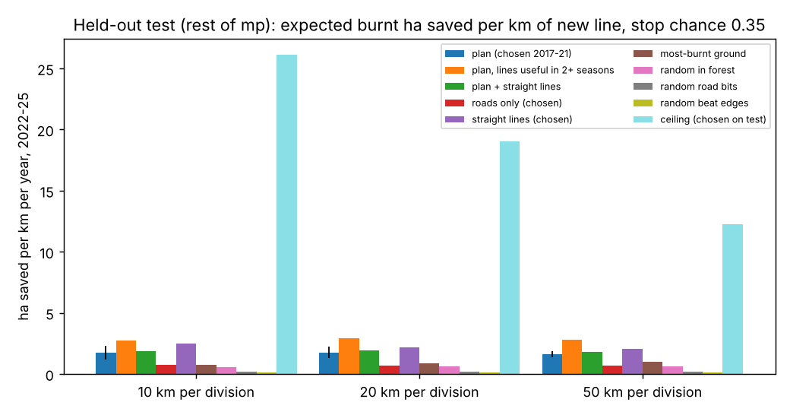
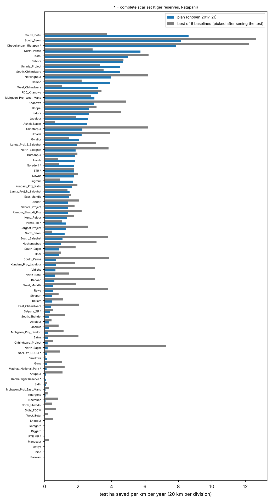

# Where to cut new fire lines: a held-out test (scouting round 25, 18 Oct 2026)

**Question.** Before the season, where should new fire lines (cleared breaks, about 10-20 m wide) be cut so they stop the most burnt forest? We want a ranked plan for each division, tested on seasons it never saw.

**Short answer.**
- **Choosing line positions from past fire paths does beat chance, but the gain is small.** Lines chosen on 2017-21 saved about **1.5-1.7 ha per km per year** in the 2022-25 test seasons. Random lines in forest saved about **0.5-0.6**, and lines along existing roads or beat edges saved about **0.1-0.2**.
- **Absolute effect: 20 km of new line per division would have stopped about 0.3% of the burnt area.** Even perfect hindsight (lines picked on the test fires themselves) reaches only about 4%. On their own, passive lines cannot stop much of the burning.
- **The training numbers are about 14 times too optimistic.** The same lines "saved" 22-24 ha/km/yr on the fires they were chosen on. Most fire paths do not repeat: only 38% of chosen lines cut off any ground in 2022-25, and only 10% did so in two or more test seasons.
- **Within single divisions the result is noise.** At 20 km per division, the plan beat random forest lines in 6 of 9 tiger reserve/Ratapani divisions and in 50 of 73 other divisions. Only 2 of those 82 divisions show a gain whose 95% range clears zero.
- **Straight lines chosen the same way do as well as or better than lines along terrain or features.** What matters is *where* a line goes, not what feature it follows.
- **Not following existing roads is a finding in itself.** Fronts already stop at roads (3.3x odds), so most past scars end at a road. Upgrading a road protects little ground that a road is not already protecting.

Code: `code/fire_lines/` (`f1`-`f5`, `run_all.sh`). Tables, maps and lines: `code/fire_lines/out/`. Large intermediates are in scratch r25 only.

**Tags.**
- DATA = computed here.
- **[inference]** = my reasoning.

---

## 1. Which scars each number uses

| set | divisions | fires (chained from daily events) | train seasons | test seasons | outlines |
|---|---|---|---|---|---|
| **Complete** ("core") | 8 tiger reserves (BTR, Kanha, Pench, Panna, Satpura, Sanjay-Dubri, Noradehi, Madhav) + Ratapani (Obedullahganj) | 9,287 fires, 4,318 in test | 2017-21 | 2022-25 | Tiger reserves: all events 2017-25 (`tiger_reserve_scars.geojson`, 3 km chips drawn before the edge fix). Ratapani: scar outlines v2 (2026-10-16). |
| **Rest of MP** (statewide history, partly built) | 73 other divisions | 71,295 fires, 38,994 in test | only seasons ≥95% finished: 2019-21 (2018 in one division) | 2022-25 | `read_hist_geom()` on 18 Oct, about 20:00 IST. 130,450 of 153,817 events finished (85%). 2019-25 are 100% done, 2018 is 70%, 2017 is 0%. |

- Every number below names its set. "Core" numbers are the trustworthy ones.
- The rest-of-MP numbers come from that file as it stood on 18 Oct. `run_all.sh` reruns everything unchanged once the history is finished. Each division then picks up 2017 and 2018 by itself: a season is used once it is ≥95% done (`coverage_rest.csv`).
- Burnt area is the sum over fires. Fires in the same division and season overlap on only 2-8% of their ground, so the double count is small.
- Statewide training is 2019-21 against 2017-21 for core, which is fewer seasons. The scar key 2022-25 was not needed: test seasons are complete in both sets.

## 2. Method (plain)

1. **Fires.**
   - Daily scar events are chained into one fire when their outlines touch (within 60 m) and their dates are at most 4 days apart.
   - The fire's footprint is the union of the chained outlines on a 60 m grid (the VTM land-cover grid, UTM 43N).
   - **Start** = the first VIIRS look, meaning the dots within 2 h of the earliest overpass. The cells within 400 m of those dots are the start cells.
2. **Fire path picture.**
   - Inside each training fire's footprint, a shortest-path tree runs out from the start.
   - Each cell gets the hectares that burned "beyond" it, meaning the ground that fire could only reach by passing through that cell.
   - Adding this up over all training fires gives a **spread-flow map**. Dark ribbons on the map are corridors that many past fires ran through to reach more forest (map below).
3. **Candidate lines.** Each candidate is cut into 1, 2 and 4 km pieces, every 0.5 km. A piece is kept only if it is at least 60% forest and at least 80% inside the division. Candidates come from:
   - existing Overture roads and tracks;
   - beat boundaries;
   - valley lines (more than 1 km² draining in) and ridge lines (the same rule on the flipped surface);
   - "necks": straight 1-3 km lines in 4 directions through peaks of the training flow map.
   - Baselines: a straight 2 km lattice in 4 directions every 2 km, and 3,000 random 2 km lines in forest.
4. **Benefit of a line for one past fire.**
   - Remove the line's cells and let the fire spread again from its start, only inside its own footprint, cell to neighbouring cell.
   - The cells it can no longer reach are the **ground the line would have protected**.
   - That ground is multiplied by the **chance the line actually stops the front**. Several lines: a cell is saved unless every line cutting it off fails.
5. **Stop chance = 0.35.**
   - A front in tree cover stops within 100 m about 15% of the time. A road within 40 m raises the odds 3.3x (README "Where fronts stop"). That gives (0.176 × 3.3) / (1 + 0.176 × 3.3) ≈ **37%**.
   - The 95% range of the odds (2.2-4.6x) gives 28-45%. Results are also shown at 0.20 and 0.50.
   - Nothing assumes a line always holds.
6. **Choosing.**
   - Greedy choice: each step adds the line with the most extra hectares saved per km. A line may overlap lines already chosen by at most 20%.
   - Lines are chosen on training seasons only, then scored on 2022-25 at the same km (10, 20 and 50 km per division).
   - Baselines: roads only (chosen the same way), the straight lattice (chosen the same way), the most-burnt ground (lines crossing the most training burns, no cut logic), and random forest lines, random road pieces and random beat-edge pieces (200 draws each).
   - Ceiling: lines chosen on the test fires themselves.
   - 95% ranges come from resampling whole test fires within each division (1,000 times). Differences are paired.

## 3. Held-out result (test 2022-25, ha saved per km of line per year, stop chance 0.35) - DATA

**Core (complete scars), 9 divisions, 85,200 ha burnt per test year.**

| km per division | plan (chosen 2017-21) | 95% range | roads only | straight lines (chosen) | most-burnt ground | random forest | random road | random beat edge | ceiling | plan, % of test burnt ha | plan on training fires |
|---|---|---|---|---|---|---|---|---|---|---|---|
| 10 | **2.1** | 0.5-4.9 | 0.22 | 2.7 | 0.25 | 0.45 | 0.09 | 0.28 | 26.7 | 0.22% | 30.4 |
| 20 | **1.5** | 0.6-2.9 | 0.17 | 2.1 | 0.42 | 0.47 | 0.11 | 0.25 | 18.5 | 0.33% | 22.2 |
| 50 | **1.8** | 1.1-2.8 | 0.16 | 1.8 | 0.64 | 0.48 | 0.09 | 0.27 | 11.6 | 0.98% | 14.5 |

**Rest of MP (partial history: train 2019-21), 73 divisions, 709,500 ha burnt per test year.**

| km per division | plan | 95% range | roads only | straight lines (chosen) | most-burnt ground | random forest | random road | random beat edge | ceiling | plan, % of test burnt ha | plan on training fires |
|---|---|---|---|---|---|---|---|---|---|---|---|
| 10 | **1.7** | 1.2-2.3 | 0.78 | 2.5 | 0.73 | 0.59 | 0.18 | 0.14 | 26.1 | 0.16% | 34.0 |
| 20 | **1.7** | 1.3-2.2 | 0.68 | 2.2 | 0.84 | 0.60 | 0.18 | 0.14 | 19.0 | 0.33% | 23.7 |
| 50 | **1.6** | 1.4-1.9 | 0.69 | 2.0 | 0.99 | 0.60 | 0.18 | 0.14 | 12.2 | 0.74% | 14.6 |

**Plan minus baseline at 20 km per division** (ha/km/yr, paired 95% range).

| baseline | core | rest of MP |
|---|---|---|
| random forest lines | +1.0 (0.1 to 2.4) | +1.1 (0.7 to 1.6) |
| random road pieces | +1.4 (0.5 to 2.8) | +1.6 (1.1 to 2.1) |
| random beat-edge pieces | +1.3 (0.3 to 2.6) | +1.6 (1.2 to 2.1) |
| roads only (chosen) | +1.3 (0.4 to 2.7) | +1.0 (0.6 to 1.5) |
| most-burnt ground | +1.1 (0.2 to 2.5) | +0.9 (0.5 to 1.3) |
| straight lines (chosen) | **-0.6 (-1.7 to 0.3)** | **-0.4 (-0.9 to 0.0)** |

**What the tables say.**
- The plan beats every untrained or road/beat baseline in both sets. But it does not beat straight lines placed by the same greedy logic.
- The skill is in **placing a line across a corridor that past fires ran through**. The line type does not matter. In the working list, 52% of the lines are "neck" lines and 28% are beat edges.
- **Lines through the most-burnt ground do poorly.** A line inside a burn patch does not cut it off: the fire goes round.
- **Plan variant "lines that cut ground in 2+ training seasons."** Rest of MP: 2.9 ha/km/yr at 20 km, better than the plan. Core: 1.1, worse than the plan. Not a clear winner.

### Stability
- **By test year, 20 km per division (ha/km/yr):**

| | 2022 | 2023 | 2024 | 2025 |
|---|---|---|---|---|
| core, plan | 1.05 | 0.44 | 0.73 | 3.77 |
| core, random forest | 0.81 | 0.21 | 0.21 | 0.64 |
| rest, plan | 2.69 | 0.77 | 1.45 | 1.87 |
| rest, random forest | 1.06 | 0.27 | 0.23 | 0.87 |

  The plan beats random every year, but its size swings 4-8x between years.
- **Do the same places pay again?** Compare each candidate's benefit in training with its benefit in test. Spearman rank correlation: median **0.40** (core) and **0.33** (rest).
- **Stop chance.** At 20 km, the plan gives 0.86 / 1.50 / 2.12 (core) and 1.0 / 1.7 / 2.4 (rest) ha/km/yr at stop chances 0.20 / 0.35 / 0.50. The ranking does not change.
- **Conservative start rule.** Count every new front (a dot more than 750 m from all earlier dots) as its own start. The plan then drops to **0.80** (core) and **0.37** (rest) ha/km/yr. Some of the "protected" ground in the main numbers may have been reached by a separate start or a spot fire, not by crossing the line.

## 4. Per division (20 km of line, test 2022-25) - DATA

**Core.**

| division | test fires | burnt ha (4 yrs) | plan ha/km/yr | 95% range | straight (chosen) | random forest | ceiling | plan, % of burnt ha |
|---|---|---|---|---|---|---|---|---|
| Obedullahganj (Ratapani) | 1,061 | 125,580 | **7.9** | 1.3-19.6 | 12.2 | 2.4 | 70.6 | 0.53% |
| Noradehi | 304 | 42,382 | **1.8** | 0.0-4.7 | 0.9 | 0.5 | 31.0 | 0.37% |
| BTR | 972 | 51,189 | **1.8** | 0.3-3.8 | 1.7 | 0.5 | 27.5 | 0.29% |
| Panna TR | 384 | 40,389 | **1.3** | 0.0-3.6 | 1.0 | 0.2 | 11.0 | 0.28% |
| Satpura TR | 203 | 19,899 | 0.3 | 0.0-0.9 | 0.5 | 0.1 | 7.1 | 0.13% |
| Sanjay-Dubri | 736 | 35,559 | 0.2 | 0.0-0.4 | 0.9 | 0.2 | 7.8 | 0.04% |
| Madhav NP | 62 | 9,823 | 0.1 | 0.0-0.3 | 1.2 | 0.3 | 6.4 | 0.11% |
| Kanha TR | 476 | 12,392 | 0.1 | 0.0-0.2 | 0.0 | 0.0 | 1.5 | 0.06% |
| Pench (PTR MP) | 120 | 3,671 | 0.0 | 0.0-0.0 | 0.0 | 0.0 | 0.8 | 0.00% |

**Rest of MP, the 8 highest** (all 73 are in `out/division_table.csv`).

| division | test fires | burnt ha (4 yrs) | plan ha/km/yr | 95% range | straight (chosen) | random forest |
|---|---|---|---|---|---|---|
| South Betul | 513 | 46,856 | 8.6 | 0.1-24.7 | 3.7 | 0.8 |
| South Seoni | 729 | 71,866 | 8.1 | 0.1-22.9 | 12.7 | 2.3 |
| North Panna | 302 | 40,080 | 5.7 | 0.3-13.6 | 2.9 | 0.8 |
| Katni | 386 | 51,319 | 5.0 | 0.1-13.6 | 6.2 | 0.7 |
| Sehore | 1,264 | 104,060 | 4.7 | 0.6-13.7 | 4.7 | 1.9 |
| Umaria Project | 351 | 23,158 | 4.5 | 0.9-9.5 | 3.3 | 1.4 |
| South Chhindwara | 1,063 | 82,175 | 4.5 | 0.9-9.0 | 3.5 | 1.3 |
| Narsinghpur | 1,011 | 87,432 | 4.0 | 1.0-8.5 | 6.2 | 1.1 |

- **Where lines pay at all:** divisions with large fires that run through narrow forest necks, such as Ratapani, Noradehi, BTR and Panna.
- **Where they pay nothing:** Kanha, Pench and Madhav, whose fires are many and small. There is nothing beyond a line to protect.
- [inference] In those three divisions, line money is better spent elsewhere.

## 5. Maps and figures

*Orange-dark = corridors that 2017-21 fires burned through to reach more forest. Blue = 2022-25 burns. Cyan = lines chosen on 2017-21. In Panna, most test burns fell in the south-west, away from the training corridors. That is the year-to-year instability in one picture.*

## 6. The plan: lines per division (`code/fire_lines/out/top_fire_lines.geojson`, 2.5 MB)

The file holds two sets of lines.
- **`chosen_on = "all seasons ..."`: the working list.**
  - Same method, re-run on every usable season (2017-25 core; 2019-25 for most of the rest).
  - First ~50 km per division, ranked (2,658 lines, 3,872 km).
  - Fields:
    - `rank`, `kind`, `km`, `cum_km`;
    - `hist_ha_saved_per_yr`: in-sample, **expect about 1/14 of this**;
    - `seasons_cut`: how many past seasons the line would have cut ground. 55% of lines have 2 or more; prefer those;
    - `heldout_div_ha_per_km_yr`: the honest held-out value for that division at 20 km.
- **`chosen_on = "2017-21 (tested)"`: the lines that were actually tested** (first ~20 km per division), with their own `test_ha_saved_per_yr`.

**How to use it** [inference]:
1. Spend line-cutting effort first in divisions with the highest held-out values:
   - core: Ratapani, BTR, Noradehi, Panna;
   - rest: South Betul, South Seoni, North Panna, Katni, Sehore, Umaria Project, South Chhindwara, Narsinghpur.
   - None of these is certain on its own. Only Umaria Project, South Chhindwara and Narsinghpur have a 95% lower bound near 1 ha/km/yr.
2. Within a division, take lines in rank order and prefer `seasons_cut` ≥ 2. Stop around 10-20 km, since the extra gain per km falls after that.
3. Treat the ranking as a shortlist for a ground check, not as a design.
   - A 60 m grid cannot tell where a 15 m line can actually be cut.
   - "Neck" lines are straight sketches across a corridor. Bend them onto the nearest ridge, nala or compartment edge on the ground.
4. Do not expect upgrading existing roads to cut much burnt area. Fronts already stop there.
5. Past scars do not support passive lines as a way to cut burnt area by more than about 1%.
   - Lines likely earn their keep mainly as anchors for crews and for early (managed) burning.
   - This round could not test that use.

## 7. Caveats
- **Coverage.**
  - Core numbers use complete scar sets. Rest-of-MP numbers use the history as built on 18 Oct (2017 missing, 2018 70%), so training there is only 2019-21.
  - Tiger-reserve outlines were drawn on 3 km chips before the v2 edge fix. Large single-day burns there can be cut at the chip edge, which understates big fires and so understates line benefit.
- **Suppression.** Past fires that crews stopped are scars that already ended. A new line there would add little. The method credits a line only with ground that actually burned.
- **Fire stays inside its footprint.** A line is credited only if, inside the historical outline, it cuts ground off from the start. A real fire could flank round through ground that did not burn that time. This makes the benefits optimistic.
- **Spotting and second starts.** Fronts can jump a 10-20 m line, and the stop chance (0.35) is borrowed from roads. Counting every new front as its own start halves the core benefit and cuts the rest-of-MP benefit by about 80%.
- **Start position.** VIIRS dots are ±375 m. The start cells are those within 400 m of the first look.
- **Maintenance.** A line works only if it is cleared before the season every year. A grown-over line is not a line.
- **Greedy limits.** Two lines that only work together are not found unless one of them already pays alone. With 4 km pieces this rarely matters.
- **Grid.** The 60 m grid is UTM 43N for all of MP. Scale error in the far east is under 1% in length.

## 8. Files
- Code (`ratapani/fsi/scouting/code/fire_lines/`):
  - `common.py`, `fl_lib.py` (numba kernels);
  - `f1_fires.py` (chain events into fires; `core` / `rest`);
  - `f2_candidates.py` (layers and candidate lines);
  - `f3_select.py` (benefit, selection, held-out test);
  - `f4_report.py` (tables, bootstrap, figures);
  - `f5_final.py` (working list and geojson);
  - `run_all.sh` (full rerun, about 1.5 h).
- Outputs (`code/fire_lines/out/`): `division_table.csv`, `summary_tables.json`, `top_fire_lines.geojson`, `fig_*.png`.
- Scratch (`r25/`): fires, candidates, layers and per-division selections.
