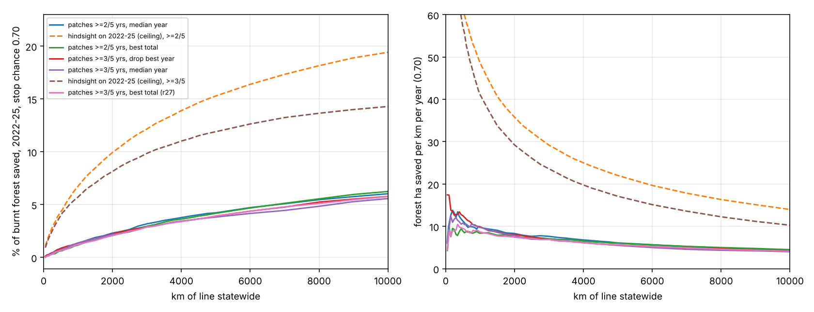
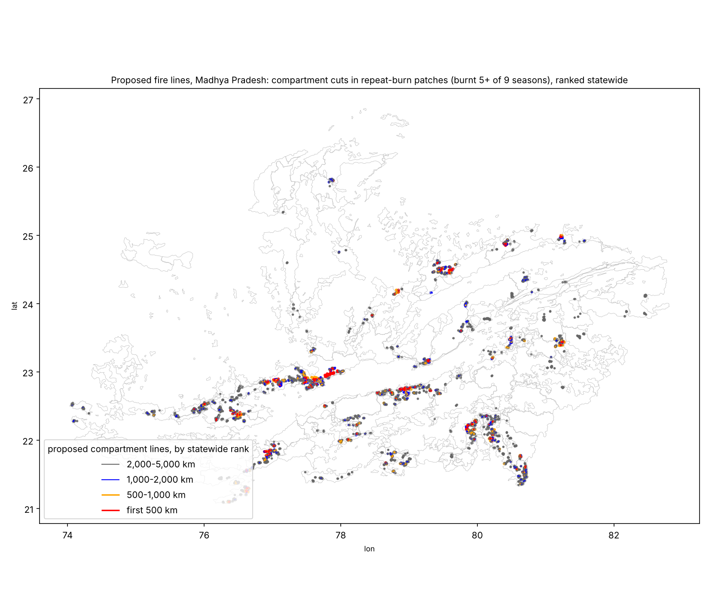
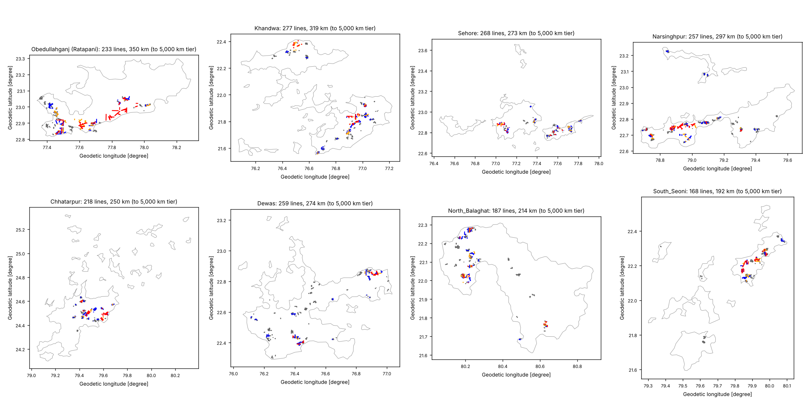
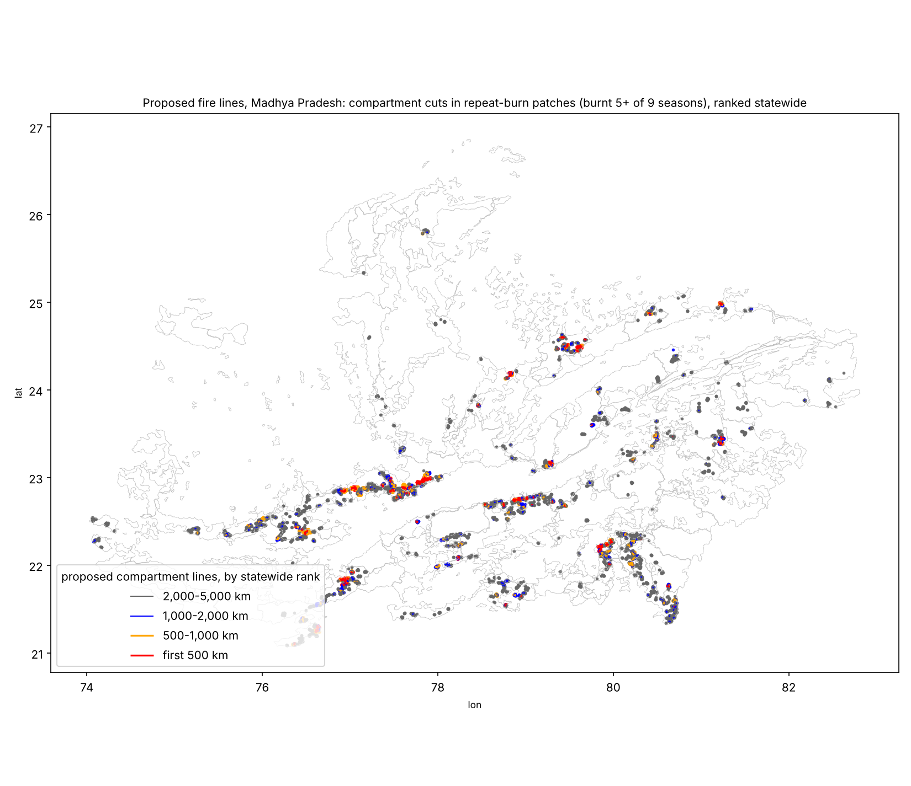
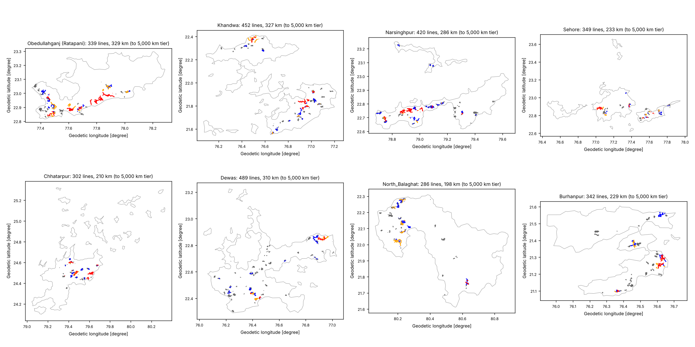

# Fire lines, second look: how much forest can lines really save, and what saves more (scouting round 28, 19 Oct 2026)

**Akkshay's ask (verbatim).** "not satisfied i know the we can find a way by creating new firelines and save much more forest not just what u showing . apply your full brains and knowledge . do it seriously"

**What I did.** Went back to first principles: what a line can physically save, where the burning actually is, what chance a line has of holding, and how to choose lines so they pay in most years rather than one. Then re-tested everything held out (chosen on 2017-21, scored on 2022-25, 82 divisions, 93,116 fires, scar outlines clipped to forest). The scoring rule is the round-27 one (each fire spreads again from its start inside its own outline; each line crossing is stopped with chance p).

**Short answer.**
1. **Round 27 under-sold lines by about 2x, because its stop chance was too low.** It used p = 0.35, taken from "a road within 40 m" in Ratapani. The spread thread measured how often a fire that *reaches* a line actually holds: OSM roads 0.69 (0.78 for fires that started more than 1 km away), railway 0.75, big streams 0.72-0.83 (`spread/README.md` 4m). A cleared, maintained line is at least a road. At **p = 0.70** the same 500 km of cuts saves **9.5 forest ha per km per year**, not 5.2.
2. **Choosing cuts that pay in most years, not the ones with the best five-year total, adds another ~35% at realistic budgets.** Objective "drop the best year" (mean of the other four): held out, 500 km saves **7.0 forest ha/km/yr at p 0.35 (12.5 at p 0.70)** against 5.2 (9.5) for round 27. 84-89% of the patches cut then save something in 2022-25, against 66-71% before. The gain fades above ~2,000 km, where both methods take nearly every patch anyway.
3. **Scale is the real limit, not cleverness.** Statewide, 720,000 ha of forest burns per year. A line only saves the ground beyond it in fires that cross it. Held out at p 0.70: **1,000 km saves 1.4% of burnt forest, 2,000 km 2.2%, 5,000 km 3.9%, and every cut in every repeat patch (19,000 km) about 8%.** The hindsight ceiling (cuts chosen on the 2022-25 fires themselves) is 5.7-6.7% at 1,000 km and 12-15% at 5,000 km, so even perfect foresight of the fire paths would not take 5,000 km past about a seventh of the burning. There is no placement trick that turns 500 km into 10%: the per-km return falls with every km because the best patches are few.
4. **The burning is concentrated, and we know where.** The 10% of 5 km squares that burnt most in 2017-21 (19% of forest) held **51% of the forest burnt in 2022-25 and 72% of the big-fire (>= 500 ha) burning**; the top 2% of squares burn **34% of their forest every year**. Rank correlation between periods is 0.84. So a statewide programme should go to about 150-750 squares, not be spread per division.
5. **The strongest "line" is a burnt block, and it beats cut lines per unit of effort.** Fires that start inside the repeat patches (4.8% of forest) burn **135,000 forest ha a year, 19% of all burnt forest: 78,000 inside the patches and 57,000 outside them** (2022-25, held out). A patch burnt early and cool in February cannot carry a March fire, so an early burn of the patch removes both the hot-season burn inside and the fire's run outside. Held out, **every 100 ha of repeat patch burnt early stops about 18-19 ha of forest outside the patch each year**, flat across budgets: 25,000 ha treated stops 4,700 ha outside (0.65% of burnt forest) and turns 2,700 ha of hot-season burn into a cool one; 100,000 ha treated stops 19,000 ha (2.6%) and converts 16,000 ha; all 416,000 ha stops 63,000 ha (8.8%) and converts 72,000 ha. This assumes the ignition does not simply move next door, which nobody has measured; read it as the upper bound.
6. **Widening the candidate set to patches burnt in 2 of 5 years (tr2, 7,600 km more of candidates) changes little.** With the median-year objective it saves 11.2 forest ha/km/yr at 500 km and 6.1 at 5,000 km (p 0.70), against 12.5 and 5.6 from the 3-of-5 patches with the drop-best-year objective. The bigger patches help only above ~2,000 km, by about 0.3 points of burnt forest at 5,000 km (4.2% against 3.9%). The patches are not the bottleneck; knowing which of them will burn next is.

**What this means for "save much more forest".** Lines in repeat patches, chosen the robust way and built to road standard, are worth about **10-12 forest ha per km per year** at the first 1,000 km and 5-6 at 5,000 km. To save a tenth of MP's burnt forest with cut lines alone would take more than 20,000 km in the right places; the repeat patches do not hold enough of the burning for less. The route to a large saving is (a) early burning of the repeat patches, which attacks the 19% of burnt forest that starts in them, plus (b) compartment lines in the patches that are not burnt early, plus (c) detection and suppression for the other 80%, which starts in places that change from year to year (only 45% of the squares with a big fire in 2017-21 had one in 2022-25, against 8% of all squares).

**Tags.** DATA = computed here. **[inference]** = my reasoning.

Code: `code/fire_lines_v2/` (`m0`-`m7`). The proposed lines themselves: section 8 (straight, superseded) and section 9 (practical, following terrain). Tables: `code/fire_lines_v2/out/`. Figures: `figs_r28/`. Big intermediates: scratch r28.

---

## 1. Where the burning is (DATA, `m1_sizes.py`, `out/m1_sizes.json`)

**Fire sizes, 2017-25, 93,116 fires, 796,000 forest ha per year.**

| fire size (forest ha) | fires per year | share of fires | share of burnt forest |
|---|---|---|---|
| under 10 | 2,718 | 26% | 1.6% |
| 10-50 | 4,434 | 43% | 13.7% |
| 50-100 | 1,401 | 14% | 12.4% |
| 100-200 | 892 | 9% | 15.7% |
| 200-500 | 621 | 6% | 24.0% |
| 500-1,000 | 202 | 2% | 17.3% |
| 1,000 and over | 77 | 0.7% | 15.3% |

- Fires of 200 ha and more are 8% of fires but 57% of burnt forest. A line pays when it cuts one of these, not the thousands of 20 ha fires. The share in fires of 500 ha+ is 32-40% in the big years (2017, 2018, 2021, 2022) and 14-19% in the quiet years (2020, 2023, 2024).

**5 km squares (7,573 squares with forest; ranked on 2017-21, scored on 2022-25).**

| top squares by 2017-21 burning | squares | share of forest | share of 2022-25 burnt forest | share of 2022-25 big-fire (500 ha+) burning | forest burnt per year in these squares |
|---|---|---|---|---|---|
| top 2% | 152 | 4.1% | 17% | 29% | 34% |
| top 5% | 379 | 10.0% | 34% | 55% | 28% |
| top 10% | 758 | 18.7% | 51% | 72% | 22% |
| top 20% | 1,515 | 34.3% | 73% | 89% | 18% |

- The statewide average is 8.2% of forest burnt per year. The top 2% of squares burn 34% of their forest every year.
- Rank correlation of square burning between 2017-21 and 2022-25: 0.84 (all fires), 0.51 (big fires only).
- Big fires move about: 872 squares had a 500 ha+ fire in 2017-21; 45% of them had one again in 2022-25 (8% of all squares did). But those 872 squares still held 73% of the 2022-25 big-fire burning.

**Repeat patches as fire sources (tr3 = cells burnt in 3+ of 5 seasons 2017-21; 3,867 patches, 416,000 forest ha = 4.8% of forest).**

| 2022-25, per year | fires | forest ha burnt | of which inside the patches | outside the patches |
|---|---|---|---|---|
| fires that start inside a patch | 1,130 | 135,200 (18.7% of burnt forest) | 78,200 | 57,000 (7.9%) |
| fires that start outside and enter a patch | 1,788 | 284,900 | 65,700 | 219,200 |
| all fires touching a patch | | 58% of burnt forest | 143,900 | |

- [inference] The patches are both where fires start and where big fires pass. Compartment cuts act on the first group; a ring would act on the second, but round 27 showed rings hold little because entering fires are already large and come from any side.

## 2. Stop chance: 0.35 was the wrong number for a built line (DATA from the spread thread)

- Round 25 derived p = 0.35 from Ratapani fronts: a front in tree cover stops within 100 m 15% of the time; a road within 40 m raises the odds 3.3x. That is the effect of *any* road near a front, most of them unmaintained tracks with litter on them.
- The spread thread (`spread/README.md` section 4m, 3,640 Ratapani event scars) measured, per line type, how often a fire that reaches the line is held by it, against the same lines shifted 300-1,000 m:

| line | holds, all fires | holds, fires that started > 1 km away |
|---|---|---|
| OSM-mapped roads | 0.69 | 0.78 |
| railway | 0.75 | 0.76 |
| roads 10 m or wider | 0.47 | 0.68 |
| streams, catchment >= 25 km2 | 0.72 | 0.83 |
| streams 5-25 km2 | 0.45 | 0.56 |
| ridges, power lines | 0.00-0.13 | |

- A line cut and cleaned before the season, 10-20 m wide, is at least an OSM road. **p = 0.70 is the honest central value for a built and maintained line**; 0.35 is what an unmaintained track does. Every result below is given at both, and at 1.0 as the bound.
- [inference] A line that is also burnt out (a black strip) is better than a road: a surface litter fire has nothing to carry it across. Spread-thread physics found "ground burnt earlier this season as no fuel" the one barrier rule that improved its forecasts (+0.024). I have no direct measurement of a burnt strip's hold rate; treat it as 0.7-1.0.

## 3. Choosing cuts that pay in most years (DATA, `m2_cuts.py`, `m3_score.py`)

Same patches, candidates, validity rule and greedy as round 27 (`code/compartments/k1_cuts.py`), with the objective changed:
- **sum** (round 27): mean over the five training years of patch forest saved per km.
- **median year**: the median of the five yearly savings. A cut must pay in three years to count.
- **drop best year**: the mean of the four years after dropping the best one. One big fire cannot carry a cut.
Statewide allocation as before (greedy knapsack on each patch's upper concave hull, one lambda). Held out on 2022-25, 95% ranges from resampling test fires within divisions (1,000 draws).

**Held-out saving, forest ha per km of line per year (`out/m4_tables.md`, `out/m3_curve_*.csv`).**

| budget | objective | patches | patch forest p .35 (95%) | forest p .35 | **forest p .70** | % of burnt forest p .35 / **.70** / 1.0 | in-sample patch ha/km/yr | patches that saved anything held out |
|---|---|---|---|---|---|---|---|---|
| 500 km | sum (r27) | 151 | 3.1 (2.1-4.4) | 5.2 | **9.5** | 0.36 / **0.66** / 0.88 | 30 | 66% |
| | median year | 85 | 3.7 (2.7-4.9) | 5.9 | **10.8** | 0.41 / **0.75** / 1.00 | 20 | 86% |
| | **drop best year** | 77 | **4.7 (3.3-6.4)** | **7.0** | **12.5** | 0.49 / **0.87** / 1.15 | 25 | 84% |
| 1,000 km | sum (r27) | 245 | 3.0 (2.3-3.8) | 4.8 | 8.7 | 0.66 / 1.20 / 1.59 | 23 | 71% |
| | median year | 143 | 3.5 (2.8-4.4) | 5.5 | 9.8 | 0.76 / 1.36 / 1.76 | 16 | 87% |
| | **drop best year** | 131 | **3.7 (2.9-4.7)** | **5.7** | **9.9** | 0.79 / **1.38** / 1.76 | 20 | 89% |
| 2,000 km | sum (r27) | 399 | 2.6 (2.2-3.1) | 4.3 | 7.5 | 1.19 / 2.08 / 2.70 | 17 | 68% |
| | drop best year | 242 | 2.9 (2.4-3.5) | 4.7 | 8.1 | 1.30 / 2.24 / 2.87 | 15 | 83% |
| 5,000 km | sum (r27) | 950 | 1.9 (1.6-2.1) | 3.3 | 5.6 | 2.30 / 3.92 / 5.00 | 10 | 68% |
| | drop best year | 645 | 2.0 (1.7-2.2) | 3.3 | 5.6 | 2.31 / 3.91 / 4.95 | 9 | 79% |

- The robust objective gets the same saving from fewer, surer patches: at 500 km, 77 patches instead of 151, and 84% of them pay held out instead of 66%. The in-sample figure drops (25 against 30), which is the point: it over-promises less (5x instead of 10x).
- Per division at 1,000 km, drop-best-year, p 0.70 (`out/m3_div_tr3_lo.csv`): Ratapani 117 km saves 1,710 forest ha/yr (14.6 per km, 5.8% of the division's burnt forest); Khandwa 142 km, 1,630 ha (11.5/km, 4.4%); Chhatarpur 50 km, 810 ha (16/km, 4.1%); Burhanpur 96 km, 760 ha (7.8/km, 4.5%); Narsinghpur 65 km, 700 ha (10.7/km, 3.5%); South Seoni 46 km, 520 ha (11.3/km); South Balaghat 35 km, 500 ha (14.1/km); Indore 25 km, 440 ha (17.3/km). At 2,000 km Ratapani reaches 8.4% of its burnt forest and Indore 7.6%.
- By test year (patch forest ha saved, 500 km, p 0.35), drop-best-year against round 27: 2022 4,495 vs 3,371; 2023 697 vs 221; 2024 1,158 vs 580; 2025 2,991 vs 2,058. The robust choice wins in every year, and by 2-3x in the quiet years, which is what it was built for.

*Left: % of 2022-25 burnt forest saved against km of line statewide, at p 0.70. Right: forest ha saved per km per year. Dashed: hindsight ceiling.*

## 4. Hindsight ceiling and the wider patch set

**Hindsight ceiling (`obj = oracle`: cuts chosen on the 2022-25 fires themselves and scored on them; the most any placement could get).**

| budget | patch set | forest ha/km/yr p .35 | **p .70** | % of burnt forest p .35 / **.70** / 1.0 | our robust plan, % at p .70 | gap |
|---|---|---|---|---|---|---|
| 500 km | 3 of 5 | 35.6 | **57.1** | 2.5 / **4.0** / 4.8 | 0.87 | 4.5x |
| | 2 of 5 | 40.5 | **62.5** | 2.8 / **4.3** / 5.1 | 0.78 | 5.5x |
| 1,000 km | 3 of 5 | 26.5 | **41.1** | 3.7 / **5.7** / 6.8 | 1.38 | 4.1x |
| | 2 of 5 | 31.5 | **48.6** | 4.4 / **6.7** / 8.0 | 1.34 | 5.0x |
| 2,000 km | 3 of 5 | 19.3 | **29.2** | 5.4 / **8.1** / 9.6 | 2.24 | 3.6x |
| | 2 of 5 | 23.6 | **35.8** | 6.6 / **9.9** / 11.7 | 2.30 | 4.3x |
| 5,000 km | 3 of 5 | 11.6 | **17.1** | 8.1 / **11.9** / 13.8 | 3.91 | 3.0x |
| | 2 of 5 | 15.0 | **22.0** | 10.4 / **15.3** / 17.7 | 4.22 | 3.6x |

- Two readings. (a) **Even perfect foresight of where the next four seasons' fires run gets 5,000 km of line to 12-15% of burnt forest, and 1,000 km to 6-7%.** That is the physical limit of cut lines in repeat patches: fires are many, mostly small, and spread out. (b) **Our forward plan sits 3-5x below that ceiling**, because 2017-21 only half-predicts where 2022-25 fires will run inside a patch (the robust objective closed part of that gap: round 27 was 6-7x below). The rest of the gap is the limit of foresight, not of the algorithm [inference]: the same limit the 'where' model meets (held-out top-10% map catches 44% of brand-new fires).

**Wider patch set (tr2 = cells burnt in 2 or more of 5 seasons; 16,000-34,000 km of candidate cuts against 11,500-19,000).**

| budget | 3 of 5, drop best year | 3 of 5, median | 2 of 5, median | 2 of 5, best total |
|---|---|---|---|---|
| forest ha/km/yr at p .70, 500 km | **12.5** | 10.8 | 11.2 | 8.9 |
| 1,000 km | **9.9** | 9.8 | 9.8 | 8.4 |
| 2,000 km | 8.1 | 7.8 | **8.3** | 7.5 |
| 5,000 km | 5.6 | 5.5 | **6.1** | 6.0 |
| % of burnt forest at 5,000 km, p .70 | 3.9 | 3.8 | **4.2** | 4.2 |

- More candidates do not raise the per-km return at small budgets; they add a little at 5,000 km. The robust objective matters more than the patch set.

## 5. Early burning of repeat patches as the strongest line (DATA, `m5_blockburn.py`, `out/m5_curve.csv`, `out/m5_patches.csv`)

Per tr3 patch: fires that started inside it (most start cells in the patch), the forest they burnt inside and outside the patch. Patches ranked on their 2017-21 outside-burn per patch ha, scored on 2022-25.

| repeat-patch forest burnt early (ha) | patches | forest outside stopped per year (held out) | % of burnt forest | hot-season burn inside converted to a cool burn (ha/yr) | outside ha stopped per 100 ha treated |
|---|---|---|---|---|---|
| 5,000 | 97 | 990 | 0.14 | 420 | 20 |
| 10,000 | 155 | 1,860 | 0.26 | 1,060 | 19 |
| 25,000 | 315 | 4,690 | 0.65 | 2,740 | 19 |
| 50,000 | 475 | 8,880 | 1.24 | 6,110 | 18 |
| 100,000 | 731 | 18,970 | 2.64 | 15,930 | 19 |
| 200,000 | 1,159 | 35,310 | 4.91 | 36,160 | 18 |
| all 416,000 | 3,867 | 63,380 | 8.82 | 71,830 | 15 |

- The leverage is flat at 18-20 outside ha per 100 ha treated: the 2017-21 ranking of patches barely predicts which ones will throw fires outward in 2022-25 (in-sample 350 per 100 ha for the top 5,000 ha; held out 20). Choose patches by size and access, not by a league table.
- Compared with cut lines: 100,000 ha of early burning stops about 19,000 ha a year outside the patches and converts 16,000 inside; 5,000 km of robust cut lines at p 0.70 saves about 28,000 ha. Which is cheaper per hectare depends on crew costs I do not have; a 100 ha patch burn and 1-2 km of cut line are of the same order of crew-days [inference].
- Caveats. (i) If the people who light fires in a patch simply light the next patch, the outside saving is smaller; nothing here measures that. (ii) An early cool burn still burns the patch; the gain inside is in severity, not area. (iii) Control burning is tagged officials-only, February only, in the live system; the same calendar applies here.

## 6. What I would now put to the department (ranked)

1. **Early burning of the repeat patches in the top squares, in February**: start with the 150 patches in the top 2% of squares. This is the only measure here that attacks the fires at their source, and the one with a flat, dependable return.
2. **Compartment cuts, robust choice, built to road standard (p >= 0.7), 1,000-2,000 km statewide**, concentrated in Ratapani, Khandwa, Chhatarpur, Burhanpur, Narsinghpur, South Seoni, South Balaghat and Indore. Expect 1.4-2.2% of burnt forest, 10-12 forest ha per km per year at first, falling to 8 by 2,000 km.
3. **Do not spread lines per division.** The per-km return outside the top divisions is 3-5 ha.
4. **Keep the lines out of the ring**: perimeter rings and entry-side lines stay at 0.7-2.2 ha/km (round 27).
5. Everything above adds up to perhaps 10-15% of burnt forest at full scale. The other 85% needs the live alert and suppression work, because it happens in different places each year.

## 7. Limits

- Outlines are from Sentinel-2/Landsat scars clipped to VTM forest; a fire's "start" is its first VIIRS look (within 400 m), which is 230 m off on average, so the inside/outside split of starts is approximate (the share "start inside" is 50% of start cells, a majority rule).
- Stop chance is from Ratapani roads and streams, applied statewide.
- A fire can only be "saved" within its own observed outline, so suppression that already happened is baked into every number.
- The multi-start caveat of round 27 (26% of the value under the conservative start rule) applies to the compartment numbers here too; it was not re-run.

## 8. The proposed lines, all over MP (DATA, `m6_export.py`)

Final plan: compartment cuts inside the all-season repeat patches (cells burnt in 5 or more of the 9 seasons 2017-25, 2,876 patches), chosen on all nine seasons with the drop-best-year objective, ranked statewide by the greedy knapsack. These are in-sample choices (there is nothing left to hold out); the held-out tests above say what to expect from them: about 10-12 forest ha per km per year for the first 1,000 km at road-grade lines, 8 at 2,000 km, 5-6 at 5,000 km.

Files:
- `code/fire_lines_v2/out/proposed_fire_lines_mp.geojson`: 4,567 lines (WGS84), each with statewide `rank`, `cum_km`, `budget_tier_km` (500 / 1,000 / 2,000 / 5,000), division, patch, cut number, compartments after the cut, km, kind (straight / ridge / valley / track) and in-sample forest ha/yr. Opens in QGIS or Google Earth.
- `code/fire_lines_v2/out/proposed_fire_lines_mp.csv`: the same as a table with start and end lon/lat.
- `code/fire_lines_v2/out/proposed_lines_by_division.csv`: km and lines per division at each budget.
- Maps: `figs_r28/r28_fig2_map.png` (all MP), `figs_r28/r28_fig3_divisions.png` (the eight divisions with most km).

| take the first | lines | patches | divisions | in-sample forest ha/yr (expect ~1/3 to 1/2 of this held out) |
|---|---|---|---|---|
| 500 km | 290 | 74 | 32 | 12,288 |
| 1,000 km | 651 | 128 | 38 | 19,996 |
| 2,000 km | 1451 | 240 | 45 | 31,154 |
| 5,000 km | 4567 | 620 | 56 | 51,439 |

Divisions with the most km in the first 2,000 km:

| division | patches | lines | km | in-sample forest ha/yr |
|---|---|---|---|---|
| Obedullahganj (Ratapani) | 9 | 131 | 238 | 3,668 |
| Khandwa | 12 | 121 | 172 | 2,941 |
| Sehore | 15 | 129 | 148 | 1,861 |
| Narsinghpur | 16 | 105 | 147 | 2,297 |
| Chhatarpur | 16 | 95 | 132 | 2,254 |
| Dewas | 12 | 70 | 98 | 1,326 |
| North_Balaghat | 10 | 70 | 98 | 1,441 |
| South_Seoni | 8 | 63 | 96 | 1,912 |
| Burhanpur | 7 | 61 | 96 | 1,447 |
| South_Balaghat | 19 | 76 | 84 | 1,411 |
| Umaria | 6 | 38 | 51 | 1,185 |
| Damoh | 5 | 31 | 46 | 573 |
| Indore | 8 | 33 | 46 | 823 |
| Noradehi | 3 | 31 | 44 | 630 |
| South_Chhindwara | 8 | 38 | 42 | 586 |

- On the ground, each straight cut should be bent onto the nearest ridge, nala or track (97% of chosen cuts are straight chords because terrain chains seldom cross a patch edge to edge). The patch and compartment polygons from round 27 (`code/compartments/out/compartments.geojson`) show the pieces each cut creates.
- The ranking inside a patch is a prefix: cut 1 before cut 2. The statewide order is by in-sample return per km; take the first N km.

## 9. Practical lines: cuts that follow nalas, crests, edges and tracks (DATA, `m7_natural.py`)

Akkshay (11:46Z): "u did not follow the natural barriers and the terrain etc so all these fire lines seems non practical". He is right: 97% of the round-27/28 cuts were straight chords.

**What is inside the repeat patches to follow.** On the 60 m grid, cells inside the tr3 patches are: roads or tracks 0.0-0.4%, nala lines 1-3%, ridge crests 2-4%, forest edge 1-2%, open ground under 1%, forest interior 93% (Dindori, Khandwa). The patches burn repeatedly partly because nothing crosses them. The DEM available statewide is 150 m (web tiles), so nalas smaller than about 0.1 km2 of catchment are not visible; the department's crews will know finer ones.

**How the practical cuts are drawn.** Each candidate cut is now the cheapest path across the compartment on a cost surface, instead of a straight chord: existing road or track 0.20, nala line (D8 drainage >= 0.1 km2) 0.30, forest edge 0.40, open ground 0.50, ridge crest (drainage of the flipped surface >= 0.2 km2) 0.50, forest interior 1.00; moving along a 20% grade doubles the cost, so lines run along contours, crests and nala floors, not up slopes. The two ends are where a chord meets the compartment edge, free to slide 180 m along the edge. Everything else (validity, greedy choice with the drop-best-year objective, the knapsack, the held-out scoring) is unchanged.

**Where the chosen cuts run** (tr3, chosen on 2017-21, 8,957 km of cuts across the 82 divisions): on nala lines 21%, ridge crests 15%, forest edge 3%, roads or tracks 1%, open ground 1%; 59% still crosses forest interior, on low grades; 10% of the length is steeper than 15%. In Ratapani 45% of the length is on nalas or crests. Against 3% on any feature before.

**Held out (2022-25), forest ha per km per year, drop-best-year objective, practical against straight cuts.**

| budget | practical: forest ha/km/yr p .35 | patch ha/km/yr p .35 (95%) | straight: forest p .35 | practical **p .70** | straight p .70 | % of burnt forest p .70, practical / straight | patches that pay held out |
|---|---|---|---|---|---|---|---|
| 250 km | 6.5 | 4.4 (2.8-6.4) | 6.8 | **12.5** | 12.7 | 0.38 / 0.43 | 88% |
| 500 km | 5.8 | 3.9 (2.7-5.2) | 7.0 | **10.4** | 12.5 | 0.71 / 0.87 | 83% |
| 1,000 km | 5.6 | 3.6 (2.8-4.6) | 5.7 | **9.9** | 9.9 | 1.37 / 1.38 | 87% |
| 2,000 km | 4.7 | 2.9 (2.4-3.5) | 4.7 | **8.1** | 8.1 | 2.26 / 2.24 | 89% |
| 5,000 km | 3.4 | 1.9 (1.7-2.2) | 3.3 | **5.8** | 5.6 | 4.00 / 3.91 | 78% |

- Following the terrain costs about 17% of the saving at 500 km and nothing from 1,000 km up. The patch-forest 95% ranges overlap at every budget. The straight cuts were never worth their impracticality.
- The lines still cross forest interior for half their length, because inside these patches that is all there is; those stretches run along contours and crests. On the ground, crews should snap each stretch to the nearest nala or crest the 150 m DEM cannot see.

**The practical line set for all MP (final: all5 patches, all nine seasons, drop-best-year, `m7_natural.py all5 finalnat`, `m6_export.py finalnat _practical`).** This replaces the straight set of section 8.

- `code/fire_lines_v2/out/proposed_fire_lines_mp_practical.geojson` (7,704 lines, 4,986 km, WGS84) and `proposed_fire_lines_mp_practical.csv` (start/end lat-lon, statewide rank, cumulative km, tier, and per line the km on nala, ridge crest, road, forest edge, the km steeper than 15% and the mean grade); `proposed_lines_by_division_practical.csv`.
- Maps: `figs_r28/r28_fig2_map_practical.png` (all MP) and `figs_r28/r28_fig3_divisions_practical.png` (the eight divisions with most km).
- Of the 4,986 km: 21% on nala lines, 15% on ridge crests, 3% on the forest edge, 1% on roads or tracks; 10% of the length is steeper than 15%.

| take the first | lines | patches | divisions | in-sample forest ha/yr (expect ~1/3 to 1/2 held out) | % of length on a nala, crest, edge or track |
|---|---|---|---|---|---|
| 500 km | 330 | 63 | 29 | 10,579 | 51% |
| 1,000 km | 763 | 114 | 36 | 17,378 | 50% |
| 2,000 km | 1,936 | 223 | 48 | 27,034 | 47% |
| 5,000 km | 7,704 | 753 | 56 | 42,473 | 40% |

Divisions with the most km in the first 2,000 km:

| division | patches | lines | km | in-sample forest ha/yr |
|---|---|---|---|---|
| Obedullahganj (Ratapani) | 9 | 149 | 222 | 3,204 |
| Khandwa | 13 | 143 | 168 | 2,616 |
| Narsinghpur | 17 | 154 | 156 | 2,060 |
| Sehore | 13 | 147 | 126 | 1,501 |
| Chhatarpur | 15 | 120 | 120 | 1,897 |
| Dewas | 12 | 101 | 112 | 1,248 |
| North_Balaghat | 9 | 101 | 106 | 1,324 |
| Burhanpur | 5 | 88 | 96 | 1,360 |
| South_Seoni | 8 | 79 | 79 | 1,468 |
| South_Balaghat | 17 | 81 | 76 | 1,029 |
| Indore | 9 | 61 | 61 | 884 |
| North_Betul | 4 | 66 | 58 | 615 |

