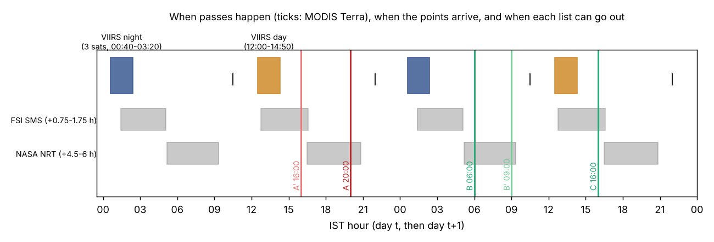
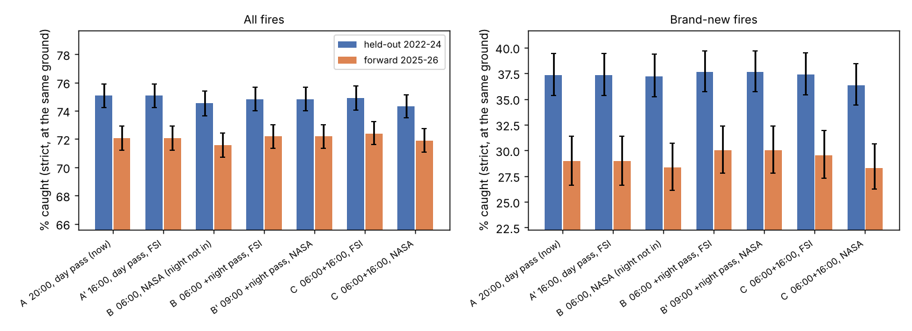
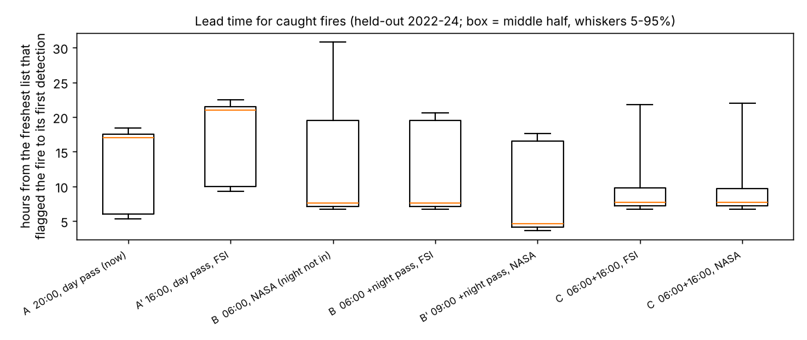
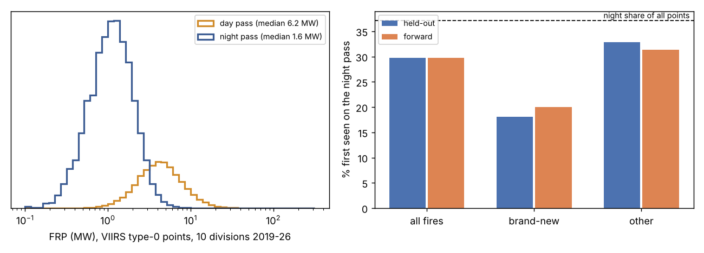

# When to build and send the "watch these squares" list (round 23, 18 Oct 2026)

Question: at what time of day should the daily list be built and sent so that it catches the most fires on the same amount of ground? Data in hand only: VIIRS points with their pass times, and the round-22 set-up.

**Bottom line: there is no gain from moving the list or sending it twice a day.**
- At the same ground, every timing option catches the same fires as today's evening list, to within about half a point. That is inside the bootstrap noise and the model-to-model noise (about 0.7 point).
- Adding the ~01:30 night pass to a 06:00 list changes all-fire catch by -0.3 (held-out) and +0.1 (forward). Brand-new fires change by +0.3 and +1.0. None of these CIs excludes zero.
- Two lists a day (06:00 + 16:00) on the same total ground: -0.2 / +0.3 all fires. Two full-size lists catch more (79.0% vs 75.1%), but only because they cover more ground. A single daily list on that larger ground catches the same (79.0%).
- **What timing does change is the lead time staff get.** The evening list gives about 17 h before a day-pass fire. The earliest useful slot is **about 16:00 the same day, using FSI's fast points**. It catches exactly the same fires as the 20:00 list and gives **4 more hours** of lead.
- A 06:00 list built with NASA NRT is worse: -0.5 all fires (CI -0.8 to -0.3). By 06:00 NASA has not delivered the night pass yet, so the list is simply the evening list sent 10 hours late.

## 1. Set-up

Everything is reused from round 22 (`system_rebuild_satellite_gis_ml.md`):
- the same 10 divisions;
- strict scoring where each fire counts once;
- held-out 2022-24 (trained on 2019-21) and forward 2025-26 (trained on 2019-24);
- the kept model: B0 + static GIS (LightGBM, identical settings);
- bootstrap CIs by fire, and paired differences against today's list.

**Pass times** (VIIRS, MP, 15 Feb-31 May; 3 satellites from 2023):

| Pass | IST (1st-99th percentile) | FSI points arrive | NASA NRT arrives |
|---|---|---|---|
| Night | 00:55-02:55 (all before 03:21) | about 02:00-04:15 | about 05:30-09:20 |
| Day | 12:20-14:30 (all before 14:50) | about 13:00-16:30 | about 16:50-20:50 |

MODIS Terra passes at about 10:30 and 22:00, and Aqua at about 13:30 and 01:30. See fig 1.

So in a day the system can only be in one of **two information states**:
- **after the day pass (MD)**: today's system, uses points through ~13:30 of day t;
- **after the night pass (MN)**: also uses the ~01:30 pass of day t+1.

I trained the kept model for both states and both test periods (`lt_train.py`). The MN model sees each night pass one day earlier, so its label is the next 4 passes after it, just as MD's is.

**A fair rule for every option** (`lt_score.py`):
- Each fire has a first detection time, which is its earliest VIIRS point, and first-pass squares, which are the squares seen on that same pass.
- A fire is caught if **any list issued in the 48 h before its first detection** flags one of those squares or is next to one. For a daily list that means its 2 latest lists; for twice daily, its 4.
- Every option is scored on **the same 10,583 held-out and 10,751 forward fires**. Fires first seen on 15 Feb are dropped, because not every option has lists that early.
- Ground is matched on the **ground in force**: the share of squares flagged or next to a flag on any list that counts at that moment, weighted by time. This matters for twice-daily lists, where 4 lists are in force at once.
- Check: today's list (A, 20:00) scores 75.1% all / 37.3% brand-new under this rule. The round-22 day-based rule gave 75.0 / 37.3 for the same model.

## 2. Results (same ground in force: 22.2% held-out, 22.6% forward)

| Option | Information | Held-out all (Δ, 95% CI) | Held-out brand-new (Δ) | Forward all (Δ) | Forward brand-new (Δ) |
|---|---|---|---|---|---|
| **A 20:00 day t** (now) | day pass, NASA or FSI | **75.1** | **37.3** | **72.1** | **29.0** |
| A' 16:00 day t | day pass, FSI only | 75.1 (0) | 37.3 (0) | 72.1 (0) | 29.0 (0) |
| B 06:00 t+1, NASA | night pass not in yet | 74.5 (**-0.5**, -0.8 to -0.3) | 37.2 (-0.1) | 71.6 (**-0.5**, -0.7 to -0.2) | 28.4 (-0.6) |
| **B 06:00 t+1, FSI** | + night pass | 74.8 (-0.3, -0.8 to +0.3) | 37.6 (+0.3, -1.2 to +1.8) | 72.2 (+0.1, -0.4 to +0.7) | 30.0 (+1.0, -0.6 to +2.6) |
| B' 09:00 t+1, NASA | + night pass | 74.8 (-0.3) | 37.6 (+0.3) | 72.2 (+0.1) | 30.0 (+1.0) |
| **C 06:00 + 16:00, FSI**, each list smaller (16.1% per list) | both | 74.9 (-0.2, -0.6 to +0.3) | 37.4 (0.0) | 72.4 (+0.3, -0.1 to +0.8) | 29.5 (+0.6) |
| C 06:00 + 16:00, NASA | each list one pass staler | 74.3 (**-0.7**, -1.2 to -0.3) | 36.3 (-1.0) | 71.9 (-0.2) | 28.3 (-0.7) |

**Ground-matching controls.**
- C with each list kept at today's size (19.2% per list) covers 25.9% ground in force. It scores 79.0 / 44.1 held-out and 76.8 / 35.0 forward.
- Today's single daily list on that same 25.9% scores 79.0 / 43.1 and 76.8 / 35.3. **Twice daily adds nothing; the extra catch comes from the extra ground.**

**Notes on the table.**
- A' and A, and B and B', score exactly the same because they use the same lists. No VIIRS pass falls between 16:00 and 20:00, or between 06:00 and 09:00, so only the lead time differs.
- B (FSI) against A combines two effects:
  - the night information is worth about +0.3 point on all fires (B FSI against B NASA, same clock time);
  - issuing 10 h later costs about 0.5 point, because the 01:30 fires are then scored against an older list.
  - The two effects cancel.
- The MD and MN models are trained separately, so B-against-A also carries the round-22 model noise of about 0.7 point.

## 3. Night pass against day pass

**Fires first seen at night.**

| | Held-out | Forward |
|---|---|---|
| All fires first seen on the night pass | 3,154 of 10,583 (29.8%) | 3,199 of 10,751 (29.8%) |
| Brand-new fires first seen at night | 389 of 2,157 (18.0%) | 307 of 1,537 (20.0%) |
| Other fires first seen at night | 32.8% | 31.4% |

- By season, the night share was 35% in 2022 and fell to 27% in 2023 and 23% in 2024. It was 30% and 29% in 2025-26.
- Night-first fires are mostly fires near earlier fires. A brand-new fire is usually first seen by day.

**Catch by first pass** (today's list): 82.4% of night-first fires and 72.0% of day-first fires held-out; 78.6% and 69.3% forward. The night-first fires are the easier ones, because they sit next to live fires.

**The fires today's list missed** (held-out; forward in brackets):

| First seen on | Missed | Within 1 km of a flag | Within 2.5 km of a flag | A 06:00 FSI list would catch | …but would lose fires A caught |
|---|---|---|---|---|---|
| Night pass | 556 (684) | 125 (170) | 311 (381) | 96 (115) | 138 (150) |
| Day pass | 2,081 (2,319) | 436 (516) | 1,045 (1,209) | 294 (356) | 280 (305) |

- Only 21% of the missed fires were first seen at night: 556 of 2,637 held-out, and 684 of 3,003 forward.
- Of those, about one in four was within 1 km of a flag (just outside the 3x3 "next to a flag" ring), and about half were within 2.5 km.
- A morning list built after the night pass picks up some of them. It drops a similar number, so the net is about zero.

**Lead time** for caught fires, in hours from the freshest list that flagged the fire to its first detection (held-out median; forward is the same within 0.3 h):

| Option | Fire first seen at night | Fire first seen by day | All caught (median) | From the earliest flagging list |
|---|---|---|---|---|
| A 20:00 (now) | 5.7 | 17.3 | 17.0 | 40.8 |
| **A' 16:00 (FSI)** | **9.7** | **21.3** | **21.0** | **44.8** |
| B 06:00 | 19.8 | 7.3 | 7.6 | 31.5 |
| B' 09:00 (NASA) | 16.8 | 4.3 | 4.6 | 28.5 |
| C 06:00 + 16:00 | 9.8 | 7.3 | 7.7 | 44.7 |

- Most fires are first seen on the day pass, about 70% of them. So a morning list gives staff only about 7 h before that 13:30 pass, against 17 h from the 20:00 list.
- Twice daily gives a fresher list but no extra warning: the first flag still comes about 45 h ahead.

**Are night detections under-represented?**
- **Night points are weak.** The median FRP is 1.55 MW at night against 6.19 MW by day (90th percentile 3.1 against 14.8 MW). FIRMS gives no night point "low" confidence.
- **Night points are 37% of all points but only 30% of first detections.**
- **Re-seeing test.** Some 500 m squares are seen on two day passes in a row; the fire probably kept burning through the night. The night pass in between saw the same square in 30% of 1,142 such cases, and the square or a neighbour in 52%. The reverse (two night passes with a day pass between) gave 23% and 45%.
  - So the night pass re-sees an ongoing fire no less often than the day pass does.
- **Reading.** Fires burn cooler at night (low FRP), and many go out or smoulder below detection. [inference] There is no sign that the night pass is blind in a way a later list could fix: the night information adds only about 0.3 point.
- Tables: `night_det_mix.csv`, `night_persistence.csv`, `night_fires_by_pass.csv`.

**MODIS as an earlier look.** Only 1-2.5% of fires had a MODIS point within 1 km in the 12 h before their first VIIRS point. Most of those were Terra at 10:30, 3 h ahead of the VIIRS day pass. So a list keyed to MODIS would start the clock earlier for very few fires (`night_modis_before*.csv`).

## 4. What to do

1. **Keep one list a day, built from the day pass.** Moving it to the morning, or sending two lists, does not catch more fires on the same ground.
2. **Send it as soon as the day pass is in.** With FSI points (13:30 pass + about 1-2 h), that is **about 16:00**: the same fires, 4 more hours of warning. With NASA NRT alone, 20:00 is the earliest safe time, which is the current set-up.
3. **Do not send a 06:00 list built from NASA data.** The night pass is not in by then, and it costs about half a point.
4. If staff want a morning check, a 06:00 refresh built with FSI's night pass is harmless on the same ground (about 0.3 point either way). Treat it as a convenience, not a gain.

**Caveats.**
- These are 10 divisions, and the model is a stand-in for the PC model.
- Delivery delays are taken as fixed ranges: FSI 0.75-1.75 h and NASA 4.5-6 h. Real outages would push lists later.
- Fires are scored at the VIIRS pass that first saw them, so the true ignition time is unknown.
- Seasons are few; CIs resample fires, not seasons.

**Files.**
- Code: `code/list_timing/` (lt_train.py, lt_score.py, lt_night.py, lt_report.py).
- Small outputs: `code/list_timing/out/` (schedules_held/fwd.csv, qgrid_*.csv, missed_A20.csv, lead_by_pass_held.csv, night_*.csv, fig1-4).
- Score cubes and per-fire tables: scratch `r23/` only.
