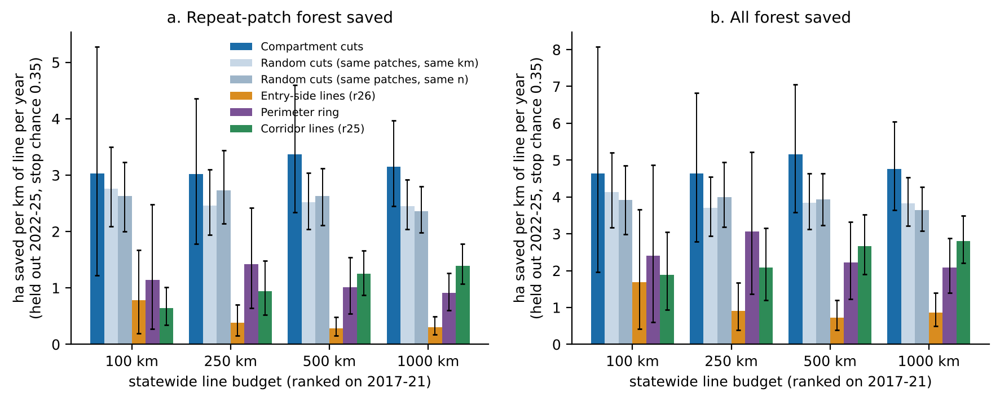
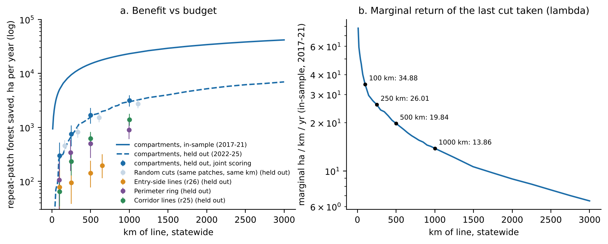
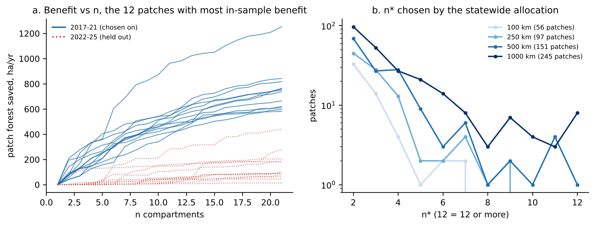
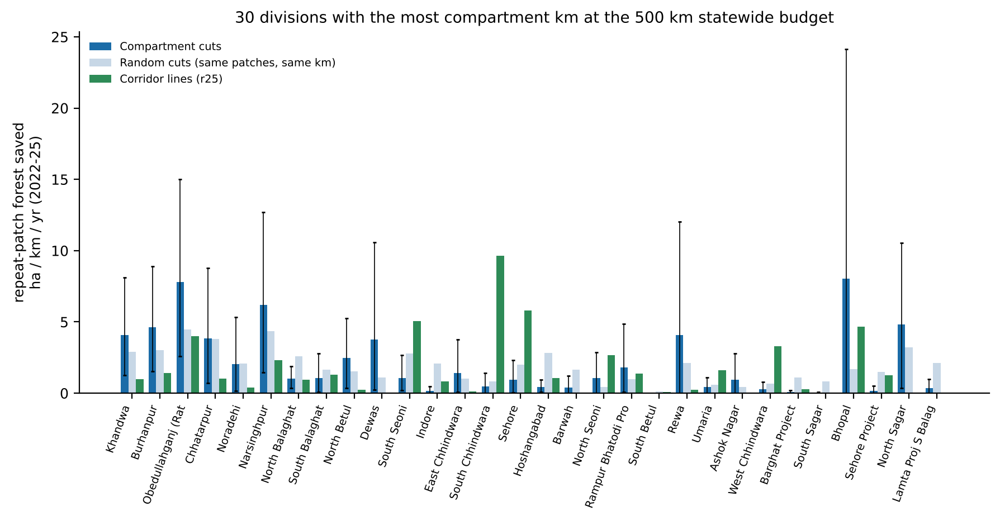
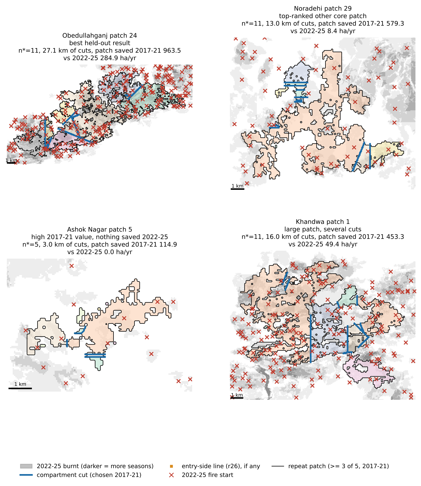

# Cutting repeat-burn patches into compartments: a held-out test (scouting round 27, 19 Oct 2026)

**Akkshay's idea (verbatim).** "In repeated burnscars if we divide this scar into n parts and n is computed through a algo where less work can give high impact".

**Why it might work.** In round 26, about 40% of the main fires in a repeat patch started *inside* the patch (another ~20% at its edge). No line on the patch edge can stop those fires. A line *inside* the patch can, because it keeps the fire in the part where it started.

**What was tested.**
- Every repeat patch was split by internal cut lines, chosen greedily. Each cut had to save the most patch forest per km on the 2017-21 fires.
- For each patch, this gives a curve of benefit against n (the number of compartments).
- n* for every patch comes from one statewide rule: spend a km budget on the next cut that saves most per km, whichever patch it is in.
- The cuts were then scored on the 2022-25 fires, which they never saw. They were compared at the same statewide budgets with random cuts in the same patches, round-26 entry-side lines, round-25 corridor lines and whole perimeter rings.

**Short answer.**
- **Compartment cuts work better than any line tried before, but the total effect is still small.**
  - At a 500 km statewide budget they saved **3.4 ha of repeat-patch forest per km per year** in 2022-25 (95% range 2.3-4.6), and **5.2 ha of all forest** (3.6-7.1). Stop chance per crossing is 0.35.
  - The same km of corridor lines (r25) saved 1.2 patch / 2.7 forest. Perimeter rings saved 1.0 / 2.2, and entry-side lines (r26) 0.3 / 0.7. Compartments beat each of these with 95% ranges that clear zero.
- **Most of the gain comes from *which* patches get cut, not from *where* inside them.** Random straight cuts in the same patches, of the same total length, saved 2.5 patch ha/km/yr. Compartments minus random is +0.8 (95% range -0.0 to +1.8) at 500 km and +0.7 (+0.2 to +1.2) at 1,000 km.
  - [inference] The algorithm's real skill is the statewide choice: big repeat patches with many fires that start inside them.
- **Small in absolute terms.**
  - 500 km of cuts would have saved about **2,580 ha of forest per year, 0.36% of the 721,000 ha of forest burnt per year** in 2022-25.
  - 1,000 km would have saved 0.66%. Even if every line always held (stop chance 1.0), 500 km would save only 0.88%.
- **Very optimistic in-sample.** The same cuts "saved" 32 patch ha/km/yr on the fires they were chosen on, about 10 times the held-out value. 34% of the patches cut at 500 km saved nothing in 2022-25.
- **The gain sits in a few big patches.** At 500 km, one Ratapani patch gives 18% of the held-out total and five patches give 53%.
- **n\*.** At 500 km, 151 patches get cuts. The median n* is 3 compartments, 90% have 6 or fewer, and the largest is 13.
  - The last cut taken returns 19.8 ha/km/yr in-sample (lambda), which [inference] is likely about 2 ha/km/yr held out.
  - Budget allocation: 100 km goes to 56 patches, 250 km to 97, 500 km to 151 and 1,000 km to 245.
- **Sensitive to multiple starts.** Suppose every new front counts as its own start (a second ignition or spot fire). Compartment savings then drop to **26%** of the main figure (0.86 patch ha/km/yr), level with random cuts.
  - They are still ahead of corridor lines (0.47) and entry lines (0.16) under that rule.
  - This is the biggest caveat. Repeat patches are where fires start most often, and an internal line does nothing against a second start on the far side.

**Tags.** DATA = computed here. **[inference]** = my reasoning.

Code: `code/compartments/` (`k0`-`k6`, `run_all.sh`). Tables and geojson: `code/compartments/out/`. Figures: `conference/figs/`. Big intermediates: scratch r27 only.

---

## 1. Data (same fires as round 26)

- **Fires.** Round-26 fires (scratch r26), built as follows:
  - 8 tiger reserves (`tiger_reserve_scars.geojson`) plus Ratapani scar outlines v2, and the statewide history read only through `read_hist_geom()`. That history is complete (153,817 events, finished 19 Oct).
  - Events are chained into fires when their outlines are within 60 m and their dates are at most 4 days apart. The start is the first VIIRS look (round 25).
  - Outlines are clipped to VTM tree forest or scrub on the 60 m lattice.
  - Counts: 82 divisions, 49,804 fires in 2017-21 and 43,312 in 2022-25.
  - Sensors: the scar-history events were built from VIIRS S-NPP, VIIRS NOAA-20 and MODIS (Aqua, Terra) points (`mp_alert_event.csv`: 258,366 / 193,672 / 28,552). NOAA-21 VIIRS (2023+) was not used in the event history.
- **Repeat patches.** Round-26 patches:
  - `tr3`: 120 m forest cells burnt in ≥3 of the 5 seasons 2017-21, connected areas ≥10 ha. There are 3,867 patches, used for the held-out test.
  - `all5`: ≥5 of the 9 seasons 2017-25, 2,876 patches, used for the final in-sample list.
- **Test burning.** 721,181 ha of forest burnt per year in 2022-25 (sum over fires). This is the denominator for "% of burnt forest".

## 2. Method

**Scoring rule (one rule for every line strategy, `k0.py`).**
- Each fire spreads again from its start cells, cell to cell (4-connected), only inside its own outline. This is the round-25 rule.
- A line can be crossed. Each crossing is stopped with chance p = 0.35, the round-25 value from road odds; p = 1.0 is the upper bound.
- A cell that needs k crossings to reach burns with chance 0.65^k. Its expected saving is 1 − 0.65^k, where k is the fewest crossings, found by a 0-1 shortest path.
- The line itself is treated as zero width. Its 60 m cell belongs to the side the fire reaches it from.
- Saved ground is reported three ways: repeat-patch forest, all forest, and all ground.
- This is the same multi-line rule as round 25 ("saved unless every line cutting it off fails"). It is applied to all strategies, so the comparisons are like for like. The entry-side lines therefore score 0.29 here against 0.19 patch ha/km/yr in round 26.

**Candidate cuts (`k1_cuts.py`), inside one compartment at a time.**
- Straight chords: 8 directions (every 22.5°), at offsets every max(2 cells, width/30).
- Round-25 ridge, valley and Overture road/track chains, where they cross the compartment.
- A cut may run up to 2 cells (120 m) past the patch edge, to tie into the ground around it. It may never run into another compartment.
- It must leave at least two pieces of ≥2 ha.

**Choosing cuts in one patch (greedy).**
- Repeatedly add the cut that saves the most of this patch's forest per km per year on the defining fires (2017-21 for `tr3`).
- Stop when nothing more is saved or at 20 cuts.
- The result is each patch's benefit-against-n curve, for n = 1 to 21 (Fig. 9a).

**n\* and the statewide budget (`k2_score.py`).**
- Each patch's curve is reduced to its upper concave hull.
- A single statewide greedy pass then takes the next hull step with the highest ha saved per km across all patches, until the first step that does not fit the budget. This is a greedy knapsack with an equal-marginal-return rule.
- n* = cuts taken + 1.
- lambda (the return of the last step taken) is the threshold that a per-patch "knee" rule would use.

**Comparisons at the same statewide budgets** (all ranked on 2017-21 and scored on 2022-25):
- random straight cuts in the same patches: (a) the same number per patch, (b) about the same km per patch. 5 draws each.
- round-26 entry-side lines (618 lines, 649 km), ranked by 2017-21 patch ha per km.
- the whole perimeter ring of the `tr3` patches, ranked the same way.
- round-25 corridor plan lines, ranked by their own in-sample ha/km/yr. In the rest of MP these were trained on 2019-21 only, because the history was partial then.

**Uncertainty.** 95% ranges come from resampling test fires within each division, 1,000 times. Every strategy is scored on the same fires, so the differences are paired.

## 3. Results - DATA

**Held-out (2022-25) ha saved per km of line per year, stop chance 0.35** (`out/strategy_table.csv`).

| budget | strategy | km | patch forest | 95% range | all forest | 95% range | in-sample patch (2017-21) | % of burnt forest saved |
|---|---|---|---|---|---|---|---|---|
| 100 km | **compartments** | 99 | **3.0** | 1.2-5.3 | **4.6** | 2.0-8.1 | 55.8 | 0.06 |
| | random cuts, same km | 166 | 2.8 | 2.1-3.5 | 4.1 | 3.2-5.2 | 8.1 | 0.10 |
| | corridor (r25) | 99 | 0.6 | 0.3-1.0 | 1.9 | 0.9-3.0 | 20.6 | 0.03 |
| | ring | 93 | 1.1 | 0.3-2.5 | 2.4 | 0.6-4.9 | 10.7 | 0.03 |
| | entry side (r26) | 99 | 0.8 | 0.2-1.7 | 1.7 | 0.4-3.7 | 2.8 | 0.02 |
| 250 km | **compartments** | 250 | **3.0** | 1.8-4.4 | **4.6** | 2.8-6.8 | 40.3 | 0.16 |
| | random cuts, same km | 332 | 2.5 | 1.9-3.1 | 3.7 | 2.9-4.5 | 7.4 | 0.17 |
| | corridor | 249 | 0.9 | 0.5-1.5 | 2.1 | 1.2-3.2 | 16.2 | 0.07 |
| | ring | 242 | 1.4 | 0.6-2.4 | 3.1 | 1.4-5.2 | 8.0 | 0.10 |
| | entry side | 249 | 0.4 | 0.2-0.7 | 0.9 | 0.4-1.7 | 1.5 | 0.03 |
| 500 km | **compartments** | 500 | **3.4** | 2.3-4.6 | **5.2** | 3.6-7.1 | 32.2 | **0.36** |
| | random cuts, same km | 607 | 2.5 | 2.0-3.0 | 3.8 | 3.1-4.6 | 6.9 | 0.32 |
| | random cuts, same n | 885 | 2.6 | 2.1-3.1 | 3.9 | 3.2-4.6 | 7.0 | 0.48 |
| | corridor | 499 | 1.2 | 0.9-1.7 | 2.7 | 1.9-3.5 | 12.3 | 0.18 |
| | ring | 497 | 1.0 | 0.5-1.5 | 2.2 | 1.2-3.3 | 6.3 | 0.15 |
| | entry side | 500 | 0.3 | 0.2-0.5 | 0.7 | 0.4-1.2 | 0.7 | 0.05 |
| 1,000 km | **compartments** | 999 | **3.2** | 2.4-4.0 | **4.8** | 3.6-6.0 | 24.6 | **0.66** |
| | random cuts, same km | 1,113 | 2.5 | 2.0-2.9 | 3.8 | 3.2-4.5 | 6.3 | 0.59 |
| | corridor | 999 | 1.4 | 1.1-1.8 | 2.8 | 2.2-3.5 | 9.4 | 0.39 |
| | ring | 996 | 0.9 | 0.6-1.3 | 2.1 | 1.4-2.9 | 4.8 | 0.29 |
| | entry side (all 618) | 649 | 0.3 | 0.2-0.5 | 0.9 | 0.5-1.4 | 0.6 | 0.08 |

**Paired differences, compartments minus each other strategy** (patch forest ha/km/yr; 95% range).

| budget | − random (same km) | − corridor | − ring | − entry side |
|---|---|---|---|---|
| 100 | +0.3 (-1.3 to +2.2) | +2.4 (+0.6 to +4.8) | +1.9 (+0.1 to +3.9) | +2.2 (+0.3 to +4.5) |
| 250 | +0.6 (-0.5 to +1.9) | +2.1 (+0.8 to +3.6) | +1.6 (+0.2 to +3.2) | +2.6 (+1.3 to +4.0) |
| 500 | +0.8 (-0.0 to +1.8) | +2.1 (+1.0 to +3.4) | +2.4 (+1.2 to +3.7) | +3.1 (+2.0 to +4.3) |
| 1,000 | +0.7 (+0.2 to +1.2) | +1.8 (+1.2 to +2.4) | +2.2 (+1.5 to +3.1) | +2.8 (+2.2 to +3.7) |

- Compartments beat corridor lines on *all* forest too, at 500 km: +2.5 (+0.8 to +4.5).
- **Stop chance 1.0** (every line always holds), 500 km: compartments 8.3, corridor 3.4, ring 2.3 and entry side 0.8 patch ha/km/yr. That is 0.88% of burnt forest.
- **Conservative start rule** (every new front more than 750 m from earlier dots is its own start), 500 km, p 0.35:

  | strategy | patch ha/km/yr | 95% range | share of main value |
  |---|---|---|---|
  | compartments | 0.86 | 0.70-1.05 | 26% |
  | random cuts, same km | 0.81 | 0.68-0.95 | 32% |
  | corridor | 0.47 | 0.36-0.60 | 38% |
  | ring | 0.39 | 0.26-0.53 | 39% |
  | entry side | 0.16 | 0.11-0.22 | 55% |

- **By test year** (500 km, patch ha/km/yr):
  - compartments: 7.1 (2022), 0.4 (2023), 1.6 (2024), 4.3 (2025);
  - corridor: 2.0, 0.5, 1.3, 1.2.
  - Compartments win in the big fire years and lose slightly in 2023.
- **Where the saved patch ha come from** (500 km): **76%** comes from test fires that started inside a repeat patch, 1,280 of 1,682 ha/yr. This is the mechanism Akkshay proposed.
- **Cut kinds.** 97% of the cuts taken are straight chords; 11 of 378 follow a ridge, valley or track. Terrain and track chains seldom cross a compartment from edge to edge.
  - [inference] On the ground, bend each chord onto the nearest ridge, nala or track.

*Left: in-sample (solid) against held-out (dashed) patch ha saved per year as the statewide budget grows, with the joint-scored held-out points of every strategy. Right: lambda, the in-sample marginal return of the last cut taken.*

**n\* and allocation** (`out/tables.json` `nstar`, `alloc_curve`).

| budget | patches cut | cuts | median n* | 90th pct n* | max n* | lambda (in-sample ha/km/yr) | held-out patch ha/yr |
|---|---|---|---|---|---|---|---|
| 100 km | 56 | 99 | 2 | 4 | 7 | 34.9 | 298 |
| 250 km | 97 | 205 | 3 | 5 | 9 | 26.0 | 753 |
| 500 km | 151 | 378 | 3 | 6 | 13 | 19.8 | 1,682 |
| 1,000 km | 245 | 740 | 3 | 7.6 | 18 | 13.9 | 3,148 |

- Of the 3,867 patches, 3,606 have at least one valid cut that saved something in 2017-21. Their median first cut saves only 1.6 ha/km/yr in-sample. A statewide budget therefore goes to the few large, often-burnt patches.

**Per division, 500 km** (`out/division_table.csv`; 46 divisions get cuts). Ten divisions with the most km, patch ha/km/yr held out:

| division | patches | cuts | km | compartments | 95% range | in-sample | random, same km | corridor | ha/yr saved (patch) | % of division's burnt forest |
|---|---|---|---|---|---|---|---|---|---|---|
| Khandwa | 10 | 40 | 66.2 | 4.1 | 1.2-8.1 | 29.3 | 2.9 | 1.0 | 270 | 1.21 |
| Burhanpur | 5 | 27 | 60.2 | 4.6 | 1.5-8.9 | 26.3 | 3.0 | 1.4 | 279 | 2.16 |
| Obedullahganj (Ratapani) | 8 | 30 | 57.5 | **7.8** | 2.6-15.0 | 30.6 | 4.5 | 4.0 | 448 | 2.22 |
| Chhatarpur | 7 | 31 | 37.2 | 3.8 | 0.7-8.8 | 34.3 | 3.8 | 1.0 | 142 | 1.35 |
| Noradehi | 3 | 20 | 29.8 | 2.0 | 0.2-5.3 | 36.1 | 2.1 | 0.4 | 61 | 0.77 |
| Narsinghpur | 9 | 20 | 28.3 | 6.2 | 1.5-12.7 | 30.8 | 4.4 | 2.3 | 175 | 1.13 |
| North Balaghat | 3 | 21 | 28.1 | 1.0 | 0.3-1.9 | 33.5 | 2.6 | 1.0 | 29 | 0.26 |
| South Balaghat | 14 | 24 | 20.0 | 1.1 | 0.1-2.8 | 29.9 | 1.6 | 1.3 | 22 | 0.10 |
| North Betul | 7 | 12 | 19.2 | 2.5 | 0.4-5.2 | 25.3 | 1.5 | 0.2 | 47 | 1.18 |
| Dewas | 10 | 16 | 16.7 | 3.8 | 0.2-10.6 | 32.0 | 1.1 | 0.0 | 63 | 0.26 |

- Across the 46 divisions with cuts, compartments beat random same-km cuts in 17, corridor lines in 21, rings in 15 and entry lines in 30 (division values are noisy).
- Even in the best divisions, 500 km statewide removes about 1-2% of a division's burnt forest.

**Top 20 tested patches** (cuts chosen on 2017-21 at the 500 km budget; ranked by 2017-21 value, which is what a planner would see; `out/top_tested_patches.csv`).

| division | patch centre (lon, lat) | patch ha | n* | km | 2017-21 ha/yr | 2022-25 ha/yr |
|---|---|---|---|---|---|---|
| Obedullahganj (Ratapani) | 77.827, 22.962 | 9,166 | 11 | 27.1 | 963 | **285** |
| Burhanpur | 76.613, 21.267 | 4,415 | 13 | 25.7 | 636 | **165** |
| Noradehi | 79.212, 23.150 | 4,355 | 11 | 13.0 | 579 | 8 |
| North Balaghat | 80.239, 22.116 | 2,811 | 11 | 14.2 | 502 | 10 |
| Burhanpur | 76.585, 21.544 | 3,645 | 7 | 18.0 | 480 | 26 |
| Narsinghpur | 78.899, 22.744 | 3,518 | 8 | 18.8 | 471 | **145** |
| Khandwa | 76.511, 22.363 | 5,990 | 11 | 16.0 | 453 | 49 |
| Noradehi | 79.281, 23.170 | 3,086 | 10 | 16.1 | 431 | 53 |
| Chhatarpur | 79.476, 24.501 | 1,679 | 9 | 10.6 | 429 | 8 |
| South Seoni | 79.908, 22.226 | 1,732 | 7 | 6.6 | 334 | 5 |
| Khandwa | 76.949, 21.781 | 2,857 | 7 | 10.8 | 301 | 76 |
| Chhatarpur | 79.593, 24.471 | 3,267 | 6 | 9.6 | 248 | **116** |
| North Balaghat | 80.212, 22.252 | 2,724 | 6 | 7.7 | 240 | 18 |
| Sehore | 77.049, 22.882 | 2,890 | 7 | 4.7 | 237 | 4 |
| Chhatarpur | 79.430, 24.597 | 1,241 | 7 | 5.2 | 234 | 1 |
| Burhanpur | 76.242, 21.445 | 1,683 | 5 | 8.9 | 230 | 19 |
| Khandwa | 76.950, 21.838 | 2,123 | 4 | 8.8 | 220 | **93** |
| South Seoni | 79.849, 22.188 | 2,015 | 4 | 4.7 | 207 | 8 |
| Obedullahganj (Ratapani) | 77.949, 23.010 | 2,051 | 9 | 6.4 | 207 | 10 |
| Khandwa | 77.019, 21.849 | 1,263 | 5 | 7.4 | 194 | 7 |

- These 20 patches "saved" 7,600 ha/yr in-sample and 1,106 ha/yr held out.
- Ratapani patch 24 alone is 18% of the statewide held-out total. One large fire area that keeps burning drives the result.

## 4. Final list: 2017-25 repeat patches (≥5 of 9 seasons), in-sample (`out/final_patches.csv`, `out/final_cuts.csv`, geojson)

| statewide budget | patches | cuts | in-sample patch ha/yr | lambda | [inference] expected held out (about 1/10 of in-sample, as in section 3) |
|---|---|---|---|---|---|
| 100 km | 39 | 75 | 2,680 | 21.1 | ~270 ha/yr |
| 250 km | 73 | 183 | 5,360 | 15.5 | ~540 |
| 500 km | 125 | 363 | 8,630 | 11.4 | ~860 |
| 1,000 km | 199 | 732 | 13,350 | 8.1 | ~1,340 |

**Top 20 final patches at 500 km** (in-sample 2017-25):

| division | lon, lat | patch ha | fires 2017-25 | n* | km | in-sample patch ha/yr |
|---|---|---|---|---|---|---|
| Obedullahganj (Ratapani) | 77.842, 22.968 | 10,156 | 529 | 21 | 48.9 | 971 |
| Narsinghpur | 78.961, 22.756 | 3,175 | 147 | 15 | 24.6 | 472 |
| Noradehi | 79.284, 23.171 | 1,884 | 42 | 8 | 14.3 | 261 |
| Chhatarpur | 79.476, 24.502 | 1,410 | 47 | 10 | 12.9 | 258 |
| Chhatarpur | 79.606, 24.481 | 2,265 | 62 | 11 | 13.4 | 255 |
| Khandwa | 76.507, 22.370 | 3,982 | 166 | 9 | 9.2 | 247 |
| Umaria | 81.235, 23.449 | 1,296 | 39 | 8 | 10.5 | 244 |
| Khandwa | 76.941, 21.837 | 2,228 | 61 | 9 | 14.4 | 238 |
| Obedullahganj (Ratapani) | 77.611, 22.898 | 2,808 | 141 | 8 | 12.9 | 225 |
| Sehore | 77.048, 22.878 | 2,799 | 171 | 10 | 10.3 | 196 |
| Rewa | 81.227, 24.979 | 1,315 | 32 | 9 | 13.0 | 195 |
| Dewas | 76.931, 22.853 | 1,954 | 98 | 6 | 10.6 | 189 |
| Burhanpur | 76.631, 21.293 | 1,362 | 60 | 6 | 10.7 | 177 |
| South Seoni | 79.852, 22.198 | 2,025 | 85 | 5 | 8.6 | 176 |
| Narsinghpur | 78.879, 22.743 | 1,067 | 43 | 7 | 11.7 | 164 |
| South Seoni | 79.930, 22.235 | 860 | 32 | 7 | 8.4 | 155 |
| North Panna | 80.410, 24.878 | 747 | 28 | 8 | 8.3 | 150 |
| Khandwa | 76.943, 21.786 | 1,560 | 59 | 8 | 7.3 | 148 |
| North Sagar | 78.828, 24.179 | 1,210 | 76 | 7 | 9.7 | 129 |
| Umaria | 81.217, 23.398 | 1,208 | 40 | 6 | 7.8 | 127 |

(Patch ha = all 60 m cells of the patch. The 2017-25 patches are re-drawn, so their numbers differ from the 2017-21 patches above.)

## 5. Verdict

- **Dividing a repeat burn scar into n parts does help, and it helps more per km than any other line tried in rounds 25-27.** In held-out seasons, a km of internal cut saved about 3 ha of repeat-patch forest (about 5 ha of all forest) per year. Corridor lines saved about 1.2 and edge lines 0.3-1.0.
- **"Less work, high impact" holds only for the choice of patches.** The statewide greedy rule puts the km into a few large patches burnt by many fires that start inside them. There, n* is usually 2-6.
  - Within those patches, random straight cuts do almost as well (75-80% of the value). The exact line position is not worth much optimising.
- **The gain is small in absolute terms.** It is 0.36% of burnt forest per year for 500 km, and 0.66% for 1,000 km. Every km must also be cleared again each year. With multiple starts counted as separate ignitions, the value falls to a quarter.
- [inference] **Practical use.**
  - Treat the top 20-50 large repeat patches (section 4) as candidates for 2-6 internal lines each, placed along ridges, nalas or tracks near the sketched chords.
  - Combine the lines with patrol and early burning of the compartments, since 76% of the benefit comes from fires that start inside.
  - Do not expect lines alone to change statewide burnt area.

## 6. Caveats

- **The spread model is the round-25 rule.** Fires stay inside their historical outline, start at the first VIIRS look, and spotting is ignored. The stop chance is borrowed from roads (0.35) and applied per crossing.
  - Internal cuts are the line type most hurt by multiple starts: the conservative start rule leaves 26% of the value.
- **60 m grid.** A cut is a 60 m chain. A real cut is 10-20 m wide and must follow a ground feature, and 97% of the chosen cuts are straight sketches.
- **Overfitting.** In-sample values are about 10 times the held-out values. Use the held-out numbers (or 1/10 of in-sample for the 2017-25 list).
- **Concentration.** A handful of patches carries the result (top patch 18%, top 5 53%), so the statewide number has wide uncertainty. 34% of the cut patches saved nothing in 2022-25.
- **Comparison lines.** Rest-of-MP corridor lines (r25) were trained on 2019-21 only. Entry lines exist only for the 618 "consistent" patches, 649 km in total, so the 1,000 km row uses all of them.
- **Random-cut length.** Random chords are longer than greedy cuts. The "same km" draws reach 607 km where 500 km was the target, so compare per km.
- **Tiger-reserve outlines** were drawn before the v2 chip-edge fix.

## 7. Files

- **Code** (`scouting/code/compartments/`):
  - `k0.py`: settings, 0-1 BFS scoring kernels, conservative start rule;
  - `k1_cuts.py`: candidate cuts, greedy n curves, test curves, random draws;
  - `k2_score.py`: per-line values, statewide allocation, joint held-out scoring;
  - `k3_final.py`: 2017-25 list and geojson;
  - `k4_report.py`: tables and bootstrap;
  - `k5_mosaic.py`: statewide repeat-burn mosaic;
  - `k6_figs.py`: figures;
  - `k7_paper.py`: conference PDF;
  - `run_all.sh`.
- **Outputs** (`code/compartments/out/`):
  - `strategy_table.csv`, `division_table.csv`, `tables.json`;
  - `top_tested_patches.csv`, `final_patches.csv`, `final_cuts.csv`, `final_budget_curve.csv`, `division_summary.csv`;
  - `compartments.geojson` (about 3.7 MB). Its layers:
    - `compartment_2017_25`: compartments of patches cut at 1,000 km;
    - `cut_2017_25`: cuts, with the first budget that takes them;
    - `cut_tested_2017_21`: cuts tested at 500 km, with their 2022-25 result per patch.
- **Conference paper:** `scouting/conference/fire_lines_mp_2017_25.pdf`, figures in `conference/figs/`.
- **Scratch r27:** cut sequences per division and set, per-fire scores, allocation.
