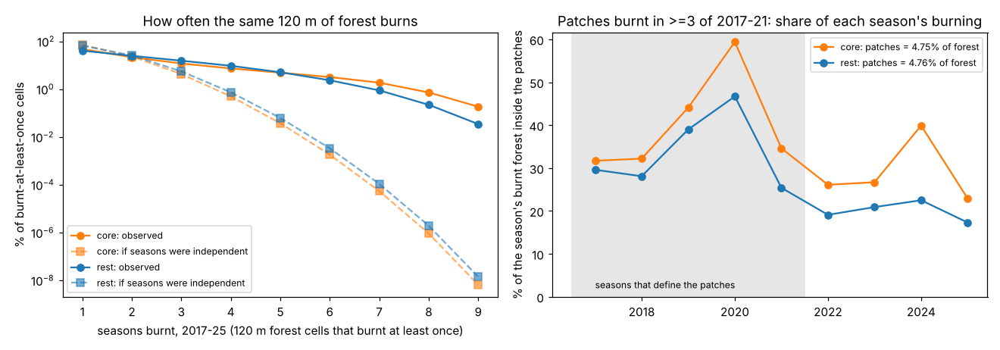
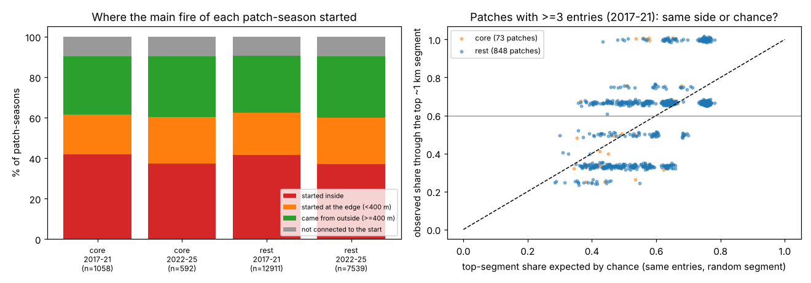
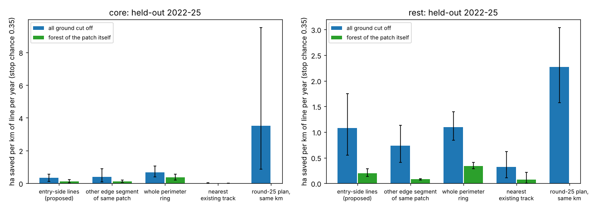
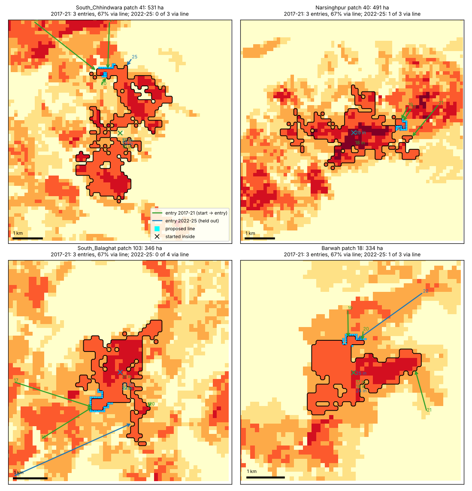

# Same patch, same direction, every year? A held-out test of entry-side fire lines (scouting round 26, 19 Oct 2026)

**Akkshay's logic (verbatim).** "find out burnscars which are each year or most of the year . then find the direction of fire in to that burn scar now propose the firelines if same fire everyyear from same direction coming and burning same patch then firelines can save that"

**What was tested.** Each step of that logic, as written:
1. find forest patches that burn in most years;
2. find the side each year's fire came in from;
3. where the fire keeps coming in from the same side, put a line on that side;
4. check on later seasons the lines never saw.

Patches, entry sides and lines all come from 2017-21. Scoring uses only 2022-25.

**Short answer.**
- **"Same patch" is real.** Fire in MP keeps going back to the same ground. Forest burnt in 3 or more of the 5 seasons 2017-21 makes up **4.8% of forest**. In 2022-25 it held **20% (rest of MP) and 27% (core) of all burnt forest**, about 4-6 times its share of the land. Cells that burn in 5 or more of 9 seasons are about 80-170 times more common than if each season burnt at random.
- **"Every year" is not.** Only **0.16% of forest burnt in all 5 seasons** of 2017-21, and **0.01% in all 9 seasons** of 2017-25. A typical repeat patch burns in 3-4 of 5 seasons. It is also small: median **30 ha**.
- **"Same fire from the same direction" is mostly not what happens.**
  - Most patch-seasons do not have an entry side a line could block. In **37-42%**, the fire that burnt most of the patch **started inside it**. In another **20%**, it started within 400 m of the edge, which is inside the error of a VIIRS location. Only **28-30%** came in from 400 m or more outside.
  - In 2017-21, **921** patches had at least 3 fire entries. Their median share through the top ~1 km edge segment was **0.67**. The share expected by chance with the same few entries is **0.63**. Only **5 of 921** beat chance at p ≤ 0.05, fewer than the 46 expected by luck alone.
- **The held-out check finds a weak side-preference.** In 2022-25, **49% of entries** into the 618 line patches came through the proposed segment. Chance would give **37%** (95% range of the difference: +8 to +15 points). Counting only fires that started 400 m or more away: 51% against 38%. This holds in the rest of MP, not in the core, where the sample is small (60 entries).
- **But the lines save almost nothing** (stop chance 0.35, test 2022-25, all of MP, 649 km of line):
  - **0.19 ha of the patch per km per year.** A random other edge segment of the same patch saves 0.08 (difference +0.11, 95% range +0.05 to +0.19). Even if every line always held (stop chance 1.0), the figure is 0.54 ha.
  - **1.0 ha per km per year counting all ground cut off**, inside and outside the patch. Random edge segments give 0.7 (difference +0.3, range -0.2 to +1.0, not significant). Round-25 plan lines of the same total length give **2.4**, more than twice as much.
  - In total the lines would have saved **0.02% (core) and 0.09% (rest)** of the burnt area in 2022-25. **58%** of the 618 tested lines saved nothing in four test seasons.
- **Verdict.** Repeat burning is real, but "same fire, same direction, same patch, every year" is true for very few patches. Most repeat patches are small, are often lit from inside or at their edge, and are burnt from changing sides. A 1 km line on the edge most fires used before protects about a fifth of a hectare per year.
  - [inference] For repeat patches, the useful levers are ignition inside and at the edge (patrol, early burning of the patch itself) and the round-25 corridor lines. Edge lines are not.

**Tags.** DATA = computed here. **[inference]** = my reasoning.

Code: `code/repeat_patch_lines/` (`r1`-`r6`, `run_all.sh`). Tables, figures and geojson: `code/repeat_patch_lines/out/`. Big intermediates are in scratch r26 only.

---

## 1. Data and coverage (which scars every number uses)

| set | divisions | scar outlines | events used | fires (chained) | seasons |
|---|---|---|---|---|---|
| **core** | 8 tiger reserves + Ratapani (Obedullahganj) | Tiger reserves: `tiger_reserve_scars.geojson` (all events, 3 km chips drawn before the v2 edge fix). Ratapani: scar outlines v2 (2026-10-16). | 15,288 | 9,287 (4,318 in 2022-25) | 2017-25 all |
| **rest of MP** | 73 other divisions | statewide history via `read_hist_geom()`, **finished 19 Oct 01:45Z** | 131,687 events with status `scar` (scar_faint not used, as in round 25) | 83,829 (38,994 in 2022-25) | 2017-25 all: 99.9% of events processed in every season. Every division-season is ≥95% done except Barwani 2022 (9 of 10 events). |

- Fires are chained exactly as in round 25. Outlines within 60 m, dates at most 4 days apart. The start is the first VIIRS look.
- **Outlines are clipped to forest.** Only VTM tree forest or scrub counts, on the 60 m VTM lattice. This is the raster behind `static_gis_v1` `lc_forest` + `lc_scrub`; I used the 60 m version rather than the 500 m shares so that small patches survive. Forest shares use forest inside the division polygon.
- Every table names its set. "All MP" = core + rest.

## 2. Step 1 - repeat-burn patches - DATA

**Method.**
- The grid is 120 m (2 × 2 VTM cells). A cell "burnt" in a season if at least 2 of its four 60 m cells are forest and inside that season's scars.
- A patch is a connected area (8-neighbour) of cells burnt in ≥K seasons, with at least 10 ha of forest.

**Patches and the share of each season's burnt forest that falls in them.**

| patches defined on | rule | set | patches | forest in patches | % of forest | % of burnt forest in patches, 2017-21 (in-sample) | % of burnt forest in patches, 2022-25 (held out) |
|---|---|---|---|---|---|---|---|
| 2017-21 | ≥3 of 5 (majority) | core | 287 | 51,900 ha | 4.75 | 37.0 | **26.7** |
| 2017-21 | ≥3 of 5 | rest | 3,580 | 363,900 ha | 4.76 | 30.2 | **19.0** |
| 2017-21 | ≥4 of 5 | all MP | 1,717 | 107,400 ha | 1.23 | 10.1 | 6.3 |
| 2017-21 | 5 of 5 (every year) | all MP | 344 | 14,200 ha | **0.16** | 1.6 | 1.0 |
| 2017-25 | ≥5 of 9 (majority) | all MP | 2,876 | 268,200 ha | 3.07 | 19.7 (2017-21) | 20.6 (2022-25; also in-sample) |
| 2017-25 | ≥7 of 9 | all MP | 757 | 36,400 ha | 0.42 | 3.5 | 3.7 |
| 2017-25 | 9 of 9 | all MP | 45 | 1,100 ha | **0.01** | 0.1 | 0.1 |

- By year, all MP, ≥3 of 5 patches, % of burnt forest inside: 2017 30, 2018 29, 2019 40, 2020 49, 2021 26 | 2022 20, 2023 22, 2024 24, 2025 18.
- **Repeat burning is strongly clustered.** Take 120 m forest cells burnt at least once in 2017-25. Of these, 6.0% (core) and 3.5% (rest) burnt in 6 or more seasons. If each season burnt the same share of forest at random, that figure would be under 0.01% (left panel below).
- **But "every year" hardly exists.** Ground burnt in all 5 training seasons is 0.16% of forest and holds 1% of later burning. Patches are small: median 30 ha of forest, and 75% are under 80 ha.

*Left: how many seasons a burnt 120 m cell burnt, observed against independent seasons (log scale). Right: share of each season's burnt forest inside the patches defined on 2017-21 (grey band). They keep 18-24% in 2022-25 while covering 4.8% of forest.*

## 3. Step 2 - where the fire came in from - DATA

**Method, per fire that burnt ≥1 ha of a patch.**
- **Started inside:** a first-look VIIRS dot (its own 60 m cell) lies in the patch.
- **Otherwise, entry point:** let the fire spread from its first-look dots, cell to neighbouring cell, inside its own outline. The patch cells it reaches first are the entry. This is the same spread rule as the round-25 benefit.
- **Edge segment:** the ring of cells just outside the patch is cut into ~1 km segments (k-means on the ring). The entry is assigned to the nearest segment.
- **Bearing:** from the patch centre to the entry point.
- **Patch-season:** the fire that burnt most of the patch that season.
- **Cross-checks:**
  - daily growth: the patch cells covered by the earliest chained daily outline;
  - dot order: the last dot outside the patch before the first dot inside it.

**Where the main fire of each patch-season started** (patches ≥3 of 5 in 2017-21).

| set, seasons | patch-seasons | started inside | started at the edge (<400 m, within VIIRS error) | came from ≥400 m outside | start not connected inside the outline | share of patch ha burnt by fires that started inside |
|---|---|---|---|---|---|---|
| core 2017-21 | 1,058 | 41.9% | 19.6% | 28.7% | 9.3% | 66% |
| core 2022-25 | 592 | 37.3% | 22.9% | 30.1% | 9.5% | 67% |
| rest 2017-21 | 12,911 | 41.6% | 20.9% | 28.3% | 9.3% | 55% |
| rest 2022-25 | 7,539 | 37.1% | 23.1% | 30.1% | 9.7% | 51% |

**Is the side consistent?** Patches with ≥3 entered patch-seasons.

| patches defined on | set | patches burnt | with ≥3 entries | median share through top ~1 km segment | expected by chance (same entries, random segment by length) | beat chance at p ≤ 0.05 | median circular concentration R of bearings | "consistent" (≥3 entries, ≥60% one segment) | consistent using only entries from ≥400 m |
|---|---|---|---|---|---|---|---|---|---|
| 2017-21 (≥3/5) | core | 287 | 73 | 0.67 | 0.62 | 0 | 0.40 | 48 | 15 |
| 2017-21 (≥3/5) | rest | 3,580 | 848 | 0.67 | 0.63 | 5 | 0.44 | 570 | 157 |
| 2017-25 (≥5/9) | all MP | 2,876 | 2,108 | 0.60 | 0.57 | 47 (≈105 expected by luck) | 0.46 | 1,179 | 615 |

**Reading this.**
- Most patches with "≥60% through one segment" pass only because they have 3-5 entries and 2-4 segments. A patch with two 1 km segments and three entries shows ≥67% on one side most of the time by chance alone (right panel below).
- **The cross-checks agree only weakly.**
  - Dot order agrees with the spread-path segment in 58% of entries (2,370 with usable dots). Chance would be about 37%.
  - Daily growth agrees in 29% of entries that took more than a day inside the patch (1,909 entries).
  - [inference] Entry sides at 1 km resolution are noisy. The VIIRS dots are ±375 m and the patches are only about 1-3 km across.
- **Not used:** the S2/Landsat mid-fire direction (`app/direction.py`) and the runway model. Both were suggested as cross-checks, but this round did not run them.

*Left: where the main fire of each patch-season started. Right: observed top-segment share against the share expected by chance. Points sit on or near the diagonal.*

## 4. Step 3 - lines proposed (2017-21 only) - DATA

- **Rule.** For a patch with ≥3 entered patch-seasons and ≥60% of them through one segment, the line is that segment's ring cells: outside the patch, along its boundary. Lines are 0.4-1.9 km, median 1.0 km.
- **Count.** 618 lines, 649 km: 48 lines (52 km) in core and 570 lines (598 km) in the rest of MP.
- **Alternatives:**
  - the whole perimeter ring of the same patches (2,252 km);
  - the nearest existing road or track window (round-25 Overture candidates, centre within 2 km, similar length; found for 345 km);
  - another edge segment of the same patch, drawn at random (200 draws).
- **Comparison.** Round-25 plan lines, using the first lines up to the same km per division. Round-25 rest-of-MP lines were chosen on 2019-21 only, because the history was partial then.

## 5. Step 4 - held-out test, 2022-25 - DATA

- **Benefit.** The round-25 rule. Remove the line, let each test fire spread again from its start inside its own outline, and count what it can no longer reach. Multiply by the stop chance (0.35; 1.0 = upper bound).
- **Two measures:**
  - "patch" = forest of the line's own patch (Akkshay's question);
  - "all" = all ground cut off, comparable with round 25.
- **95% ranges** come from resampling test fires within each division (1,000 times).

**Did fires enter through the line?**

| set | lines | test entries (main fire of a patch-season, came in from outside) | through the line | chance (segment length / ring) | difference, 95% range |
|---|---|---|---|---|---|
| core | 48 | 60 | 43% | 39% | -10 to +18 points |
| rest | 570 | 642 | 49% | 37% | **+8 to +16** |
| all MP | 618 | 702 | 49% | 37% | **+8 to +15** |
| all MP, entries from ≥400 m only | 618 | 430 | 51% | 38% | +9 to +18 |

- Of the 1,072 test patch-seasons on these patches, 24% started inside the patch, so no edge line could have helped them.

**Hectares saved per km of line per year (test 2022-25, stop chance 0.35).**

| line set | core: patch | core: all ground | rest: patch | rest: all ground | all MP: patch | all MP: all ground (95% range) | all MP at stop chance 1.0 (patch / all) | in-sample 2017-21 (all ground) |
|---|---|---|---|---|---|---|---|---|
| **entry-side lines (proposed)** | 0.12 | 0.33 | 0.20 | 1.08 | **0.19** | **1.02** (0.56-1.64) | 0.54 / 2.68 | 1.48 |
| other edge segment, same patch (random) | 0.11 | 0.40 | 0.08 | 0.73 | 0.08 | 0.70 (0.41-1.02) | 0.23 / 2.02 | 1.03 |
| whole perimeter ring | 0.36 | 0.68 | 0.34 | 1.10 | 0.34 | 1.07 (0.80-1.37) | 0.95 / 2.94 | 2.42 |
| nearest existing track | 0.00 | 0.01 | 0.07 | 0.32 | 0.07 | 0.30 (0.11-0.61) | 0.12 / 0.75 | 0.87 |
| round-25 plan, same km | - | 3.52 | - | 2.27 | - | **2.37** (1.67-3.25) | - / 6.51 | 28.7 |

- **Entry lines minus random edge segment (paired):** patch +0.11 (+0.05 to +0.19); all ground +0.32 (-0.22 to +0.98).
- **Absolute effect.** All 649 km would have saved about 660 ha a year: 0.02% of 2022-25 burnt area in core and 0.09% in the rest of MP.
- **Unlike round 25, in-sample and held-out values are close** (1.5 against 1.0). The entry rule does not overfit much because it never found much to begin with.

**Per division, core** (all ground, ha/km/yr, stop chance 0.35; Madhav has no qualifying patch).

| division | lines | km | test fires | entry lines | 95% range | random edge | ring | round-25 same km | patch only |
|---|---|---|---|---|---|---|---|---|---|
| Obedullahganj (Ratapani) | 16 | 17.1 | 1,061 | 0.56 | 0.14-1.13 | 0.30 | 0.90 | **9.06** | 0.11 |
| Satpura TR | 9 | 9.6 | 203 | 0.52 | 0.02-1.30 | 0.17 | 0.31 | 0.71 | 0.33 |
| Panna TR | 3 | 3.2 | 384 | 0.41 | 0.00-1.22 | 0.04 | 0.73 | 0.00 | 0.25 |
| BTR | 6 | 6.8 | 972 | 0.13 | 0.00-0.38 | 2.04 | 1.83 | 1.02 | 0.02 |
| Noradehi | 10 | 10.6 | 304 | 0.01 | 0.00-0.02 | 0.06 | 0.15 | 0.60 | 0.01 |
| Sanjay-Dubri, Kanha, Pench | 1-2 each | 4.3 | 1,332 | 0.00 | - | 0-0.15 | 0-0.09 | 0-0.17 | 0.00 |

**Rest of MP, 8 highest** (all 59 are in `out/division_table.csv`).

| division | lines | km | entry lines | 95% range | random edge | round-25 same km | patch only |
|---|---|---|---|---|---|---|---|
| Umaria | 10 | 9.7 | 14.5 | 0.0-43.5 | 0.38 | 3.09 | 0.30 |
| South Seoni | 9 | 8.6 | 6.9 | 0.1-24.8 | 9.63 | 10.00 | 0.10 |
| Chhatarpur | 10 | 10.2 | 4.2 | 0.1-12.0 | 0.50 | 0.69 | 0.06 |
| Satna | 25 | 26.0 | 4.1 | 0.2-11.8 | 0.39 | 0.27 | 0.25 |
| Sehore Project | 4 | 4.2 | 4.1 | 0.0-11.0 | 0.17 | 1.82 | 1.61 |
| Lamta Proj N Balaghat | 3 | 3.5 | 3.3 | 0.0-9.8 | 0.12 | 0.30 | 2.32 |
| Sehore | 16 | 16.8 | 2.4 | 0.7-4.6 | 1.11 | 5.10 | 0.46 |
| Dindori | 11 | 12.6 | 1.6 | 0.0-4.7 | 0.04 | 0.66 | 0.12 |

- Entry lines beat random edge segments in 31 of 67 divisions and beat round-25 lines in 17 of 67.
- The high values come from one or two large test fires that happened to run past a line. Most of that ground lies outside the patch (see the "patch only" column).

## 6. Step 5 - verdict and where it does hold

**Is "same patch, same direction, every year" real in MP fires?** Mostly no.
- **Same patch:** yes. About 5% of forest takes about 20-27% of later burning.
- **Every year:** no. Hardly any forest burns every season.
- **Same direction:** weakly. Held out, entries use the previously favoured 1 km side 49% of the time against 37% by chance. But the fire started inside or at the edge of the patch in about 60% of patch-seasons, and the spread path is often round the side.
- **Firelines can save that:** no. They save about 0.2 ha of the patch per km per year, and 58% of tested lines saved nothing.

**Example patches** (lines chosen on 2017-21; green arrows = 2017-21 entries from start to entry point, blue = 2022-25).

*Panna TR patch 4 is the hypothesis working: all 3 test entries came through the line. Ratapani patch 103 and Noradehi patch 25 are the common case: test fires started inside or came from other sides.*

**Tested lines that paid most in 2022-25** (ha/yr, stop chance 0.35).

| division | patch centre (lon, lat) | patch forest ha | line km | 2017-21 entries (share via line) | 2022-25 seasons burnt / entries via line | saved, patch | saved, all ground |
|---|---|---|---|---|---|---|---|
| Satna | 81.171, 24.281 | 19 | 1.24 | 3 (100%) | 4 / 4 | 0.8 | 96.6 |
| Umaria | 81.224, 23.438 | 10 | 1.03 | 4 (75%) | 3 / 2 | 0.0 | 85.9 |
| Umaria | 81.224, 23.444 | 12 | 0.86 | 3 (100%) | 3 / 2 | 1.0 | 83.3 |
| South Balaghat | 80.463, 21.699 | 346 | 1.89 | 3 (67%) | 4 / 0 | 15.7 | 29.8 |
| Dindori | 81.104, 23.072 | 20 | 1.51 | 3 (100%) | 2 / 2 | 1.5 | 19.8 |
| Khandwa | 77.176, 21.942 | 109 | 0.97 | 3 (67%) | 2 / 1 | 5.4 | 15.2 |
| Sehore Project | 77.239, 22.868 | 111 | 0.92 | 3 (67%) | 4 / 1 | 6.7 | 11.8 |
| Lamta Proj N Balaghat | 80.227, 22.323 | 158 | 1.30 | 3 (67%) | 1 / 1 | 8.0 | 11.3 |

- Even these "hits" protect at most a few hectares of the patch itself. The large all-ground numbers come from big passing fires, not from the repeat patch.

**Final list (2017-25, ≥5 of 9 seasons): 1,179 entry-side lines, 1,246 km** (87 core, 1,092 rest; `out/top_patches.csv` and the geojson).
- In-sample, they would have saved about 1,800 ha per year in all, at stop chance 0.35. Only 410 ha of that is patch forest.
- Expect the held-out value to be about 70% of in-sample, as in section 5.
- The 10 highest in-sample: Noradehi patch 28 (79.197, 23.178), Bhopal 19 (77.575, 23.303), Satna 47, Dindori 43, Dewas 136, Noradehi 33, South Balaghat 24, Hoshangabad 8, South Betul 45, East Chhindwara 35. Each has 0.9-1.4 km of line and 23-65 ha/yr in-sample.
- [inference] Treat these as ground-check candidates only where the patch is large, its fires mostly enter (not start inside), and the round-25 corridor lines do not already cover it.

**[inference] What to do with repeat patches instead.**
1. They are worth knowing as a map: 5% of forest, a fifth to a quarter of each season's burning.
2. Because 40% of their main fires start inside and another 20% start at the edge, the levers are ignition-side: patrol at the start of the season, and early or managed burning of the patch itself. An edge line does not touch these fires.
3. Where a line is wanted, use the round-25 corridor lines. Held out, they protect about 2.4 ha/km/yr against about 1.0 for entry-side lines.
4. A whole perimeter ring around a patch protects more of the patch (0.34 ha/km/yr) but costs about 3.5 times the km.

## 7. Caveats

- **Entry side is uncertain at this scale.** VIIRS dots are ±375 m, and the patches are 1-3 km across with 2-4 segments. A real side-preference would be blurred toward chance. The held-out test (49% against 37%) is the fairer measure, and it is positive but modest.
- **The spread path is a model.** Fires are assumed to spread cell to neighbouring cell inside their own outline from the first look. Chained events can be separate ignitions. 9-10% of patch-seasons are "not connected", and all 20% of "edge" starts are ambiguous.
- **Benefits are as in round 25:**
  - lines are credited only inside historical outlines;
  - spotting and second starts are ignored;
  - the stop chance is borrowed from roads (0.35);
  - all of this makes the numbers optimistic.
- **Tiger-reserve outlines** predate the v2 chip-edge fix. Large single-day burns may be clipped.
- **The round-25 comparison** uses round-25 lines. In the rest of MP these were trained on 2019-21 only. The comparison is still held out, because neither set saw 2022-25.
- **Not run:** the S2/Landsat direction rule and the runway model cross-checks.

## 8. Files

- **Code** (`scouting/code/repeat_patch_lines/`):
  - `c26.py` (settings, reuses round-25 `common`, `f1_fires`, `f3_select`, `fl_lib`);
  - `r1_fires.py` (fires with dots, daily growth, forest);
  - `r2_patches.py` (repeat-burn counts, patches);
  - `r3_entries.py` (entry status, segments, consistency, chance check);
  - `r4_test.py` (line sets, held-out scoring);
  - `r5_report.py` (tables, bootstrap, geojson);
  - `r6_figs.py`;
  - `run_all.sh`.
- **Outputs** (`code/repeat_patch_lines/out/`):
  - `tables.json`, `test_summary.csv`, `division_table.csv`;
  - `test_lines.csv` (618 tested lines);
  - `top_patches.csv` (1,179 final lines);
  - `fig_repeat.png`, `fig_entries.png`, `fig_test.png`, `fig_examples.png`;
  - `repeat_patches_lines.geojson` (10.6 MB). Its `layer` field takes these values:
    - `patch_all5`: 2017-25 patches, all 6,801 polygon parts;
    - `patch_tr3`: 2017-21 patches that got a tested line;
    - `line_tested_2017_21`: tested lines, with their 2022-25 results;
    - `line_proposed_2017_25`: final lines, with in-sample ha.
- **Scratch r26:** fires, patch rasters, entries, rings, per-division test pickles.
