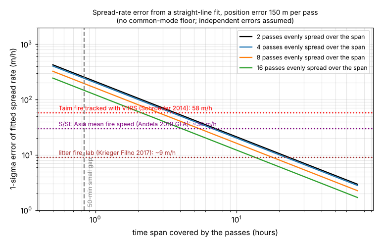

# Detection squares v2: deep literature on structured noise and pooling many passes

Thread r19_lit. Written 2026-10-17. Feeds the sibling threads r19_pool (`squares_v2_pooled.md`) and r19_track (`squares_v2_tracking.md`).

**Why this exists.** The first pass (`detection_squares_experiment.md`) looked at each VIIRS small-gap pair (two looks about 50 min apart) on its own. The apparent moves were noise. The median move was 254-290 m, and the industrial-site null had a median of 254 m and a 95th percentile of 1,083 m. Real litter-fire spread in 50 min is about 10-20 m. Akkshay asked for the next step: model the noise properly and pool or combine many passes. This file collects what the published literature says about doing that, with numbers taken from the full texts.

**Ground rules followed.** VIIRS is treated as a 375 m-or-larger block using scan/track geometry. Every sensor detection is kept separate with its own time, and near-time looks are never merged. No credentials are written here. "INFERENCE" marks my own reasoning, as opposed to what a paper states.

**Terms used (one phrase each)**

| Term | Meaning |
|---|---|
| pass / look | one satellite overpass imaging Ratapani |
| small-gap pair | two looks by different VIIRS satellites about 50 min apart |
| scan / track | across the swath / along the flight direction |
| aggregation zone | VIIRS onboard averaging of 3, 2 or 1 raw samples along scan, which sets pixel size |
| bow-tie | overlap between neighbouring scans at the swath edge; some rows are deleted onboard |
| common-mode error | a position error shared by all pixels in one pass (pointing/attitude) |
| quantization error | a fire is reported at the pixel centre, so it is off by up to half a pixel |
| drizzle | adding many shifted coarse images onto a finer grid |
| MAP | maximum a posteriori: the best estimate under a data model plus a prior |
| non-detection | a pixel that was seen clearly and had no fire, which is evidence too |
| loop closure | checking that A→B plus B→C equals A→C |
| IQR | interquartile range, a robust spread measure |
| FRP | fire radiative power, in MW |

---

## 1. Reading status

The task asked for at least 15 sources read in full. **The count is 19.** "FULL" means I read the whole body text (references skipped). "PARTIAL" means the methods and results sections were read in a targeted way.

| # | Source | Status | Main use |
|---|---|---|---|
| 1 | Fruchter & Hook 2002, PASP 114:144 (drizzle) | FULL | track |
| 2 | Merino & Nunez 2007, IEEE TGRS 45:1446 (drizzle for Landsat) | FULL | track |
| 3 | Farsiu et al. 2004, IEEE TIP 13:1327 (robust super-resolution) | FULL | track, pool |
| 4 | Peterson et al. 2013a, RSE 129:262 (sub-pixel fire area vs airborne) | FULL | negative result |
| 5 | Peterson & Wang 2013b, RSE 129:231 (sub-pixel retrieval sensitivity) | FULL | negative result |
| 6 | Wooster et al. 2005, JGR 110:D24311 (FRP physics) | FULL | FRP noise |
| 7 | Scaduto, Chen & Jin 2020, IEEE JSTARS 13:5102 (VIIRS/MODIS day-of-burn interpolation) | FULL | track |
| 8 | Andela et al. 2019, ESSD 11:529 (Global Fire Atlas) | FULL | spread priors |
| 9 | Chen et al. 2022, Sci Data 9:249 (FEDS VIIRS fire tracking) | FULL | track, code |
| 10 | Roberts, Wooster & Lagoudakis 2009, Biogeosciences 6:849 (SEVIRI diurnal cycle) | FULL | timing |
| 11 | Wooster et al. 2015, ACP 15:13217 (LSA SAF geostationary FRP) | FULL | geostationary |
| 12 | Ramo et al. 2021, PNAS 118:e2011160118 (Sentinel-2 small fires) | FULL | truth data |
| 13 | Schroeder et al. 2014, RSE 143:85 (VIIRS 375 m active fire algorithm) | FULL | noise model |
| 14 | Wolfe et al. 2013, JGR Atmos 118:11508 (VIIRS geolocation) | FULL | noise model |
| 15 | Csiszar et al. 2014, JGR Atmos 119:803 (VIIRS active fire status) | FULL | noise model |
| 16 | Schroeder, Giglio & Hall 2025, VIIRS C2 375 m AF User Guide v1.2 | FULL | data fields |
| 17 | Haley et al. 2018 (detection likelihood for fire data assimilation) | FULL | track, likelihood |
| 18 | Farguell et al. 2021, Remote Sens 13:2203 (SVM fire arrival time) | FULL | track |
| 19 | Parks 2014, IJWF 23:215 (day-of-burn interpolation, 10 methods) | FULL | track |
| 20 | Kääb et al. 2016, Remote Sens 8:598 (Sentinel-2 co-registration, glacier flow) | PARTIAL | pool |
| 21 | Gardner et al. 2018, Cryosphere 12:521 (ITS_LIVE stacking) | PARTIAL | pool |
| 22 | Morishita et al. 2020, Remote Sens 12:424 (LiCSBAS time series) | PARTIAL | pool |
| 23 | Mandel et al. 2012, arXiv 1203.2230 (fire data assimilation) | PARTIAL | track |
| 24 | Rochoux et al. 2014, NHESS (EnKF on fire front) | PARTIAL | track |
| 25 | Veraverbeke et al. 2014, IJWF (kriging day-of-burn) | PARTIAL | track |
| 26 | Briones-Herrera et al. 2020, Remote Sens (convex hull of active fires) | PARTIAL | area |
| 27 | Johnston et al. 2018, Fire (rate-of-spread methods, lab burns) | PARTIAL | spread |
| 28 | Krieger Filho et al. 2017 (litter fire lab study, Amazon) | PARTIAL | spread |
| 29 | Giglio et al. 2006, JGR 111:G02016 (diurnal cycle, TRMM VIRS) | PARTIAL | timing |
| 30 | Giglio dissertation (sub-pixel / Dozier limits) | PARTIAL | negative result |
| 31 | ISRO INSAT-3DS product documents, LSA SAF IODC page | PARTIAL | geostationary |
| 32 | VIIRS 375 m ATBD (NASA) | PARTIAL | noise model |

**Wanted but not obtained** (paywall, Cloudflare block or not found):
- Giglio & Kendall 2001 (Dozier limits; I used the numbers quoted by Peterson 2013a instead).
- Zhukov 2006; Wooster 2003; Zhang/Wooster 2017; Calle 2009 (quoted via Peterson).
- Freeborn 2011 and 2014; Coen & Schroeder 2013; Srivas 2016; Ahmadov 2017.
- Dehecq 2015; Meinhart (PIV ensemble correlation); Oliva & Schroeder 2015.

One honest correction: Johnston 2018 turned out to be a laboratory study comparing rate-of-spread methods (27 burns, 8 methods). It is not a satellite rate-of-spread paper.

---

## 2. Main finding in one paragraph

No published work recovers sub-pixel fire motion from one pair of passes 50 minutes apart, and the first pass showed why. The best VIIRS fire-tracking systems state a perimeter uncertainty of about ±500 m (FEDS) and time steps of about 12 h (FEDS, Farguell). Spread rates in the literature are measured over days, as with the 58 m/h Taim fire tracked over 6 days by Schroeder 2014.

Three tools from other fields do carry over, and each makes errors shrink with more data:
- **glacier and InSAR stacking:** per-pass offset correction on stable targets, robust IQR culling, and loop closure;
- **astronomy drizzle and robust super-resolution:** many dithered looks with median/L1 fusion;
- **fire data assimilation:** a footprint likelihood that also counts non-detections.

The single biggest lever is **time span, not pair count** (Figure 1). Fitting one straight line through all passes over 24 h cuts the spread-rate error by about 30× compared with a 50-min pair (INFERENCE from the LiCSBAS formula). Sub-pixel tricks (drizzle, Dozier) give much smaller gains for binary detections of weak fires.

*Figure 1. The 1-sigma error of a spread rate fitted as a straight line through N passes, with 150 m position error per pass and independent errors. A 50-min pair gives about 255 m/h. Six passes over 24 h give about 9 m/h. Real errors have a floor from correlated noise (section 4), so these are best cases.*

---

## 3. The structured noise in a VIIRS 375 m detection (what the sources say)

This is the error model both sibling threads should use. Each line gives its source.

| Error part | Size | Shared by a whole pass? | Source |
|---|---|---|---|
| **Pixel quantization**: the fire sits anywhere inside the pixel but is reported at its centre | per-axis sd = pixel/√12. That is 375 m → 108 m at nadir, about 790 m → 228 m at the swath edge | No (per pixel) | INFERENCE from the footprints in Schroeder 2014 |
| Pixel size by aggregation zone | 0-31.6°: about 375×375 m; 31.7-44.9°: grows; 44.9-56.3°: up to 795×784 m | No, but steps at 31.59-31.72° and 44.6-44.86° | Schroeder 2014; Csiszar 2014; Wolfe 2013 |
| Along-scan blur | trapezoid (detector dragged during integration); along track a box | — | Wolfe 2013 |
| Geolocation | RMSE 70 m along track, 60 m along scan, mean bias about 2 m (nadir-equivalent; grows with scan angle) | Partly | Wolfe 2013 |
| Attitude jitter | about 10 arcsec peak-to-peak, which is ±40 m; about once per orbit for about 2 min | **Yes** | Wolfe 2013 |
| Star-tracker realignment | 5 arcsec ≈ 20 m step | **Yes** | Wolfe 2013 |
| Terrain parallax | up to 2.75 × the DEM error at the swath edge | No | Wolfe 2013 |
| Residual bow-tie duplicates | the same ground spot can be detected in two adjacent scans; flagged only in the L2 "algorithm QA" bit 22, **not** in the ML CSV | Within a pass | C2 User Guide 2025 |
| Bow-tie deleted rows | 4 rows (zone 2), 8 rows (zone 3). These are missing data, **not** non-detections | — | Schroeder 2014 |
| FRP sharing | FRP is computed on the 750 m M13 pixel and split equally among the 375 m pixels inside it | — | C2 User Guide 2025 |
| Detection probability step | the detectable fire area/temperature jumps at the zone switch angles | — | Csiszar 2014 |
| Night plume / hot-gas parallax | detections at high scan angle pushed outward toward the swath edge | No | C2 User Guide 2025 |
| Early-record bug | M13 about 50 K low before 3 Apr 2012; whole-scan-line false detections about 1/day until Oct 2012 | — | Csiszar 2014 |

**INFERENCE (important for both threads).** The first-pass null (industrial sites, median pair move 254 m) is explained mostly by **quantization plus zone-dependent pixel size, not by geolocation**:
- Two independent quantization errors at nadir give a per-axis sd of √2·108 ≈ 153 m and a radial median of about 180 m.
- Off-nadir zones push this higher, which matches the 254 m median.
- Geolocation (60-70 m) adds only modestly.

Consequences:
- **Per-pass common-mode correction will help only a little with random scatter** (expected roughly 10-20% smaller per-pass error). It does matter for **bias**, because bias never averages down.
- Quantization **does** average down when the pixel grid lands at a different sub-pixel phase on each pass. VIIRS orbits shift every day, so this holds (Merino 2007: super-resolution needs "different sampling lattices"). This is the physical basis for both pooling and drizzle.
- The 95th percentile of 1,083 m is a heavy tail: bow-tie duplicates, zone-3 pixels, and neighbouring heat sources. Use median/IQR statistics, never means (Farsiu 2004; Gardner 2018).

**Explains the first-pass FRP result.** FRP weighting gave no gain because neighbouring 375 m pixels in one M13 pixel share identical FRP by construction (C2 User Guide). The FRP differences inside a 750 m block carry no position information.

---

## 4. Pooling theory (for r19_pool)

| Idea | Equation / rule | Source | Our number |
|---|---|---|---|
| Error of the mean | σ/√N for independent errors | standard | 255 m/h/√N per pair; ±25 m/h needs about 100 pairs at 1σ, about 420 for a clear detection (first pass) |
| Straight-line fit over a span | σ_v = 2√3·σ_e /(√N·T) (large N, even spacing) | Morishita 2020 (LiCSBAS) | σ_e=150 m, N=6, T=24 h → **8.8 m/h** (INFERENCE) |
| Correlated-noise floor | InSAR vs GNSS velocity scatter levels off at about 2 mm/yr and does not reach 0 as data grow | Morishita 2020 | expect a floor from per-pass common-mode error and zone effects; measure it on static sites |
| Per-pass offset from stable targets | co-register each pair on stationary pixels (<50 m/yr, IQR<40), offsets weighted by count; absolute Landsat-8 error about 15 m removed | Gardner 2018 | use industrial/static heat sites in the same pass as "stable ground" |
| Robust stacking | drop values outside Q1−T·IQR … Q3+T·IQR, T=3 first, then T=1.5; report the IQR as the error because formal σ is "unrealistically low" | Gardner 2018 | apply per fire episode and per pooled class |
| Loop closure | A→B + B→C − A→C should be 0; the residual measures noise and flags bad pairs | Kääb 2016 (triplets; 10-20% of a pixel); Morishita 2020 | triplets of passes (e.g. S-NPP / NOAA-20 / NOAA-21) give a free empirical noise estimate |
| Stable-offset subtraction | estimate the mean offset on stable ground and subtract it as a constant before computing velocity; Sentinel-2 bias 1-3 m (up to 10 m along track), random ±1-2 m ≈ 1/10 pixel | Kääb 2016 | per-pass offset from static sites, then subtract |
| Robust fusion | mean (L2) has breakdown point 0; median (L1) has 0.5. A wrong 1-pixel registration in 3 of 16 frames ruins L2 but not L1 | Farsiu 2004 | always median-of-displacements, never mean |

**Concrete pooling recipe (copyable, INFERENCE where noted):**
1. **Use signed projections, not distances.** The mean of |displacement| is biased upward by noise (the Rice bias; INFERENCE, standard statistics). Project each later detection's offset onto the **outward direction from the earlier-pass cluster centroid** (or the uphill or downwind direction). Pure noise then has mean zero and real spread has a positive mean. This is the single most important change from the first pass.
2. Before any spread estimate, subtract each pass's common-mode offset, estimated from static/industrial sites in the same pass (Gardner, Kääb).
3. Before pooling, drop residual bow-tie duplicates (same pass, about 1 scan apart, needs L2 QA bit 22 or scan/line reconstruction). This drops a duplicate record of one look; it does not merge two looks.
4. Stratify by aggregation zone of each look (1/2/3) and by day versus night. Weight by 1/(pixel area)², because quantization variance ∝ pixel size².
5. Get the noise from closure triplets and the static-site null, not from formulas.
6. Report median ± IQR per class (Gardner).

---

## 5. Per-source entries

Each entry lists: the exact numbers (from the full text), what to copy, and a **Concrete action for us** tagged [pool], [track], [spread] or [big-fires].

### 5.1 Fruchter & Hook 2002: Drizzle (PASP 114:144; arXiv astro-ph/9808087) — FULL
- **Numbers:**
  - Weight update W' = a·w + W; image update I' = (d·a·w·s² + I·W)/W', where a is the overlap area, p the "pixfrac" drop size and s the output scale.
  - Hubble Deep Field: p=0.6, s=0.5.
  - Noise correlation ratio: R = 1/(1−r/3) for r=p/s ≤1, or r/(1−1/(3r)) for r ≥1. At p=0.6, s=0.5, R=1.662.
  - Astrometry reached 0.018 input pixel rms, but only with many dithers on bright stars.
  - Drizzle does **not** deconvolve. It needs many looks spread evenly in sub-pixel phase.
- **Copy:** the two update equations and the R correction. When you quote an error from a drizzled map, multiply it by √R.
- **Concrete action for us [track]:** drizzle **static** heat sources (industrial sites) over all passes onto a 125 m grid, s=1/3 of 375 m, p≈0.6. Check whether the drizzled centroid converges on the known site location as passes are added. This is the calibration curve that shows what drizzle can deliver for binary detections. Expect far worse than 0.018 px, because detections are binary and low signal (INFERENCE).

### 5.2 Merino & Nunez 2007: Super-resolution variable-pixel linear reconstruction (IEEE TGRS 45:1446) — FULL
- **Numbers:**
  - 9 Landsat ETM+ 30 m scenes over 2 years were reconstructed to 15 m (s=0.5).
  - Co-registration RMSE was 0.5-0.6 pixel. They chose p=0.85, because stripe artefacts appear near p_min = √(2s²) = 0.71.
  - Quickbird simulation: 9 images, 4.8 → 2.4 m.
  - Things that change between dates create "ghosts" proportional to the fraction of images showing them.
- **Copy:** the p_min = √2·s rule. Use p a bit above it.
- **Concrete action for us [track]:** a moving fire **is** a ghost. Drizzle only inside windows where the fire moves much less than one pixel. With litter-fire speeds of about 9-30 m/h (section 5.8, 5.26), a window up to about 6-12 h moves 50-350 m (INFERENCE). So drizzle per day/night window, not across days. Use the static-site test (5.1) to pick p.

### 5.3 Farsiu, Robinson, Elad & Milanfar 2004: Fast and robust multiframe super-resolution (IEEE TIP 13:1327) — FULL
- **Numbers:**
  - Forward model Y_k = D·H·F_k·X + V_k (warp F, blur H, decimation D).
  - The L2 estimate equals the pixelwise mean (breakdown point 0). The L1 estimate equals the pixelwise median (breakdown 0.5).
  - With a wrong 1-pixel motion in 3 of 16 frames, L2 gives artefacts and L1 does not.
  - A moving object in 10 of 55 frames is removed by the median.
  - A bilateral total-variation prior beats Tikhonov (MSE 215 vs 313).
  - About r² frames are needed for an enhancement factor r. 5-20 iterations. MATLAB code on the Milanfar site.
- **Copy:** the forward model, with D = the zone-dependent decimation and H = trapezoid along scan × box along track (Wolfe). Use L1 data fidelity plus a bilateral-TV prior. "Median shift-and-add, then deblur" is the fast version.
- **Concrete action for us [track][pool]:** build r19_track's MAP as L1 + BTV. For a factor of 3 (375 → 125 m), plan on ≥9 looks with varied phase per window. Treat bad registration as outliers, not Gaussian noise.

### 5.4 Peterson et al. 2013a: Sub-pixel fire area vs airborne truth (RSE 129:262) — FULL
- **Numbers:**
  - Airborne AMS imagery (about 15 m) within ±15-17 min of MODIS: 6 scenes, 33-37 fire pixels.
  - Per-pixel fire area correlation R=0.59. With high-confidence pixels only, R=0.67. With 8/33 edge pixels removed, R=0.84, but that drops 45% of pixels.
  - **Cluster sums R=0.91.**
  - Sub-pixel (Dozier) retrieval is feasible only above a fire fraction of about 0.005 (Giglio & Kendall, quoted).
  - Pixel brightness falls when the fire is near the pixel edge and rises near the centre (Calle 2009, quoted).
  - MODIS detection limits about 9-11 MW.
- **Copy:** nothing per pixel. Copy only the "aggregate first, then retrieve" rule.
- **Concrete action for us [pool]:** do **not** try per-pixel sub-pixel fire location or area. Litter fires fill a fraction of about 1e-4 to 1e-3 of a pixel, below the Dozier limit (INFERENCE from 0.005). Note: the edge-versus-centre brightness effect means detection probability itself depends on where the fire sits in the pixel. This supports a footprint likelihood (5.17) rather than a point model.

### 5.5 Peterson & Wang 2013b: Sensitivity of sub-pixel retrievals (RSE 129:231) — FULL
- **Numbers:**
  - A 1 K error in the 11 µm background changes the retrieved fire area by 50-196% (mean 122%).
  - A ±5 K error at 4 µm changes area by 23%. A water-vapour error changes area by 69%.
  - Retrieval is impossible (background warmer than the fire pixel) in 8.1% (California) and 17.6% (Texas) of cases: 26.4% by day, 1.9% at night.
  - Gridding to 10 km (cluster averaging) raises the correlation with wind from 0.14 to 0.55.
- **Concrete action for us [pool]:** a negative result. It closes off sub-pixel temperature/area as a position signal. Night looks are cleaner than day looks, so give night detections more weight in any intensity-based step.

### 5.6 Wooster et al. 2005: FRP physics (JGR 110:D24311) — FULL
- **Numbers:**
  - FRP = A·σ/a·(L_MIR − L_bg)/τ, accurate within ±12% for 665-1365 K. The coefficient a = 2.96 (Terra), 2.98 (Aqua), 3.06 (SEVIRI) ×1e-9; VIIRS M13 uses a=2.88e-9.
  - An 800 K fire covering 0.001 of the pixel raises the 4 µm temperature by +30 K but the 11 µm temperature by <1.5 K.
  - A background error of ±0.75 K gives ≤8% FRP error. With recent burn scars nearby, the error can reach +90 % / −140 % for the smallest fires.
  - 0.368 ± 0.015 kg of fuel per MJ of fire radiative energy (r²=0.98).
  - About 9% of FRP remains 7 minutes after flaming stops.
- **Copy:** the 0.368 kg/MJ conversion if we ever turn FRP into fuel burned.
- **Concrete action for us [spread]:** the FRP of small fires is dominated by background noise. Do not pool FRP changes as a spread signal for fires under about 5-10 MW. The residual glow means a detection can lag the front (smouldering behind it), which biases "last seen" positions backward (INFERENCE).

### 5.7 Scaduto, Chen & Jin 2020: Day-of-burn interpolation from VIIRS and MODIS (IEEE JSTARS 13:5102) — FULL
- **Numbers:**
  - 42 northern-California fires >5,000 acres, compared with nightly airborne IR perimeters (6.3 m).
  - Methods: kriging, IDW (p=2, ≥8 points or 2 km), natural neighbour, empirical Bayesian kriging; 375 m grid; the earliest detection is kept.
  - Cumulative detection: VIIRS 0.65 ± 0.19, MODIS 0.72 ± 0.17, both 0.84 ± 0.12. Daily VIIRS false-negative rate 0.41.
  - VIIRS natural neighbour: kappa 0.55; 61% exact day; 86% within ±1 day. Daily-area R² 0.70, rising to 0.83 with a 2-day window.
  - Camp fire: active fire caught only 40-57k of 109k acres in the first 2 days, because the fast front was missed.
  - They merged MODIS/VIIRS within 20 min and 200 m. We do **not**, by Akkshay's rule.
- **Concrete action for us [track]:** use natural-neighbour interpolation of the earliest detection as the **baseline** arrival-time map that drizzle/MAP must beat. Expect about 60% exact-day agreement against our 340-photo truth if Ratapani behaves like California (INFERENCE).

### 5.8 Andela et al. 2019: Global Fire Atlas (ESSD 11:529) — FULL
- **Numbers:**
  - Built from MCD64A1 (500 m, daily); minimum fire 21 ha.
  - Mean fire speed 0.9 km/d. **S/SE Asia 0.7 km/d ≈ 30 m/h**, with expansion 0.4 km²/d.
  - Against VIIRS burn dates in forests: 24% same day, 54% within ±1 day.
  - A 3-day running mean is needed to match USFS daily growth. Speed and direction were **not** validated.
  - Daily burned area cannot resolve the diurnal cycle; the product is poor below 100 ha.
  - Data: ORNL DAAC dataset 1642.
- **Concrete action for us [spread][pool]:** use 30 m/h (day-averaged) as the regional **prior** for spread speed. Since fires burn mostly by day, the daytime rate is perhaps 2-3× that (INFERENCE from the diurnal width in 5.10). That is the effect size pooling must detect. Download the GFA perimeters and directions for MP to set a prior direction for the signed projection (section 4, step 1).

### 5.9 Chen et al. 2022: FEDS VIIRS fire tracking (Sci Data 9:249) — FULL
- **Numbers:**
  - Input: VNP14IMGML, vegetation type only; half-daily steps.
  - A new detection joins an existing fire if within 5 km (forest) or 1 km (other).
  - Perimeter: alpha shape α=1 km plus a 187.5 m buffer. Three pixels make a convex hull; one or two pixels become circles of r=187.5 m. The active front is the part of the perimeter within 500 m of new pixels.
  - Static-fire rule: area <20 km² and >20 pixels/km² marks an industrial site.
  - Validation: precision 0.847, recall 0.925, IoU 0.794. **Perimeter uncertainty ±500 m (1 sd).**
  - Python code: figshare 10.6084/m9.figshare.c.5601537.
- **Copy:** the static-fire rule (to build our list of stable-ground calibration sites) and the alpha-shape code.
- **Concrete action for us [pool][track]:** use the static rule to find calibration sites inside the same passes, as Gardner does with stable ground. Use FEDS α=1 km perimeters as a second baseline. FEDS treats each pixel as a point at its centre; our improvement is the footprint likelihood.

### 5.10 Roberts, Wooster & Lagoudakis 2009: SEVIRI diurnal cycle (Biogeosciences 6:849) — FULL
- **Numbers:**
  - The majority of SEVIRI fire pixels appear in only 1-2 consecutive 15-min slots.
  - Co-registration error <0.4 km.
  - Diurnal peak about 14:00 local time. The width (25th-75th percentile of the cumulative cycle) is **2-4 h in deciduous forest/woodland** and 4-8 h in grassland.
  - Per-pixel FRP in the early afternoon is about 2× the night value.
  - Fires vanish in the evening and reappear the next morning.
- **Concrete action for us [spread][track]:** do **not** fit a constant spread rate across night and day. Fit a two-rate model (day rate, night rate ≈ small), or put the diurnal shape into the arrival-time prior. The 13:30 VIIRS passes sit at the peak and the 01:30 passes near the trough. A night non-detection is weak evidence of extinction.

### 5.11 Wooster et al. 2015: LSA SAF geostationary FRP (ACP 15:13217) — FULL
- **Numbers:**
  - SEVIRI 4.8 km field of view, sampled every 3 km.
  - Detects pixels down to about 10 MW, but counts are underestimated below 30-40 MW.
  - Omission against MODIS at the same time is about 70%.
  - The sub-pixel fire position changes the signal by 1.0 ± 7.7% (Met-8 vs Met-9). A sinc-type resampling filter smears the fire into its neighbours.
  - Saturation at about 250 MW.
  - The paper covers only 0° MSG. The IODC product is listed separately by LSA SAF as a demonstration product.
- **Concrete action for us [big-fires]:** at Ratapani's view angle (about 45-48° from IODC), the useful minimum is about 40-60 MW per pixel (INFERENCE: scales with pixel area). Our cell-passes ≥50 MW are 2.2%. Use geostationary data only to time big fires (start/peak hour), never for sub-375 m geometry.

### 5.12 Ramo et al. 2021: Small fires seen by Sentinel-2 (PNAS 118:e2011160118) — FULL
- **Numbers:**
  - Sentinel-2 at 20 m found 4.89 Mkm² burned in Africa in 2016, against 2.72 for MCD64A1.
  - **Fires <100 ha are 41% of burned area at 20 m but 4.8% in MODIS.** In forest the small-fire ratio is 10.2×.
  - Sentinel-2 burned area: omission 24.5%, commission 8.1%, Dice 0.83.
  - The algorithm is seeded by active-fire detections.
- **Concrete action for us [track]:** Sentinel-2 burned-area scars (5-day revisit, 20 m) are the best wide-area **truth** for the final shape of a litter fire. Seed with VIIRS 375 m detections. Score drizzle/MAP footprints against Sentinel-2 scars, beyond the 340 photos.

### 5.13 Schroeder et al. 2014: VIIRS 375 m active fire algorithm (RSE 143:85) — FULL
- **Numbers:**
  - Native sample 125 m along scan. Zones: aggregate 3 (0-31.72°), 2 (to 44.86°), 1 (to 56.28°).
  - Footprint 383×360 m at nadir, 795×784 m at the swath edge.
  - Bow-tie deletion of 4 rows (zone 2) and 8 rows (zone 3).
  - I4 saturates at 367 K: 8% of daytime fire pixels, 1% at night.
  - Commission <1.2%. Low-confidence pixels make up 11% of daytime detections and sit at cluster edges, as "lower intensity sub-pixel fire activity".
  - A night bonfire of about 5 m² was detected.
  - **The Taim fire's spread was measured at 58 m/h from sequential VIIRS 375 m images over 6 days.**
- **Concrete action for us [pool][track]:** keep low-confidence edge pixels; they are real weak fire. Give each detection its zone footprint. Mark deleted bow-tie rows as "not observed", not as non-detections. Taim (58 m/h over days) is the only published VIIRS-derived spread rate I found, and it used a multi-day span, which supports ranking item 1.

### 5.14 Wolfe et al. 2013: VIIRS geolocation (JGR Atmos 118:11508) — FULL
- **Numbers:**
  - Orbit about 829.8 km (equator), 101.5 min period, 16-day repeat.
  - Along-scan line spread is a trapezoid; along track it is a box; the I-bands are "undersampled in all zones".
  - Geolocation RMSE 70 m (track), 60 m (scan), mean 2 m.
  - Jitter ±40 m, about once per orbit for about 2 min. Star-tracker steps 20 m. Sync-loss events about 1 in 17 days are flagged.
  - Terrain parallax up to 2.75× the DEM error.
  - Band-to-band offset about 0.1 M-pixel (about 75 m) or less.
- **Concrete action for us [pool][track]:** the error model in section 3. Estimate the common-mode part per pass, and per 2-min segment if jitter shows up, from static sites. **INFERENCE:** the split of 60-70 m into common-mode versus per-pixel is unpublished, so measure it.

### 5.15 Csiszar et al. 2014: VIIRS active fire status (JGR Atmos 119:803) — FULL
- **Numbers:**
  - Switch angles 31.58° and 44.6°. The detection limit "changes more significantly at those angles".
  - VIIRS vs MODIS counts: +26% in the 3-sample zone, +70% outside it.
  - M13 aggregation bug before 3 Apr 2012 (about 50 K low).
  - Whole-scan-line false detections about 1/day until Oct 2012, then about 1/month.
  - A case where MODIS detections were shifted 1-2 km along track at 51.8° view.
- **Concrete action for us [pool][track]:** start the record in Apr 2012. Drop detections that form a full-scan-line burst. Model detection probability as a step function of zone, not of view angle alone.

### 5.16 Schroeder, Giglio & Hall 2025: VIIRS C2 375 m AF User Guide v1.2 — FULL
- **Numbers:**
  - Granule 6 min ≈ 202 scans × 32 rows × 6,400 samples.
  - Fire mask classes 0-9: 1 = bow-tie deletion; 7/8/9 = low/nominal/high confidence.
  - Residual bow-tie duplicates are flagged only in L2 QA bit 22.
  - FRP is shared equally among the 375 m pixels inside one M13 pixel.
  - ML CSV fields include Line, Sample, VZA, VAA, PixArea and Type. A Type bug (static sources labelled vegetation) was fixed in v3 (May 2025).
  - Night plume parallax pushes detections outward.
  - Access: public login in the C2 User Guide §4.2 (not copied here).
- **Concrete action for us [pool][track]:**
  1. Re-download ML CSV v3 to get the corrected Type flags (static sites).
  2. Use Line/Sample to rebuild the zone, detector row and scan number for every detection.
  3. Pull **L2 VNP14IMG/VJ114IMG fire masks** (not just CSVs) to get non-detections (class 5 = clear land, no fire) and bit 22. This is the single most important data step for r19_track.

### 5.17 Haley, Farguell, Kochanski, Schranz & Mandel 2018: Detection likelihood for fire assimilation — FULL
- **Numbers:**
  - Heat flux h = 0 before arrival time T(x), then decays exponentially with a 2 h time constant.
  - P(detect) is logistic in heat fraction: 50% at 1% heat fraction, with a 0.1% false-detection rate.
  - The detection is convolved with an isotropic Gaussian geolocation error s (2,000 m used for MODIS).
  - Non-detection likelihood is 1−P. A confidence c∈[0,1] weights each pixel; c=0 means missing (cloud). Log-likelihoods add.
  - Ignoring non-detections biases ignition **early**. The real fire (Patch Springs) came out 3 km off, with time within 1 h.
- **Copy:** the whole likelihood, with three changes:
  - (a) replace the isotropic Gaussian with the **zone footprint box × trapezoid**, convolved with σ≈65 m geolocation;
  - (b) refit the 1% / 50% logistic with a zone step (Csiszar);
  - (c) treat bow-tie rows as c=0.
- **Concrete action for us [track]:** this is r19_track's observation operator. Fit one arrival-time surface per fire using all looks, detections and non-detections, each kept separate with its own time. Parameters to estimate are the ignition point/time and one rate of spread (Mandel 5.23), not a free grid.

### 5.18 Farguell et al. 2021: SVM fire arrival time (Remote Sens 13:2203) — FULL
- **Numbers:**
  - Weighted soft-margin SVM (RBF kernel) on (lon, lat, time). Fire = +1, clear ground = −1, using L2 masks.
  - Weights C_i = k·c_i³. Clear ground gets c=95%. Fire pixels below 70% confidence are dropped.
  - 10 large California 2020 fires: POD 0.86, FAR 0.21, Sørensen 0.82, area MAPE 12%. 81% of fire pixels fall between the right perimeters (about 2 in 10 are inconsistent).
  - **63% of errors are over-prediction from treating pixels as centre points** when the footprint is >1 km² at the edge.
  - Code: wrfxpy / JPSSdata on GitHub.
- **Concrete action for us [track]:** a ready alternative baseline, and proof that non-detections help at scale. Its main stated error is exactly the point-versus-footprint problem, which supports the footprint likelihood. Note that it drops low-confidence pixels, but for us they are real edge fire (5.13), so keep them with low weight.

### 5.19 Parks 2014: Ten day-of-burn interpolators compared (IJWF 23:215) — FULL
- **Numbers:**
  - 21 US fires 6,337-221,043 ha.
  - Best method (weighted mean date) 46.1% exact, 75.8% within ±1 day, 85.8% within ±2 days. Worst (ND) 42.8/69.4/80.7.
  - The top six methods agree with kappa >0.95.
  - Patches ≤25 ha were merged into neighbours.
  - "Unsuitable" for fires much smaller than 500 ha.
- **Concrete action for us [track]:** the interpolator barely matters (differences under 4 points). Don't tune interpolators; improve the data model. Most Ratapani fires are well under 500 ha, so expect worse than 46% exact-day from a simple interpolation (INFERENCE).

### 5.20 Kääb et al. 2016: Sentinel-2 co-registration and glacier flow (Remote Sens 8:598) — PARTIAL
- **Numbers:**
  - Repeat-orbit bias 1-3 m (up to 10 m along track), random ±1-2 m ≈ 1/10 pixel.
  - A DEM error dh shifts position by dh/5.4 across track (up to dh/2.7 between neighbouring orbits).
  - The offset on stable ground is subtracted as a constant.
  - Three-image triangulation residuals give 10-20% of a 10 m pixel.
- **Concrete action for us [pool]:** closure triplets of VIIRS passes (three satellites within about 100 min) estimate the per-detection noise empirically, and flag bad looks.

### 5.21 Gardner et al. 2018: ITS_LIVE glacier velocity stacking (Cryosphere 12:521) — PARTIAL
- **Numbers:** absolute geolocation about 15 m, removed per pair using stationary pixels; IQR culling with T=3, then T=1.5; error reported as IQR because the formal σ is too optimistic.
- **Concrete action for us [pool]:** this is the recipe in section 4 almost unchanged. Swap "stationary ice" for "static heat sites in the same pass".

### 5.22 Morishita et al. 2020: LiCSBAS time series (Remote Sens 12:424) — PARTIAL
- **Numbers:**
  - Loop-closure phase flags bad interferograms.
  - σ_v = 2√3·σ_e/(√N·T).
  - Velocity scatter against GNSS converges to about 2 mm/yr, not 0.
  - Network gaps shrink the effective T.
- **Concrete action for us [pool][spread]:** fit a line (or a two-rate day/night model) through every look of one burning episode. Report σ_v from the formula **and** from the empirical floor measured on static sites. See Figure 1.

### 5.23 Mandel et al. 2012: Fire data assimilation (arXiv 1203.2230) — PARTIAL
- **Numbers:**
  - The fire state is a level set / arrival time, built from a perimeter with the eikonal equation R|∇L|=1.
  - Additive data assimilation fails for fire; morphing corrections are needed.
  - EnKF needs 20-100+ ensemble members; particle filters need 1e4+.
- **Concrete action for us [track]:** estimate **one rate-of-spread multiplier per fire-day** between observed footprints, not a gridded state. That is cheap and robust.

### 5.24 Rochoux et al. 2014: EnKF on fire-front position (NHESS) — PARTIAL
- **Numbers:** the EnKF converged with Ne=48 members (Ne=1000 with a polynomial-chaos surrogate), with observation error σ_o = 2 m on a reduced-scale fire. Control parameters were fuel moisture and surface-to-volume ratio.
- **Concrete action for us:** not directly usable. Their observation error is 2 m; ours is about 150-250 m. It shows the parameter-estimation framing (5.23) is standard.

### 5.25 Veraverbeke et al. 2014: Kriging day-of-burn from MODIS (IJWF) — PARTIAL
- **Numbers:**
  - Kriging with variogram analysis per fire.
  - 73% of pixels within one day for 9 fires, against 33% for MCD45A1 and 53% for MCD64A1.
  - Median kriging standard error 0.80-3.56 days. Geolocation adds 0.34-2.72 days, highest in dense clusters.
- **Concrete action for us [track]:** kriging gives a free per-pixel timing error map. Use it as a second baseline. Geolocation-induced timing error is largest in dense clusters, which is where the footprint likelihood should help most.

### 5.26 Krieger Filho et al. 2017: Litter fire lab study (Amazon litter) — PARTIAL
- **Numbers:** rate of spread 15.1 ± 1.2 cm/min ≈ 9 m/h. The fire propagated in only 49% of 72 experiments.
- **Concrete action for us [spread]:** about 8 m in 50 min, which is about 1/25 of the pair noise (about 210 m position-difference sd). That confirms single small-gap pairs cannot work. Lab litter fires are slower than wind- or slope-driven field fires, so take 9 m/h as a floor.

### 5.27 Johnston et al. 2018: Comparing rate-of-spread methods (Fire) — PARTIAL
- **Numbers:** 27 lab burns, 8 rate-of-spread methods. 63% of burns got conflicting intensity classes depending on the method. Direction matters.
- **Concrete action for us [spread]:** report the method with any spread number (head-fire versus mean radial). The signed-projection approach gives a mean outward rate, not a head-fire rate.

### 5.28 Briones-Herrera et al. 2020: Convex hulls of active fires (Remote Sens) — PARTIAL
- **Numbers:** convex hulls of monthly MODIS+VIIRS detections at a 750-1500 m aggregation distance gave 93/88/96% agreement with MCD64A1. A hull needs ≥3 points. A 1 km buffer around lone points overestimates small burns.
- **Concrete action for us [track]:** use only as a crude area baseline. Lone-point fires (most of ours) need the footprint model, not buffers.

### 5.29 Giglio et al. 2006 (JGR 111:G02016) and the Giglio dissertation — PARTIAL
- **Numbers:**
  - A strong diurnal cycle in SE Asia; Terra (10:30) is nearly blind in tropical forest.
  - The Dozier bispectral method on ASTER was "relatively unsuccessful" because of the background radiance problem. Use at cluster level only.
- **Concrete action for us:** agrees with 5.4, 5.5 and 5.10.

### 5.30 INSAT-3DS products and LSA SAF IODC — PARTIAL
- **Numbers:**
  - An L2P FIR (fire) product exists (e.g. `3SIMG_18SEP2024_0600_L2P_FIR_V01R00`) with KML output for FIRE and SMOKE.
  - MOSDAC Live keeps a rolling archive of about 6 weeks.
  - The IODC FRP product is labelled a demonstration product.
- **Concrete action for us [big-fires]:** archive INSAT-3DS FIR KMLs going forward (they expire). Use them, and IODC, only for big-fire start times. Details are in `geostationary_fire_timing.md`.

---

## 6. Ranked methods by what OUR data supports

"Expected gain" is against the first-pass single-pair result: about 255 m/h 1σ for a 50-min pair. All gains are INFERENCE from the formulas and numbers above, not measured. The sibling threads should confirm or refute them.

| Rank | Method | Main sources | What it needs from our data | Expected gain | Honest limits |
|---|---|---|---|---|---|
| **1** | **Fit one spread model through every look of a fire episode** (all VIIRS + MODIS looks kept separate with their times). Use a straight line, or a day-rate/night-rate model, on signed outward displacement or arrival time | Morishita 2020; Schroeder 2014 (Taim); Roberts 2009 | fires seen on ≥4 looks over ≥12-24 h | about 255 → **9-20 m/h** (N=6, T=12-24 h). About 15-30× better | Fires seen on only 1-2 looks get nothing. Assumes steady spread within the day; there is a correlated-noise floor. Gives a per-fire mean rate, not sub-hour timing |
| **2** | **Per-pass offset correction from static sites, then robust stacking** (signed projection, IQR culling, closure triplets, zone/day-night strata) | Gardner 2018; Kääb 2016; Farsiu 2004; Chen 2022 static rule | ML CSV v3 Type flags; ≥1 static site in the pass; L2 bit 22 | Removes bias (the key for pooling). Shrinks per-look scatter by only about 10-20%, because quantization dominates. Signed projection removes the noise-only positive mean entirely | Gives population averages (e.g. "day spread in dry deciduous forest ≈ X m/h"), not per-fire values. About 100-400 pairs needed per class |
| **3** | **Footprint-aware likelihood with non-detections** (Haley-type, zone box × trapezoid, σ≈65 m) → arrival-time surface / ignition point + one rate-of-spread multiplier | Haley 2018; Farguell 2021; Mandel 2012; Csiszar 2014 | **L2 fire masks** (non-detections, cloud, bow-tie) | Removes the early-ignition bias and the 63%-over-prediction error Farguell reports. Turns quantization into usable information when lattices differ (INFERENCE) | Needs L2 downloads and compute. No published sub-hour validation |
| **4** | **Drizzle / L1+BTV MAP within short windows** (sub-375 m footprint shape) | Fruchter 2002; Merino 2007; Farsiu 2004 | ≥9 looks per window with varied sub-pixel phase; fire nearly static in the window | Up to 2-3× finer footprint (375 → 125-190 m) for slow fires and static sites. Calibrate on industrial sites first | Moving fire = ghosting. Binary detections are much weaker than star images. Few Ratapani fires get 9 looks within 12 h. Validate on the 340 photos plus Sentinel-2 |
| **5** | **Sentinel-2 burned-area scars as truth** (seeded by VIIRS) | Ramo 2021 | Sentinel-2 L2A over MP fire season | Not a gain itself, but a large truth set for small fires (41% of area is from fires <100 ha). Validates 1-4 | 5-day revisit. Low-severity litter burns may be faint (Ramo forest omission about 25%) |
| **6** | **Baselines: natural-neighbour / kriging / FEDS α=1 km** | Scaduto 2020; Veraverbeke 2014; Parks 2014; Chen 2022 | existing CSVs | 0 (reference). Expect ≤60% exact-day | Must be reported so gains from 1-4 are honest |
| **7** | **Geostationary (IODC SEVIRI, INSAT-3DS) timing** | Wooster 2015; Roberts 2009 | archived products | Start/peak hour for the ~2% of fires ≥40-60 MW | Blind to litter fires. No geometry |
| ✗ | **Per-pixel sub-pixel retrieval (Dozier) or FRP-weighted position** | Peterson 2013a, b; Wooster 2005; C2 Guide | — | **None.** A 1 K background error gives 122% area error. FRP is shared across 375 m pixels | Do not pursue |
| ✗ | **EnKF / particle filter on a gridded fire state** | Rochoux 2014; Mandel 2012 | — | Overkill: observation error 150-250 m vs 2 m in the paper | Estimate one rate-of-spread multiplier instead (rank 3) |

**Expected outcome (INFERENCE).** Per-fire spread rates good to about ±10-20 m/h are realistic only for fires seen on 4+ looks over a day or more. Class-average day and night spread rates can be good to about ±10 m/h from a few hundred pooled, signed, offset-corrected pairs. Sub-hour, sub-pixel tracking of a single small litter fire is not supported by any paper I read. The first pass's negative result stands for single pairs.

---

## 7. Hand-off checklist

**For r19_pool:**
1. Use signed outward projection, not |d|.
2. Subtract each pass's offset from static sites.
3. Drop bow-tie duplicates.
4. Stratify by zone and day/night, with 1/pixel-area² weights.
5. Use closure triplets for empirical noise.
6. Use median/IQR with T=3 then 1.5 culling.
7. Fit long-baseline lines (rank 1) alongside the pairs.

**For r19_track:**
1. Get L2 fire masks (non-detections, bit 22).
2. Use the Haley likelihood with a zone footprint box × trapezoid and σ≈65 m.
3. Estimate per-fire ignition plus one rate-of-spread multiplier, with a diurnal prior (14:00 peak, 2-4 h width).
4. Drizzle with p≈0.6-0.85 and s=1/3-1/2, only within windows where the fire moves much less than a pixel. Calibrate on static sites first.
5. Beat the natural-neighbour, kriging and FEDS baselines on the 340 photos and Sentinel-2 scars.

PDFs and text extracts are in the r19_lit scratchpad. Per-source notes are in `r19_lit/notes.md` (scratchpad, not shared).
