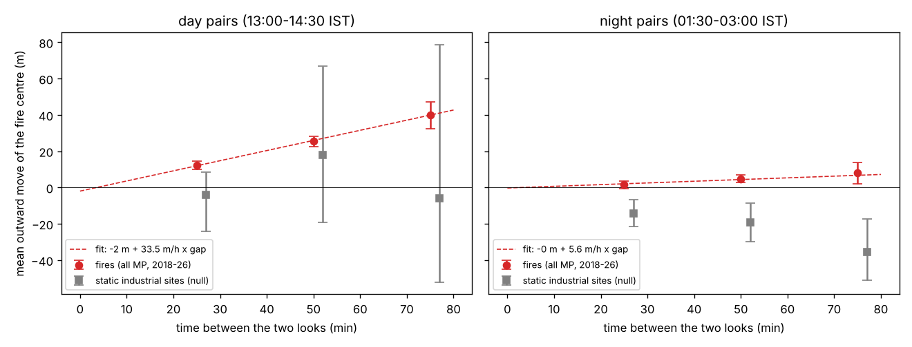
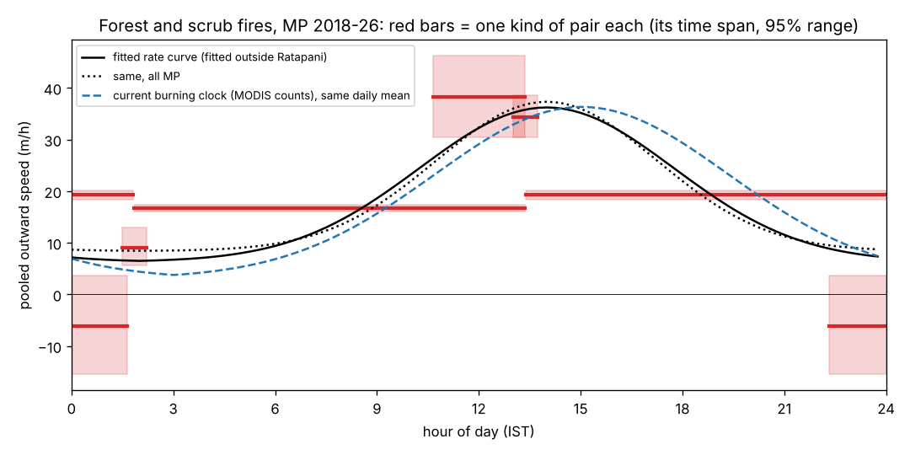

# Squares v2: pooled small-gap displacement (scouting round 19, 17 Oct 2026)

Asked by Akkshay: redo the "squares" work properly. The first pass judged each small-gap pair on its own, found the moves were mostly grid jitter, and stopped. This note takes the opposite approach.
- The noise is measured and modelled.
- The bias is removed.
- **Hundreds of thousands of pairs across all of MP are then averaged.** The mean of N noisy pairs has an error of about σ/√N, so speeds of a few m/h become visible.

Sibling notes cover the other two parts: per-fire tracking in `squares_v2_tracking.md` and the reading in `squares_v2_literature.md`. This note is only the pooled statistics.

**Set-up**
- Data: the FIRMS SP archive for all MP, Jan-Jun 2018-2026. S-NPP, NOAA-20, NOAA-21, Terra and Aqua: 2.2 M points.
- Every detection is kept as its own row, with its own sensor and time. Nothing is merged.
- Scripts are in `code/squares_v2/pooled/` and tables and figures in `code/squares_v2/pooled/results/`. Big intermediates stay in scratch.

**Terms**
- **pair**: two looks at the same fire by two different satellites. A "look" is all of one pass's detections in a group of points linked within 1 km. A **small-gap** pair is 25, 50 or 75 min apart.
- **outward move**: how far the later look's centre lies further from the fire's earlier position than the first look's centre. The earlier position E is the centre of detections 2-48 h before. Formally, the move is projected on the direction from E to the pair's mid-point.
- **later-growth direction**: from E to the centre of detections 2-48 h after the pair. It never uses the two looks being tested, so it is an out-of-sample direction.
- **static null**: the same code run on FIRMS type-2 industrial hot spots, which cannot move.
- **CI**: 95% bootstrap range, resampling fire clusters (5 km cell × season) or, for the null, sites.
- [inference] marks interpretation rather than measurement.

## Bottom line
1. **Pooling works: the fire centre really moves outward, and the move grows with the time gap as real spread must.**
   - Day pairs (13:00-14:30 IST), mean outward move:
     - 12 m after 25 min;
     - 26 m after 50 min;
     - 40 m after 75 min.
   - A line through all day pairs gives **33.5 m/h (CI 26.7-40.8)** with an intercept of −2 m (−7 to +3).
   - Night pairs (01:30-03:00): **5.6 m/h (1.2-11.0)**, intercept −0.3 m.
   - The near-zero intercepts mean no per-pair artefact is left in the mean. The part of the move perpendicular to the outward direction is −1.0 m/h by day and +0.5 m/h at night (both n.s.).
   - Basis: 384,327 VIIRS small-gap fire pairs. 185,920 of them have earlier detections, so an outward direction exists.
2. **Forest and scrub fires are faster than farm fires:**
   - day 34-38 m/h, night 9-10 m/h;
   - farm fires: 26-28 m/h by day and 2-5 m/h at night.
   - Every season alone gives a positive day speed: 21 to 39 m/h, 2018-2026.
3. **The data alone give a diurnal spread-rate curve.**
   - Segments: day and night small gaps, Terra 10:40 → VIIRS 13:30, Terra 22:10 → VIIRS 01:50, and both 12 h gaps.
   - Fitted outside Ratapani, forest: peak at **14:00 IST**, width 3.75 h, floor 6 m/h, peak 36 m/h, daily mean ~16-18 m/h.
   - It agrees with the continuity thread's MODIS-count burning clock (peak 15:00). The peak is about 1 h earlier and the night floor a little higher.
   - Share of a day's spread between 01:30 and 10:30: 24%, against the clock's 19%.
4. **Upslope matters a little by day, and the sign reverses at night.**
   - Move towards upslope:
     - day +9 to +11 m/h (CI ~4-15);
     - night −5 to −8 m/h (CI ~−12 to −1), i.e. downslope.
   - [inference] Day up-slope / night down-slope winds.
   - **Downwind** (ERA5, Ratapani only, ~5k pairs): about +18 m/h by day once a constant geometry bias is removed (CI 4-33). At night it is 0.
5. **Size, intensity and fire age drive speed more than terrain does.** Day speed rises:
   - from 20 to 59 m/h, from 1-2 pixels to 10+ pixels;
   - from 10 to 56 m/h, from the lowest to the highest FRP fifth;
   - to 67 m/h in fires younger than 13 h.
6. **Growth in a small gap, with pixel-size effects removed and minus the static sites' drift:**
   - Night: pixel count −7 to −9%/h and FRP −12 to −15%/h. Fires are dying down after 01:30.
   - Day, forest: pixel count +6.7%/h (3.4-10.1). FRP +4%/h is not significant, because static sites also "gain" FRP in the afternoon.
7. **Turned into model inputs and tested out of sample, the gains are small or absent.**
   - **Photos** (340 mid-fire photos): the pooled curve as the blend map's clock beats the current MODIS clock by +0.05 points of pixel accuracy (CI +0.02 to +0.10) and +0.002 AUC. That is consistent, but negligible.
   - **Next VIIRS look**, diurnal clocks: no gain. Making the reach grow with time at all is worse than a fixed reach.
   - **Next VIIRS look**, outward-drift prior: it seems to help (+3.8 points of new detections caught). At equal forecast area, though, it is **worse** than simply enlarging the reach.
8. **Negative and unresolved results:**
   - **Static null.** It is not a clean zero.
     - Night outward: −27 m/h.
     - Towards later growth: −14 m/h.
     - It is not explained by sensor offsets, coupling or time windows (tested).
     - For fires, three checks agree there is no such artefact: the near-zero intercepts, the agreement of outward with later-growth directions, and the random-direction null (±2-4 m/h).
     - [inference] Industrial sites have multi-stack, site-specific structure that fires do not.
   - **Hot pixels.** Against 30 m Sentinel-2/Landsat hot pixels, the 10:45 → 13:30 VIIRS check is inconclusive: 5 m/h (−28 to 37).
   - **ECOSTRESS.** No rasters are on disk; only the match list exists, because the download needs an Earthdata login.

## 1. The noise and bias model (`p2_noise.py`, `p2b_geometry.py`)
**Data.** Static industrial sites across MP: 35,580 VIIRS–VIIRS small-gap pairs at 100 sites (3.5 km cells). Most are night pairs: industry is detected far more often at night.

**Per-sensor offsets.** Least squares on static sites, relative to S-NPP:

| | day east | day north | night east | night north |
|---|---|---|---|---|
| NOAA-20 | +52 m (28 to 67) | **−93 m** (−116 to −82) | −20 m | **+79 m** (71 to 85) |
| NOAA-21 | −57 m (−67 to −36) | −25 m | +27 m | −44 m |

- The NOAA-20 north-south offset flips sign between day (ascending) and night (descending). So it is a ~85-95 m along-track offset of NOAA-20 relative to S-NPP, the "~65 m N-S" from the literature.
- **Fires give the same offsets independently.**
  - Method: the mean (A→B) for one sensor order minus the mean for the reverse order, halved. Real motion cancels in this difference.
  - NOAA-20 minus S-NPP, day: (+46, −94) m from fires against (+52, −93) m from static sites.
  - NOAA-21 minus NOAA-20, day: (−115, +74) m from fires against (−109, +68) m from static sites.

**A view-geometry bias that no sensor table removes.**
- In a pair, the later pass is always on an orbit ~6-12° further west. The site is ~600 km west of nadir in the earlier look and ~600 km east in the later one (`geometry_bias.json`).
- Any view-angle-dependent geolocation error therefore looks like a later look shifted ~30-60 m east, in **both** sensor orders, for static sites and fires alike.
- This change in view angle is the same in every pair, so it cannot be separated from a real constant drift.
- **Consequence:** the mean displacement *vector* is unusable. Only projections onto directions that vary from pair to pair are safe. A direction that is the same everywhere (wind) is handled by removing each stratum's mean vector ("centred").

**Scatter.**
- Robust SD per axis: 180-260 m (`noise_cov_bins.csv`).
- Model fitted on static sites: variance = k × pixel²/(12 n) + geolocation², with:
  - along scan: k 0.59, geolocation 180 m;
  - along track: k 0.90, geolocation 132 m.
- 1.2-1.4% of pairs lie beyond 3 robust SD.
- Two looks share a per-pass-pair offset of SD 72 m (east) and 52 m (north), against 226 m within a pass pair. That is real, as the literature says, but it averages out over passes. Subtracting it would remove under 10% of fire-pair variance.

**Not done, and why.**
- **Three-satellite loop closure:** a centroid displacement around a loop sums to zero by construction (no image matching is involved), so it cannot test anything here.
- **Same-pass near-duplicates (bow-tie):** these weight the two looks' centres alike. They cannot bias the pooled mean of a symmetric projection, but they do inflate pixel counts (see §5, which uses a view-angle term).

## 2. Pairs built (`p1_pairs.py`, `p3_context.py`)
- **All pairs: 792,120.** Fires 727,829 and static sites 64,291.
- **VIIRS–VIIRS small-gap fire pairs: 384,327** (day 221,228, night 163,099). By season:

  | 2018 | 2019 | 2020 | 2021 | 2022 | 2023 | 2024 | 2025 | 2026 |
  |---|---|---|---|---|---|---|---|---|
  | 10.7k | 20.3k | 14.3k | 32.6k | 24.6k | 45.5k | 45.3k | 104.8k | 86.2k |

- Median gaps by sensor order:

  | order | median gap |
  |---|---|
  | NOAA-21 → S-NPP | 27 min |
  | S-NPP → NOAA-20 | 25 or 50 min |
  | NOAA-20 → NOAA-21 | 49 min |
  | NOAA-20 → S-NPP | 50 min |
  | NOAA-21 → NOAA-20 | 51 min |
  | S-NPP → NOAA-21 | 73 min |

- Also built:
  - 97,600 pairs with MODIS within 4 h (Terra → VIIRS gives the 10:40 and 22:10 segments);
  - 245,770 VIIRS pairs 10-14 h apart.
- **Context for every pair:**
  - terrain from a public ~140 m SRTM tile mosaic for all MP. Its upslope direction agrees with Ratapani's 20 m grid within 45° on 78% of sloping pixels.
  - forest type from the Roy et al. VTM map;
  - Ratapani cover classes;
  - ERA5-Land wind, available on disk for Ratapani only.

## 3. Pooled speeds (`p4_pooled.py`, `p5_bins.py`, `p5b_gapfit.py`)
**Headline, all MP, bias-corrected, mean over pairs ÷ mean gap:**

| direction | day 13:30 | night 01:30 | static null day / night |
|---|---|---|---|
| outward (away from earlier detections) | **30.7 m/h** (27.5-33.4), n 92,793 | **5.2** (3.0-7.5), n 93,127 | +9 (−18 to 47) / −27 (−39 to −13) |
| towards later growth (out of sample) | **27.9** (24.4-31.4), n 54,796 | **5.0** (2.4-7.8), n 64,753 | −16 / −14 |
| perpendicular to outward (must be 0) | −1.0 (−3.9 to 1.9) | +0.5 (−1.9 to 3.2) | |
| NULL: a random other pair's growth direction | +1.4 (−1.9 to 4.8) | −3.6 (−6.1 to −1.4) | |
| upslope (slope ≥ 2°), centred | **+10.9** (6.7-15.0) | **−8.0** (−12.2 to −3.9) | wide (16-27 sites) |
| downwind, Ratapani, centred | +17.8 (4.5-33.0), n 4,535 | −0.8 (−9.1 to 8.3), n 5,710 | none |
| downwind, raw | 52 (37-67) | 21 (10-31) | inflated by the eastward geometry bias (westerly winds) |

**Fit through the gaps (move = a + v × gap):**

| set | day v | day a | night v | night a |
|---|---|---|---|---|
| all fires | 33.5 (26.7-40.8) | −2 m | 5.6 (1.2-11.0) | −0.3 m |
| forest + scrub | 38.4 (29.5-47.7) | −2 m | 10.3 (2.4-19.0) | 0 m |
| farm | 28.2 (17.5-39.2) | −2 m | 4.8 (−2.6 to 11.5) | −2 m |

**Robust variants** of the headline:

| variant | day | night |
|---|---|---|
| trimmed at 1 km | 29.2 m/h | 5.5 m/h |
| 3σ then 1.5σ culling | 25.7 m/h | 4.3 m/h |
| weights 1/pixel-area² | 27.0 m/h | 4.8 m/h |
| inverse-variance weights | 32.6 m/h | 5.4 m/h |
| FRP-weighted centres | 30.9 m/h | 4.5 m/h |
| median | 28.0 m/h | 5.1 m/h |

- Culling shrinks the estimate because it cuts the tail on the side of real motion.

**What the speed depends on** (`pooled_bins.csv`; [fig3](code/squares_v2/pooled/results/fig3_dependence.png)).

| bin | day m/h | night m/h |
|---|---|---|
| 1-2 / 3-5 / 10+ pixels in the two looks | 20 / 30 / 59 | 4.5 / 2.5 / 13 |
| FRP lowest / highest fifth | 10 / 56 | 2.5 / 11 |
| fire age <13 h / 13-25 h / >49 h | 67 / 31 / 24 | 0 / 15 / 4 |
| teak / dry deciduous / sal / moist deciduous | 38 / 39 / 34 / 31 | 14 / 10 / 20 / 14 |
| agriculture / scrub-grass | 26 / 31 | 2 / **−18** (−30 to −5) |
| slope 0-2° / 2-5° / 5-10° / >10° | 29 / 36 / 31 / 35 | 2 / 12 / 9 / 16 |
| month Jan / Feb / Mar / Apr / May | 3 / 9 / 35 / 34 / 20 | 3 / −1 / 8 / 5 / −2 |
| Ratapani area (cover extent) | 51 (30-74), n 1,133 | 23 (3-44), n 741 |

- Ratapani cover classes have too few pairs (68-671) to separate grass from closed canopy.
- [inference] The negative night value for scrub/grass may be grass fires going out at the front, so the centre slides back towards older, still-glowing ground.

**Minimum pairs per bin** (80% power, 5% test, measured SD 288 m by day and 229 m at night, design effect 1.3):

| speed to detect | day pairs | night pairs |
|---|---|---|
| 50 m/h | 489 | 317 |
| 20 m/h | 3,054 | 1,982 |
| 10 m/h | 12,215 | 7,925 |
| 5 m/h | 48,859 | 31,697 |

- To detect a difference between two bins, double these numbers.
- Ratapani alone (~1-2k pairs per slot) can only see speeds of ~25 m/h or more.

**About the static null.**
- It is not zero: night outward −27 m/h, towards later growth −14 m/h. It stays at −9 to −20 m whatever reference is used: same day/night only, 7-30 days earlier, the whole season, or the future.
- So it is not a timing or sensor-offset effect. Bias leakage through the mean direction explains only 1-11 m of it.
- The fire set does not show such an artefact, for four reasons:
  - the gap fit's intercepts are ~0;
  - outward and later-growth projections agree within 1-3 m/h, although only the outward one could pick up coupling between the look noise and the direction;
  - the perpendicular parts are 0;
  - a random direction gives ±2-4 m/h.
- [inference] Industrial sites have multiple stacks, and their "earlier position" is a noise-sized 180 m away (fires: ~1 km). This makes the null hypersensitive to site structure. It is a weak null for this test.

## 4. Diurnal curve and the 12 h speeds (`p6_diurnal.py`)
Forest and scrub fires, fitted outside Ratapani (`diurnal_segments_noratapani.csv`):

| segment (IST) | pairs | pooled outward speed |
|---|---|---|
| Terra 10:40 → VIIRS 13:30 | 5,121 | 38.3 m/h (30.4-46.2) |
| VIIRS 13:00 → 14:30 (small gaps) | 45,971 | 34.4 (30.4-38.5) |
| VIIRS 13:30 → 01:30 (12 h) | 43,838 | 19.3 (18.4-20.2) |
| Terra 22:10 → VIIRS 01:50 | 1,567 | −6.2 (−15.5 to 3.6) |
| VIIRS 01:30 → 03:00 (small gaps) | 33,742 | 9.0 (5.6-12.9) |
| VIIRS 01:30 → 13:30 (12 h) | 50,525 | 16.7 (16.0-17.4) |

**Fitted curve:**
- Peak 14:00, width 3.75 h, floor 6.3 m/h, amplitude 29.9 m/h (`diurnal_fit_noratapani.json`).
- As multipliers of the daily mean (all-MP forest fit):

  | 00 | 04 | 08 | 10 | 12 | 14 | 16 | 18 | 20 | 22 h |
  |---|---|---|---|---|---|---|---|---|---|
  | 0.48 | 0.48 | 0.75 | 1.21 | 1.77 | 2.05 | 1.77 | 1.21 | 0.75 | 0.54 |

- **Caveat:** χ² is 13-18 on 2 degrees of freedom, so the segments scatter more than their CIs. Widen the curve's ranges by ×2.5-3.
- The Terra segments rest on few MODIS static sites (14-18), and MODIS's own bias is poorly known.

**Against the 25 m/h multi-pass front speed:**
- The pooled numbers measure the active centre, not the farthest front, so they should sit below a front speed.
- The 12 h centre speeds are 17-19 m/h for forest, matching the curve's daily mean (16-18 m/h).
- In the Ratapani box, small-gap speeds are higher: 51 m/h by day and 23 m/h at night, with wide CIs.
- So the afternoon is ~2× the daily mean and the night ~0.3-0.5×. [inference] This is the same shape the burning clock assumed. The 25 m/h front fit already averages over it.

## 5. Growth from pixel count and FRP (`p7_growth.py`)
**Model.** log(B/A) = sensor sensitivity (both orders exist) + β × log(pixel area B / A) + γ × gap.

**Pixel size.**
- Flagged area scales with pixel area^0.5-0.9.
- The pixel count barely depends on pixel size (β −0.1 to −0.5).
- [inference] Most fires are smaller than one pixel: one fire, one pixel, whatever its size.

**Fires minus static sites, pair type by pair type:**

| | day, all | day, forest | night, all | night, forest |
|---|---|---|---|---|
| pixel count, %/h | +2.3 (−0.8 to 5.6) | **+6.7** (3.4 to 10.1) | **−9.1** (−9.9 to −8.3) | **−7.2** (−8.2 to −6.2) |
| total FRP, %/h | −2.5 (−6.5 to 1.7) | +3.9 (−0.4 to 8.4) | **−14.6** (−15.5 to −13.6) | **−11.6** (−12.7 to −10.4) |

- The raw model alone says day FRP +11-18%/h. But static sites show +15%/h by day (1.7 to 21), so that part is not fire growth. [inference] It may be a sensor or retrieval effect tied to afternoon heating.
- Per gap, the residual change grows with the gap: 25 → 50 → 75 min. The NOAA-21 → S-NPP → NOAA-20 triplet spacing is inside this.

## 6. Spread-model inputs, tested out of sample (`p8_clock_photos.py`, `p9_nextlook.py`, `p11_hotpix.py`)
**A. Blend map with the pooled curve as its clock.** The curve was fitted outside Ratapani; the test uses 340 photos from 283 fires; CIs are by fire.

| | pixel accuracy | AUC |
|---|---|---|
| time of nearest look | 84.4% | 0.719 |
| blend, flat clock | 84.3% | 0.726 |
| blend, current MODIS clock | 84.4% | 0.723 |
| **blend, pooled clock** | **84.5%** | 0.725 |
| pooled minus MODIS clock | +0.05 points (+0.02 to +0.10) | +0.002 (+0.000 to +0.004) |
| same, photos with a look before and after (171) | +0.11 points (+0.04 to +0.20) | +0.002 |

**B. Next VIIRS look.** 4,543 forecasts on 1,585 Ratapani fires, 2017-26. The reach is 375 m plus speed × clock time, and every method gets the same mean reach (472 m).

| method | next-look points caught | NEW points caught |
|---|---|---|
| plain clock | 61.6% | 15.9% |
| pooled clock | 61.6% (+0.0) | 15.3% (−0.6, −0.9 to −0.4) |
| MODIS clock | 61.5% | 15.2% (−0.7) |
| fixed reach (no time) | 63.1% (+1.5, +0.8 to +2.2) | 17.3% (+1.4, n.s.) |
| outward-drift prior, full | 62.3% (+0.7) | 19.7% (+3.8, +3.0 to +4.6) |

- **At equal area the drift prior loses.**
  - The drift prior uses 388 ha and catches 62.6% / 18.9%.
  - The plain reach enlarged to 390 ha catches 69.1% / 29.5%.
- [inference] Pushing old dots outward wastes area. Next-look points appear near old dots, in no particular direction. This repeats the spread review's and the first pass's photo findings.

**C. Independent truth: 30 m hot pixels at ~10:45.** The outward direction comes from VIIRS 13-48 h before, so it is independent of the looks tested.

| look | n passes (fires) | outward position vs hot pixels |
|---|---|---|
| Terra MODIS within 30 min (should be ~0) | 14 (13) | +274 m (−23 to 564) |
| VIIRS night look 6-12.5 h before | 321 (170) | **−249 m** (−350 to −148): the fire was behind, ~28 m/h |
| VIIRS day look 1-4.5 h after | 295 (153) | +14 m (−76 to 101): 5 m/h (−28 to 37), **does not confirm** the 38 m/h |

- The perpendicular parts reach 137 m. Coarse-pixel centres and 30 m hot-pixel centres measure different things: Terra at the same minute sits +274 m outward.
- So this truth set is too noisy and too differently defined to check speeds of tens of m/h.
- **ECOSTRESS:** `research/big-fires/results/ecostress_matches.csv` lists 730 passes, but no rasters are on disk (download blocked by the Earthdata login). Not used.

## 7. Concrete inputs for the spread model
1. **Diurnal rate multipliers:** use the table in §4: peak 14:00, ×2.05 at the peak, ×0.5 at night.
   - It is data-based and matches the current clock's shape.
   - Switching the blend map's clock to it gains +0.05-0.1 points on photos. Optional.
2. **Slope factor:**
   - day: +11 m/h upslope component on top of ~35 m/h, about ±30% up-/downslope at 2-10°;
   - night: about −8 m/h, i.e. downslope.
   - [inference] This small effect matches the continuity thread's finding that terrain does not help maps. Do not add it to forecasts unless a test on photos shows a gain.
3. **Fuel/size factors:**
   - Night spread exists in teak/sal/moist-deciduous forest (10-20 m/h) but not in farm or grass (≤2 m/h, or negative).
   - Bigger, hotter and younger fires spread 2-3× faster.
   - These belong in a rate model: rate ∝ FRP^~0.4 [inference from the quintile slope].
4. **Do not use an outward-drift prior** for next-look forecasts. At equal area it loses. Use a fixed reach around all dots.
5. **Use the bias tables** (`bias_table_*.csv`) in any tracker:
   - per-sensor along-track offsets of ~90 m (NOAA-20) and ~50 m (NOAA-21);
   - the view-geometry eastward shift of the later look (~30-60 m), which no tracker should read as motion.

## Limits
- Static sites are an imperfect null here (§3).
- MODIS biases rest on 14-18 sites.
- Wind is Ratapani only.
- Near-duplicate pixels were not removed.
- A pooled speed is the average active-centre speed of fires seen twice. Fires that die or start between the two looks drop out (survivor selection).
- Forest type uses a ~2005-10 map.
- 2025-26 dominate the pair counts.

## Files (`code/squares_v2/pooled/`)
**Scripts, in run order:**
- `p0_load.py`
- `p_dem.py` (public SRTM tiles; scratch only)
- `p1_pairs.py`
- `p2_noise.py`
- `p2b_geometry.py`
- `p3_context.py`
- `p4_pooled.py`
- `p5_bins.py`
- `p5b_gapfit.py`
- `p6_diurnal.py` (then run again with `EXCL_RATAPANI=1`)
- `p7_growth.py`
- `p8_clock_photos.py` (reads the continuity code, read-only)
- `p9_nextlook.py`
- `p10_figures.py`
- `p11_hotpix.py`

**Results** in `results/`:
- `pooled_main.csv`, `pooled_bins.csv`, `gapfit.csv`
- `diurnal_*`, `growth_*`, `noise_*`, `bias_table_*`, `geometry_bias.json`
- `photo_clock_*`, `nextlook_*`, `hotpix_*`
- figures `fig1-3`

Intermediates (pairs, context, DEM; ~600 MB) stay in the r19_pool scratch folder.
