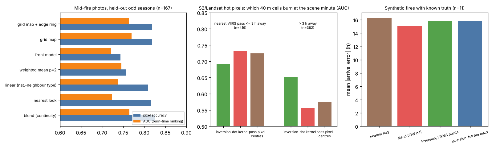
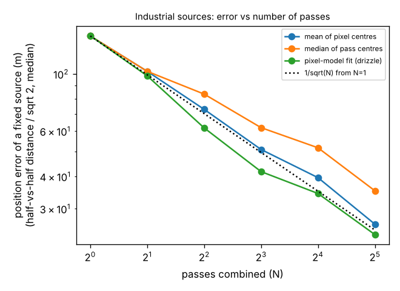
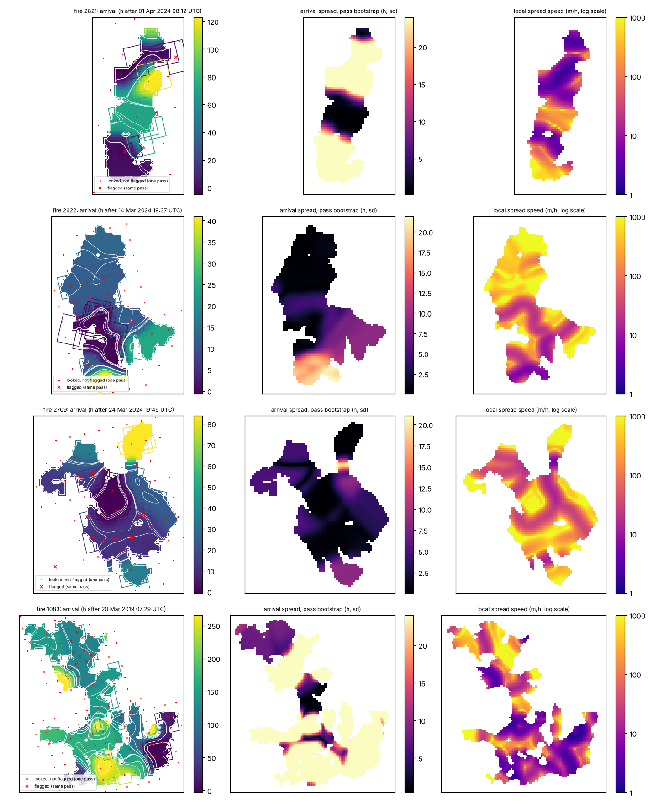

# Squares v2, tracking: rebuilding where each fire burned, and when, from every satellite pass at once (17 Oct 2026)

**Asked:** stop judging VIIRS squares one pair at a time. Model the known noise, combine every pass of a fire (flagged pixels *and* pixels that looked and saw nothing), and rebuild a sub-square burning-time map per fire. Test it against independent truth.

**This thread's part.** It covers the per-fire, multi-pass reconstruction. Pooled small-gap statistics are in [squares_v2_pooled.md](squares_v2_pooled.md), and reading is in [squares_v2_literature.md](squares_v2_literature.md). Neither is repeated here.

**Rules kept:**
- Every satellite pass is a separate observation with its own time and its own pixel grid. Nothing is merged into "looks".
- VIIRS pixels are scan × track blocks, turned to the satellite track.
- No credential was used or written.

**Code and outputs:** `code/squares_v2/tracking/` (scripts `t0`–`t9`, numbers and figures in `results/`). Large maps stay in the container scratch.

**Tags:** **[DATA]** = computed today on our files. **[inference]** = my reasoning. Ranges in brackets are 95% bootstrap ranges, resampled over fires.

**Terms:**
- **lattice**: the grid of one pass's pixel centres, rebuilt around the fire.
- **looked-not-flagged node**: a pixel of that grid with no FIRMS point.
- **arrival map**: the hour each 40 m cell started burning.
- **hidden-pass test**: drop one pass, refit, and predict which of its pixels flagged.
- **AUC**: how well a score ranks true cases above false ones. 0.5 is guessing, 1 is perfect.
- **held-out**: the settings were chosen on even seasons and scored on odd seasons. Photos and hot pixels were never used to choose anything, except where the text says so.

---

## Bottom line

**What works (positive results):**
1. **The noise is structured, and it is now measured** [DATA]. The source is 78,000 looks at 91 static industrial sources in all of MP (FIRMS type 2).
   - Each satellite has its own steady offset. At night: NOAA-20 is +51 m north (37 to 62), NOAA-21 is −86 m (−119 to −53), and S-NPP is ~0. These hold in even and in odd years separately.
   - Pixels tile exactly. The next pixel along scan sits 1.006 × `scan` away, and along track 1.024 × `track`. So FIRMS scan/track sizes are the true pixel spacing, and every pass's grid can be rebuilt from its own points.
   - The scatter of one look at a fixed point, after removing the in-pixel placement, is ~100–120 m per axis at night and ~250 m by day. That is 2–4× the published 55–60 m geolocation error.
2. **Combining looks of something that does not move works as theory says** [DATA].
   - A fixed source's position error falls as 1/√N: ~140 m with one pass, ~72 m with 4, ~40 m with 16 and ~26 m with 32.
   - Fitting the pixel model to all passes beats averaging pixel centres by 15–18% at 4–16 passes.
   - With ~230 passes, two independent halves agree to 16 m.
3. **Where inside the squares the fire was: modest but real gains against 30 m hot pixels** [DATA]. Truth is 798 Sentinel-2/Landsat scenes on 692 fires. None of these were inputs or used for any choice.
   - The reconstruction's burning-weighted centre at the scene minute sits **347 m** from the hot-pixel centre. Plain pixel centres of the nearest VIIRS pass sit 413 m away. The paired median gain is **50 m (33–74)**.
   - When the nearest VIIRS pass is more than 3 h from the scene, the reconstruction ranks hot cells best: AUC 0.65, against 0.56–0.58 for the dot kernel or pixel centres.
4. **On the 340 mid-fire photos, the reconstruction (grid map) ties the best existing maps on accuracy and ranks burn time better** [DATA].
   - Held-out odd seasons: pixel accuracy **81.8%**, against 81.7% for the nearest look and 82.5% for the continuity blend map.
   - Burn-time ranking: AUC **0.770**, against 0.724 for the nearest look (+0.046, range +0.018 to +0.073). Against blend (0.765) the difference is +0.006 (−0.036 to +0.045).

**What does not work (negative results, reported in full):**

5. **A physical "one front, burn once" reconstruction (eikonal fit) is worse than the simple maps.**
   - Photos: 75.9% accuracy, against 84.4% for blend. It also marks 7 points too much ground as burned.
   - Its fitted speeds sit at the prior's 20 m/h in almost every fire. So FIRMS points cannot pin a per-fire speed field.
   - This repeats the continuity thread's finding that single-front fits run ahead.
6. **No reconstruction beats a plain space-time dot kernel at predicting which pixels an unseen pass flags.**
   - Held-out VIIRS passes: kernel AUC **0.85**. The reconstruction scores 0.70, the same as nearest-look (0.72) and weighted-mean (0.70) maps.
   - Terra MODIS, never an input: kernel 0.88, reconstruction 0.70.
   - [inference] Fires keep re-flagging the same ground for many hours. A narrow pixel response plus a short burning window cannot copy that; a wide kernel does.
7. **The data move the reconstruction only a little from the starting map.**
   - In the chosen grid map the median cell moves **0.3 h** from "time of the nearest flagged pixel", and 9% of cells move more than 3 h.
   - The negative evidence is weak, because a burning VIIRS pixel is missed in ~45–65% of passes anyway (measured below).
8. **The coordinator's edge-ring prior (big-fires 14c) does not help.**
   - Photos: accuracy +0.000 (−0.000 to +0.001), AUC −0.004 (−0.007 to −0.002).
   - Hidden passes: no change against the same baselines.
   - It cannot be fully held out: the prior was measured on the same Sentinel-2/Landsat hot-pixel scenes I would score it on. So it was scored only on photos and hidden passes, not on hot pixels.
9. **Simulation says the VNP14IMG fire masks would add little to this reconstruction:** arrival error 15.82 h with masks against 15.83 h without, on 11 synthetic fires.
   - [inference] This is conditional on our forward model. The model's detection likelihood is weak, so the masks' main worth is elsewhere: real cloud labels, bow-tie flags and an honest test of the 250 m blur. A ready-to-run pull script and the likelihood hook for the masks now exist (§7). They wait for an Earthdata token in a project environment secret named `EARTHDATA_TOKEN`, which does not exist yet. Nothing was downloaded.
10. **ECOSTRESS 70 m rasters are not on disk.** The big-fires fetch (`b16_ecostress_fetch.py`) waits for an Earthdata token, and its cache folder does not exist. The 730 matched passes (`research/big-fires/results/ecostress_matches.csv`) are the planned validation, and the code here (`t7_hotpix.py`) runs on them unchanged once the clips exist.

**What to use:**
- **Placement:** the grid reconstruction's burning-weighted centre at a given minute (≈50 m better than pixel centres).
- **"Which pixel flags next":** a dot kernel.
- **Burned-by-time maps:** the blend map. The grid map is an equal alternative with better ranking.
- **Speeds:** not from per-fire FIRMS fits. Use pooled numbers.

---

## 1. Forward detection model and its calibration (`t0_prep.py`, `t1_calib.py`, `t1b_static_drizzle.py`)

**Data.**
- FIRMS standard-processing archive for all MP (`fire-alert-scars/alerts_mp`), 2017–2026, Jan–Jun: 2.32 M points.
- S-NPP, NOAA-20 and NOAA-21 VIIRS, plus Terra/Aqua MODIS.
- In the Ratapani box: 83,752 points, of which 16,853 are on fires (big-fires rule: inside the scar + 200 m, from the day before to 2 days after).
- 12,863 overpasses viewed Ratapani: detections within 250 km or on both sides.
- For each pass the local pixel size at Ratapani comes from that pass's points nearest in the along-scan direction.

### 1a. Per-satellite offsets and scatter (static industrial sources, all MP)

Each site's reference point is the mean of all its VIIRS pass centroids.

| satellite, day/night | passes | sites | east (m) | north (m) | scatter per axis after removing in-pixel placement, robust (m) |
|---|---|---|---|---|---|
| S-NPP night | 30,207 | 91 | +9 (−19 to 37) | −10 (−23 to 6) | 119 / 98 |
| NOAA-20 night | 27,691 | 91 | −21 (−50 to 3) | **+51 (37 to 62)** | 120 / 105 |
| NOAA-21 night | 13,087 | 90 | −13 (−64 to 39) | **−86 (−119 to −53)** | 118 / 104 |
| S-NPP day | 3,010 | 47 | −2 (−112 to 106) | **+47 (7 to 108)** | 251 / 249 |
| NOAA-20 day | 2,654 | 49 | +23 (−103 to 116) | −25 (−89 to 58) | 261 / 245 |
| NOAA-21 day | 1,370 | 44 | −92 (−216 to 13) | −88 (−145 to 1) | 311 / 221 |

- **Null check, even vs odd years.** Night offsets are stable: NOAA-20 +44 / +59 m north, NOAA-21 −90 / −80 m. Day offsets are noisy.
- **Rule used:** an offset is subtracted only where its range excludes 0.
- The pooled thread finds the same pattern independently: NOAA-20 ≈ 90 m along track relative to S-NPP.
- [inference] The scatter includes sites with more than one stack, so it is an upper bound. It is still 2–4× the published geolocation error, and the hidden-pass test later prefers a blur of this size (250 m).

### 1b. The pixel lattice
- Adjacent fire pixels of one pass sit **1.006 × `scan`** apart along scan (IQR 0.993–1.017; 20,145 pairs) and **1.024 × `track`** apart along track (1.017–1.031; 16,503 pairs).
- The along-track ratio is the same at every view angle (1.025 / 1.025 / 1.022).
- So the FIRMS sizes are the pixel spacing, and each pass's grid around a fire can be rebuilt from any one of its points. This is what makes "looked, not flagged" explicit.
- **20% of fire points (3,142 of 15,726) do not sit on their pass's grid** (more than 0.35 pixel off).
  - 473 of these are same-pass near-duplicates (overlapping scans or bow-tie) and were dropped.
  - The rest were kept as their own flagged pixels.
  - [inference] These are the scan-overlap rows the CSV does not flag (literature note, point 6).

### 1c. How often a burning fire is flagged at all
This is a pass that viewed a fire known to be burning: the fire was flagged by other passes before and after, both within 14 h.

| | day | night |
|---|---|---|
| S-NPP | 53% (974 passes) | 36% (1,181) |
| NOAA-20 | 55% (866) | 38% (1,006) |
| NOAA-21 | 48% (427) | 35% (483) |
| Aqua MODIS | 24% | 3% |
| Terra MODIS | 13% | 4% |

By VIIRS pixel width at Ratapani:

| width | share flagged |
|---|---|
| ≤ 420 m | 60% |
| 420–520 m | 51% |
| 520–650 m | 39% |
| > 650 m | 10% |

So the detection model has a ceiling: even a pixel that is fully burning is missed often. In the model, P(flag) = ε + q·(1 − e^(−λ·burning ground in the pixel response)).
- q = 0.6 by day and 0.45 by night (set from this table).
- λ falls with pixel area.
- ε = 10⁻⁵ (false alarm per pixel).

### 1d. Pixel response
- Along scan: a box of the pixel's width, blurred by the native-sample trapezoid (the on-board aggregation zone is read from `track`) and by the geolocation error.
- Along track: a box blurred by the geolocation error.
- The blur was chosen by the hidden-pass test on even seasons: 80 / 160 / 250 m tried, and **250 m** won on both ranking and log-loss.

### 1e. "Drizzle" on things that cannot move (40 sites, even vs odd years; `fig_static_drizzle.png`)

Error is the half-vs-half distance divided by √2, median over sites.

| passes combined | mean of pixel centres | median of pass centres | pixel-model fit |
|---|---|---|---|
| 1 | 140 m | 140 | 141 |
| 4 | 73 | 84 | **62** |
| 16 | 40 | 52 | **34** |
| 32 | 26 | 35 | **24** |
| ~230 (all) | 13 | 13 | **11** |

- The error follows 1/√N (dotted line in the figure).
- With all passes, the pixel-model fit is closer than the plain centre at 45% of sites. The median difference is 0 m (−5 to 0).
- So the model helps most at 4–16 looks. That is the range a fire has.
- [inference] For a fire this applies only while it stands still: within one 25–50 min triplet it moves ~20 m.

## 2. Negative evidence made explicit (`t2_lib.py`: `Fire.lattice`, `Fire.build_obs`)

**Passes that flagged the fire.**
- The pass's grid is rebuilt over the fire outline + 1 km, anchored on its first point, with the satellite's offset removed.
- Each grid node is either flagged (a point snaps to it) or looked-not-flagged.
- Over the 845 run fires that is ~**15,700 flagged points** and a few hundred looked-not-flagged nodes per pass.

**Passes that viewed Ratapani but flagged nothing near the fire.**
- Their grid position is unknown.
- They enter as "no pixel over the fire flagged". Summed over a grid that tiles, the pixel responses add to about 1 whatever the offset, so no position is needed.

**Clouds** are unknown and assumed rare (Feb–Jun). A looked-not-flagged node therefore carries weight 0.7, not 1.

**Bow-tie trimmed rows** at the swath edge are not modelled. [inference] They are a small share at Ratapani, where pixels over 650 m wide hold 4.5% of points.

## 3. The reconstruction (`t2_lib.py`, `t4_run.py`)

**Unknown:** the hour each 40 m cell inside the fire outline (v2 scars, + 60 m) started burning. Cells are 60–80 m for fires over 700 ha, for run time.

**Burning:** a cell burns for about τ hours after it starts, with soft edges of 0.5 h.

**Likelihood:** every flagged and looked-not-flagged node of every pass, plus the "nothing flagged" passes, through the model in §1.

**Two ways to fit it:**
- **Front model (eikonal).** The arrival map comes from shortest walking time out of a few start points, at a smooth speed field (log-speed on a 200 m grid).
  - The fire burns once and the front only moves outward, by construction.
  - Start points are the first pass's points plus any point more than 1.2 km from all earlier ones.
  - A greedy step switches off starts the data do not need (otherwise an early stray point anchors a false early start).
  - Gradients come exactly through the shortest-path tree; this was checked against finite differences.
- **Grid map.** The arrival map is free per cell, with a smoothness penalty (second differences) and a pull towards "time of the nearest flagged pixel" (sd 12 h).

**Settings chosen on even-season hidden passes only** (`results/t5_hidden_tune*.json`): pixel blur 250 m, burning window τ = 1.5 h, λ = 0.02 (day) and 0.0125 (night) per 40 m cell, no burning clock.
- The clock lowered hidden-pass scores slightly (0.627 vs 0.638 AUC). So the burning clock is not imposed, and day/night differences are left to the data.
- A long smouldering tail lowered scores (0.555).

**Grid map strength:** 6, 12 or 24 h pull. It was picked on **even-season photos** (accuracy 84.6 / 84.6 / 84.5%: a tie; 12 h was taken) and is reported on odd seasons.

**Uncertainty:**
- Laplace (curvature) arrival sd, median 2.2 h. [inference] This is too optimistic.
- Pass-bootstrap refits for the example fires: often >20 h where few passes constrain the map (figure in §5).

## 4. Validation against independent truth

### 4a. Mid-fire photos (340 photos on 280 fires; `t6_photos.py`)

The table shows pixel accuracy / AUC for burned-by-photo-time.

| map | all 340 | odd seasons (held out, 167) | look before AND after (159) | big fires (77) |
|---|---|---|---|---|
| blend (continuity; its own per-photo scores) | 84.4% / 0.723 | 82.5% / 0.765 | 82.4% / 0.817 | 83.1% / 0.768 |
| nearest look (each detection separate) | 83.4 / 0.710 | 81.7 / 0.724 | 81.8 / 0.779 | 83.2 / 0.778 |
| linear interpolation (natural-neighbour type, Scaduto) | 82.9 / 0.714 | 80.9 / 0.738 | 80.8 / 0.797 | 82.6 / 0.783 |
| weighted mean p = 2 (Parks type) | 79.2 / 0.696 | 75.7 / 0.746 | 72.9 / 0.785 | 76.9 / 0.719 |
| **grid map (this thread)** | **83.3 / 0.756** | **81.8 / 0.770** | 81.5 / **0.833** | 83.2 / **0.825** |
| front model (eikonal) | 75.9 / 0.715 | 74.4 / 0.722 | 73.0 / 0.760 | 77.3 / 0.721 |
| grid map + edge ring (coordinator prior) | 83.3 / 0.749 | 81.9 / 0.764 | | |

Paired differences for the grid map (range over fires):
- **Accuracy:**
  - vs nearest look −0.1 points (−1.2 to +0.9);
  - vs blend −1.2 (−2.3 to −0.2), or −0.6 (−1.8 to +0.4) on odd seasons;
  - vs Parks +4.1 (+2.6 to +5.7).
- **AUC:**
  - vs nearest look **+0.046 (+0.022 to +0.069)**, or +0.046 (+0.018 to +0.073) on odd seasons;
  - vs linear +0.042 (+0.016 to +0.070);
  - vs blend +0.034 (+0.001 to +0.068), or +0.006 (−0.036 to +0.045) on odd seasons.
- Burned-share error: grid map +6 points; blend +4; nearest look +4.

Notes:
- Blend scores come from the continuity thread's own run on all chip pixels; the others use up to 5,000 pixels per photo. So the blend comparison is per photo, not per pixel.
- Front model vs blend, accuracy: −8.5 points (−11.2 to −6.0).

### 4b. Hidden passes, odd seasons (80 fires, 240 hidden passes, 160 of them flagged; `t5_hidden.py`, `t5b_hidden_summary.py`)

| predicting which pixels of the hidden pass flag | AUC | log-loss |
|---|---|---|
| grid map (through the detection model) | 0.700 | **0.192** |
| nearest look (same model) | 0.716 | 0.195 |
| weighted mean p = 4 (same model) | 0.698 | 0.194 |
| weighted mean p = 2 (same model) | 0.688 | 0.220 |
| **dot kernel** Σ exp(−d/400 m)·exp(−\|Δt\|/12 h) | **0.854** | n/a |

Paired differences for the grid map:
- vs nearest look: AUC −0.015 (−0.029 to −0.005); log-loss −0.003 (−0.007 to +0.001).
- vs kernel: AUC −0.154 (−0.207 to −0.106).

Notes:
- 150 of the 160 flagged hidden passes have another pass within 2 h, so this test mostly measures near-simultaneous agreement.
- Whether a hidden pass flags the fire at all: AUC 0.80 (grid map) vs 0.80 (nearest look).
- The pixel grid of the hidden pass is rebuilt from its own points, so every method gets the same grid offset.

### 4c. Terra MODIS as an unseen sensor (188 fires, 243 Terra passes that flagged; `t7b_terra.py`)

Terra passes at ~10:30 and ~22:30 IST, hours VIIRS never sees.
- Which Terra 1 km pixels flag: grid map 0.701, nearest look 0.708 (difference −0.004, range −0.015 to +0.007), **dot kernel 0.876**.
- Day 0.717 / 0.725 / 0.879; night 0.632 / 0.635 / 0.860.
- Whether Terra flags the fire at all: 5,279 passes, 4.6% flagged. Grid map AUC 0.759, nearest look 0.750.

### 4d. Sentinel-2/Landsat 30 m hot pixels (798 scenes, 692 fires; `t7_hotpix.py`)

The scene is ~10:45 IST. The nearest VIIRS pass is a median 2.9 h away.

| | grid map | front model | pixel centres of the nearest pass | dot kernel |
|---|---|---|---|---|
| burning-weighted centre to hot-pixel centre (median) | **347 m** | 409 m | 413 m | |
| same, nearest VIIRS pass ≤ 3 h away (416) | **321** | 359 | 366 | |
| same, > 3 h away (382) | **376** | 461 | 448 | |
| which cells hold hot pixels, AUC | **0.673** | 0.642 | 0.653 | 0.649 |
| AUC, ≤ 3 h | 0.691 | 0.668 | 0.724 | **0.732** |
| AUC, > 3 h | **0.653** | 0.613 | 0.575 | 0.557 |

- **Grid map vs pixel centres:** placement −50 m (−74 to −33). AUC +0.020 (−0.001 to +0.042).
- **Grid map vs kernel:** AUC +0.024 (0.000 to +0.046). Hot pixel to the nearest predicted burning cell (same number of cells): −24 m (−39 to −2).
- **"Where in the square" at the VIIRS pass's own minute:**
  - The grid map's burning centre inside that pass's footprints is 18 m closer to the hot pixels than the pixel centres (−26 to −6).
  - The front model's is 9 m closer (−14 to −3).
  - [inference] The gain is small because the hot pixels are 2–3 h older than the pass, and fires move in that time.
- The grid map puts the burning near the middle of each footprint: median offset 0.11–0.13 half-pixel. The coordinator's edge result (hot pixels in the outer half) says that is wrong in detail. Forcing the edge ring did not improve photos (§4a), and testing it on hot pixels would be circular.

### 4e. Synthetic fires with known arrival time (`t3_sim.py`, 11 fires)

**Set-up:**
- Truth is walking time from one start point (plus 0–2 extra starts) at a patchy speed (median 25 m/h, lognormal sd 0.6, patches ~300 m), on the burning clock.
- The fire's real pass schedule and pixel sizes are used, with a random grid offset per pass and 10% cloudy passes.
- Points are drawn from the fitted detection model.

| | mean arrival error | "photo" accuracy at 10:30 IST |
|---|---|---|
| nearest flag | 16.3 h | 78.1% |
| blend (IDW p4) | 15.0 h | 74.6% |
| grid map from FIRMS-like points | 15.8 h | 79.5% |
| grid map from a full fire mask (true grid, clouds known) | 15.8 h | 79.5% |

- The grid map beats the nearest flag: error −0.45 h (−0.71 to −0.26), accuracy +1.4 points (+0.2 to +2.6).
- It beats blend on accuracy, +4.9 (+0.8 to +10), but not on error, +0.8 h (+0.0 to +1.6).
- **Full mask vs FIRMS: −0.01 h (−0.03 to +0.01).**
- [inference] The fitted detection model is weak: its synthetic fires get only ~10 points in 20–75 passes. Under it, the clear-pixel information that masks add is swamped by the 40–55% chance of missing a burning pixel. Masks would matter more if the real detection response turned out sharper than this model. Only the masks themselves can show that.
- An earlier front-model simulation, with the first, untuned settings (6 fires, `results/t3_sim.csv` history), gave 6.6 h vs 8.2 h for the nearest flag. Masks did not help there either.

## 5. Per-fire outputs (845 fires: photo fires, hot-pixel fires and the 146 big fires)

- `results/fires_grid12.csv` and `fires_final.csv`: per fire, the cells, passes, flagged passes, points, removed duplicates, off-grid points, active starts (front model), and speeds.
- `results/fronts_grid12.csv`: per fire and per pass time, the ground burned so far (ha) and the equivalent front radius.
- `results/subsquare_grid12.csv`: per VIIRS point, where inside its own footprint the map puts the burning at that minute (offsets along scan and track, in half-pixels) and the share of the footprint burning.
- Arrival maps are kept in the container (`scratch/r19_track/maps/<config>/<fire>.npz`). Rerun `t4_run.py grid12 0 all` (about 1 h) to remake them.

**Speeds are not identifiable per fire from FIRMS points.**
- Front model: median local speed 20.6 m/h in all fires and in big fires, the same as its 20 m/h prior. Day/night ratio 1.0.
- Grid map: |∇T| gives plateaus and steps, with a median of 530 m/h.
- [inference] Neither is a measurement. Use the pooled thread's speeds, and the big-fires 25 m/h multi-pass fit for typical speed.

**Example fires** (`fig_examples_grid12b.png`; grid map with 8 pass-bootstrap refits). Each row shows:
- the arrival map with isochrones at pass times, every flagged footprint (coloured by its own time), and one pass's flagged and looked-not-flagged nodes;
- the bootstrap spread of arrival time;
- the local speed. The speed is shown only to make the point that it carries no information.

**The four fires:**
- 2821: 187 ha, 2024, 62 passes.
- 2622: 472 ha, 2024, 18 flagged passes.
- 2709: 933 ha, 2024.
- 1083: 1,603 ha, 2019, 30 flagged passes.

Where passes are dense, the spread is 1–5 h. Where only one or two passes flagged, it exceeds 20 h.

## 6. What this means for the other threads

**Spread thread**
- Do not fit per-fire speed fields from FIRMS points. The front model's speeds return its prior.
- Use the detection model's measured parts as fixed inputs to any scorer:
  - offsets: NOAA-20 +51 m and NOAA-21 −86 m north at night;
  - an effective blur of ~250 m per axis between passes;
  - per-pass detection ceilings: 53–55% day, 35–38% night, falling to 10% for pixels over 650 m wide.
- For "will this ground light up next pass", the plain dot kernel is the strongest predictor we have. Hidden VIIRS AUC is 0.85 against 0.70–0.72 for any arrival map; unseen Terra is 0.88. It belongs in the next-look capture test as the baseline to beat.

**Big-fires thread**
- For placement, use the grid map's burning-weighted centre at the minute of interest. It sits 50 m (33–74) closer to Sentinel-2/Landsat hot pixels than pixel centres, and 72 m closer when no pass is within 3 h.
- The atlas can draw `fronts_grid12.csv` (burned ha by pass) with the bootstrap ranges of `t4_run.py <cfg> 8`.
- The edge prior from 14c did not sharpen anything here. If it is used, apply it as a drawing convention, not a model input.

**Continuity thread**
- Keep blend for burned/unburned maps. Accuracy is equal or better: 82.5% vs 81.8% on held-out seasons.
- Consider the grid map's arrival times as a ranking layer. Burn-time AUC is +0.046 over nearest look on held-out seasons, and +0.006 (not significant) over blend.
- Drop single-front (eikonal / one-speed) fits. They over-burn by 7 points, as continuity found.

**Data that would add information (estimates from this model)**
- **VNP14IMG / VJ114IMG / VJ214IMG fire masks** (an Earthdata token; nothing here can fetch them until the `EARTHDATA_TOKEN` project secret exists; see §7):
  - The simulation gain for arrival maps is ~0, conditional on the weak detection model.
  - The real value is the measurement itself: true clear vs cloud vs bow-tie for each pixel, and the true per-pixel geolocation (VNP03IMG). With those, the 250 m effective blur and the 20% off-grid points can be checked directly.
  - Priority: start with the 146 big fires' passes (`--only-big`, 1,895 passes), then rerun `t5_hidden.py` and `t6_photos.py` with `mask_dir` set.
- **VNP14IMGML monthly CSVs** (UMD SFTP, public login per the User Guide; not fetched here): line/sample would replace this thread's grid reconstruction with the true grid. This is the cheapest next check of §1b and §2.
- **ECOSTRESS 70 m** (Earthdata token; big-fires owns the fetch): needed for same-minute truth, because Sentinel-2/Landsat are 2–3 h away from VIIRS. Once clipped, `t7_hotpix.py` runs on it as is.

## 7. Real fire masks: pull script and likelihood hook (ready, not run)

**Status.** The masks cannot be downloaded yet. The token must come from a project environment secret named `EARTHDATA_TOKEN`, and that secret does not exist yet. No token was looked for anywhere else, and nothing was downloaded.

**What is ready:**
- **`pull_fire_masks.py`**:
  - Reads the token only from `os.environ['EARTHDATA_TOKEN']`. It stops with a plain message if the token is missing, and never prints or writes it.
  - Sends the token only as a Bearer header to NASA archive hosts. Redirects are followed by hand, so the header is never sent to the signed S3 link or to the search service.
  - For each pass in `results/fire_mask_pull_plan.csv`, searches CMR by pass time (±9 min) and the fires' box. The plan has one row per fire × viewing pass: the 845 run fires, which include every photo-test fire.
  - Streams each granule into a temporary folder, crops it at once to the union of the fires' boxes + 8 pixels, and deletes it. One granule is on disk at a time, ~185 MB at most.
  - Each crop keeps the fire mask, algorithm QA, lat/lon (from the 03IMG file), sensor zenith and azimuth (view angle), and every `FP_` array for fire pixels in the window.
  - Stops when the crops reach 2 GB (`--max-gb`). It can be resumed, and `--plan` runs a metadata-only size check that needs no token.
- **Likelihood hook** (`t2_lib.py`; set `mask_dir` in the settings). When a pass has a crop, its nodes are the true pixel centres instead of the rebuilt grid, with the same per-satellite offsets removed. The fire-mask classes are read as follows:

| mask class | meaning | role in the likelihood |
|---|---|---|
| 7, 8, 9 | fire (low, nominal, high) | flagged |
| 3, 5 | water, clear land | looked, no fire (weight `w_clear`, default 1, instead of 0.7) |
| 2, 4, 6 | glint, cloud, unclassified | no information (dropped) |
| 0, 1 | not processed, bow-tie deletion | missing (dropped, not a non-detection) |

  - A pass that flagged nothing is no longer "position unknown": its clear pixels count one by one.
  - Pixel spacing and heading are measured from the crop's own lat/lon. The blur for these passes can be set separately (`geo_mask`).
  - Without masks, the results are unchanged: per-node weights equal the old 0.7.
  - **Tested on a synthetic crop** (fire 2821, one pass). It recovers spacing 460 / 399 m and heading 347°, the same as the rebuilt grid, and the fit runs. Untested on a real file, because none exists here.

**Size of the pull (estimate)** [DATA for counts; sizes from a metadata-only CMR query of sample granules, 10 Apr 2024]:

| | count | size per granule | streamed in total | kept |
|---|---|---|---|---|
| passes in the plan (845 fires, 2017–2026) | 3,657 (S-NPP 1,657, NOAA-20 1,425, NOAA-21 575); 1,427 flagged a run fire | | | |
| fire-mask granules (LP DAAC cloud) | ~3,700–4,200 (some passes straddle two 6-min granules) | 2.3–3.1 MB | **~10–13 GB** | |
| geolocation granules (03IMG, LAADS cloud) | same | 155–185 MB | **~600–750 GB** | |
| crops | one per pass | | | **~0.3–0.9 GB** (well under the 2 GB cap) |

**Cheaper options** [inference]:
- `--only-big` (1,895 passes) roughly halves the transfer.
- `--no-geo` pulls only the flagged passes' masks (1,427 passes, ~4 GB). These are geolocated from their own fire pixels, but this loses the no-fire passes, which carry most of the new negative evidence.
- The geolocation files are 98% of the transfer. Reading only their window with HTTP range requests (h5py over fsspec) would cut that to a few MB per granule. That is not built, because it cannot be tested without a token.
- At 20–50 MB/s, the full pull is ~4–10 h.

## Limits
- Settings were chosen on even-season hidden passes. The grid strength was chosen on even-season photos, a three-way tie. Everything is reported on odd seasons too.
- Cloud is assumed absent, and looked-not-flagged nodes are down-weighted (0.7) for that reason.
- The detection model is phenomenological: burning ground × pixel response, with a ceiling. Its λ was tuned for ranking, not fitted to fire physics.
- Hot pixels are 2–3 h from VIIRS. Photos are mostly morning scenes after a night pass.
- The edge-ring test could not be held out on hot pixels (circular). It was scored on photos and hidden passes only.
- MODIS-as-input (`t4_run.py final_modis`) is implemented but was not run. Terra was used only as unseen truth.

## Files (`code/squares_v2/tracking/`)

**Scripts:**
- `t0_prep.py`: tables (detections, viewing passes, static sources).
- `t1_calib.py`: offsets, lattice spacing, detection rates.
- `t1b_static_drizzle.py`: fixed-source combining.
- `t2_lib.py`: detection model, grid rebuild, both reconstructions.
- `t3_sim.py`: synthetic fires and the fire-mask value.
- `t4_run.py`: fit all fires (configs `grid12` = chosen, `final` = front model, `ring` = edge prior).
- `t5_hidden.py`, `t5b_hidden_summary.py`: hidden passes.
- `t6_photos.py`: photo test.
- `t7_hotpix.py`, `t7b_terra.py`: hot-pixel and Terra tests.
- `t8_figures.py`, `t8b_valfig.py`: figures.
- `t9_tracks.py`: per-fire tables.
- `pull_fire_masks.py`: fire-mask pull (ready, not run).
- `results/fire_mask_pull_plan.csv`: its pass list.

**Rerun:** `TR_SCRATCH=<dir> python3 t0_prep.py && python3 t1_calib.py && python3 t4_run.py grid12 0 all && python3 t6_photos.py grid12 && python3 t7_hotpix.py grid12 && python3 t9_tracks.py grid12`.
