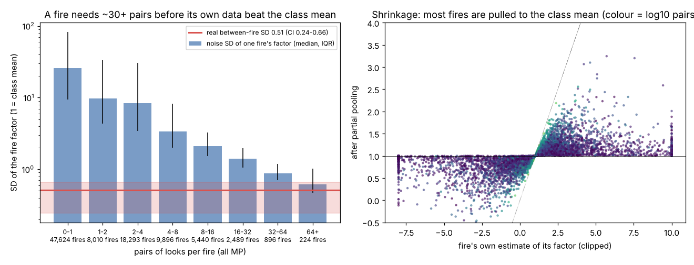
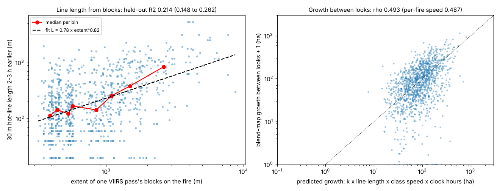
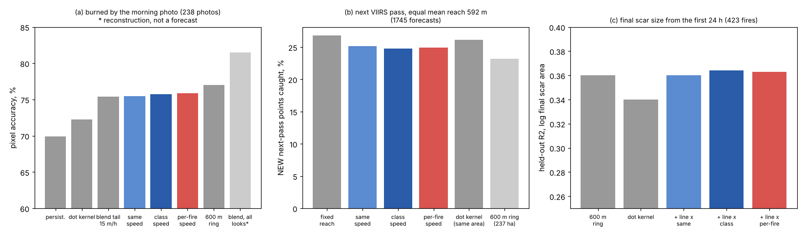

# Squares v3, part B: per-fire spread speed and growth by partial pooling (17 Oct 2026)

**Asked:** go deeper on the square blocks. Give every fire its own spread speed by partial pooling, turn block arrangement into an active fire-line length, get growth = line length x speed, and test all of it against independent truth and in forecasts. Say plainly whether per-fire speeds beat class speeds.

**Sibling note:** part A (`squares_v3_speed_truth.md`) corrected the pooled speeds for edge, geometry and cluster-size artefacts. Its per-pair edge term is already subtracted from every small-gap pair here. The code reads part A's files when they exist (`b_lib.py`), so a later correction drops in with a rerun.

**Code and numbers:** `code/squares_v3/b/` (scripts `b0`-`b6`, results in `results/`). Large intermediates stay in the r20_b scratch folder. No credential was used or written.

**Tags:** [DATA] = computed today on our files. [inference] = my reasoning. Ranges in brackets are 95% bootstrap ranges, resampled over fires (or over 5 km x season blocks of fires for all-MP numbers). Every fitted thing (class means, between-fire spread, noise inflation, line-length calibration, forecast scalings) was fitted with the scored season left out.

**Terms:**
- **pair**: two looks at one fire by two satellite passes, each with its own time (25-75 min, Terra to VIIRS ~3 h, or VIIRS 12 h apart).
- **outward move**: how far the later look's centre lies further from where the fire was 2-48 h earlier (squares_v2 definition).
- **clock hours**: hours weighted by the diurnal spread curve (afternoon ~2x, night ~0.5x), so speeds are daily means.
- **class mean**: the speed a typical fire of its kind has (forest type, month, size, FRP, age).
- **fire factor**: a fire's own speed divided by its class mean (1 = typical).
- **partial pooling**: each fire's factor is pulled towards 1, more strongly the less data it has.
- **reliability (B)**: share of a fire's own estimate that survives the pooling (0 = all class mean, 1 = all own data).
- **active line length**: length of the burning edge at one moment.

---

## Bottom line

1. **Lasting speed differences between fires of the same class are modest, and the satellite data can resolve them for only ~1% of fires** [DATA].
   - **Upper end: 0.51 (0.27-0.67)**, the split-half estimate (two halves of each fire's passes, no pass shared) on all 14,194 fires that burned on 2+ days. On this scale a fire of a 20 m/h class runs at 10-30 m/h.
   - **On the 2,985 better-measured fires: 0.35 (0-0.50).** On those, the rank correlation between a fire's two halves is only 0.03 (0.00 to 0.07).
   - **Full Bayesian model** (NumPyro, heavy-tailed noise): **0.06 (90% range 0.00-0.15)**. That model puts the outliers into noise.
   - **Honest summary:** the real SD lies between ~0.1 and ~0.5.
   - The class model (forest type, month, size, FRP, age) removes about 60% of between-fire variance (split halves: with one speed for all, the SD is 0.81).
   - Noise in one fire's factor: median SD **11.9** (92,872 MP fires). It falls below 0.5 only at **30+ pairs**, which 1,182 fires have.
   - After pooling, the median reliability is 0.005 (Ratapani fires 0.04). Even at the upper estimate only 178 fires (0.2%) differ clearly from their class, 70 of them clearly fast. Under the Bayesian model, none do.
2. **What the noise is made of** [DATA]. In a 12 h pair the outward move scatters by ~500 m. Only ~210 m of that is measurement error. The rest (~475-550 m) is real wandering of the active centre between fronts within the same fire, not a lasting fire trait. Lasting between-fire differences are only ~100-120 m of a 12 h move.
3. **Fire-line length from blocks works, but only roughly** [DATA]. On 814 VIIRS passes 2-3 h after a 20-30 m hot-pixel scene (457 fires), the **extent of the pass's blocks** predicts the hot-line length with held-out **R² 0.21 (0.15-0.26)**.
   - That is better than block count (0.17) or FRP (0.15).
   - The median hot line is 200 m. One block holds ~140 m of line at 10:45 and 9+ blocks hold ~1.3 km.
4. **Growth = line length x speed tracks map growth, and all of the skill comes from line length** [DATA].
   - Against blend-map growth between looks (1,201 intervals, 451 fires): rho 0.49 (0.44-0.55).
   - Against grid-map growth: rho 0.58 (0.53-0.62).
   - Speed alone gives rho 0.13. Per-fire speed instead of class speed changes rho by −0.007 (−0.018 to +0.005).
   - Absolute burned area by the photo minute is not predicted (rho 0.12, n.s.). The burned share by photo time is worse than the blend map (error 0.28 vs 0.15).
5. **Forecasts: per-fire speeds do NOT beat class speeds, and speeds of any kind barely beat simple geometry** [DATA, held-out seasons].
   - **(a) Burned by the next morning photo** (238 photos): per-fire 75.9% pixel accuracy, class 75.8%, same speed for all 75.5%. Per-fire minus class is +0.1 points (−0.1 to +0.4). The plain 600 m ring scores 77.0%. Persistence scores 69.9%.
   - **(b) Next VIIRS pass** (1,745 forecasts, equal mean reach 592 m): new points caught are per-fire 24.9%, class 24.8% and same speed 25.2%. A fixed reach catches 26.8%, which is +1.6 points over class (0.6-2.6).
   - **(b) Detection counts** (5,225 forecasts): adding any speed to the count model changes deviance by under 0.1%.
   - **(c) Final scar size** from the first 24 h (423 fires): held-out R² 0.364 with class speed, 0.363 with per-fire speed and 0.360 with the 600 m ring alone.
6. **Which fires are fast: no driver on disk explains much** [DATA].
   - All MP: every driver together explains **1.9% (1.5-2.2%)** of the real between-fire variance in held-out seasons.
   - Best single group: fire extent (fires with many pairs run faster), 1.6%. Terrain, place, timing and the class inputs each explain under 1%.
   - Ratapani fuel, grass share, canopy, teak, earlier burns, slope and weather: not measurable. Reliability is 0.05, and every held-out R² range spans −1 to +1.
7. **Part A's 30 m front-advance check** (57 Ratapani fires, hot-pixel scenes 1-6 days apart): class speed rank-correlates at 0.09 and per-fire speed at 0.13. Both are near zero.
   - The median 30 m advance is 23 m/h against a median per-fire centre speed of 17 m/h. [inference] The front runs ~1.4x the active centre.

**What to use:**
- **Speeds:** the class mean (forest type x month x size/FRP/age, on the diurnal clock). Per-fire factors are worth looking at only for the ~1,200 MP fires with 30+ pairs, and even there as a hint (±50% at most).
- **Growth and area:** use block extent (line length) as the growth signal. Speed adds nothing measurable on top.
- **Forecasts:** keep the 600 m ring or a fixed reach. Speed-scaled reaches do not help.

---

## 1. Per-fire speeds by partial pooling (`b0_pairs.py`, `b1_hier.py`, `b1b_numpyro.py`, `b_post.py`)

### 1a. Observations
- Source: the pooled run's pair table (r19_pool `ctx.parquet`). FIRMS fire pairs with earlier detections, all MP, 2018-2026: **364,053 pairs**.

| segment | pairs | mean clock hours |
|---|---|---|
| VIIRS small gap, day | 92,793 | 1.45 |
| VIIRS small gap, night | 93,127 | 0.33 |
| VIIRS 12 h, day to night | 73,512 | 13.1 |
| VIIRS 12 h, night to day | 86,439 | 10.8 |
| Terra 10:40 to VIIRS | 11,912 | 4.8 |
| Terra 22:10 to VIIRS | 6,270 | 1.6 |

- Every look keeps its own sensor and time. Sensor offsets come from the static-site tables of squares_v2. Part A's edge term is subtracted from the clipped move of every small-gap pair.
- **Fires:** pairs whose earlier looks are under 1.5 km and 30 h apart are linked (92,872 MP fires). In Ratapani, the big-fires fire ids are used (795 fires with pairs, 4,485 pairs).

### 1b. Model
- **Move of pair j of fire i:** outward move = f_i x class mean x clock hours + cluster-size term + Terra offset + noise.
  - Cluster-size term, fitted: −5 m per doubling of pixels by day and −11 m at night. Part A found −11 / −16.
  - Terra offset, fitted per pair: +36 m by day and +16 m at night.
- **Noise per segment:** the static-site noise model (pixel size, pixel count, geolocation), scaled on the **perpendicular part** of the same pairs, which has a true value of 0.
- **Shared passes:** a fire's pairs share passes, so its effective noise is larger. The design effect (DE) was measured on the perpendicular part: 1.3 at 2 pairs, 2.2 at 4-8, 3.4 at 8-16 and 4.1 at 16+.
- **Between-fire spread τ (SD of f), estimated two ways:**
  - **Split halves.** Each fire's pairs are split into odd and even fire-days (06:00-06:00 IST), so the two halves share no pass. The covariance of the two halves' factors is τ², with no noise in it. The perpendicular null gives −0.08 (−0.28 to +0.14), which is consistent with 0.
  - **Moments (DerSimonian-Laird).** This gives τ 0.88. It also counts within-fire wandering that is larger along the outward direction than sideways. [inference] So it is an upper bound.
- **Posterior:** f_post = 1 + B (f_hat − 1), with B = τ² / (τ² + DE·s²).

**Class means** (daily-mean outward centre speed, m/h; all seasons; `b1_hier.json`). One speed for all gives 16.3.

| forest type | day-start pairs | night-start pairs |
|---|---|---|
| agriculture | 11.2 | 11.2 |
| scrub / grass | 15.5 | 16.7 |
| sal | 18.5 | 18.9 |
| teak | 20.3 | 20.5 |
| moist deciduous | 21.7 | 21.8 |
| dry deciduous | 22.7 | 21.2 |

Adjustments relative to March, 3-4 pixels, middle FRP fifth and fire age 13-25 h:

| factor | adjustment (m/h) |
|---|---|
| January | −8.5 |
| February | −1.7 |
| April | +1.0 |
| May | −2.2 |
| June | −4.7 |
| 10+ pixels | +9.6 |
| 2 pixels | −1.8 |
| top FRP fifth | +3.7 |
| bottom FRP fifth | −3.1 |
| age < 13 h | +2.3 |
| age > 49 h | −6.9 |

- Day and night class means come out equal once the clock is applied. So the v2 diurnal curve already carries the day/night difference for every class.
- Held-out check: predicted vs observed pooled move per season x segment, r = 0.95.

### 1c. How much fires differ, against the noise

| | class model | same speed for all |
|---|---|---|
| between-fire SD of the factor, split halves, all 14,194 two-day fires | **0.51** (0.27-0.67) | 0.81 (0.65-0.92) |
| same, values winsorised at 2/98% | 0.49 (0.19-0.66) | |
| same, fires with each half's noise SD < 4 (2,985 fires) | **0.35** (0-0.50); null 0.12 (0-0.40) | |
| same, noise SD < 1 (489 fires) | 0.35 (0-0.52); rank correlation of halves 0.08 (−0.03 to 0.17) | |
| same, first fire-day vs day 3+ (halves ≥ 2 days apart) | 0.50 (n.s., 1,147 fires) | |
| full Bayesian model, heavy-tailed noise (section 1d) | **0.06** (90%: 0.00-0.15) | |
| moments estimate (upper bound) | 0.88 (0.83-0.95) | 0.99 |
| median noise SD of one fire's factor | 11.9 | 8.2 |
| fires with reliability > 0.5 | 1,025 of 92,872 | 668 |
| fires whose 95% range excludes 1 (fast) | 178 (70) | 156 (87) |

**Noise SD of one fire's factor, by pairs** (all MP; the real between-fire SD is 0.51):

| pairs | fires | noise SD |
|---|---|---|
| 1 | 47,624 | 25 |
| 2 | 8,010 | 9.6 |
| 3-4 | 18,293 | 8.3 |
| 5-8 | 9,896 | 3.3 |
| 9-16 | 5,440 | 2.1 |
| 17-32 | 2,489 | 1.4 |
| 33-64 | 896 | 0.85 |
| 64+ | 224 | 0.6 |

- The 70 clearly fast fires have a median of 20 pairs and a median factor of 2.5.
- None of them is in Ratapani: no Ratapani fire is clearly fast or clearly slow.

**What one pair's outward move is made of** (SD in metres; `b1_variance_decomposition.csv`):

| segment | class mean move | measurement noise | real wandering (sideways) | lasting fire difference |
|---|---|---|---|---|
| small gap, day | 21 | 211 | 127 | 14 |
| small gap, night | 3 | 212 | ~0 | 2 |
| 12 h, day to night | 203 | 207 | 553 | 118 |
| 12 h, night to day | 166 | 208 | 475 | 96 |
| Terra to VIIRS, day | 80 | 344 | 541 | 47 |

[inference] The 12 h pairs carry nearly all the per-fire information. They are dominated by the active centre jumping between fronts (big-fires section 2, continuity "new fronts not one ring"). That wandering is real fire behaviour, but it is not a lasting speed of the fire, so it acts as noise for a per-fire speed.

### 1d. Full Bayesian check (NumPyro, NUTS)
- **Pair-level model** (each pair through a Student-t likelihood, 12,000-fire subsample): it did not mix on CPU. τ stayed at its starting value (ESS 6). Not used.
- **Fire-level model** (`b1b_numpyro.json`):
  - each fire's estimate and its noise (with the design effect) from b1;
  - log-normal fire factors, Student-t noise, 2 chains;
  - 45,248 fires with 2+ pairs; no divergences; R-hat 1.06; ESS 60.
- **Result:** τ **0.06 (90%: 0.00-0.15)**. Noise tails ν ≈ 8. No fire's 90% interval excludes 1.
- [inference] Why the Bayesian and split-half answers differ:
  - With a heavy-tailed noise model, the few fires whose two halves are both far from 1 are read as noise outliers.
  - The split-half covariance reads them as real, lasting differences.
  - Restricting to well-measured fires lands in between (0.35, range 0-0.50).
  - Either way the per-fire signal is small against the noise. That is why all the forecast tests in section 4 show no gain.

## 2. Active fire-line length from the blocks (`b2_linelength.py`)
- **Truth:** Sentinel-2/Landsat hot pixels (`fire-alert-scars/out/af`, common 20 m grid) inside the fire's outline + 300 m, scenes with ≥ 3 hot pixels.
- **Hot-line length:** the skeleton length of the hot-pixel mask, closed by one pixel.
- **VIIRS:** each pass on its own, 2-3 h after the scene (the ~13:30 passes). 814 pass-scene pairs on 457 fires.

| predictor (per pass, on that fire) | held-out R², log length | Spearman |
|---|---|---|
| **extent** (longest span of the block centres + one block) | **0.214** (0.148-0.262) | 0.41 |
| half the outer perimeter of the block union (line along the cluster edge, big-fires 14c) | 0.206 (0.141-0.263) | 0.40 |
| number of blocks | 0.165 (0.104-0.222) | 0.38 |
| blocks x block width | 0.160 (0.103-0.209) | 0.37 |
| total FRP | 0.147 (0.089-0.195) | 0.38 |
| Terra MODIS within 1 h, any measure (41 passes) | ≤ 0.10, ranges include 0 | |

**Median hot-line length by number of blocks:**

| blocks | passes | hot line |
|---|---|---|
| 1 | 382 | 140 m |
| 2 | 191 | 200 m |
| 3 | 103 | 365 m |
| 4-5 | 80 | 320 m |
| 6-9 | 45 | 890 m |
| 10+ | 13 | 1,290 m |

- **Calibration used later:** L = 0.78 x extent^0.82. It was refitted with each season left out.
- Block count tracks line length, as big-fires 14c said. The arrangement (extent) does a little better than the count, and better than intensity (FRP).
- **Limits:**
  - The hot pixels are 2-3 h older than the VIIRS pass. [inference] The 10:45 line is shorter than the 13:30 line, so L is biased low. A constant bias does not hurt the rank tests below.
  - Night passes have no truth. They use the same calibration [inference].
  - Terra at the same minute has 1 km blocks and too few cases.

## 3. Growth rate = line length x speed (`b3a_blend.py`, `b3_growth.py`)
**Intervals.** Consecutive look slots of a Ratapani fire, 6-40 h apart. A slot is the passes within 2 h; each pass keeps its own line estimate, and these are averaged.

**Predicted growth:** k x mean line length x speed x clock hours. k is fitted on the other seasons.

**Truth:**
- **Blend-map growth:** the continuity thread's map, rebuilt with its own code. It is not independent of the detections.
- **Grid-map growth:** squares_v2 tracking. Not independent either.
- **Mid-fire photos:** independent.

| predictor | vs blend growth (1,201 intervals, 451 fires): rho | held-out R² (log) | vs grid growth (1,203): rho |
|---|---|---|---|
| line x same speed | **0.50** (0.45-0.55) | 0.15 | **0.59** (0.54-0.62) |
| line x class speed | 0.49 (0.44-0.55) | 0.12 | 0.58 (0.53-0.62) |
| line x per-fire speed | 0.49 (0.44-0.53) | 0.10 | 0.57 (0.52-0.62) |
| per-fire speed only (fixed line) | 0.13 (0.07-0.19) | < 0 | 0.16 |
| clock hours only | 0.00 | < 0 | 0.00 |

- **Per-fire minus class, rho:**
  - blend −0.007 (−0.018 to +0.005);
  - grid −0.004 (−0.016 to +0.008);
  - for the 34 fires with reliability > 0.2: 0.49 vs 0.49.
- **k is 15-20.** Map growth is ~15-20x line x centre speed. [inference] Three reasons:
  - the 10:45 hot line is shorter than the real line;
  - the centre moves more slowly than the front (part A: 30 m front 24 m/h);
  - the maps fill whole outlines between looks.
  So read L x v as a rank index, not as hectares.
- **Mid-fire photos** (196 photos with a look before the photo):
  - Absolute burned area by the photo minute, against the chip's burned area: rho 0.12 (−0.03 to 0.26). Not predicted.
  - Burned share of the scar by photo time, the line-growth curve's own share: mean error 0.28, against blend 0.15, grid 0.16 and nearest look 0.15. **Worse than the maps.** A per-fire speed cancels in a share.
  - Photo-to-photo growth: only 5 usable photo pairs (same event, ≥ 12 h apart). Not testable.

## 4. Forecasts with held-out seasons (`b4_forecast.py`)
Each forecast uses only detections and pairs finished by its issue time. The per-fire factor uses only the pairs finished by then.

**(a) Burned by the next morning photo.**
- 238 photos on 189 fires. Issue = last VIIRS look ≥ 2 h before (median 8.7 h, 6.1 clock hours).
- Photo pixels lie inside the final scar. Median reliability of the per-fire factor at issue time: 0.0002 (max 0.34).

| method | pixel accuracy | burned-share error |
|---|---|---|
| persistence (inside pre-issue blocks only) | 69.9% | −0.23 |
| dot kernel (threshold fitted on other seasons) | 72.3% | +0.08 |
| blend tail, 15 m/h from the blocks | 75.4% | −0.05 |
| same speed for all | 75.5% | −0.04 |
| class speed | 75.8% | −0.02 |
| **per-fire speed** | **75.9%** | −0.02 |
| class speed + 120 m (part A: centre sits behind the front) | 76.5% | +0.09 |
| **600 m ring around pre-issue points** | **77.0%** | +0.10 |
| blend map from ALL looks, including after the photo (not a forecast) | 81.5% | +0.09 |

**Paired differences** (points of accuracy):

| comparison | difference |
|---|---|
| per-fire − class | +0.12 (−0.10 to +0.44) |
| per-fire − class, photos with reliability > 0.05 | +0.5 (−0.4 to +1.7) |
| class − same speed | +0.27 (−0.40 to +0.97) |
| class − 600 m ring | −1.3 (−3.7 to +1.0) |
| class − persistence | +5.9 (+2.8 to +9.1) |

- Ranking AUC: distance to blocks 0.771, kernel 0.756. A per-fire factor cannot change a single fire's ranking.

**(b) Next VIIRS pass: where.**
- 1,745 forecasts on 843 fires, next slot 6-36 h later.
- Every speed method is scaled to the same mean reach (592 m = 375 m + 15 m/h x mean clock hours).

| method | all next points caught | NEW points caught (> 400 m from all earlier) | area |
|---|---|---|---|
| fixed reach (no time) | **43.9%** | **26.8%** | |
| same speed | 42.7% | 25.2% | |
| class speed | 42.4% | 24.8% | 475 ha |
| per-fire speed | 42.5% | 24.9% | 479 ha |
| dot kernel at the class method's area | 42.7% | 26.2% | 475 ha |
| 600 m ring around the latest slot | 38.9% | 23.2% | 237 ha |

**Paired differences:**

| comparison | all points | new points |
|---|---|---|
| per-fire − class | +0.14 (−0.16 to +0.46) | +0.18 (−0.24 to +0.58) |
| class − fixed reach | −1.6 (−2.6 to −0.6) | |

- This repeats squares_v2: making the reach grow with time does not help.

**(b) Next VIIRS pass: how many detections.**
- 5,225 forecasts on 3,249 fires: the first VIIRS pass that viewed the fire ≥ 6 h after issue. 88% were silent, because many fires had ended.
- Poisson model on log count now, day/night of the target, target pixel width and gap:

| model | deviance per forecast | AUC "flags at all" |
|---|---|---|
| persistence x day/night ratio | 1.223 | 0.702 |
| base model | 1.122 | 0.752 |
| + same speed | 1.122 | 0.753 |
| + class speed | 1.121 | 0.751 |
| + per-fire speed | 1.122 | 0.751 |

- Per-fire − class deviance: +0.0007 (−0.002 to +0.005).

**(c) Final scar size from the first 24 h.**
- 423 fires still detected after 24 h. Median final scar 251 ha.
- Log-linear fits on the other seasons. The remaining duration is the median of other-season fires.

| predictors | held-out R², log area | median error factor |
|---|---|---|
| 600 m ring area so far | 0.360 | x1.65 |
| dot-kernel (400 m) area so far | 0.340 | x1.65 |
| ring + line x same speed | 0.360 | x1.64 |
| ring + line x class speed | **0.364** | x1.64 |
| ring + line x per-fire speed | 0.363 | x1.64 |
| ring + line only | 0.361 | x1.64 |

- Squared error, per-fire − class: +0.001 (−0.000 to +0.003). Class − ring: −0.005 (−0.014 to +0.004).
- The blend map cannot forecast final size, because it is drawn inside the final outline.

**Verdict:** per-fire speeds never beat class speeds; every difference is within ±0.5 points and not significant. Class speeds do not reliably beat one speed for all either. The only clear gains are geometric: any reach beats persistence, and a fixed reach beats a time-scaled one.

## 5. Which fires are fast (`b5_drivers.py`)
- **Target:** each fire's own factor estimate, weighted by 1 / (τ² + its noise).
- **Fit:** fitted on the other seasons and scored on the held-out season.
- **Score:** held-out R² of the **real** between-fire variance (noise removed from the denominator), so fitting noise scores 0.

| drivers (all MP, 79,000 fires) | held-out R² of real variance |
|---|---|
| fire extent (pairs, largest look) | 1.6% (1.2-1.9) |
| class inputs again (forest/farm/grass share, FRP, age) | 0.9% (0.6-1.1) |
| terrain (slope, elevation) | 0.5% (0.3-0.7) |
| timing (night share, month) | 0.5% |
| place (latitude, longitude) | 0.4% |
| distance from earlier detections | 0.5% |
| **all together** | **1.9% (1.5-2.2)** |

**Signs** (all together, per SD):
- More pairs (+0.17), more forest (+0.09), higher FRP (+0.07) and steeper slope (+0.04) are faster.
- Older fires (−0.08) are slower.
- [inference] "More pairs = faster" partly means that long, much-seen fires are the big runs. It is not a driver that can be known in advance.

**Ratapani** (786 fires; fuel season map, grass share = cover class "open grass", canopy cover, teak probability, burn frequency, 20 m slope, NASA POWER RH / temperature / wind / days since rain on the start day, to 2024):
- Every held-out R² range spans roughly −1 to +1 (e.g. fuel −0.09, grass −0.08, dryness +0.02, all together +0.43 with range −2.7 to +4.0).
- Mean reliability is 0.05: Ratapani fires have too few pairs for any driver to be measured.
- **Negative result:** the data cannot say whether grass, fuel or dryness make a Ratapani fire faster.

## Limits
- The fire factor is a factor on the **active-centre** speed (squares_v2 / part A), not the front speed. Part A's 30 m front runs ~1.4x faster.
- All-MP "fires" are linked pairs (1.5 km, 30 h). In farm areas a cluster can hold several fires.
- Class means apply part A's per-pair edge term to small-gap pairs only. 12 h and Terra pairs have no edge correction. The Terra offset and cluster-size term are fitted here.
- Line-length truth is 2-3 h older than the VIIRS pass and exists only by day.
- The blend and grid maps are built from the same detections, so their growth is a semi-independent truth. Photos are the only fully independent growth truth, and they show no skill for absolute area.
- Per-fire posteriors use a normal approximation (empirical Bayes) with the split-half τ, the upper end of the range. A smaller τ (Bayesian 0.06) would shrink per-fire speeds even closer to the class means, so the forecast verdicts would not change.

## Files (`code/squares_v3/b/`)

**Scripts:**
- `b_lib.py`: settings and part A drop-in hooks.
- `b0_pairs.py`: pair table and fire ids.
- `b1_hier.py`: class model, noise, design effect, τ and posteriors.
- `b1b_numpyro.py`: full Bayesian check.
- `b1c_tau_robust.py`: robustness of the split-half τ.
- `b_post.py`: season-held-out posteriors at any issue time.
- `b2_linelength.py`: line length.
- `b3a_blend.py`: blend maps.
- `b3_growth.py`: growth tests.
- `b4_forecast.py`: forecast tests (a, b, c).
- `b5_drivers.py`: drivers.
- `b6_figures.py`: figures.

**Results** (`results/`):
- `b1_hier.json`, `b1_variance_decomposition.csv`, `b1_class_loso_check.csv`, `b1b_numpyro.json`, `b1c_tau_robust.json`
- `b2_linelength*.csv/json`
- `b3_growth.json`, `b3_intervals.csv`, `b3_photo.csv`
- `b4_forecast.json`, `b4a_photos.csv`, `b4b_nextpass_*.csv`, `b4c_final.csv`
- `b5_drivers.json/csv`, `b5_ratapani_fires.csv`
- figures `fig_b1_pooling.png`, `fig_b2_line.png`, `fig_b3_growth.png`, `fig_b4_forecast.png`

**Scratch (r20_b):**
- `obs.parquet`
- `fires_post.parquet`: per-fire posterior for all 92,872 MP fires.
- `line_pass.parquet`: line length of every pass.
- blend maps.

**Rerun:** `python3 b0_pairs.py && python3 b1_hier.py && B_REDO=1 python3 b_post.py && python3 b2_linelength.py && python3 b3a_blend.py && python3 b3_growth.py && python3 b4_forecast.py && python3 b5_drivers.py && python3 b6_figures.py`. Set `B_IGNORE_A=1` for the v2 numbers without part A.
