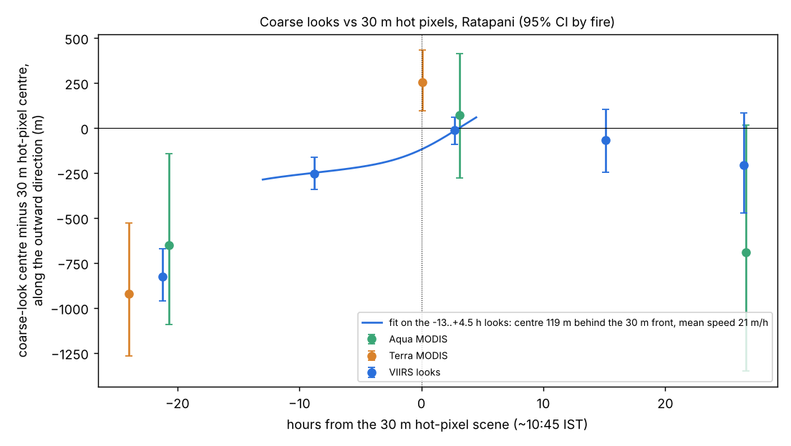
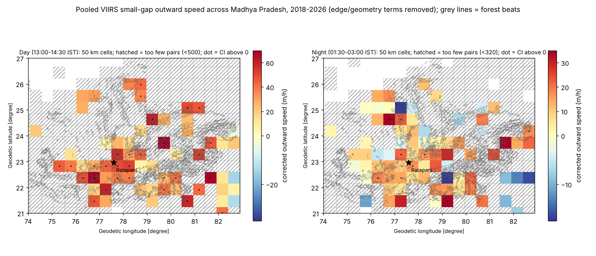
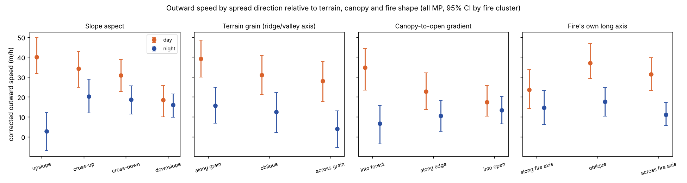

# Squares v3, part A: making the pooled spread speed trustworthy, and mapping it (17 Oct 2026)

Asked by Akkshay: dig deeper into the "square blocks" pooled result. Part A covers four things:
1. why the pooled VIIRS speed and the 30 m hot-pixel check disagreed;
2. matched truth tests;
3. a regional map;
4. direction effects (anisotropy).

The per-fire part is a sibling thread (part B).

**Rules kept.**
- VIIRS is a 375 m+ block with its own scan/track size.
- Every pass is its own look with its own time. Nothing near in time was merged.
- No credential was used or written.
- All fitted terms were fitted on one half of the seasons and applied to the other.
- CIs are 95% bootstraps by fire cluster: a 5 km cell × season, or one fire for the hot-pixel tests.

**Code and outputs.** These are in `code/squares_v3/a/`: scripts `a1`–`a6`, tables and figures in `results/`. The v2 intermediates in scratch (`r19_pool`) were only read.

**Terms**
- **outward move**: how far the later look's centre lies beyond the earlier look's, measured along the direction from the fire's earlier detections (2-48 h before) to the pair.
- **centre**: the mean position of one pass's flagged blocks.
- **front**: where the flaming line actually is. The 30 m hot pixels and the 70 m ECOSTRESS pixels show it.
- **edge offset**: how far a coarse look's centre sits behind (−) or ahead of (+) the front at the same moment.
- **edge reach**: a bigger block, or a hotter fire, pushes the centre outward.
- **coupling**: a bias that arises because the outward direction is built partly from the same two looks.

[inference] marks reasoning rather than measurement.

---

## Bottom line

1. **The contradiction is resolved: the 5 m/h hot-pixel check compared unlike things.**
   - The v2 test set a VIIRS *centre* against the 30 m *front* and assumed they coincide.
   - They do not. At the same moment, a VIIRS centre sits **about 120 m behind the flaming front** (−119 m, CI −182 to −52; from 286 fires).
   - With that offset fitted freely, the same 30 m data give a 13:30 speed of **42 m/h (21-63)**. That agrees with the pooled value.
   - Only the *shape* of the pooled day/night curve is borrowed. Its level is not.
   - The v2 day-only check also had little power: SE 11 m/h, so only a 59% chance of telling 5 m/h from 30 m/h.
2. **Removing the edge-reach, geometry and coupling terms barely changes the day speed. It roughly doubles the night speed.**

   | | v2 pooled | v3 corrected (held-out terms) | gap-fit slope | towards later growth (no coupling) |
   |---|---|---|---|---|
   | Day 13:30, all fires | 30.7 | **29.7 (26.5-32.6)** | 31.6 (24.4-38.4) | 28.6 (24.0-31.9) |
   | Night 01:30, all fires | 5.2 | **10.1 (7.7-12.4)** | 8.0 (3.0-13.6) | 7.8 (5.1-10.5) |
   | Day, forest + scrub | 35.6 | **32.6 (28.8-36.1)** | 33.7 | |
   | Night, forest + scrub | 10.3 | **14.6 (11.1-18.2)** | 13.4 | |

   All values are m/h.

   **Best-supported speeds (centre speed):**
   - **day ≈ 30 m/h (26-33)**;
   - **night ≈ 9 m/h (5-12)**. The range spans the three methods.
   - Forest by day ≈ 33 m/h, forest at night ≈ 14 m/h.
3. **What the terms are, measured on 186k fire pairs and 34k static-site pairs:**
   - **Bigger blocks reach outward:** +0.08 m of centre shift per m of extra block size (CI 0.06-0.10). In a pair the earlier look has the bigger blocks, so this term pulls speeds down by 0.7 m/h by day and 1.9 m/h at night.
   - **Coupling:** worth 0.4-0.5 m/h.
   - **Satellite order:** no effect by day (NOAA-20 and NOAA-21 terms ±1 m). It is +3 m for NOAA-21 at night.
   - **View-angle shift:** +1.9 m/h by day and −2.2 m/h at night.
   - Night is where the terms add up (−5 m/h). That is why the v2 night value was low.
4. **Cluster growth and shrinkage between looks is a strong artefact in subsets, but small on average.**
   - When a cluster gains pixels, its centre moves *inward* (−11 m per doubling by day, −16 m at night). When it loses pixels, the centre moves outward.
   - [inference] Gains and losses happen mostly on the burnt-out rear side.
   - At night, pairs whose cluster shrank show +25 m/h and pairs whose cluster grew show −4 m/h.
   - Averaged over all pairs this cancels to about 1 m/h, because the mean change is small.
   - So scrub's v2 night value of −18 m/h, and similar subset numbers, can come from this, not from fire behaviour.
5. **The static-site night null (−27 m/h) is only partly explained (now −20, CI −32 to −7).**
   - It is not sensor order, block size, coupling or view angle.
   - Fires do not show it: intercepts are ~0 m, and the later-growth direction agrees.
   - [inference] It is a multi-stack site effect, so it is a weak null for this test.
6. **The 30 m truth tests agree with the pooled speeds wherever they have power.**
   - **Bracket test.** 117 scenes had a VIIRS look before (night) and after (day) the hot-pixel scene.
     - The VIIRS-only centre speed through the bracket is 14.8 m/h (−0.1 to 29.2). Pooled says 16.7 for that 01:30 → 13:30 stretch.
     - The 30 m front sits 61% of the way from the before-look to the after-look, where 55% of the clock has elapsed.
   - **30 m front, measured directly.** Between hot-pixel scenes of the same fire 1-6 days apart (62 pairs, 58 fires), new hot pixels lie a median of **24 m/h (20-29)** from the old ones. This matches the big-fires multi-pass front speed of 25 m/h.
7. **Map: day speed varies across MP, and the pattern holds between even and odd seasons. Night speed shows no reproducible pattern.**
   - Day, 50 km cells (63 cells with enough pairs): cells range from 9 m/h (10th percentile) to 56 m/h (90th).
   - Even- vs odd-season agreement: weighted r 0.45, p 0.006 against shuffled cells.
   - Night: r 0.16, p 0.09.
   - Most 25 km cells have too few pairs.
8. **Direction effects.**
   - **Slope:** spread is faster upslope by day (+22 m/h over downslope, CI 11-35) and faster downslope at night (−13, CI −24 to −2).
   - **Canopy:** spread is faster into forest than into open ground by day (+17, CI 3-29).
   - **Terrain grain:** spread is faster along valleys/ridges than across them, by +11 m/h both day and night, but the CI just includes 0 (−2 to +25). Suggestive, not firm.
   - **Fire shape:** not faster along the fire's own long axis (−8, n.s.).

---

## 1. Why the speeds disagreed, and the decomposition (`a1_decomp.py`, `a1b_growth_check.py`)

**Model.** Each pair's outward move is fitted, separately for day and night, as:

> true advance (v × gap, fires only) + sensor-order terms + block-size term (later minus earlier block side) + view-angle term + coupling term (+ optionally the change in pixel count and in FRP).

- Fires and static industrial sites are fitted jointly; static sites have no v.
- The coefficients are fitted on even seasons and applied to odd seasons, then the reverse.

**Fitted terms** (all seasons, for reading; [`a1_decomposition.json`](code/squares_v3/a/results/a1_decomposition.json)):

| term | day | night | meaning |
|---|---|---|---|
| v (gap slope) | 32.0 (25.6-38.4) | 7.0 (1.3-12.7) | true advance, m/h |
| block size, fires | +0.080 (0.059-0.100) | +0.088 (0.073-0.103) | m of outward shift per m of larger block in the later look |
| block size, static | +0.15 | +0.25 | same, for sites |
| NOAA-20 / NOAA-21 order | −0.2 / −1.1 m (n.s.) | +0.6 / **+3.2 m** | satellite order |
| coupling (fitted / theory 1.0) | 0.32 | 0.43 | noise-model coupling, partly captured |
| intercept, fires | −1.6 m (−5.7 to 2.8) | +2.3 m (−1.3 to 6.2) | no leftover per-pair artefact |
| + pixel-count change (ln nB/nA) | −11 m (−17 to −6) | −16 m (−20 to −11) | growth adds pixels at the rear |
| + FRP change (ln) | −3 (n.s.) | −4 (−7 to −1) | |

- Adding the two cluster-change terms moves v by less than 1.6 m/h.
- [inference] Hypothesis (b), cluster changes, is real per pair, but it averages out.

**Hypotheses tested:**

| | verdict |
|---|---|
| (a) edge reach (block size, threshold) | **real but small.** Bigger blocks push the centre outward, by +0.08 m per m. Its average effect is under 2 m/h. |
| (a') night threshold shrinks clusters → inward artefact | **partly.** Night terms sum to −5 m/h, so the corrected night speed is ~10, not 5. At night a shrinking cluster moves the centre *outward*, not inward. |
| (b) cluster size or intensity changes between looks | **real per pair, cancels in the mean** (about 1 m/h). Subset speeds by fuel or size can be biased by it. |
| (c) satellite order × view angle | **no effect by day.** At night NOAA-21 order is worth +3 m. The view-angle term is ±2 m/h. |
| (d) hot-pixel test underpowered | **yes, and mis-specified.** SE 11 m/h, and it ignored the centre-to-front offset (§2). |

**Robustness.** The day speed per minute of gap is the same for all six sensor orders: 0.46-0.53 m/min, i.e. 28-32 m/h.

## 2. Matched truth tests with 30 m hot pixels (`a2_hotpix.py`, `a2b_offset.py`)

**Data.** 798 Sentinel-2/Landsat scenes on Ratapani fires, each ~10:45 IST. 370 scenes had at least 3 hot pixels and a usable look. Every VIIRS, Terra and Aqua look of the same fire within ±27 h was kept as its own look: 1,371 looks on 318 fires.

**Measure.** For each look: (look centre − 30 m hot-pixel centre), projected on the direction from earlier VIIRS detections to the hot pixels.

| looks (VIIRS) | lag | mean | |
|---|---|---|---|
| previous afternoon | −21 h | −827 m (−962 to −671) | far behind |
| night before | −9 h | −253 m (−342 to −162) | behind |
| afternoon after | +2.7 h | −12 m (−90 to 59) | level with the front |
| night after / next afternoon | +15 h / +26 h | −67 / −206 m | falls back [inference: later looks pick up other parts of the fire; the direction was set by the hot pixels at 10:45] |

**Fit on the window around the scene (−13 to +4.5 h; 740 looks, 286 fires):**
- **centre-to-front offset: −119 m (−182 to −52)**;
- clock-mean speed: 21 m/h (10.5-31.6).
- Converted with the pooled curve's shape, that is **42 m/h at 13:30 (21-63)** and 8 m/h at 01:30.
- Held-out check (offset fitted on one season half): mean speed 16.4 (8.7-24.2) on odd seasons and 14.6 (5.5-24.1) on even seasons.

**Why v2 got 5 m/h.** It read −12 m at +2.7 h as front advance, with the offset taken as 0. With the offset at −120 m, the advance is about 110 m in 2.7 h.

**Independent check of the offset:**
- **ECOSTRESS 70 m** visible passes with VIIRS within 1 h: 11 fires. The VIIRS centre sits −29 m (−133 to 76) from the 70 m front; median −76 m; behind it in 64% of passes. Same sign, weak.
- **Big-fires 14c:** hot pixels sit in the outer half of blocks 78-88% of the time. [inference] A centre ~120 m behind the line is what that implies for a ~470 m block whose fire line runs near its outer side.

**Terra MODIS at the same minute (22 passes): +254 m (94-432) *ahead* of the hot pixels.**
- This is not resolved.
- In the all-MP pooled pairs, Terra 10:40 → VIIRS 13:30 gave +38 m/h outward. If Terra centres sat 250 m ahead, that segment would be strongly negative.
- [inference] This is a small Ratapani sample with 1 km pixels. Any speed segment that uses Terra rests on an unknown Terra edge offset.

**Bracket test (117 scenes with a VIIRS night look 6-13 h before and a day look 1-4.5 h after):**
- VIIRS-only shift: +166 m (−35 to 335) over 11.6 h, i.e. **14.8 m/h (−0.1 to 29.2)**. Pooled says 16.7 m/h for this stretch.
- The 30 m front sits at a median 0.61 of the way between the two looks, against 0.55 of the clock elapsed.

**30 m front advance between scenes 1-6 days apart (62 pairs on 58 fires; median gap 48 h):**
- New hot pixels sit a median of 24 m/h (20-29) from the nearest earlier hot pixel.
- That is 38 m/h for 12-60 h gaps and 15-17 m/h for 60-150 h gaps.
- [inference] It is an upper-bound style measure: a nearest distance is not additive, and new flanks count as advance.
- The hot-pixel *centre* does not move outward between such scenes (−6 m/h, n.s.). The flaming part wanders around the scar.

**Same-day Sentinel-2 + Landsat (39 fire-days):**
- The scenes are a median 4 min apart, so there is no usable time gap.
- Their centres differ by 85 m, and Landsat hot pixels lie 28 m from the nearest Sentinel-2 hot pixel.
- So 30 m positions are reliable to tens of metres, but these pairs cannot measure speed.

## 3. Regional spread-rate map (`a4_map.py`)

Corrected outward speed per cell; hatched cells have too few pairs to see 50 m/h (under 500 by day, under 320 at night). [`a4_cells_50km.csv`](code/squares_v3/a/results/a4_cells_50km.csv) and `a4_cells_25km.csv` give n, CI, and even/odd-season values per cell.

| | day, 50 km | night, 50 km | day, 25 km | night, 25 km |
|---|---|---|---|---|
| cells with enough pairs | 63 of 248 | 79 of 241 | 30 of 843 | 76 of 780 |
| cell speeds, 10th / 50th / 90th percentile | 9 / 30 / 56 | −7 / 9 / 22 | 7 / 39 / 67 | −10 / 7 / 33 |
| χ² around the MP mean (degrees of freedom) | 130 (62) | 78 (78) | 71 (29) | 99 (75) |
| even- vs odd-season r (p vs shuffle) | **0.45 (0.006)** | 0.16 (0.09) | 0.76 (<0.002, 20 cells) | 0.08 (0.29) |

- **Day:** real regional differences. The fastest well-sampled 50 km cells are forested, at 50-75 m/h. Their centres lie roughly near Damoh, Khandwa-Harda, Betul, Balaghat, the Amarkantak side, Panna and Ratapani-Raisen. The place names are approximate cell locations.
- **Slowest:** the far eastern edge and some farm cells, under 10 m/h. [inference] The far east (82.6°E) is also at the edge of the data box and is worth suspecting.
- **Night:** cell differences are not distinguishable from noise. Use one night value per forest type.

**By forest type** (corrected, m/h; [`a4_forest_types.csv`](code/squares_v3/a/results/a4_forest_types.csv)):

| type | day (CI) | night (CI) | pairs, day / night |
|---|---|---|---|
| dry deciduous | 36.0 (29.0-42.9) | 15.0 (7.7-21.8) | 13.4k / 9.0k |
| teak | 34.8 (27.6-41.8) | 17.9 (11.8-25.4) | 14.1k / 10.5k |
| sal | 29.0 (19.4-38.0) | 22.1 (11.9-32.1) | 6.7k / 5.2k |
| moist deciduous | 28.9 (19.8-39.0) | 17.9 (8.1-27.7) | 7.1k / 4.5k |
| degraded forest | 29.3 (18.7-39.2) | 2.9 (−8.0 to 14.8) | 4.9k / 3.4k |
| agriculture | 27.2 (22.9-32.2) | 7.5 (4.7-10.4) | 40.5k / 54.2k |
| scrub / grass | 26.5 (5.5-46.6) | −11.3 (−25.0 to 2.4) | 2.0k / 2.3k |
| bamboo | 21.9 (0.3-43.4) | 22.5 (2.4-43.8) | 1.1k / 1.6k (too few) |

- Forest divisions: no division boundaries are on disk, so the map uses cells instead.
- Scrub at night is still negative, though not significant. See point 4 of the bottom line for a likely artefact.

## 4. Anisotropy (`a3_feat.py`, `a5_aniso.py`)

Pairs were grouped by the angle between their outward direction and an axis at the pair's mid-point. The axes are:
- **slope aspect**: SRTM ~140 m, slope ≥ 2°;
- **terrain grain**: the ridge/valley axis from the structure tensor over ~1.4 km, with coherence ≥ 0.3 and relief ≥ 15 m. In MP it is mostly E-W/ENE, as the Vindhya and Satpura ranges are.
- **canopy gradient**: the VTM forest fraction on a 300 m grid, pointing towards denser forest; gradient ≥ 0.1 per km;
- **the fire's own long axis**: from earlier detections, axis ratio ≥ 2.

A centred version, which removes any constant vector bias per stratum, gives the same contrasts within 5 m/h.

| contrast (m/h) | day | night | pairs, day / night |
|---|---|---|---|
| upslope minus downslope | **+21.7 (10.6-34.5)** (40 vs 19) | **−13.4 (−24.2 to −2.1)** (3 vs 16) | 32k / 30k |
| along grain minus across grain | +11.3 (−2.4 to 24.9) (39 vs 28) | +11.6 (−1.2 to 24.9) (16 vs 4) | 20k / 16k |
| into forest minus into open | **+17.3 (2.9-29.4)** (35 vs 17) | −6.8 (−18.5 to 4.1) | 23k / 21k |
| along the fire's long axis minus across it | −7.7 (−20.2 to 5.2) | +3.6 (−7.1 to 13.7) | 29k / 32k |

**Reading:**
- Slope has the clearest effect. Upslope spread by day is about 2× downslope spread. At night the direction reverses, with downslope spread about 5× upslope spread. [inference] This fits day upslope winds and night drainage winds.
- Along-grain spread is a slope-independent quantity, because along the grain means across the slope. It is faster in both day and night, by a similar ~11 m/h. That is a suggestive valley/ridge channelling effect, not yet significant.
- "Into forest" being faster by day fits fuel continuity. [inference] It may also reflect farm-edge fires that run into forest.
- No speed-up along the fire's own long axis. [inference] Elongated clouds of earlier detections are often flank lines or neighbouring fires, not a heading direction.

## What to use
- **Pooled spread speeds** (centre speeds; the front sits ~120 m ahead of the VIIRS centre):
  - day: 30 m/h (26-33);
  - night: 9 m/h (5-12);
  - forest: 33 by day and 14 at night.
- **Hand-off to part B:**
  - [`class_speed_correction.json`](code/squares_v3/a/results/class_speed_correction.json): day factor 0.97, night factor 1.94, with absolute values and CIs;
  - `edge_term_by_pair.parquet`: the per-pair term `edge_m`, keyed on `pair_row` = the pairs.parquet row. Subtract it from the clipped p_out.
- **Any tracker or forecast that seeds from VIIRS block centres** should move the seed ~120 m outward (CI 50-180) to reach the flaming front.
- **Direction factors:**
  - day: ×1.3 upslope and ×0.6 downslope, against the mean;
  - night: the reverse;
  - into forest ×1.2 by day.
  - These have not been tested out of sample on photos.
- **Regional map:** a day-time map at 50 km cells is reproducible across seasons. Use one night value.

## Limits
- All 30 m truth is from Ratapani, at ~10:45 IST only. ECOSTRESS has 11 usable same-hour fires.
- The hot-pixel speed borrows the *shape* of the pooled day/night curve. Its level is free.
- The Terra same-minute offset (+254 m) is unexplained.
- The coupling term uses the v2 noise model, and its fitted coefficient (0.3-0.4) is below theory (1). The night correction rests partly on it, but the later-growth projection, which has no coupling, gives 7.8 m/h, so the night range of 8-10 m/h stands either way.
- The static night null is still −20 m/h.
- Pooled speeds are **centre** speeds of fires seen twice (survivor selection).
- Forest map ~2005-10; DEM ~140 m; no division boundaries.

## Follow-up (17 Oct, spread thread test)
The spread thread tried the 120 m outward seed shift on 818 unseen fires (2,246 forecasts, same added area). It did not help:

| Seed | Score |
|---|---|
| Centre seeds | 0.477 |
| All seeds shifted 120 m outward | 0.451 (worse on 660 fires, better on 39) |
| Latest look only shifted | 0.460 |
| Hull-edge seeds | 0.456 |

The thread's caveat: its truth comes from VIIRS dot centres, which favours centre seeds. Use the 120 m lag for physics and isochrones, not for the 24 h map. See ratapani/spread/unseen_validation/README.md section 7.
