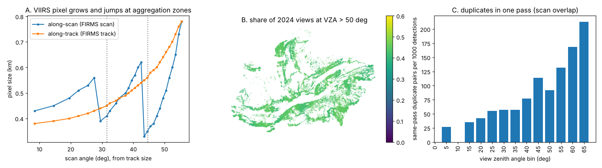
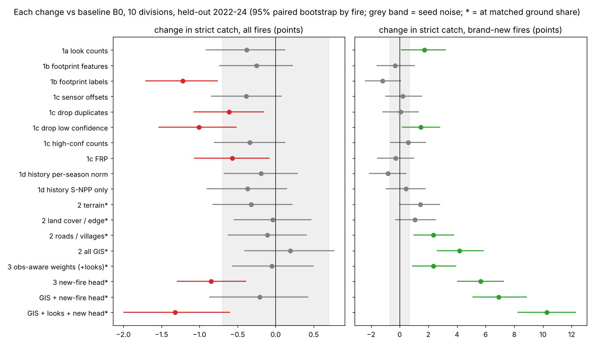
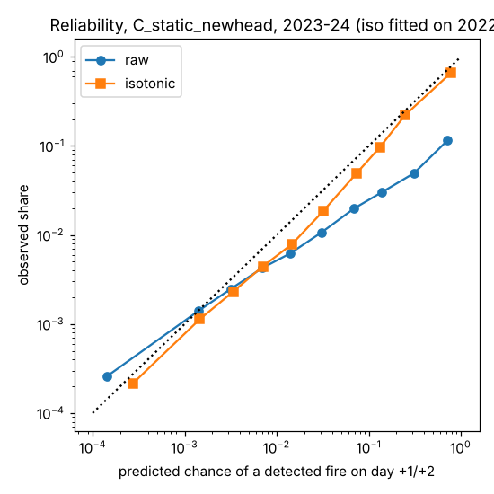
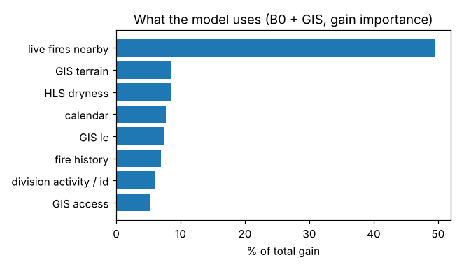
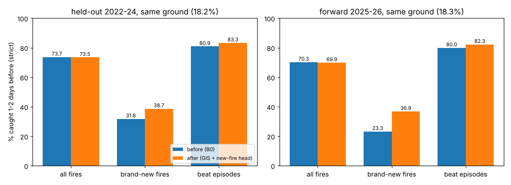

# System rebuild: satellite, GIS and ML layers (round 22, 17-18 Oct 2026)

Akkshay's ask: "whatever we have now use those data and improve the system from basic understanding of satellite working their data and metadata also and then the gis part and then ml part". This note uses only data we already have.

**Bottom line.** Of about 20 changes tested, two survive the noise: **static GIS inputs** (terrain, land cover and forest edge, roads and villages) and **a separate model head for brand-new fires**.
- Together, at the same ground share, they keep all-fire catch flat. They raise brand-new-fire catch from 31.8% to 38.7% on held-out 2022-24, and **from 23.3% to 36.9% on the forward 2025-26 test**. Beat episodes rise by 2.3-2.4 points.
- The satellite-metadata changes give no gain. They help explain the data (every square is viewed every day; the viewing angle and clouds decide what is seen), but the forecast does not improve from cleaning the points.
- Scope: 10 divisions, so this is not the PC's 87-division model. The PC's published 73.2 / 39.9 are context only.

## 0. Set-up (what every number below means)

- **Score.** I use the strict officer rule from `ratapani/scoring/mp_check`. Each fire counts once. A fire is caught if one of its first-day squares is flagged, or next to a flag, 1 or 2 days before it starts. The flags are the top 10% of the division's test square-days. The season runs 15 Feb to 31 May, and likely control burns are dropped.
  - My re-coded scorer (`evalr.py`) finds exactly the same fires as mp_check: 50,997 on 2022-24 and 54,033 on 2025-26.
  - On the simple rules it agrees within the tie-breaking noise. "Fires nearby" scores 54.9 / 11.0 (all fires / brand-new fires) against mp_check's 54.7 / 11.4. "Burned before" scores 42.4 / 35.0 against 40.8 / 33.3.
- **Scope (coordinator, 17 Oct).** The PC pipeline thread owns the all-MP 87-division model and its scoring. So all ablations here run on **10 divisions that span MP's forest types**:
  - Obedullahganj (Ratapani) and Raisen, Khandwa (teak);
  - South Balaghat and Dindori (sal);
  - Kanha TR and Satpura TR (tiger reserves with early burning);
  - Shivpuri and Gwalior (north, thorn and grass);
  - Singrauli (industrial heat).
  - Together they hold 10,611 fires in 2022-24, of which 2,160 are brand-new.
  - The PC's published numbers (73.2% all fires / 39.9% brand-new at about 20% ground, all 87 divisions) are context only. They are not computed on the same divisions.
- **Baseline model (B0).** One pooled LightGBM, with the division as a categorical input (a per-division intercept and interactions). Negatives are subsampled at 1.5% with weight 1/0.015. It has 51 inputs:
  - recent fires at 0.5-50 km over 1-30 days, and days since the last fire;
  - fire history over the 5 previous seasons;
  - day of year and the division's usual fire rate for that day;
  - HLS dryness;
  - the share of the division burning today and over the last 7 days.
  - The PC's own feature code is not in this container, so B0 is a stand-in, not a copy.
- **Seasons.** Train on 2019-21 and test on 2022-24 ("held-out"). The forward test trains on 2019-24 and tests on 2025-26.
- **Noise.** 95% bootstrap CIs resample fires. Each change is compared with B0 on the same fires using a paired bootstrap. A change is kept only if the paired CI excludes zero.
- **Full-MP check.** For reference, I also trained B0 on all 87 divisions, before the scope change. Held-out it scores **68.8% all fires (CI 68.4-69.2), 30.1% brand-new, 75.5% beats, at 16.8% ground**. That is below the PC model's 73.2 / 39.9 / 81.6 at 20% ground.
  - Part of the gap is ground: the B0 flags clump, so they cover 3 points less ground.
  - The rest is features. The PC model is the better all-MP model.

Code: `code/system_rebuild/` (common.py, evalr.py, features.py, run.py, variants.py, s1-s6, l3.py, compare.py). Big tables are kept in scratch only.

## 1. Satellite layer: how VIIRS sees MP

### 1a. Rebuilding every overpass from the detection metadata (`s1_passes.py`, `s2_looks.py`)
- **Passes.** A pass is one satellite's detections less than 15 min apart. That gives 12,850 passes in 2014-26, and each one crosses MP in about 2 min.
  - 627 more passes reached MP but had no detection in the box. I added these from the orbit: about 101.4 min between orbits, so each next orbit's nadir sits 25.35° further west. Almost all of them clip MP's edge at the far end of the swath.
- **Scan angle comes from the along-track size, not the along-scan size.** FIRMS `track` grows steadily from 0.375 km at nadir to 0.78 km at the edge. FIRMS `scan` has a saw-tooth (fig 1A), because the instrument changes how many samples it adds together at about 32° and 45° (the aggregation zones).
  - So `scan` alone cannot give the angle. `track` can.
  - In our fit the jumps sit about 2-3° early, which is consistent with rounding of `track`.
- **Nadir track of each pass.** The orbits are sun-synchronous, so the nadir local solar time at 23° N is fixed: 13:09 by day and 01:40 by night, for all three satellites (r19 table). That gives a first guess at the nadir longitude from `acq_time`. I then fitted it per pass so that each detection's distance across the track matches its `track` size.
  - The median miss is 11 km per pass.
  - The scan angle from a detection's position matches the one from its `track` size within a median 0.5° (p90 6.5°).
- **Every square is viewed every day.** Over a season every MP square gets views:

  | Satellites | Views per square per day |
  |---|---|
  | S-NPP only (2014-17) | 2.5 |
  | 2 satellites (2019-22) | 5.0 |
  | 3 satellites (2023-25) | 7.1-7.5 |

  - The share of square-days with no VIIRS view at all is **0.0%**.
  - About 44% of views are at a view zenith angle above 50°, evenly spread over MP (fig 1B).
  - With 3 satellites, the median best look of the day is 7° from vertical.
  - So "not viewed" almost never happens. **What decides whether a fire is seen is the viewing angle, clouds and smoke, and timing, not missing passes.**
- **Detected fire rate depends on the view.**
  - Square-days whose best look is within 20° of vertical show 1.5-2x the detection rate of those whose best look is 20-35°.
  - The quintile of square-days with the fewest effective looks has about 0.65x the rate of the top quintile.
  - Effective looks = the sum of (375 m)² ÷ pixel area: a small fire is a smaller part of a bigger pixel.
  - Table: `out/s6_rate_by_view.csv`.
- **Duplicates in one pass.** Neighbouring scans overlap toward the swath edge, and on-board "bow-tie" deletion removes only part of that overlap. Two detections of one pass less than half a pixel apart:

  | View zenith angle | Duplicates per 1,000 detections |
  |---|---|
  | 5-10° | 27 |
  | 45-50° | 114 |
  | 65-70° | 213 |

  - In all, 161k detections (6.8%) are a second copy (fig 1C).
- **What cannot be known without cloud masks.** FIRMS lists only detections. A square under cloud or thick smoke at pass time looks the same as a clear square with no fire.
  - The only way to see "looked clear, no fire" is the VIIRS fire-mask product (VNP14IMG), which needs an Earthdata login (see `squares_v2_tracking.md`).
  - So every "looks" count here is an upper bound on clear looks. HLS clear % is a 15-day mean and cannot stand in for clear sky at 01:30 or 13:30.

### 1b-1d. Satellite changes scored (10 divisions, held-out 2022-24, paired against B0)
B0 scores **73.7% all fires (CI 72.9-74.6), 31.8% brand-new (30.0-33.7), 80.9% beats, at 18.2% ground**.

**Training noise.** Re-running B0 with a different negative sample and seed gives 73.1 / 31.3. So differences under about 0.7 point on all fires, or about 1 point on brand-new fires, are training noise, even when the paired CI excludes zero.

| Change (layer 1) | All fires Δ (95% CI) | Brand-new Δ (95% CI) | Ground | Verdict |
|---|---|---|---|---|
| 1a look counts: views, effective looks, slant/night share, best VZA, tomorrow's known geometry, good looks since the last fire, fires per look | -0.4 (-0.9 to +0.1) | **+1.7 (+0.1 to +3.2)** | 18.4% | candidate, new fires only |
| 1b footprint-weighted live and history features | -0.3 (-0.7 to +0.2) | -0.3 (-1.6 to +1.1) | 18.3% | no gain |
| 1b footprint soft labels for training | **-1.2** (-1.7 to -0.8) | -1.2 (-2.4 to +0.1) | 17.6% | worse |
| 1c per-satellite offsets removed | -0.4 (-0.9 to +0.1) | +0.2 (-1.0 to +1.6) | 18.2% | no gain |
| 1c same-pass duplicates dropped | -0.6 (-1.1 to -0.2) | +0.1 (-1.2 to +1.3) | 18.2% | no gain |
| 1c low-confidence points dropped | **-1.0** (-1.5 to -0.5) | +1.5 (+0.1 to +2.8) | 18.3% | trade-off; not kept |
| 1c high-confidence counts as separate inputs | -0.3 (-0.8 to +0.1) | +0.6 (-0.7 to +1.9) | 18.2% | no gain |
| 1d history normalised per season (sum per season equalised) | -0.2 (-0.7 to +0.3) | -0.8 (-2.1 to +0.5) | 18.3% | no gain |
| 1d history from S-NPP only | -0.4 (-0.9 to +0.2) | +0.4 (-1.0 to +1.8) | 18.1% | no gain |
| 1c FRP inputs (FRP sum at 1.5/3.5 km over 1-7 d, max FRP nearby) | -0.6 (-1.0 to -0.1) | -0.3 | 18.1% | no gain |
| 1d number of satellites as input | 0.0 | 0.0 | 18.2% | cannot be learned: all 2019-21 training seasons have 2 satellites |

**What the satellite layer tells us.**
- **Cleaning the points does not help the forecast.** B0 counts squares with any fire, and it already uses many radii (0.5-50 km). So footprints, offsets of about 50-90 m and duplicates move a detection by at most one square, and the 1.5-3.5 km inputs absorb that.
- **Footprint labels hurt.** They spread a target over 2-4 squares, but the score counts the first-day square. The model learns "near a fire" instead of "in this square".
- **Low-confidence points are real fires in the main.** Dropping them costs 1 point on all fires. They are mostly small or slant-view fires next to fires that continue.
- **Look counts are the one satellite input with a signal, and only for brand-new fires.** The model learns that a quiet square seen through few or slant looks is less certain to be quiet. [inference]
- **The NOAA-21 mix problem is real but cannot be trained away from 2019-21.** No training season has 3 satellites. The forward test (trained on 2019-24, with 2023-24 on 3 satellites) is where it is tested.

## 2. GIS layer (`s5_static.py`)

**Grid check.**
- The grid is UTM 43N. Its central meridian is at 75° E, and MP runs from 74.0 to 82.8° E.
- The scale factor runs from 0.9996 to 1.0074. So in the far east a "500 m" square is 496 m on the ground. Area error is at most +1.5%. Grid north is turned up to 3.3° from true north.
- That is far below the 375-750 m VIIRS pixel and the 50-250 m geolocation noise. **No fix needed** (`out/s5_scale_check.json`).

**Static square inputs** (for all 418,642 union squares):
- **Terrain** from the public z10 terrain tiles (about 140 m): elevation, slope, ruggedness (SD in the 3x3 block), within-square roughness, TPI (elevation minus the 5 km mean), southness.
- **Land cover** from the VTM 60 m map:
  - shares of tree forest, scrub, grass, farm, settlement and water;
  - forest types: sal, teak, dry mixed, moist mixed, bamboo, degraded;
  - farm share within 2.5 and 5 km; forest share within 5 km;
  - distance to the forest edge inside the forest, and to forest outside it;
  - beat cover in the square and within 5 km.
- **Access** from Overture 2026-09:
  - road km per square, major road km, road km within 5 km;
  - distance to a major road and to any road or track;
  - distance to the nearest of 54,740 localities and 48,404 neighbourhoods/hamlets (39k villages, 15k hamlets), and their count within 5 km;
  - VTM settlement share within 5 km.
- **Neighbourhood at several radii** was already in B0: fires at 0.5, 1.5, 3.5, 7.5, 10, 15 and 50 km, and history at 0.5-7.5 km.

**Scores** (paired against B0; the flag share is set so that ground matches B0's 18.2%, `mg.py`; seed noise is about 0.7 point on all fires and 0.5-1 point on brand-new fires):

| Change (layer 2) | All fires Δ | Brand-new Δ | Beats | Verdict |
|---|---|---|---|---|
| Terrain | -0.3 (-0.8 to +0.2) | +1.4 (-0.1 to +2.8) | 81.5 | weak |
| Land cover and forest edge | 0.0 (-0.6 to +0.5) | +1.1 (-0.3 to +2.6) | 81.5 | weak |
| Access: roads and villages | -0.1 (-0.6 to +0.4) | **+2.4 (+1.0 to +3.8)** | 81.2 | helps new fires |
| **All static inputs together** | +0.2 (-0.4 to +0.8) | **+4.2 (+2.6 to +5.9)** | **82.6** | **kept** |

- Without matching ground (standard top 10%), all static inputs give 75.0% all fires and 37.3% brand-new, but on 19.2% ground instead of 18.2%.
- The three groups add up. Each alone is small; together they lift brand-new fires by 4 points. [inference] They tell the model where people start fires in quiet places: near villages and tracks, and on forest edges and terrain that history alone cannot separate.

**Spatial leakage check (20 km blocks).** Blocks were split at random into two halves. A model trained on one half's squares (2019-21) scored the other half (2022-24), and the other way round. Result: 72.6% all / 33.2% brand-new, against B0's 73.7 / 31.8 (ground 19.5% vs 18.2%). Squares the model never saw are forecast almost as well. **So the model is not memorising squares**, and the history inputs carry over in space.

## 3. ML layer (`l3.py`, `s7_calib.py`)

All rows are at matched ground (18.2%) and paired against B0.

| Change (layer 3) | All fires Δ | Brand-new Δ | Beats | Verdict |
|---|---|---|---|---|
| Observation-aware, hard: down-weight negatives with no look under 50° on the next 2 days | 0.0 | 0.0 | 81.5 | does nothing: with 2-3 satellites that case never happens |
| Observation-aware, soft: negatives weighted by the next 2 days' effective looks (0.3-1), with look inputs | -0.1 (-0.6 to +0.5) | +2.4 (+0.9 to +3.9) | 82.0 | about the same as look inputs alone (+1.7 at native ground); weighting adds little |
| **Separate brand-new-fire head**: a second LightGBM trained only on square-days with no fire within ±5 km over 7 days, used for those squares | **-0.9 (-1.3 to -0.4)** | **+5.7 (+4.0 to +7.3)** | 81.6 | strong for new fires; costs about 1 point on others |
| **GIS + new-fire head** | -0.2 (-0.9 to +0.4) | **+6.9 (+5.1 to +8.9)** | **83.3** | **kept: the recommended recipe** |
| GIS + look inputs + new-fire head | **-1.3 (-2.0 to -0.6)** | **+10.3 (+8.2 to +12.3)** | 83.2 | option if brand-new fires matter more than the rest |

**Why the separate head works.** [inference]
- In the pooled model, brand-new square-days (no fire within 5 km for a week) all get small scores. The splits that matter there (live fires nearby) are flat for them.
- Trained alone, the new-fire head ranks these squares by history, calendar, dryness and the GIS inputs. At the division's 10% cut, these squares now compete fairly with squares next to live fires.

**Calibration** (GIS + new-fire head, held-out). The target is a detected fire on day +1 or +2.
- **Raw scores are badly over-confident.** The model says 72% where 12% happen, and its Brier skill is negative (-0.41). Negative subsampling, plus the two heads, distort the probabilities even though the ranking is good.
- **Fix:** an isotonic map fitted on the first test season (2022) and applied to 2023-24, as a live system would recalibrate on last season. After it, predicted vs observed:

  | Predicted (isotonic) | Observed | Share of square-days |
  |---|---|---|
  | <0.1% | 0.02% | 73% |
  | 0.5-1% | 0.44% | 4.4% |
  | 2-5% | 1.9% | 1.3% |
  | 5-10% | 4.9% | 0.3% |
  | 10-20% | 9.6% | 0.05% |
  | 20-50% | 22% | 0.02% |

  - Brier skill rises to +0.019.
  - It still over-predicts slightly, because 2023-24 were quieter seasons than 2022.
- **The top 1% of square-days come true 3.8% of the time, 29x the base rate of 0.13%.**
- Table: `out/s7_reliability_C_static_newhead_held_sub.csv`.

**Feature importance** (B0 + GIS, gain share):

| Input group | Gain share |
|---|---|
| Live fires nearby (r 0.5-50 km) | 49% |
| Terrain | 8.6% |
| HLS dryness | 8.5% |
| Calendar | 7.7% |
| Land cover | 7.4% |
| Burn history | 7.0% |
| Division activity / id | 6.0% |
| Roads / villages | 5.4% |

The single top inputs are fires within 1.5-3.5 km today and within 5 km over 7 days. TPI is the 9th input.

**Not tried:** neural nets. The tree model is not saturated: the gains here come from inputs and from structure (the second head), not from model capacity.

## 4. Before -> after (10 divisions; strict, each fire once; flagged 1-2 days before the first day)

"Before" = B0. "After" = B0 + all static GIS inputs + the separate brand-new-fire head.

| Test | Model | All fires | Brand-new fires | Beat episodes | Ground flagged or next to a flag |
|---|---|---|---|---|---|
| Held-out 2022-24 (10,611 fires, 2,160 new) | before | 73.7 (72.9-74.6) | 31.8 (30.0-33.7) | 80.9 | 18.2% |
| | after, same 10% flags | 75.8 (75.0-76.6) | 42.2 (40.2-44.2) | 85.3 | 20.0% |
| | **after, same ground** | **73.5** (Δ -0.2, -0.9 to +0.4) | **38.7** (Δ **+6.9**, +5.1 to +8.9) | **83.3** | 18.2% |
| Forward 2025-26 (10,787 fires, 1,541 new) | before | 70.3 (69.4-71.1) | 23.3 (21.3-25.3) | 80.0 | 18.3% |
| | after, same 10% flags | 73.3 (72.5-74.1) | 40.8 (38.4-43.1) | 84.7 | 20.4% |
| | **after, same ground** | **69.9** (Δ -0.4, -1.0 to +0.2) | **36.9** (Δ **+13.6**, +11.4 to +15.8) | **82.3** | 18.3% |

**Simple rules on the same 10 divisions** (mp_check tables; each at its own ground):

| Period | Fires nearby, last 7 days (all / new) | Burned before (all / new) |
|---|---|---|
| Held-out | 56.8 / 12.8, ground 16.5% | 42.0 / 32.8, ground 22.7% |
| Forward | 52.0 / 4.9, ground 15.0% | 40.2 / 30.7, ground 21.6% |

- **Before**, the model was *below* "burned before" on brand-new fires in the forward test (23.3 vs 30.7) while using less ground.
- **After**, it beats that rule by 6 points (36.9 vs 30.7) on even less ground, and keeps the 70% all-fire catch. Mostly it beats "fires nearby" by 18-20 points.
- On the forward test the new-fire gain is about twice the held-out gain. [inference] The forward model trains on 2019-24, which has more new-fire examples and covers both 2- and 3-satellite seasons.
- **Look inputs on top** (GIS + looks + new head): held-out -1.3 all / +10.3 new; forward +0.3 / +13.7, so the same as without them. Not consistent, so **not kept**.

## 5. What helped, what did not

**Helped** (CI excludes zero, and the gain is beyond seed noise):
- **Static GIS inputs** together: brand-new fires +4.2 points at matched ground.
  - Roads and villages alone: +2.4.
  - Terrain and land cover add about 1 point each, but not significantly on their own.
- **A separate brand-new-fire head**: brand-new fires +5.7 alone, +6.9 with GIS (held-out); +13.6 with GIS on the forward test.
- **Isotonic recalibration on last season.** Raw probabilities are useless as numbers (Brier skill -0.41). After the fit, Brier skill is +0.019 held-out and +0.020 forward. Reliability is within about 25% across bins.
  - Top 1% of square-days: 3.8% come true held-out (29x the base rate), 4.7% forward (22x).

**Did not help** (no gain, or a loss):
- Footprint-weighted inputs; footprint soft labels (-1.2).
- Per-satellite offset correction; dropping same-pass duplicates.
- Dropping low-confidence points (-1.0 all, +1.5 new); separate confidence counts; FRP inputs.
- Per-season or S-NPP-only history; number of satellites as an input.
- Hard observation weighting (does nothing).
- Look inputs and soft observation weighting: +1.7 to +2.4 on new fires held-out, but nothing extra forward. Treat them as unproven.

**Checks that came out clean:**
- The grid's scale error is at most 0.75% in length, so no change.
- Spatial 20 km blocks: no square memorisation.
- Every square has at least one VIIRS view every day.

**What we cannot know with the data in hand:**
- Cloud and smoke at each pass. Without the VNP14IMG fire masks (Earthdata login), "looked clear, saw no fire" stays unknown.
- So the "looks" are upper bounds, and the observation-aware target is only partly built.
- Using the fire masks is the obvious next satellite step. It is the only satellite input that could add new information. [inference]

## 6. Recipe for the PC pipeline (exact)

1. **Labels, events and scoring:** keep the PC's. Point labels: 3 satellites, type 0, all confidences, control-burn rule on 15-28 Feb. Do **not** use footprint labels or drop low-confidence points.
2. **Static inputs per 500 m square** (`s5_static.py`; one-off and cheap, in this order):
   - Terrain from AWS terrarium z10 tiles: elev, slope, rugged (SD of elevation in the 3x3), rough_in, tpi5 (elevation minus the 11x11 mean), south.
   - VTM 60 m shares: forest (classes 11-115 and 150-163), scrub (120-134), grass (135-148), farm (170), settle (200), water (190-191); sal (24/27/36), teak (25/28/37), drymix (26), moistmix (23), bamboo (30/40), degraded (106).
   - farm_2k5, farm_5k, forest_5k, settle_5k (box means with radius 2 / 5 cells).
   - d_edge_in and d_forest_out: Euclidean distance transform on (forest + scrub ≥ 0.5), in km.
   - Overture 2026-09 roads: road_km and major_km (motorway..tertiary) per square, road_km_5k, d_major, d_road (distance to squares with ≥ 50 m of road).
   - Overture division points (locality / neighbourhood / microhood / macrohood / localadmin): d_village, villages_5k.
   - beat_frac and beat_5k.
3. **Second head for brand-new squares.**
   - Define clear(t) = no type-0 fire square-day in the 21x21-square box (±5 km) over days t-6..t.
   - Train a second LightGBM, with the same inputs and settings, on clear training rows only.
   - At prediction time, a clear square takes the second head's probability; every other square takes the main model's. Then apply the per-division top-10% cut as now.
4. **Calibration:** fit isotonic regression of the label on the score using last season's square-days. Publish calibrated probabilities. Rank on the raw combined score; isotonic is monotone per head, so the ranking is unchanged.
5. **LightGBM settings used here:**
   - binary, learning rate 0.06, 127 leaves, min_data_in_leaf 400, feature/bagging fraction 0.8, lambda_l2 1, 350 rounds;
   - division id categorical;
   - negatives subsampled at 1.5% with weight 1/0.015; all positives kept.
6. **Check on the PC:** report the strict score at matched ground share against the current model, and against "burned before" on brand-new fires. Expect most of the gain on brand-new fires. If the PC's own model already has terrain or access inputs, expect less.

**Caveats.**
- These are 10 divisions, not 87. B0 is a stand-in for the PC model: B0 on all 87 divisions scored 68.8 / 30.1, below the PC's 73.2 / 39.9.
- The separate head may give the PC model less, because its brand-new score (39.9) is already higher than B0's.
- Seasons are few (3 held-out, 2 forward). The CIs resample fires, not seasons, so season-to-season swings are not in them.

**Files.**
- Code: `code/system_rebuild/` (common, evalr, features, run, variants, l3, mg, compare, figs, s1-s7).
- Small outputs: `code/system_rebuild/out/` (results/*.json, matched_*.csv, compare_held_sub.csv, before_after.csv, s2/s5/s6/s7 tables, figures).
- Scratch only: detection tables, passes, looks per square-day, footprints, static.npz, score cubes and event tables (scratchpad `r22/`).

## 7. Ready-made static GIS table for all MP (18 Oct)
`/mnt/project-files/ratapani/mp_grid/static_gis_v1.parquet` (22 MB, 418,642 squares = every square in any of the 87 division grids, mp_check rule). It has `cell = row*1829+col` on the same EPSG:32643 grid, plus the 33 static inputs from recipe step 2. The PC can join it on `cell`, so nothing needs rebuilding there. Akkshay chose (18 Oct 03:53Z) to add the GIS inputs and the brand-new head to the 87-division run after the forward test.
