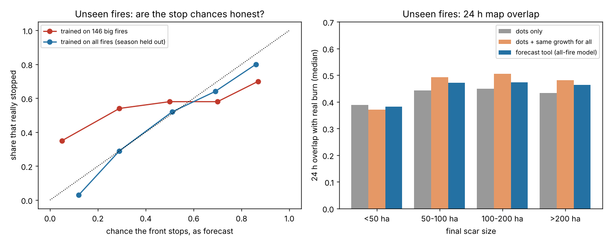

# Front forecast on unseen fires: full validation (17 Oct 2026)

Akkshay asked at 08:03Z to "use this model on unseen fires and validate full report". At 08:28Z he pasted a review asking for three
things: reconcile the demo's area accounting, prove any gain on held-out fires, and test new-front placement against distance.
All three are answered here.

## Bottom line

1. **The model built on the 146 big fires does not hold up on new fires.**
   - On 818 fires it never saw, it forecasts 2.5 times too much growth, and 12 times too much on fires under 50 ha.
   - Its stop chances are badly off. Fronts it gave a 5% chance of stopping actually stopped 35% of the time.
   - The cause is how the 146 were picked: they were big and long-lived by construction.
2. **Retrained on all 3,460 fires, with each season held out, the stop chance becomes honest.** On unseen fires:

   | Stop chance said | Share that really stopped |
   |---|---|
   | 12% | 3% |
   | 29% | 29% |
   | 51% | 52% |
   | 69% | 64% |
   | 86% | 80% |

   - Stop AUC is 0.80, against 0.65 for the simple rule "no dots at the latest look".
   - This is the part worth keeping.
3. **The 24 h map does not improve on new fires.**
   - The 0.53 overlap reported for the 146 fires falls to about 0.47 on unseen fires.
   - "Dots plus the same 24 ha for every active front" scores 0.477. That is as good as the tool with the old model (0.474) and better than the tool with the retrained model (0.455).
   - So the growth model's size numbers do not make a better map. The map is set by how much ground is added, and a fixed amount is as good as anything learned.
4. **New-front placement on unseen fires is still distance only.**
   - Of the next day's new burning, 36% is more than 1 km from every dot seen so far, and 89% of that falls in the 1-3 km band.
   - Only 1.2% of the band burns.
   - Inside a fire, the model's top 5% of cells catch 36% of new burning, against 39% for nearest-to-dots.
5. **Two corrections to earlier numbers.**
   - "Within 2x 70%" was a scoring bug: every under-forecast was counted as a hit. The true figure on the 146 fires, with each season held out, is **39% vs 23%** for a fixed median.
   - The demo map added 34 ha against 23.1 ha of front growth, because the growth step overshot. That is fixed: the fronts now add 23.0 ha, and the map says so.

## The fires

"Unseen" means every fire in big-fires/results/fires.csv that is **not** among the 146 big fires and has VIIRS dots. None of these fires was used to fit or tune the frozen models.

| Set | Fires | Forecasts issued (one per VIIRS look) | Fronts scored | Truth |
|---|---|---|---|---|
| Unseen, seen at 2+ looks | 818 (median scar 122 ha; 212 are over 200 ha but had fewer than 4 looks) | 2,246 | 3,121 active | blend arrival map inside outline v2, as for the 146 |
| Unseen, seen at one look | 2,496 (median scar 25 ha) | 2,496 | 2,548 | no timing exists; upper bound = outline beyond the 375 m blocks, within 1 km |
| Training (for comparison) | 146 big fires | 813 | 1,310 | same |

The forecast is the tool itself (scripts/forecast_fronts.py, `forecast()`), run at every look with only the dots seen up to then. Scoring code: scripts/uv_apply.py (map and front scoring), uv_summary.py, uv_report.py, uv_retrain.py.

## 1. Growth and stop per front

| | 146 big fires, season held out | Unseen 818: model from 146 big fires | Unseen 818: model from all fires, season held out |
|---|---|---|---|
| Growth within 2x of truth | 39% (fixed median 23%) | 29% (fixed median 23%) | 35% (fixed median 12%) |
| Growth forecast ÷ truth (median) | 1.0 | **2.5** | 0.9 |
| Stop AUC | 0.80 | 0.66 (rule "no dots at last look" 0.65) | **0.80** |
| Stop chance said, on average | 34% | 20% | 46% |
| Share that really stopped | 33% | 42% | 42% |

**By fire size, using the frozen 146-fire model on the unseen fires:**

| Final scar | Fronts | Over-forecast | Within 2x | Stop AUC |
|---|---|---|---|---|
| < 50 ha | 397 | 12x | 17% | 0.52 |
| 50-100 ha | 394 | 4.8x | 28% | 0.66 |
| 100-200 ha | 964 | 3.5x | 32% | 0.75 |
| > 200 ha | 1,366 | 1.0x | 31% | 0.71 |

- On fires over 200 ha the size is right, but within-2x drops from 39% to 31%.
- The model learned "a fire that is being forecast keeps growing", which was true of the 146 by how they were chosen. In live use, nobody knows at the first alert which fire will become big.

**By season.** Every season from 2017 to 2026 shows the same over-forecast: 1.4 to 4.3 times, with stop AUC 0.61-0.71. So this is not one odd year.

**One-look fires (2,496).**
- The frozen model forecasts a median 52 ha of growth at the only look. The whole outline beyond the blocks is a median 11 ha, so the over-forecast is at least 5x.
- Its stop chance averages 7%, but 21% of these fires never grew 2 ha past their blocks. Its AUC there is 0.55, close to a coin toss.
- Retrained on all fires, the stop AUC on one-look fires is 0.66 and growth within 2x is 37%, against 33% for a fixed median.

**The price of retraining.** The all-fire model under-forecasts the big fires (0.4x) and loses stop skill on them (AUC 0.73 vs 0.80). It does not know which fire will turn big, and nothing available at the alert tells it that.

## 2. The 24 h map (overlap with the real burn by +24 h; median over forecasts)

| | 146 big fires | Unseen 818: model from 146 | Unseen 818: model from all fires |
|---|---|---|---|
| Dots only (375 m blocks) | 0.486 | 0.434 | 0.434 |
| Dots + 24 ha per active front (no model) | 0.529 | **0.477** | **0.477** |
| Forecast tool | 0.528 (in-sample) | 0.474 | 0.455 |
| One blob, same area as the tool | 0.531 | 0.475 | 0.455 |
| Tool minus dots-only (95% range, by fire) | +0.05 | +0.03 to +0.04 | +0.02 |
| Tool minus "24 ha per front" | +0.01 (in-sample) | -0.006 to 0.000 | -0.017 to -0.013 |

**By final scar size, unseen fires:**

| Final scar | Dots only | Dots + 24 ha per front | Tool, model from 146 | Tool, model from all |
|---|---|---|---|---|
| < 50 ha | 0.388 | 0.371 | 0.329 | 0.383 |
| 50-100 ha | 0.443 | 0.492 | 0.472 | 0.471 |
| 100-200 ha | 0.449 | 0.505 | 0.508 | 0.474 |
| > 200 ha | 0.433 | 0.481 | 0.494 | 0.463 |

What this says:
- **Area decides the score, and where the area goes does not.** In every row the tool's separate fronts score the same as one blob of the same area.
- **The 0.53 on the 146 fires does not hold on new fires.** The honest unseen figure is about 0.47.
- **On unseen fires nothing learned beats a fixed 24 ha per active front.** The better-calibrated retrained model scores lower on the map, because it is cautious on growth and Sørensen overlap rewards guessing a little big.
- **On fires under 50 ha, every growth rule is worse than the dots alone.**

## 3. New fronts on unseen fires (scripts/mf_newfront.py, each season held out)

| | 146 big fires | Unseen 818 |
|---|---|---|
| Next-day new burning > 1 km from every dot | 34% | 36% |
| ... of which inside the 1-3 km band | - | 89% |
| Share of the band that burns | 1.9% | 1.2-1.7% |
| AUC across all fires: model / distance | 0.79 / 0.73 | 0.73 / 0.68 |
| Within a fire, top 5% cells: model / distance | 33% / 35% | 36% / **39%** |

- The AUC gain comes from telling which *fires* will throw new fronts: still-growing fires with many dots.
- It does not come from *where* inside a fire. Distance wins there on both sets.
- So the model is not a better within-fire locator and should not be shown as one. This settles review point C.

## 4. Review points (08:28Z) answered

| Point | Answer |
|---|---|
| Demo: fronts 10.6 + 12.5 = 23.1 ha but the map adds 34 ha | **Bug, fixed.** The tool grew each front in 20 m rings and stopped at the first ring past the target, which overshoots on a long edge. It now finds the exact distance by bisection. The demo map adds 23.0 ha; the 0.1 ha difference is overlap between fronts. `forecast_24h` now carries `new_ha` with this definition. Fixed demo: multi_front/demo_102.geojson. Every map score in this report uses the fixed tool. |
| A. Use the growth/stop model, not one global speed | Done and tested on new fires. Use the stop chance, from the all-fire model (calibrated, AUC 0.80). The growth amount does not improve the map over a fixed 24 ha per active front, so the map should use the fixed amount until something beats it on held-out fires. |
| B. Tell an unseen advancing front from a separate start | The tracker labels each new cluster as continuing (≤ 750 m), new front (0.75-3 km) or separate start (> 3 km). 41% of new fronts are cut off by never-burned ground (multi_front/README.md). Separate-start risk is the all-MP 2-day model's job (scoring/), kept as a separate output as he asked. A per-pass coverage list for "looked, saw nothing" is not built yet (needs VNP14IMG masks on his PC). |
| C. Location against distance, fires and seasons held out | Done on 818 unseen fires with seasons held out (section 3). Distance wins inside a fire. |
| Don't raise the multiplier or replace the model | Not changed. |
| Improve beyond 0.53 on held-out fires | Not reached. The held-out level is ~0.47, and no rule tried here beats "dots + 24 ha per active front" on new fires. |

## 5. What to use, plainly

- **Stop chance per front:** all-fire model (models_all_fires/stop24_<season>.txt; for live use, train one on all seasons). Its percentages can be quoted as real chances.
- **24 h map:** dots plus a fixed 24 ha per active front, placed nearest-first. This is as good as anything learned on new fires.
- **1-3 km new-front band:** keep it, ranked by distance only. Expect about 1 to 2% of the band to burn, so it is a "watch" zone, not a target.
- **Do not quote** the 0.53 overlap or the 70% within-2x as general results. The held-out figures are about 0.47 overlap and 35-39% within 2x.

Caveats:
- Truth is the blend arrival map (84% right on photos) inside outline v2.
- One-look fires have no timing at all, so their growth truth is an upper bound.
- Suppression shapes stops and edges.
- This is all retrospective. Nothing here was run on live alerts.

## 6. C-DAC-style physics on the same test (17 Oct 13:30Z; scripts/uv_physics.py, physics_unseen.csv)
- Setup: Rothermel/level-set with ERA5 weather and roads, restarted from the dots at every look (C-DAC's planned restart).
- Test: the 818 unseen fires, 2,246 forecasts, with the same truth.

| 24 h forecast | Overlap (median) |
|---|---|
| Dots only | 0.434 |
| Physics, its own size (1.5x too big) | 0.468 |
| Physics placement, cut to the 24 ha rule's area | 0.424 |
| Our forecast tool | 0.455-0.474 |
| Dots + 24 ha per active front | **0.477** |

- Physics minus the rule is -0.021 to -0.008 by fire (95% range). Physics does better on 331 fires and worse on 441.
- C-DAC's only published score is one Sikkim fire: area +61%, with no overlap score (section 1 of ../README.md).

## 7. Seeds moved 120 m outward (17 Oct 14:50Z; squares_v3: block centre sits ~120 m behind the 30 m front)
Same test as section 6, same added area. Centre seeds 0.477; pushed 120 m away from the fire centre 0.451 (worse on 660 fires, better on 39); latest look pushed 0.460; hull edge 0.456. Moving seeds outward hurts the 24 h map at 120 m as at 190 m (edge_seed_120m.json). Caveat as before: truth is built from VIIRS dot centres.

## 8. MODIS Terra/Aqua as extra looks (17 Oct 17:30Z; scripts/modis_extra_test.py, modis_extra.json)
Forecast issued at each MODIS look with no VIIRS look within 1 h (median 8.8 h after the last VIIRS look; truth is VIIRS-only, so independent).
- **Coverage is the problem.** MODIS (1 km) saw only 71 of the 818 unseen fires at a useful time: 85 forecasts out of 2,246 (62 Terra 10:30 day, 13 Terra night). The all-MP MODIS file adds nothing beyond what is already matched.
- MODIS dots do sit on fresh burning: 19% of the next day's new burning is within 500 m of them, against 9% for the latest VIIRS dots.
- But they do not place the forecast better:

| 85 forecasts at MODIS time | Overlap (median) |
|---|---|
| VIIRS dots + 24 ha per active front (today) | 0.451 |
| + MODIS dots as extra seeds, same area | 0.427 |
| Fronts recounted with MODIS (more area) | 0.441; VIIRS-only with that same area 0.452 |
| + MODIS 1 km pixels counted as burned (+79 ha) | 0.519; VIIRS-only with that same area 0.504 (difference -0.013 to +0.021, 28 fires better, 28 worse) |

- Every gain is area, not information. Verdict: MODIS is not a useful extra look for the spread map. The extra-look gain seen with ECOSTRESS needs a sensor that sees small fires; only VIIRS does, so the next real step is VNP14IMG masks (needs the EARTHDATA_TOKEN secret).

## 9. VIIRS raw fire masks: "looked, saw no fire" (17 Oct 21:40Z; scripts/mask_stop_test.py, mask_stop_test.json)
Masks pulled in thread "VIIRS fire masks and statewide 70 m run" (mask_pixels_near_fires.parquet; all 818 unseen fires). Per active front: every
VIIRS pass after its last dot, up to the issue time; "seen clear" = a pass with >= 80% of pixels within 400 m of the front's last dots clear (class 3/5) and no fire pixel.
- 594 of 3,121 active fronts were seen clear. They did stop more often: 67% vs 36% for the rest.
- But "seen clear" is almost the same thing as "no dots at the latest look": 95% of fronts with no dots at the latest look were seen clear, and the stop model already uses that. Stop AUC 0.802 without masks, 0.802 with; Brier unchanged.
- Map: dropping seen-clear fronts' 24 ha lowers overlap, 0.477 -> 0.468 (half: 0.473); worse on 229 fires, better on 17. A third of seen-clear fronts still grew (truth is reconstructed from VIIRS looks, and fires flare up again).
- Verdict: the raw masks add nothing to the 24 h forecast. The fire-mask thread found the same on its own fires (stop AUC 0.629 -> 0.630). With this, every available data source has been tried (ECOSTRESS 70 m, MODIS, raw VIIRS masks); the ceiling of ~0.48 stands until crew logs (2027).

## 10. A mid-fire 30 m Sentinel-2/Landsat scene (17 Oct 22:10Z; scripts/s2_arrow_test.py, s2_arrow.json)
Coordinator relay (Akkshay: use the data we have). Scenes = Ratapani mid-fire chips (fuel-map/ratapani/timing/chips) matched to the unseen fires:
**103 scenes on 92 fires** (Ratapani only; a clear scene on a burning fire comes every few days at ~10:30 IST). Forecast issued at the scene time
with VIIRS dots up to then; truth = VIIRS-only blend map. Same added area for every rule unless stated.
- Burnt patch measured LIVE: NBR drop between the pre-fire and the mid-fire scene >= 0.10, plus the 30 m hot pixels, patches touching a hot pixel or within
  300 m of a VIIRS dot. No final scar and no post-fire scene used (the chips' own `bym` uses both and is NOT used for the headline). 94% of these pixels are inside the real burn.

| at the scene time | 103 scenes | 80 scenes with >= 1 ha new burning |
|---|---|---|
| dots + 24 ha per active front (today) | 0.474 | 0.456 |
| lean the 24 ha along the arrow (burnt patch -> hot line) | 0.471 (worse on 37 fires, better on 27) | 0.450 |
| 30 m hot pixels as extra seeds | 0.477 | 0.467 |
| **burnt patch counted as burned + hot seeds + 24 ha per front** | **0.605** | **0.594** |
| dots only, given that same area | 0.502 | 0.478 |

- The arrow (51% right as a direction, big-fires 15e) does not improve a 24 h area map: leaning helps where it points right and costs where it does not.
- The burnt patch does: +0.06 to +0.10 over the same area placed by dots (95% range +0.035 to +0.087; better on 65 fires, worse on 22).
- Not only past burning: of the next 24 h's new burning outside the patch, it catches 8% vs 4% (median; 14% vs 7% where >= 1 ha new; range +0.012 to +0.096).
- Use: when a clear S2/Landsat scene falls on a burning fire, redraw the map from that scene's burnt patch and hot line. Occasional (every few days, Ratapani tested), not daily.

## 11. Oct 18: exact pixel shapes, and the 30 m burnt patch on the 146 big fires
**Exact VIIRS pixel shapes (scripts/pixel_shape_test.py, pixel_shape.json).** Truth = final scar outline v2 (the blend map is built from scan x track boxes, so it would favour boxes). 2,246 issues on 818 unseen fires.

| footprint of the dots seen so far | on the final scar (precision) | overlap with scar |
|---|---|---|
| 265 m disc per dot (today) | 0.589 | 0.405 |
| real scan x track box per dot | 0.590 (difference -0.002 to +0.003) | 0.390 |
| every fire pixel in the raw masks (incl. ~24% more pixels FIRMS did not list) | 0.515 | 0.367 |
| null: today's discs shifted 0-250 m at random | 0.560 | 0.380 |

Real pixel size adds nothing, even for wide edge-of-swath pixels (scan > 0.5 km: 0.519 vs 0.568). The extra mask pixels FIRMS left out sit mostly off the scar. Today's dot placement is already better than a random shift, so there is no slack to gain from geometry. This matches the research thread's finding in the 2-day model.

**30 m burnt patch on the 146 big fires (no fitting, so they are fair test fires; mf_s2_arrow.json).** 50 scenes on 46 fires: burnt patch + hot line + 24 ha per front 0.646 vs the same area by dots 0.586 (95% range +0.053 to +0.085, better on 43 fires, worse on 2); new burning outside the patch caught 14% vs 7%. Together with section 10: **153 scenes on 138 fires, the gain holds in both sets.**
Statewide: timing truth (blend arrival maps) exists only for Ratapani. A statewide test needs arrival maps built from the MP burn scars plus pre/mid-fire NBR from Planetary Computer for the matched passes (big-fires 15a: 75,893 VIIRS day passes have a S2/Landsat scene 0-3.5 h before).

## 12. Statewide: the 30 m burnt patch across MP (18 Oct; scripts/s2_statewide.py, ../statewide/s2_statewide.json, _rows.csv)
Akkshay "go" (04:14Z). 3,469 MP passes with >= 3 30 m hot pixels (big-fires b18); usable **235 passes on 206 fires** (skipped: 1,762 had no VIIRS look before the
scene, i.e. the scene was the first sighting; 1,470 had no statewide scar yet, the 2017-24 history run is still going). Before-fire and mid-fire scenes from
Planetary Computer; burnt patch from the NBR drop only (no final scar, no post-fire scene); 70% of it lies inside the final scar (Ratapani 94%).
Timing truth built here from the statewide scar + VIIRS looks with straight-line distances (simpler than Ratapani's walking-distance maps).

| at the scene time (median overlap) | all 235 | early fires (<= 2 VIIRS looks, 161) |
|---|---|---|
| dots + 24 ha per front (today) | 0.355 | 0.300 |
| **burnt patch + hot line + 24 ha per front** | **0.485** | **0.482** |
| dots only, same total area | 0.464 | 0.425 |
| scene minus same area (95% range; fires better/worse) | +0.024 to +0.052 (151 / 68) | +0.032 to +0.067 (113 / 39) |

- The gain holds statewide but is smaller than in Ratapani (+0.02 vs +0.06 to +0.10). Statewide it comes from knowing what has already burnt; for new burning outside the patch
  it is slightly worse than dots (9% vs 12%), except early in a fire, where it ties (10% vs 9%).
- Sentinel-2 carries it (200 passes: 0.512 vs 0.461); Landsat does not (35 passes: 0.443 vs 0.469; coarser, fewer clean pixels).
- Use: when a clear Sentinel-2 scene falls on a burning fire, redraw the map from its burnt patch, most of all early in the fire.

## 13. Fire-continuity's "still burning" chance as a weight (18 Oct; scripts/still_burning_test.py, still_burning.json)
Each front's 24 ha weighted by c18's calibrated chance by hours since its last dot (<6 h 1, 6-12 h 0.62, 12-24 h 0.33, 24-48 h 0.16, 48 h+ 0.09).
0.477 -> 0.471 (all fronts weighted) / 0.471 (active only); worse on 169-181 fires, better on 13. Less area always loses here: overlap rewards drawing
a little big, and the dark fronts' share is already small. The chance is right as a stop/alert number, not as a map weight.

## 14. 30 m scene as the FIRST sighting (statewide, Oct 18 06:30Z) — DEAD END

Question (Akkshay 05:02Z "so whats next"): when a Sentinel-2/Landsat scene catches a fire before any VIIRS dot, does a 24 h map drawn from that scene beat waiting for the first VIIRS look?
Script `scripts/s2_first_sight.py` (copy of s2_statewide.py). 3,469 b18 passes; 1,707 had VIIRS first, 1,540 no scar yet → **206 passes / 191 fires** used. Truth = scar pixels burned by scene + 24 h (statewide straight-line timing blend).

| Map | Mean overlap |
|---|---|
| Scene alone (burnt patch touching hot pixels + 24.1 ha per hot front), at scene time | 0.236 |
| First VIIRS look, scene map's area | 0.297 |
| First VIIRS look, today's rule | 0.462 |
| Scene + first VIIRS look | 0.443 |

- Head start is small: first VIIRS look comes median **2.2 h** after the scene (1.6-3.5 h).
- Scene alone loses to the first VIIRS look on 185 of 206 fires (CI −0.25 to −0.20); even at equal area it loses (−0.08 to −0.04). Adding the scene to the first look hurts (−0.03 to −0.01).
- The early burnt patch is small and mostly off the final scar (median 2% inside). S2 0.23 vs 0.46; Landsat 0.26 vs 0.47.
- Caveat: the timing truth is built around VIIRS looks, which favours VIIRS-centred maps a little; the gap (0.24 vs 0.46) is far too large for that to flip.
- Verdict: no early-warning use of a first-sighting scene for the 24 h map. The scene arrives ~2 h before VIIRS and draws a worse map.

## 15. Learned fill order + Prithvi ground (Oct 18 ~08:30Z, coordinator relay after the Prithvi thread's t5)

Same truth and same area (24.1 ha per active front) as the rule; only the ORDER the area is filled changes: nearest-first vs a LightGBM chance of burning by +24 h (season held out; candidates outside blocks within 1.5 km). Fires first seen from 15 Feb only (Prithvi's Feb frame covers 1-14 Feb): **759 fires / 2,113 forecasts**. Script `scripts/prithvi_footprint_test.py`; Prithvi/HLS grids `fuel-map/prithvi/feats/`.

| Fill order | Mean overlap (per fire) | Pixel AUC |
|---|---|---|
| Nearest-first (today's rule) | 0.448 | 0.782 |
| Learned: distance only (any dot, last-look dots, side of fire, day) | 0.461 | 0.790 |
| + ground (canopy, roads, villages, forest depth, crops, slope, cover) | 0.463 | 0.805 |
| + raw HLS (Prithvi's own input) | 0.466 | 0.812 |
| + Prithvi PCA | **0.471** | 0.822 |

- Prithvi vs rule +0.023 (CI 0.021-0.026), better on 521 fires, worse on 131. Prithvi beats raw HLS +0.005 (CI 0.003-0.007) and is the best in all 10 seasons, incl. 2025 (0.499 vs 0.483) and 2026 (0.474 vs 0.447).
- Where the gain comes from: learned distance (mostly "near the LAST look's dots") +0.013; ground +0.002; raw HLS +0.003; Prithvi over HLS +0.005.
- Real and consistent, but small: the map moves from ~0.45 to ~0.47 on these fires; the ~0.5 ceiling stands. Cheap to run: Prithvi grids are per season, made before 15 Feb.

## 16. Statewide 30 m scene re-run on the finished scar history (Oct 19 ~03:00Z)

Same script (s2_statewide.py, outlines via read_hist_geom()), all 3,469 passes. Used **1,508 passes / 1,397 fires** (was 235 / 206). Skipped: 1,762 no VIIRS look before the scene, 150 no scar, 26 errors (cached scenes from the first run on a smaller window), 29 other. Outputs statewide/s2_statewide_full.json, _rows.csv.

| Map (medians) | All 1,508 | Early (<= 2 looks), 988 |
|---|---|---|
| Today's rule | 0.343 | 0.306 |
| Dots only, scene's area | 0.422 | 0.389 |
| Scene: burnt patch + hot line + 24 ha/front | **0.455** | **0.424** |

- Scene vs same area +0.03 (CI 0.023-0.035), better on 902, worse on 515; early fires +0.037 (0.030-0.046).
- Sentinel-2 +0.034 (CI 0.027-0.040, 1,272 passes); Landsat no gain (+0.007, CI -0.009 to +0.022, 236).
- New burning outside the patch is caught less (10% vs 15%): the gain is knowing what already burned, not where it goes next.
- Confirms section 12 on 7x the fires: real, small, Sentinel-2 only, only when a clear scene catches the fire.

## 17. Learned 24 h AREA per forecast (Oct 19 ~08:00Z, Akkshay "what to do for burn scar prediction that's important")

Same truth and nearest-first placement as the rule; only the area added outside the 265 m blocks changes. 818 fires / 2,246 forecasts, LightGBM on log area, season held out. Inputs known at the look: dots (all, last look, previous look), fronts, active fronts, fire age, gap since previous look, FRP (last look sum/max, all), dot spread, footprint, day/night, satellites, date, hour. Script `scripts/area_model_test.py`.

| Area added | Median ha | Mean overlap per fire |
|---|---|---|
| Rule: 24.1 ha x active fronts | 24 | 0.447 |
| Rule x best constant (fitted on other seasons) | — | 0.452 |
| Learned area (mean of log; = median quantile) | 61 | **0.460** |
| Learned, leaning bigger (70th / 90th percentile) | 98 / 178 | 0.452 / 0.420 |
| TRUE area (ceiling for any area model) | 76 | 0.499 |

- Learned area +0.013 over the rule (CI 0.010-0.015), better on 456 fires, worse on 238. That is ~1/4 of the +0.051 a perfect size would give.
- Area ranking is weak: rank correlation with the true area 0.55 (rule 0.45). Leaning bigger did not help; the median is best.
- Even the true size only reaches ~0.50 here. Size and placement together, not either alone, set the ceiling.

## 18. COMBINED map (Oct 19 ~09:00Z, Akkshay "yes")

Learned 24 h area (s17) x learned fill order (s15), on the 759 fires first seen from 15 Feb (2,113 forecasts). Scripts `scripts/combined_test.py`, `scripts/combined_scene_test.py`.

| Map | Mean overlap per fire |
|---|---|
| Today's rule (24.1 ha/front, nearest-first) | 0.448 |
| Learned area, nearest-first | 0.462 |
| 24.1 ha/front, Prithvi order | 0.471 |
| Learned area + raw-HLS order | 0.481 |
| **Learned area + Prithvi order** | **0.487** |

- Combined vs rule +0.039 (CI 0.034-0.043), better on 520 fires, worse on 191; best in all 10 seasons (2025 0.505 vs 0.483, 2026 0.487 vs 0.447). The two gains add (area +0.014, order +0.023).
- Fires with a clear Ratapani 30 m scene (92 fires / 103 scenes): rule 0.439, learned area 0.465, scene + 24 ha/front 0.535, scene + learned area 0.530. When a scene exists it carries the map; the learned area adds nothing on top.
- Recipe: Sentinel-2 scene when one caught the fire that day; otherwise learned area + Prithvi fill order. ~0.49 everywhere, ~0.53 on scene days. This is the ceiling with current data.
