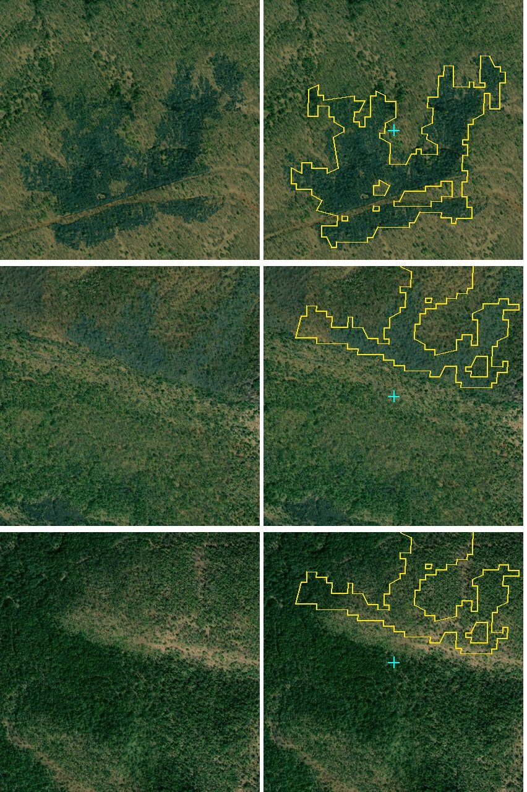
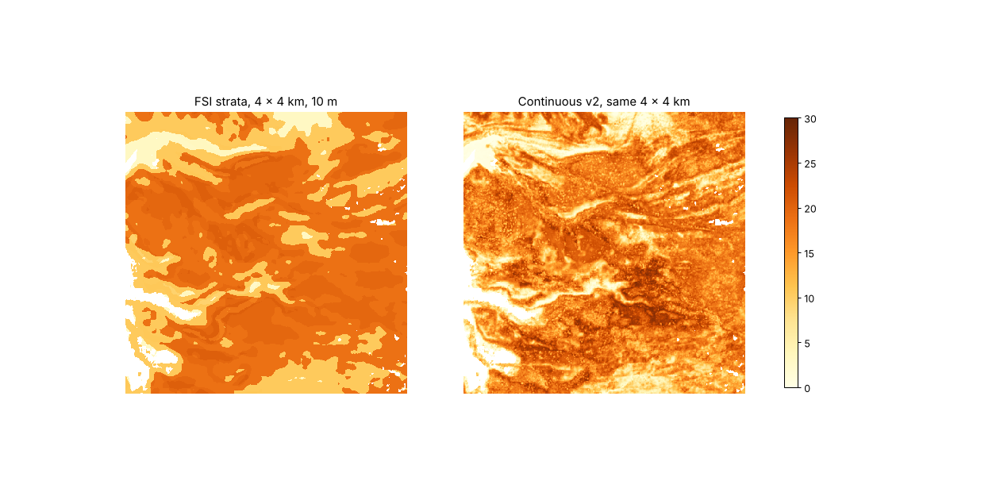
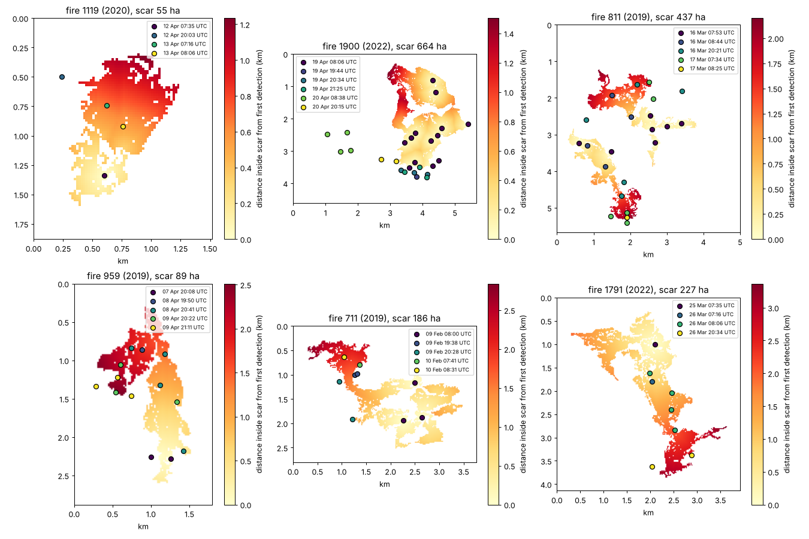
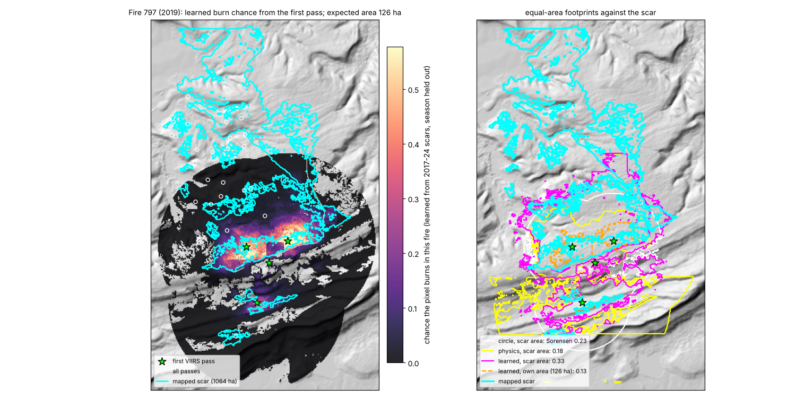
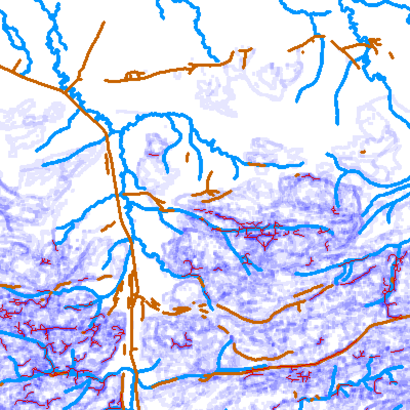
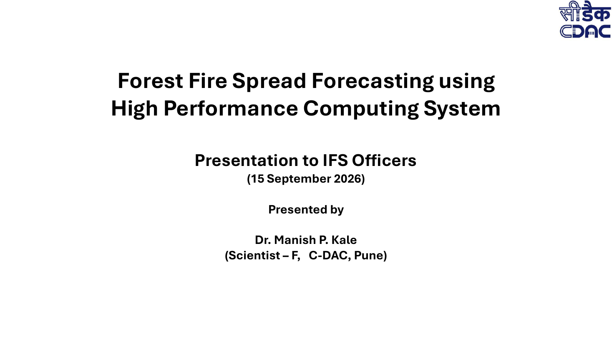

# Forest fire prediction for Madhya Pradesh: full project report

*Written 15 October 2026. Covers all work from 13 to 15 October 2026, across every thread in this project.*
*Owner: Akkshay. Pilot area: Ratapani Wildlife Sanctuary (now Ratapani Tiger Reserve), Madhya Pradesh.*

All links in this file are relative to `/mnt/project-files/report/`, so `../ratapani/...` means `/mnt/project-files/ratapani/...`. Images are shown from where they already live; nothing was copied.

---

## Contents

1. [The short version](#1-the-short-version)
2. [Words used in this report](#2-words-used-in-this-report)
3. [The problem and how we score it](#3-the-problem-and-how-we-score-it)
4. [The 2-day cell model (main model)](#4-the-2-day-cell-model-main-model)
5. [Fire prediction research thread (ignition and spread split)](#5-fire-prediction-research-thread)
6. [Burn labels: the "what burned" maps](#6-burn-labels-the-what-burned-maps)
7. [Cleaner fire labels](#7-cleaner-fire-labels)
8. [Rethink the 2-day question (when to check, not just where)](#8-rethink-the-2-day-question)
9. [Patrol pilot protocol for 2027](#9-patrol-pilot-protocol-for-2027)
10. [All of Madhya Pradesh: dryness grid and division models (PC work)](#10-all-of-madhya-pradesh)
11. [Burn scar for every fire alert](#11-burn-scar-for-every-fire-alert)
12. [Live fire alerts and field checks (the field app)](#12-live-fire-alerts-and-field-checks)
13. [High-resolution fuel load map, fire timing and fire speed](#13-fuel-load-map-fire-timing-and-fire-speed)
14. [Fire spread model like C-DAC](#14-fire-spread-model-like-c-dac)
15. [Independent check of the spread model (audit)](#15-independent-check-of-the-spread-model)
16. [FSI data and research scouting](#16-fsi-data-and-research-scouting)
17. [Repositories, system document and housekeeping](#17-repositories-system-document-and-housekeeping)
18. [Corrections log: numbers that changed and why](#18-corrections-log)
19. [Data catalogue](#19-data-catalogue)
20. [Figure gallery index](#20-figure-gallery-index)
21. [Still running and open questions](#21-still-running-and-open-questions)
22. [Limit check and the final daily rule (18-19 Oct)](#22-limit-check-and-the-final-daily-rule-18-19-oct)

---

## 1. The short version

**The goal.** Help the Madhya Pradesh Forest Department find forest fires earlier. The first test area is Ratapani, cut into 500 m squares ("cells"). The fire season that matters is **15 February to 15 June**. Almost all fires here are **surface fires in teak leaf litter**: low flames on the forest floor, not crown fires.

**What we found, in plain words.**

1. **Where a new fire will start in the next 2 days is hard to predict.** With 5 checks per beat per day, the best model finds about **29-31%** of newly burned cells, against about **16-18%** for random picks. That is close to 2x random, and it hit a ceiling. More inputs (weather, wind, roads, deep learning, Prithvi, cleaner labels) did not move it beyond about 1 point.
2. **When to check matters much more than where.** If the same season total of checks is moved onto the days the calendar and forecast say will be busy, the catch rises from **29.5% to about 63%**. Most of this comes from the season calendar itself (about 58-60%); the daily forecast adds 4-5 points.
3. **A real field trial is designed.** A three-arm patrol pilot (fixed, calendar-led, forecast-led) for **15 Feb-15 Jun 2027**, with equal staff-hours, is written up and the field app already supports it.
4. **All of MP is under way.** Per-cell dryness for all 373,681 MP beat cells is done. One model per forest division, trained on fire points from three VIIRS satellites, catches about **84.6%** of fire points in the top 10% of squares (about 20% of the ground) across 9 test divisions. Rollout to all divisions is running on Akkshay's PC.
5. **Every fire alert now gets a burn scar.** About 84% of real fires get a scar, against 4% of fake points. Blind checks on very sharp imagery show 81% of "yes" scars sit on real burned ground. This now runs daily for all of MP and shows in the field app, for senior officials.
6. **Fires and fuel, measured from satellites alone.** Fires usually start about **15 hours before** the first satellite alert. The alert point lags the real fire edge by about **380 m**; using the far side of the satellite pixel cuts that to about **130 m**. Fire fronts move about **24 m per hour**. Litter fuel is about **2-3.5 t/ha**. Flames are about **0.5 m**, so these fires can be beaten out by hand.
7. **Spread.** A physics simulator (like C-DAC's) is no better than drawing a circle. A model **learned from real scars** does better, and a model that **restarts after every satellite pass** catches about **86%** of the next pass's fire points, against **72%** for "the fire stays where it was". An independent audit confirmed this result and found and fixed two smaller leaks elsewhere.

8. **Update 19 Oct: the final daily rule.** Today's model, measured against real burn scars, warns 1-2 days ahead for about **82%** of fires, on about a fifth of the ground. The live daily list pools flags statewide, with a 50% floor per division and 35% of flags kept for quiet squares (25% until 21 Oct, then 35% by Akkshay's choice). With no hindsight, at 25% it caught **71/68%** of all fires and **46/48%** of brand-new fires (2023-24 / 2026); at 35% it catches **69.5/65.4%** and **49.6/52.3%**. The research levers are now used up. See [section 22](#22-limit-check-and-the-final-daily-rule-18-19-oct).

**What did not work** (so nobody repeats it): wind, finer weather, AlphaEarth embeddings, in-season Prithvi, deep spatial nets, roads v2, training on cleaner labels, fuel layers for "where", FSI's own 2021 fire-prone map, direction cues from a single satellite pass.

---

## 2. Words used in this report

| Word | Plain meaning |
|---|---|
| **Cell** | A 500 m x 500 m square of forest. Ratapani has 3,614 of them ([grid_500m.geojson](../ratapani/grid_500m.geojson)). |
| **Beat** | The smallest Forest Department patrol unit, looked after by one guard. Ratapani has 94; MP has 8,973. |
| **Division / range** | Larger Forest Department units. A division holds several ranges, a range holds several beats. |
| **VIIRS** | A fire sensor on three US satellites (S-NPP, NOAA-20, NOAA-21). It sees a hot fire inside a 375 m pixel, twice a day per satellite (about 1:30 am and 1:30 pm). |
| **MODIS** | An older, coarser (1 km) fire sensor. |
| **FIRMS** | NASA's public website/feed for VIIRS and MODIS fire points. |
| **FSI** | Forest Survey of India. Sends fire alerts to MP by SMS and has a portal ("Van Agni"). |
| **Fire point / alert** | One VIIRS or MODIS detection: a spot and a time. |
| **Burn scar** | The patch of ground that turned dark after a fire, seen in Sentinel-2 or Landsat images (10-30 m pixels). |
| **NBR** | Normalised Burn Ratio, a number from satellite colours that drops when ground burns. |
| **Raster** | A map made of pixels (like a photo), as opposed to outlines (polygons). |
| **Label / answer key** | The "truth" we score predictions against. |
| **LOSO** | Leave-one-season-out: train on all fire seasons but one, test on the one left out, repeat for each season. |
| **2025-26 test** | A separate honest test on the two newest seasons, never used for training. |
| **Recall at 5 per beat** | Of all cells that newly burned, the share the model had put in each beat's top 5 checks for that day. Our main score. |
| **Random baseline** | The same score if the 5 picks were random. |
| **AUC** | A 0.5-1.0 score of how well a model ranks risky over safe. 0.5 is a coin toss. |
| **Calibrated** | When the model says 20% chance, it happens about 20% of the time. |
| **Sorensen overlap** | A 0-1 score of how much a predicted burned area overlaps the real one. |
| **Persistence** | The simple guess "the fire stays near where it was last seen". |
| **Rothermel** | The standard physics formula for how fast a surface fire spreads. |
| **Leak** | When a test accidentally uses information that would not exist at forecast time. It makes scores look too good. |
| **Prithvi** | A large NASA/IBM model pre-trained on satellite images. |
| **AlphaEarth** | Google's yearly satellite "embedding" of every 10 m pixel. |
| **Earth Engine (EE)** | Google's cloud for satellite data. Project: van-suraksha-alert. |
| **t/ha** | Tonnes of fuel per hectare. 1 ha = 100 m x 100 m. |
| **kW/m** | Fire intensity: heat released per metre of fire edge. |

---

## 3. The problem and how we score it

### 3.1 The question (decided 13 Oct)

> **Which 500 m cells will newly burn in the next 2 days?**

- Truth comes from **burn scars**, not VIIRS points, because many small litter fires never trigger VIIRS.
- "5 checks per beat per day" is a **scoring rule only**, a fixed budget to compare models fairly. It is not a field rule.
- The fire season scored is **15 Feb-15 Jun** (it holds 83% of positives in 2017-24 and 96% in 2025-26). January fires are not of interest.
- Akkshay wants **calibrated % chances per cell**, not just rankings.

### 3.2 The scoring rules

Full rules: [SCORING.md](../ratapani/scoring/SCORING.md). Notes from the research thread: [research_thread_notes.md](../ratapani/scoring/research_thread_notes.md).

- **Label rule:** horizon H = 2 days, "first burn" of the cell in the season. A cell-day counts only while day t+2 is no later than the last clear satellite look, so we only score days we can actually check. About 55% of cell-days are valid. Base rate: **4.65%** of valid cell-days are positive.
- **Beats:** first scored on 68 pseudo-beats, then replaced by the **94 real beats** ([beats/cell_beat.csv](../ratapani/beats/cell_beat.csv)). FSI's beat tags agree 100% on interior cells and 77% on border cells.
- **Two answer keys:** the main key (scar windows) and **af_high_s** (burns whose date is pinned by an active-fire pixel in the cell; sharper dates).
- **Leak rule (added 15 Oct):** any "already burned" input must use `window_end + 25 days`, because a scar is only confirmed 25 days after the fire. See [Corrections log](#18-corrections-log).
- **Ceilings:** a perfect model with 5 per beat per day can only reach about **64-65%**, because busy beats burn more cells on peak days than 5 checks can cover. If checks are pooled across the sanctuary each day, a perfect model reaches 90-91%.

---

## 4. The 2-day cell model (main model)

*Thread: "WeatherNext and TimesFM pipeline plan". Model script: [pipeline_lean_model.py](../ratapani/scoring/pipeline_lean_model.py). Inputs: [ratapani/scoring/features/](../ratapani/scoring/features/).*

### 4.1 How it started (13 Oct)

- The first idea was Google's WeatherNext forecast plus the TimesFM time-series model. A simple "fire memory" model already scored AUC 0.897. TimesFM 3.0's licence is non-commercial. FireSat (the planned fire satellite constellation) was deferred to 2027.
- **Tiger reserve test:** the memory model beat India's FWI (Fire Weather Index) in all 9 MP tiger reserves (AUC 0.81-0.92).
- Ratapani was chosen as the pilot, with a 2-day target, scar labels and 5 picks per beat. Akkshay set the frame: research, not a product, no cap.

### 4.2 What went into the "lean" model

The **lean ensemble** is a LightGBM classifier rank-averaged with a LightGBM ranking model (lambdarank). Its useful inputs:

- **Per-cell dryness from Sentinel-2 / Landsat** (the "s2d" inputs). This is the only thing that helps "where" (about 4 points).
- Season-to-date fire activity and history.
- Weather (decides **when**, not **where**).
- Cell position (interior cells ignite about 2x as often as cells near villages).

### 4.3 Results on real beats

| Model and key | LOSO 2017-24 | 2025-26 test | Random |
|---|---|---|---|
| Lean, main key (all season, before leak fix) | 29.5% | 28.9% | 16.6 / 15.3 |
| Lean ensemble | 30.2% | 29.5% | |
| Lean ensemble + roads v2 | 30.1% | 29.4% | |
| **Lean, main key, honest (after 25-day leak fix)** | **29.0%** | **28.6%** | 16.6 / 15.3 |
| Lean, scored only 15 Feb-15 Jun | 31.5% | 29.2% | 17.6 / 15.4 |
| Shared daily budget (same total, pooled across beats) | 43.4% | 40.3% | |
| Recall at 10 per beat | 49.5% | | |
| af_high_s key (lean) | 44.6% (honest 43.1) | (honest 39.7) | |
| af_high_s key, deep model / blend | 39.6 / 44.5 | | |
| True-lead labels, strict | 38.9% | | 18.8 |
| True-lead labels v2, strict / ensemble | 39.5 / 40.7% | | 20.0 |

*Read headline numbers as about 0.5 point too high unless marked "honest".*

### 4.4 Everything tested that did not help

| Idea | Result |
|---|---|
| AlphaEarth embeddings | Hurt (26.4% vs 27.5% at the time) |
| Deep spatial network | 24.4% |
| Joint deep model across 9 tiger reserves | Blend 31.3 vs 30.1: small gain, not adopted as main |
| In-season Prithvi-300M | 29.6 vs 29.6: duplicates dryness. Without s2d dryness the model drops to 25.5; Prithvi brings it back to 27.8. |
| Roads v2 (Microsoft road detections + OSM) | No change |
| Wind | Nothing (also tested on VIIRS-dated fronts) |
| ERA5-Land 9 km weather instead of NASA POWER | No gain. Across Ratapani the 33 ERA5-Land points differ by only ~4.6 points of humidity and 1.5 °C. |
| Lead time | Skill fades slowly: 26.5 / 24.5 / 22 at longer leads |
| Spatial blocks | Models transfer across parts of the sanctuary |

On **14 Oct at 18:17Z** Akkshay called the 2-day cell model at its ceiling and stopped feature hunting.

### 4.5 Night-first dating

About **33%** of VIIRS-dated first burns are first seen at night, and about **11%** may be keyed a day late. This is one reason scores on fuzzy keys look low.

### 4.6 Label timing

- Only **25%** of scar-rule positives come 1-2 days before VIIRS sees the fire. The rest are same-day or later, so many "predictions" are really detections.
- This led to **true-lead labels** (fires truly ahead of the first VIIRS point): [ratapani/fsi/](../ratapani/fsi/README.md), `true_lead_labels_v2.parquet` (v2 fixes 1 in 5 burns that were dated a day late).
- **55%** of burned cells can be dated to the exact day ([fire-alert-scars/out/af/dated_first_burns.csv](../fire-alert-scars/out/af/dated_first_burns.csv)). Scar dates can slip 1-3 weeks when smoky images are dropped.

---

## 5. Fire prediction research thread

*Thread resolved. Write-up: [research/ratapani-ignition/README.md](../research/ratapani-ignition/README.md).*

This thread split every burn into a **new ignition** (nothing burning nearby) or **spread** from a fire already burning, and studied each.

**New ignitions**
- A Poisson model on 12,806 scar patches found **20% of new fires vs 12% random** (5 per beat per day).
- Timing is well predicted: Spearman correlation 0.72 / 0.70 (a plain seasonal curve gets 0.48 / 0.53).
- Interior cells ignite **2x** as often as cells near villages. Humidity under 30% **triples** the rate. **March** is the peak. No festival or weekend effect.
- Satellite dryness lifts "where" to 24.3%.

**Spread**
- Spread model: **22.9% vs 9.4%** random among cells near a recent burn. "Nearest to the front" alone gets 15%.
- Wind adds nothing, even with VIIRS-dated fronts.

**Combined model:** 25.9% LOSO / 24.8% on 2025-26 (27.0 / 26.3 on real beats). It is calibrated.

**Other findings**
- Misses: small fires and fires near villages are missed most. Upweighting them in training does not help.
- Sentinel-1 radar is not usable here: one track, 12-day revisit.
- Leak audit ("LEAKSAFE"): totals unchanged.
- Within noise: Hawkes (self-exciting) kernels, dryness slopes, pairwise loss, observation quality, negative bagging (30.4 / 29.7).
- **Leaf-fall lag:** fire risk rises about **tenfold**, peaking **51-100 days after** the cell's canopy is 50% green-down.
- Weather: persisted (yesterday's) weather is as good as forecast weather for this task.

Literature note from the start of the project: [research/fire-prediction-landscape.md](../research/fire-prediction-landscape.md) (Ratapani base rate 0.13% of cell-days by VIIRS; March holds 49% of detections).

---

## 6. Burn labels: the "what burned" maps

There are **two** maps of what burned. Knowing which is which matters.

### 6.1 Research burn-label rasters (season maps)

*[research/ratapani-burn-labels/README.md](../research/ratapani-burn-labels/README.md)*

- 20 m Sentinel-2 + Landsat maps, one per season 2017-2026. A pixel is "burned" when NBR drops sharply versus the 1.5 km around it, between two clear looks at most 20 days apart.
- Accuracy: **precision 0.83**, area recall about **0.71**, median date window **5 days**. A Prithvi-based check gives the same accuracy.
- These rasters are the answer key for the **2-day cell scoring**.

Validation sheets: [ts_sheet_00.png](../research/ratapani-burn-labels/validation/ts_sheet_00.png), [ts_sheet_13.png](../research/ratapani-burn-labels/validation/ts_sheet_13.png). A 102-point blind sheet for a human reviewer: [research/ratapani-label-check/README.md](../research/ratapani-label-check/README.md).

### 6.2 Per-alert grown outlines (scar thread)

These are polygons drawn around each fire alert (section 11). On 1,214 fires the rasters have a median of **28.5 ha** against **96 ha** for the outlines (ratio quartiles 1.4 / 2.4 / 5.1). Sentinel-2 sides with the outlines: fire 942 (April 2020) is **743 ha** of burnt ground, but the raster shows only 112 ha of patches.

**Why:** a big fire burns its own surroundings, so the "drop versus the surroundings" rule stops seeing it; and the 20-day clear-look limit drops scenes.

**Decision (Akkshay, 15 Oct 09:01Z):** grown outlines are the truth for **fire sizes, spread and fuel**. The 2-day cell scoring stays on the rasters, because switching changes those scores by under 1 point (section 7).

---

## 7. Cleaner fire labels

*Thread: "Cleaner fire labels". Write-up: [ratapani/labels_v3/README.md](../ratapani/labels_v3/README.md).*

**Question:** do cleaner labels make the 2-day model better?

- Built **8 label versions**: alert-dated, union, lenient, strict, and 4 more from the scar thread's multi-sensor dating (55% of burns dated to the day).
- **Training** on any of them changes the score by **under 1 point** (inside the normal ±2 year-to-year swing).
- As an **answer key**, cleaner labels show the model is better than the usual key suggests:

| Answer key | Model | Random | Ratio |
|---|---|---|---|
| Usual (main) | ~30% | ~17% | 1.8x |
| Burns dated by a fire pixel in the cell | 45% | 21% | **2.15x** |
| Union with grown outlines (+26% more burned cells) | | | 1.6x |
| FSI soft dates (Sentinel-3 + Landsat 7 + MODIS), sharpened cells | 35.5% | 18.1% | 2.0x |
| Sentinel-3-only soft dates | 40.4% | 19.6% | 2.1x (covers 4x more burns than VIIRS-dated) |

- Training on soft dates: 29.9% vs 30.3% on the usual rule. No gain.
- A brightness check on 0.34 m Feb-Apr 2025 imagery for 826 cells gave only a weak signal: 3-day-old burns show plainly, older litter burns barely differ.

**Conclusion:** part of the model's "misses" are fuzzy burn dates, not wrong picks. Keep the best-dated labels as a second answer key; do not expect them to improve training.

Data: `labels_v3.parquet`, `labels_v3_af.parquet`, `labels_v3_soft.parquet`, `dated_cells.csv`, `event_windows.csv`, `season_windows.csv` in [ratapani/labels_v3/](../ratapani/labels_v3/README.md).

---

## 8. Rethink the 2-day question

*Thread: "Rethink the 2-day question". Write-up: [research/reframe/README.md](../research/reframe/README.md).*

Akkshay asked whether a different question would serve the Forest Department better. Four were tested.

### 8.1 The big result: shift checks in time

Keep the same season total of checks, but give more to the days forecast as big fire days.

| Rule (same season total) | LOSO 2017-24 | 2025-26 |
|---|---|---|
| Today's fixed 5 per beat per day | 29.5% | 28.9% |
| Calendar sets the daily total | 57.9% | 60.0% |
| **Forecast sets the daily total** | **63.1%** | **63.7%** |
| Perfect forecast of the daily total | 94.8% | 98.2% |
| Forecast total, max 10 per beat per day | 44.7% | |
| Forecast total, max 15 per beat per day | 54.1% | |

On clean true-lead labels the same shift goes from 39% to 80%. With a cap of 10 per beat, it uses on average 384 checks a day instead of 470.

Akkshay (14 Oct): "so we won't fix the patrolling cells, these are variable as per the conditions". Yes: both the number of checks and which cells change daily.

### 8.2 The other questions

- **Is the next 2 days a big fire day?** Predictable: **AUC 0.88** (calendar alone 0.83). The % chances are calibrated, and the count forecast's intervals have the right coverage. Almost all the skill comes from how much burned across the sanctuary in the last few days.
- **Which beats burn this week?** AUC 0.84, mostly calendar plus beat size and history. Top 10 of 94 beats each day hold 31% of new burning vs 27% for the calendar alone.
- **Will a burning area spread, and where?** 34-40% of fires spread. Top 5 cells around a fire catch 46-47% of new burning vs 33-34% random. Distance barely matters within 1.5 km; dryness ranks the cells. Direction cues do not help at 2 days.
- **FSI's 2021 fire-prone map** adds nothing over calendar plus beat size and history.

### 8.3 Pushing the cell ranking (15 Oct, after Akkshay: "focus on the technological part")

- The daily total forecast is already near perfect, so the only lever left is which cells get checked.
- A **sanctuary-wide ranker** using dryness plus recent fires: **63% to 69%** (LOSO, up in every season) and **64% to 72%** (2025-26). Under fixed 5 per beat: 29.5% to 34.6%.
- But on clean true-lead labels it only moves 79.9% to 81.4%. **The gain is mostly next to fires already seen**, so it is a response tool, not an ignition predictor.

---

## 9. Patrol pilot protocol for 2027

*[research/reframe/pilot/PROTOCOL.md](../research/reframe/pilot/PROTOCOL.md) (v2), arms in [beat_arms.csv](../research/reframe/pilot/beat_arms.csv) (94 beats, stratified, seed 20261015).*

Akkshay proposed the pilot design on 15 Oct (09:31Z): one sanctuary, one season, a frozen model; forecast-led budget; sanctuary-wide ranking; separate known active-fire surroundings; compare at equal staff-hours; record travel time, verified fires, false alerts and misses.

### 9.1 Dry run on 2025 and 2026 (frozen model trained 2017-24, equal staff-hours)

| Rule | No nearby recent VIIRS detection found (2025 / 2026) | Burns near an active fire found (2025 / 2026) |
|---|---|---|
| Fixed 5 per beat | 30 / 30% | 27 / 29% |
| Calendar sets the daily total | 53 / 56% | 65 / 62% |
| Forecast sets the daily total | 54 / 56% | 68 / 70% |
| Forecast + recent-fire ranker | 46 / 52% | 92 / 95% |

- About **85-93% of checks find no burn** within 2 days under every rule. Staff need to expect that.
- On real fire starts (FSI ignition points): fixed 27%, calendar 48%, forecast 50%.

### 9.2 Akkshay's review and protocol v2 (09:56-09:59Z)

Four amendments, all adopted in section 0 of the protocol:

1. **Two task streams.** The ignition stream differs by arm. Cells within 1.5 km of a VIIRS point in the last 3 days are never ignition tasks; they go to the response stream (alert visits), which is the same in every arm and logged separately. The recent-fire ranker runs in **shadow mode only**.
2. **Pre-registered primary endpoint:** verified "no nearby recent VIIRS detection" fires per 100 logged ignition-stream staff-hours, as a rate ratio against the fixed arm, with 95% intervals from resampling beats. Cross-beat fires and suppression actions are recorded.
3. **App evidence:** each task carries model, code version, config and data cutoff. A check counts only with at least 2 geotagged photos inside the cell, 100 m apart, plus an outcome. Arrival alone is not an inspection.
4. **Wording and dates:** the category is "no nearby recent VIIRS detection", not "new ignition". Pilot 15 Feb-15 Jun **2027**, model trained 2017-26, everything locked by **1 Feb 2027**.

### 9.3 What one season can show

| Rate ratio (95% interval) | 2025 dry run | 2026 dry run |
|---|---|---|
| Calendar vs fixed | 2.05 (1.57-2.78) | 1.90 (1.39-2.62) |
| Forecast vs fixed | 2.53 (1.89-3.54) | 1.88 (1.39-2.63) |
| Forecast vs calendar | 1.23 (0.97-1.57) | 0.99 (0.72-1.34) |

One season should clearly show calendar or forecast beats fixed, but cannot separate forecast from calendar. Real field counts will be smaller, so intervals will be wider.

---

## 10. All of Madhya Pradesh

*Pipeline thread, run on Akkshay's PC (`E:\FIRE`) through Remote Control. Code: GitHub **Slllyio/van-suraksha-alert PR #1**. Grid docs: [ratapani/mp_grid/README.md](../ratapani/mp_grid/README.md).*

Akkshay's instruction (15 Oct 04:59Z): go all-MP, in stages.

### 10.1 Stage 1: per-cell dryness for every MP beat cell (done)

- **373,681** cells of 500 m, each mapped to its beat (`mp_cells.parquet`, `beat_uid`).
- 10-day dryness for 2017-2026, stored as `mp_dry_*.npz` (PC copy at `E:\FIRE\mp\push\`).
- Correlation with the Ratapani dryness: r = 0.90 / 0.97 / 0.98.
- Data moved from the PC to the project via private vanagni data branches (`data/ratapani-ee-2026-10-14`, `data/ratapani-burnscar-2026-10-14`, `data/mp-dryness-2026-10-15`).

### 10.2 Stage 2: one model per division, on fire points

Scored on **FSI/VIIRS fire points** (not scars), so these numbers are **not comparable** to the 31.5% scar score. The metric: share of fire points that fall in the top 10% of squares (including neighbours), which is about 20% of the ground.

Earlier PC rounds (Ratapani area): a large tree model caught 75.6% of fire points (43.9% of new fires). By ground covered: 10% of the ground holds 51% of fires, 20% holds 71%, 30% holds 81%. Prithvi on the PC: 77.9% pre-season, +1-2 points in season.

**9-division test** (train 2019-21, test 2022-24):

| Setup | Fire points caught |
|---|---|
| Model from another division (cold start) | ~77% |
| Pooled model | ~81% |
| Own-division model | ~83% |
| Own-division + dryness | 83.6% |
| **+ NOAA-20 / NOAA-21 training points (three satellites)** | **84.6%** (8 of 9 divisions better; Khandwa +3.7, Dindori +1.9) |
| New fires only (no VIIRS within 5 km in the past week) | 56.5% |

S-NPP alone saw about half the fire square-days of three satellites (23,900 vs 46,900). On an all-fire key, three satellites score 82.4%.

**Decision:** one model per division; pooled or other-division models only as a cold start. In-season Prithvi skipped for divisions. Van Agni has no fuel layer.

### 10.3 Status

- Rollout to all 87 divisions with three satellites (~30 h of unattended Earth Engine work) was running on the PC; the PC session went offline at 12:23Z (it resumes when the PC is back).
- All-MP VIIRS archive (Jan-Jun; S-NPP 2014-26, NOAA-20 2018-26, NOAA-21 2023-26, not clipped to forest): [fire-alert-scars/alerts_mp/](../fire-alert-scars/alerts_mp/README.md). The download script reads its FIRMS map key from an environment variable; the key itself is not stored anywhere in the project.
- Stage 3 (Prithvi on the 9 tiger reserves first) not started.

### 10.4 Pipeline "what next" list (15 Oct 10:33Z)

1. Calendar-vs-forecast daily budget for MP divisions.
2. People-activity data (tendu leaf collection areas, mahua areas, JFM committees) as a hypothesis. No tendu map is available now; mahua mapping from satellite is the fallback.
3. Forest Department fire register, if obtainable.
4. NOAA-20/21 for all MP (done).

Weather forecasts and wind are skipped.

---

## 11. Burn scar for every fire alert

*Thread: "Burn scar for every fire alert". Write-up: [fire-alert-scars/README.md](../fire-alert-scars/README.md).*

**Goal:** when an alert comes in, show the patch of forest that actually burned.

### 11.1 How it works

For each alert, compare Sentinel-2 / Landsat images before and after; the connected patch of darkened ground around the alert becomes the scar. Then:

1. Group alerts into fire events (15,048 FIRMS alerts 2017-26 into 6,152 events).
2. Find the first clear image after the fire; draw the scar.
3. **Grow** the scar into connected ground burned by the next clear image (fires keep spreading after the first image).
4. **Split** scars where two fires burned into each other (median 50 to 43 ha before growth; 19% of scars lost >10% to a neighbour).
5. Label each scar: confirmed, provisional, faint ("possible scar"), none visible, or waiting.

### 11.2 Results

| Check | Result |
|---|---|
| Alerts with a clear scar | about 7 in 8. "None visible" is **not** a false alert (small or light fires) |
| Fake control points | 93.5% get no scar |
| FSI large fires matched | 98% |
| FSI 2025-26 alerts with a scar | 81% (3,104 alerts) |
| Burns dated to the day | 54-55% |
| First scar after alert | ~3 days (almost always within 5) |
| **Esri Wayback blind check** (0.3-0.5 m imagery, 231 scars + 41 decoys moved 3 km) | "Yes" scars clearly darker: **81%** (image 0-3 days after), 76% (4-15 d), 58% (16-40 d). Decoys: 0-23%, about 1 in 10 overall. AUC 0.91 / 0.90 / 0.78 / 0.84 |
| "Faint" scars | real only about 1 in 3, so shown as "possible scar" |
| Grown scars | median 62 to 84 ha on the checked set; added ground looks burned 86% of the time (vs 42% for adjacent ground not added). All historic scars: median 50 to 61 ha; 341 (6%) not grown and flagged |
| January baseline fix | no gain; January burns are light (Akkshay: January not of interest anyway) |
| **All-MP check** (2,905 real fires, 76 divisions, plus fakes) | **84%** of real fires get a scar vs **4%** of fakes |

*Top row: a fresh burn matching its outline. Bottom rows: the same outline on its real fire, and moved 3 km as a decoy onto unburned forest.* Individual check chips: [fire-alert-scars/wayback/chips/](../fire-alert-scars/wayback/chips/) (272 images).

### 11.3 Frozen reference v1 and its limits

[reference/v1_2026-10-15/MANIFEST.md](../fire-alert-scars/reference/v1_2026-10-15/MANIFEST.md) and [USE_AND_LIMITS.md](../fire-alert-scars/reference/v1_2026-10-15/USE_AND_LIMITS.md):

- 5,669 FIRMS outlines and 1,762 FSI outlines for Ratapani, with checksums, frozen so all threads score against the same truth.
- Measured errors: about **9%** of the outline edge is too much, about **22%** of burned area missed. Small fires miss most (88% missed area). About half of fires are readable on sharp imagery.

### 11.4 Live and all-MP

- `live.py` runs daily, reading both NASA FIRMS and the FSI portal (an FSI point joins a NASA event within 1 km on the same day; otherwise it starts its own event).
- Akkshay (09:22Z): the 3-day lag is fine; scars are **for higher officials to monitor**, not for field staff checks.
- The daily run now covers **all of MP, forest fires only**, and the field app uses it. Test: 113 fires, 18 scars, no errors.
- All-MP pull: 480,590 fire-season alerts in beats (2017-25), 203,286 fires. Tiger reserves: 12,586 fires in the 8 other reserves, about a third done. Files: [fire-alert-scars/mp/](../fire-alert-scars/mp/).

App previews: [ui_preview/](../fire-alert-scars/ui_preview/) (`0_dashboard_today.png` to `6_guard_phone_waiting.png`).

---

## 12. Live fire alerts and field checks

*Thread: "Live fire alerts and field checks". Folder [field-system/](../field-system/README.md) (not in a git repo). API: [INTEGRATION.md](../field-system/INTEGRATION.md). Pilot gaps: [PILOT_GAPS.md](../field-system/PILOT_GAPS.md).*

An engine that plugs into MP's **eNetra** system.

**Flow:** FIRMS + FSI alerts → mapped to MP beats → filters → guard visit with photo and GPS proof → audit → range officer review → per-alert scar on the dashboard for officials.

**Main features**
- Auto "reached" from phone position, route line (gives travel time), photos with GPS and time, fire yes/no, area, cause, fire-out time, 7% random re-check, "who knew first".
- **FSI portal integration:** FSI's Fire Point Search gives a CSV of all MP alerts with beat and compartment, no login. 97% of alerts get a beat. There is no documented public FSI API; Odisha receives a direct FSI feed, and MP could request the same for eNetra.
- **Speed:** FSI SMS arrives 45 min-1.75 h after the pass; the FSI portal had a 1:10 am pass by 3:00 am; public FIRMS takes 4.5-6 h.
- FSI's 2025-26 VIIRS feed was S-NPP until 26 Apr 2026, then NOAA-21. In S-NPP months FSI pixel positions sit a median 0.25 km off NASA's, so joins need a ~0.4 km radius.
- **Burn scars per alert** (five styles: confirmed, provisional, faint/possible, none visible, waiting). "None visible" is never shown as a false alert. Guard cards say "Please still visit".
- A "fire may have moved" note, using the spread findings.

**Patrol pilot additions (15 Oct, built and tested, matched to protocol v2):**
- "Check this square" tasks for model-picked cells; ignition stream only. Near-fire cells are never sent; the ranker list is stored in shadow.
- Burn-age question on every report; auto-link to alerts within 1.5 km in the prior 3 days.
- "No fire, no fresh burn" answer, never counted as a false alert.
- Crew start/end-day log with crew size; staff-hours split by stream.
- "Report a fire here" for chance finds.
- Inspection needs 2+ photos 100 m apart; version record required on every task list; cross-beat and suppression fields.
- Dashboard: per-arm season report with rate ratio vs fixed arm and 95% range; list of alerts nobody visited within 2 days.

### Screenshots

Others: [alert_reached_route.png](../field-system/docs/alert_reached_route.png), [field_report_form.png](../field-system/docs/field_report_form.png), [range_fatehgarh_live.png](../field-system/docs/range_fatehgarh_live.png), [season_replay_2024.png](../field-system/docs/season_replay_2024.png).

**15 April 2026 demo replay** (real FSI and NASA alerts, guard visit simulated): [1 guard alerts](../field-system/docs/demo-2026-04-15/1_guard_phone_field_alerts.png), [2 visit form](../field-system/docs/demo-2026-04-15/2_guard_phone_report_form.png), [3 range officer review](../field-system/docs/demo-2026-04-15/3_range_officer_review.png) (8.7 ha scar, FSI compartment 293), [4 control room](../field-system/docs/demo-2026-04-15/4_control_room_all_alerts.png) (105 alerts, 4 divisions).

**Pilot screens:** [1 cell tasks](../field-system/docs/pilot/1_guard_cell_tasks.png), [2 cell report](../field-system/docs/pilot/2_guard_cell_report.png), [3 chance find](../field-system/docs/pilot/3_guard_chance_find.png), [4 dashboard cell check](../field-system/docs/pilot/4_dashboard_cell_check.png), [5 dashboard chance find](../field-system/docs/pilot/5_dashboard_chance_find.png), [6 pilot report](../field-system/docs/pilot/6_dashboard_pilot_report.png).

**Scar screens:** [confirmed](../field-system/docs/scars/1_dashboard_confirmed.png), [provisional](../field-system/docs/scars/2_dashboard_provisional.png), [none visible](../field-system/docs/scars/3_dashboard_none_visible.png), [waiting](../field-system/docs/scars/4_dashboard_waiting.png), [guard confirmed + waiting](../field-system/docs/scars/5_guard_confirmed_and_waiting.png), [guard provisional](../field-system/docs/scars/6_guard_provisional.png), [guard none visible](../field-system/docs/scars/7_guard_none_visible.png).

---

## 13. Fuel load map, fire timing and fire speed

*Thread: "High-resolution fuel load map". Write-ups: [fuel-map/ratapani/README.md](../fuel-map/ratapani/README.md), [inversion/README.md](../fuel-map/ratapani/inversion/README.md), [timing/README.md](../fuel-map/ratapani/timing/README.md).*

Akkshay: there is no field data; infer fuel and fire behaviour only from the fires themselves.

### 13.1 The fuel map

- 10 m maps of canopy, teak probability (AUC 0.81), leaf-fall fraction, seasonal peak fuel 2018-2026, FSI strata and Rothermel fuel layers.
- First formula (v2): Ratapani mean 1.46 t/ha. FSI strata class shares 95.5% / 4.5%.
- FSI's Van Agni fire-prone map (2021): least-prone class burned 8.5% of its area per season, extremely-prone 24.3%.
- **Fuel adds nothing to the 2-day model** (28.8 vs 29.1).

Cover checks: [cover_check/](../fuel-map/ratapani/cover_check/) (class1-5.jpg).

### 13.2 Fuel from fire speed (inversion)

- Put each fire's VIIRS passes on its own scar and measured how far the front moved: 281 intervals from 221 fires.
- First estimate: 37 m/h; later corrected (see 13.3) to about **24-30 m/h**. The front keeps moving at night.
- **Speed is the same in teak, other deciduous and grass**, so speed cannot tell forest types apart.
- To match the observed speed with little wind, Rothermel needs about **2.4-3.5 t/ha of loose litter**, double the literature-based 1.5 t/ha. This agrees with fire-energy estimates (2.5-3 t/ha) and published teak litter (2.4-3.9). The spread model's unexplained "ROS x2" became "3.0 t/ha of litter".
- Intervals per class: teak 1.1-2.5, other deciduous 1.1-2.9, open forest 0.9-4.3, grass 1.0-2.4 t/ha (grass appears 2-4x underloaded in the old map).
- **Intensity about 46-56 kW/m, flames about 0.5 m** (up to ~170 kW/m and 0.8 m on fast days). Beater crews can attack up to ~350 kW/m, so **these fires can be put out by hand**, and a cleared 2-3 m line should stop them.
- Dryness matters more than leaf-fall amount (by fire time ~95% of leaves are down).
- Ground burned the year before slowed fires to ~17 m/h (only 9 measurements; weak).
- 2018-19 fires ran ~48 m/h, 2021-24 fires 25-31 m/h; unexplained (drier years, or more satellites shortening gaps).

### 13.3 Exact timing and the 375 m pixel (Akkshay's point)

Akkshay: a VIIRS alert is a 375 m pixel, not a point. Tested against **331-352 Sentinel-2/Landsat images taken mid-fire**, each showing exactly what had burned at that minute:

- **The alert point lags the real fire edge by about 380 m.** Taking the far side of the pixel footprint cuts the error to about **130 m** with no bias.
- **61%** of the final scar has burned 6-12 h after the first alert; **87%** by 12-24 h.
- In 41% of images taken before the first alert, ~9 ha had already burned.
- Using footprints, two in three pass-to-pass gaps show no resolvable movement. Fitted on 169 fires: **front speed median 24 m/h** (10-56), fires start a **median ~15 h before** the first VIIRS detection.

Data: `midscar.parquet`, `footprint_check.parquet`, `arrival_fit.parquet`, `arrival_obs.parquet`, `passfront_fp.parquet` in [timing/](../fuel-map/ratapani/timing/README.md).

### 13.4 Ignition back-simulation (running)

For each fire seen on 2+ VIIRS passes (809 fires, 788 fitted), the spread model is replayed from many start points and times up to 48 h before the first alert; the replay that best matches every pixel footprint, quiet passes, mid-fire images and the grown outline gives the start point and time. Early sign: fires must spread **2-3x faster** than the current calibration to fill the grown outlines. Start points were shared with the spread thread (as a direction cue they scored 21%, no better than random). Still to do: refit 210 fires without their mid-fire photo and compare (a fair check), fit fuel on earlier years and test on later years with ranges (audit item), and rerun with VIIRS-only starts after the audit's finding (section 15).

---

## 14. Fire spread model like C-DAC

*Thread: "Fire spread model like C-DAC". Write-up (large): [ratapani/spread/README.md](../ratapani/spread/README.md).*

### 14.1 Physics simulator

- Rothermel/Albini spread, hourly dead-fuel moisture, terrain, 20 m grid, minimum-travel-time front, roads as barriers. Tested on 1,398 fires.
- **Physics is no better than a circle.** Reported 0.348 vs 0.345 Sorensen at equal area; after the audit's honest start, **0.275 vs 0.268** (section 15). Adding wind made the outline worse, so the final model has no wind.
- Real scars are elongated **2.1x** and the first detection sits near one end (median 0.29 along the axis), so fires run one way. Nothing in the physics inputs tells it which way.
- Fuel calibration: final model is a loose litter bed of ~3.0 t/ha (equivalent to the old 1.5 t/ha with ROS x2). After the audit, this model's area comes out **1.9x the scar**, not 1.0x, so the size calibration needs refitting.
- **C-DAC comparison:** C-DAC's design would give the same result on Ratapani; their own examples have the same outline gap but do not score it.

Example maps (before/after with simulated spread):

Others: [fire_2019_830](../ratapani/spread/examples/fire_2019_830.png), [fire_2022_1466](../ratapani/spread/examples/fire_2022_1466.png), [fire_2023_1613](../ratapani/spread/examples/fire_2023_1613.png), [fire_2024_1735](../ratapani/spread/examples/fire_2024_1735.png), [fire_2024_1751](../ratapani/spread/examples/fire_2024_1751.png).

### 14.2 Are VIIRS points smoke? (Akkshay's question on fire 797)

No. A Sentinel-2 image on 2 Apr 2019 mid-fire shows SWIR hot pixels along the north-west edge, and the VIIRS points lie on that same line within 100-200 m, even though the smoke drifted west. VIIRS sees at 4 µm, where smoke is transparent. Across 1,223 fires (3,504 points), 79% of points are within 200 m of the scar (median 45 m) and offsets show no wind pattern. The "off" points were gaps in the old scar label.

Smoke plumes in 273 mid-fire Sentinel-2 scenes, used as a wind vane: ERA5 wind direction is only loosely right, and even the real smoke direction does not predict where the fire goes next. Plume chips: [examples/plumes/](../ratapani/spread/examples/plumes/).

### 14.3 Learned models (reverse engineering from the scars)

**Learned footprint** (predicts the final burn from the first detection, using fuel, dryness, roads, earlier burns and terrain):

| Truth | Learned | Circle | Physics |
|---|---|---|---|
| Research rasters | 0.363 | 0.294 | 0.30 |
| Grown outlines | 0.517 | 0.463 | |
| **Grown outlines, honest (after audit)** | **0.498-0.502** | **0.453-0.454** | |

Better than the circle in 73-75% of fires. It points within 45° of the real run in **55%** of fires (circle and physics 37%), but under-runs.

Others: [learned_2019_830](../ratapani/spread/examples/learned_2019_830.png), [learned_2022_1466](../ratapani/spread/examples/learned_2022_1466.png), [learned_2023_1613](../ratapani/spread/examples/learned_2023_1613.png), [learned_2024_1735](../ratapani/spread/examples/learned_2024_1735.png), [learned_2024_1751](../ratapani/spread/examples/learned_2024_1751.png).

**Learned restart** (re-forecasts after every satellite pass):

- Next-pass detections inside the forecast: **85.9-86.3% vs 72.2-72.4%** for persistence at the same area. At leads over 18 h: 81% vs 42%.
- Against a fairer baseline (same area around the latest pass only): 74.1%, so the model leads by **~11.7 points** (95% interval 10.3-13.1, resampling whole fires).
- The gain is only at pass gaps of 9 h or more; at the 50-minute gap between two satellites both score ~91%.
- End footprint on outlines: 0.525 vs 0.462 circle.
- Ablation: the gain is a learned distance decay with lead time, plus dryness. Weather and momentum add nothing. Far-side pixel distances: no change (85.7 vs 85.9).
- After the audit's honest retrain: 85.7% vs 72.2%.

Others: [restart_2020_1132](../ratapani/spread/examples/learned_restart/restart_2020_1132.png), [restart_2022_1878](../ratapani/spread/examples/learned_restart/restart_2022_1878.png), [restart_2023_2017](../ratapani/spread/examples/learned_restart/restart_2023_2017.png).

### 14.4 Direction of spread

Tested on 765 fires with a clear run (random = 25%):

| Cue | Right within 45° |
|---|---|
| Shape of first-pass cluster | ~random |
| Hottest pixel / brightness | 29-30% |
| FRP-weighted centre (133 fires) | 38% |
| Toward biggest fuel mass | 38% |
| Away from earlier burns / villages | 35% |
| Wind | 26% |
| Downslope | 22% |
| Start point fitted from one pass's arc | 25% |
| Fuel thread's back-simulated start point | 21% |
| **Move from first to second pass** | **63%** (65% using pixel far sides) |

**30 m scene arrow (20 Oct re-test, [arrow_at_arrival.md](../research/big-fires/results/arrow_at_arrival.md)):** the burnt patch to hot line arrow from a mid-fire Sentinel-2 scene looked 65% right vs 47% for VIIRS dots, but the dots were given only the morning looks. The scene is online about 16:00-17:00 IST, after the 13:30 IST VIIRS look; on burning after that the arrow is 58% and the dots with the afternoon look 56% (+2 points, CI -6 to +11). Live, the arrow adds about nothing.

One VIIRS pass is a snapshot of the hot front; burnt ground behind it is cold and invisible, so a single pass has no memory of where the fire came from.

### 14.5 Barriers and fire lines

From the FSI thread's barrier map ([fire_barrier_maps.md](../ratapani/fsi/scouting/fire_barrier_maps.md), [barriers_ratapani.geojson](../ratapani/fsi/scouting/data/barriers_ratapani.geojson)), share of fires that stop when they reach a line:

| Line | Stops |
|---|---|
| Railway | ~75% |
| Roads | 30-78% (wider = more) |
| Streams | 20-72% (bigger = more) |
| Ridges | never |
| Division boundaries | ~16% |
| Range boundaries | ~14% |
| Beat boundaries | ~8% (about random) |

Akkshay (11:49Z): MP fire lines run along forest block/compartment lines, district lines, range and beat boundaries, roads and railways. Compartment lines could not be tested (no compartment map here). Edges where scars stop season after season trace ~1,160 km, close to the fire-line length MP budgets suggest.

### 14.6 Other spread facts

- **44%** of satellite passes miss a fire that is still burning (60% for weak fires, 20% for strong). A silent pass is weak evidence a fire is out.
- Fires already burning account for only about a third of tomorrow's fire points; the rest are new fires.
- Physics sizes fires right against the outlines only if run ~26 h after the first detection, not 12 h.

---

## 15. Independent check of the spread model

*Thread: "Independent check of spread model", started after Akkshay pasted an external audit (15 Oct 10:23Z). Write-up and rerun scripts: [research/spread-audit/README.md](../research/spread-audit/README.md).*

| Model | Verdict | Old number | Corrected number |
|---|---|---|---|
| Learned restart | **Holds.** Reproduces exactly, no leak | 86.3 vs 72.4% | 85.9 vs 72.2% (gap 12-15 pts, 95%); vs latest-pass-only 74.1% |
| Learned footprint | Small leak: "ground already burned this season" used burns confirmed ~25 days later | 0.516 vs circle | **0.498 vs 0.453** (still wins). Yesterday's weather instead of real weather: no change |
| Physics | **Used the answer:** every run started on the mapped scar | 0.348 vs 0.345 | **0.275 vs 0.268** (still a tie). Area now **1.9x** scar, not 1.0x |

Other open points: no spread model has been tested forward on 2025-26 yet; fire events are grouped using later detections; one physics figure did not reproduce (26.8 vs 24.9 is really 24.3 vs 22.8).

The spread thread accepted all 8 findings, patched the honest earlier-burn rule and never-snapped ignition into its code, and is running the audit's follow-ups (section 21).

---

## 16. FSI data and research scouting

*Thread: "Read the FSI fire data" (folder thread on `E:\FIRE` plus scouting). Main write-ups: [ratapani/fsi/README.md](../ratapani/fsi/README.md), [what_fsi_does.md](../ratapani/fsi/what_fsi_does.md), scouting index [INDEX.md](../ratapani/fsi/scouting/INDEX.md).*

### 16.1 FSI material

- FSI decks and the C-DAC deck read slide by slide: [cdac_slides/](../ratapani/fsi/cdac_slides/) (`slide-01..29.png`, figures `s20_*`, `s21_*`).
- **FSI portal** is open to download: alerts since Nov 2025 tagged with beat and compartment; 7,535 MP large fires 2019-25 (685 near Ratapani) with start and end times ([fsi_portal/](../ratapani/fsi/)).
- FSI VIIRS is S-NPP; FSI MODIS is Aqua only.
- Checks: 88% of VIIRS points have a scar; timing split 25 / 26 / 49% (scar before / same / after VIIRS); FSI fuel strata alone 22.6%.
- What FSI does, in plain words, plus the C-DAC work and Melghat lessons: [what_fsi_does.md](../ratapani/fsi/what_fsi_does.md).

### 16.2 Scouting rounds 1-10 (leads sent to other threads)

About 35 notes in [scouting/](../ratapani/fsi/scouting/INDEX.md). Key ones:

| Note | Finding |
|---|---|
| [ignition_points.md](../ratapani/fsi/scouting/ignition_points.md) | Where and when each fire started ([ignition_points.csv](../ratapani/fsi/scouting/data/ignition_points.csv)). A crude 1 km / 7 day new-ignition rule mislabels 26% of events; per-fire `event_role` fixes it. Ignitions median 3.5 h before first detection, located to ~300-400 m, no closer to roads or villages than random |
| [fire_barrier_maps.md](../ratapani/fsi/scouting/fire_barrier_maps.md) | Barrier stop rates (section 14.5) |
| [daily_scar_dating.md](../ratapani/fsi/scouting/daily_scar_dating.md) | Sentinel-3 daily images narrow burn dates from ~5 days to 1-2 days; right 74-81% vs 37% chance. 20,007 cell-seasons dated ([daily_dating/soft_dates.csv](../ratapani/fsi/scouting/data/daily_dating/)) |
| [geostationary_fire_timing.md](../ratapani/fsi/scouting/geostationary_fire_timing.md) | Ratapani fires peak noon-1 pm IST. GK2A (Korean, keyless, 2023+, >30 MW only) saw 2 of 3 bigger fires 3.5-6 h before polar satellites. Himawari cannot see Ratapani |
| [slstr_frp_ratapani.md](../ratapani/fsi/scouting/slstr_frp_ratapani.md) | Sentinel-3 fire pixels (10:30 am and 10 pm passes): adds ~1% more dated burns; 10 pm pass is real fire |
| [fire_cause_signatures.md](../ratapani/fsi/scouting/fire_cause_signatures.md) | No weekday cycle; crop-edge sub-model +0.4; winter managed burns real (flag, don't drop); recall 32.5% in chronic cells vs 1.4% in never-burned cells |
| [access_paths.md](../ratapani/fsi/scouting/access_paths.md) | 6,224 buildings inside the sanctuary (Google Open Buildings); risk rises with distance from hamlets up to ~4 km; OSM tracks almost absent |
| [operational_occurrence_systems.md](../ratapani/fsi/scouting/operational_occurrence_systems.md) | Galicia, Portugal, Ontario practice: neighbour-district lags, worst-class-over-20% rule, interval coverage checks |
| [fire_behaviour_field_data.md](../ratapani/fsi/scouting/fire_behaviour_field_data.md) | Published Indian fire speeds and fuel; spread calibration sits in the measured range |
| [fire_regime_ecology.md](../ratapani/fsi/scouting/fire_regime_ecology.md) | Within-season fuel-break effect of earlier burns |
| [diurnal_and_controlled_burns.md](../ratapani/fsi/scouting/diurnal_and_controlled_burns.md) | Controlled burns: daytime-only, near boundary, before ~20 Feb |
| [cold_start_cells.md](../ratapani/fsi/scouting/cold_start_cells.md) | Never-burned areas are ~1% of fires (crop edges, spill-in); not worth chasing |
| [ground_truth_sources.md](../ratapani/fsi/scouting/ground_truth_sources.md) | Request list for fire registers and compartment maps (only Akkshay/FD can ask) |
| [high_res_imagery.md](../ratapani/fsi/scouting/high_res_imagery.md) | 60 sharp fire-season images of Ratapani available free |

Also: NOAA-20 sees 33% more fire days in Ratapani than S-NPP; weekly and sanctuary-wide counts score higher mostly because summing smooths noise.

**Data accounts:** EUMETSAT keys were supplied in chat on 15 Oct and used only in-session to pull Sentinel-3; Akkshay was asked to regenerate them and set them as environment variables. Copernicus Data Space (2024-25 Sentinel-3) and MOSDAC (INSAT) accounts would add more, but are not needed now.

---

## 17. Repositories, system document and housekeeping

- **Repos:** `slllyio/vanagni` is canonical. `jwala_gemini` is its first commit; `wildfire-prediction` is a subfolder of it; `wildfire` is empty. Consolidation is planned but not done. Plan artifacts: [consolidation plan](https://claude.ai/code/artifact/e35bc74a-2432-42e4-9803-438739800063), [plan document](https://claude.ai/code/artifact/8a00142f-06b2-4049-936a-a0e6002c3187).
- `jwala_gemini` (public) contains hard-coded NASA Earthdata credentials; Akkshay was told to rotate them.
- **System document:** [docs-draft/SYSTEM.md](../docs-draft/SYSTEM.md) describes the Guna VanAagni/JwalaNetra system; it sits in vanagni draft PR #7.
- **Pipeline code:** GitHub Slllyio/van-suraksha-alert PR #1 (MP division-model code).
- **Weekly repo drift check:** a routine runs Mondays 08:45 UTC.
- **Working rules:** show proposals before code or repo changes; experiments proceed freely. Never store credentials in files, memory, code or git.

---

## 18. Corrections log

Numbers that changed, both values, and why.

| What | Before | After | Why |
|---|---|---|---|
| Lean 2-day model, main key | 29.5% LOSO / 28.9% 2025-26 | **29.0 / 28.6%** | "Scars already seen" inputs counted scars before the 25-day rule confirmed them ([lag_check.py](../ratapani/scoring/lag_check.py)). Honest seen-scar inputs add nothing. New rule: `window_end + 25 days` |
| Lean, af_high_s key | 44.6% | **43.1 / 39.7%** | Same leak |
| True-lead labels | v1: 38.9% | **v2: 39.5% (ensemble 40.7%), random 20.0** | 1 in 5 burns had been dated a day late |
| Fire sizes | Research rasters, median 28.5 ha | **Grown outlines, median 96 ha** (all historic scars median 61 ha after growth) | Raster rule misses big fires; Sentinel-2 sides with outlines. 2-day scores unaffected (<1 pt) |
| Front speed | 37 m/h (pixel centres) | **24 m/h median** (30 m/h where resolvable) | Pixel jitter inflated the point-based speed |
| Litter fuel | 1.5 t/ha with ROS x2 | **~2.4-3.0 t/ha** (range 2-3.5) | Inverted from fire speeds; under revision for identifiability and the audit |
| Physics vs circle | 0.348 vs 0.345 | **0.275 vs 0.268** | Runs started on the mapped scar (leak) |
| Physics size | 1.0x scar | **1.9x scar** | Same leak; calibration to be refitted |
| Learned footprint | 0.516 / 0.517 vs circle 0.463 | **0.498-0.502 vs 0.453-0.454** | Earlier-burn input leaked ~25 days |
| Learned restart | 86.3 vs 72.4% | **85.7-85.9 vs 72.2%** (vs 74.1% fairer baseline) | Rounding and honest retrain; no leak |
| Physics figure | 26.8 vs 24.9 | **24.3 vs 22.8** | Did not reproduce from saved results |
| Fire peak time | 4:30 pm | **noon-1 pm IST** | Geostationary test |
| Recent-fire ranker | 63 → 69% "improvement" | Mostly near known fires; true-lead only 79.9 → 81.4 | Gain is response, not ignition prediction |

---

## 19. Data catalogue

All paths under `/mnt/project-files/`.

### 19.1 Grids, boundaries, beats

| File | What it holds |
|---|---|
| [ratapani/grid_500m.geojson](../ratapani/grid_500m.geojson) | 3,614 Ratapani 500 m cells |
| [ratapani/ratapani_aoi.geojson](../ratapani/ratapani_aoi.geojson) | Ratapani boundary |
| [ratapani/beats/cell_beat.csv](../ratapani/beats/cell_beat.csv) | Cell to real beat (94 beats) |
| `ratapani/beats/mp_beats.geojson` | All 8,973 MP beats (PC: `E:\MP_Merge\Mp_Beat_Merge.shp`) |
| [ratapani/mp_grid/](../ratapani/mp_grid/README.md) | MP grid constants, `mp_cells.parquet` (373,681 cells → beat), dryness `.npz` format |
| `fire-alert-scars/mp/mp_beats_aoi.geojson` | MP beats area used by the all-MP scar run |

### 19.2 Fire points

| File | What it holds |
|---|---|
| [fire-alert-scars/alerts/](../fire-alert-scars/alerts/) | Ratapani MODIS, S-NPP, NOAA-20, NOAA-21 points |
| [fire-alert-scars/alerts_mp/](../fire-alert-scars/alerts_mp/README.md) | All-MP VIIRS Jan-Jun, S-NPP 2014-26, NOAA-20 2018-26, NOAA-21 2023-26 |
| `ratapani/viirs_snpp_2013_2024.parquet` | Ratapani S-NPP points 2013-24 |
| `ratapani/fsi/` (fsi_portal) | FSI portal alerts with beat/compartment; 7,535 MP large fires 2019-25 |
| `ratapani/fsi/scouting/data/firms_noaa20_aoi.parquet`, `firms_modis_aoi.parquet` | NOAA-20 and MODIS for the area |
| `ratapani/fsi/scouting/data/slstr_frp_*.csv` | Sentinel-3 fire pixels 2021-26 |
| [ratapani/fsi/scouting/data/ignition_points.csv](../ratapani/fsi/scouting/data/ignition_points.csv) | Per-fire ignition point, time and `event_role` |

### 19.3 Burn labels and scars

| File | What it holds |
|---|---|
| `research/ratapani-burn-labels/rasters/` | 20 m season burn rasters 2017-26 (scoring answer key) |
| [fire-alert-scars/alert_scar_lookup.csv](../fire-alert-scars/alert_scar_lookup.csv) | 15,048 FIRMS alerts → scar (grown) |
| `fire-alert-scars/fsi/fsi_alert_scar_lookup.csv` | 3,104 FSI 2025-26 alerts → scar |
| `fire-alert-scars/event_scars.geojson` | Event scar outlines |
| [fire-alert-scars/reference/v1_2026-10-15/](../fire-alert-scars/reference/v1_2026-10-15/MANIFEST.md) | **Frozen** outlines v1 (FIRMS + FSI lookups and geojson) with checksums and limits |
| `fire-alert-scars/out/af/dated_first_burns.csv` | First burns dated to the day (55%) |
| `fire-alert-scars/mp/out/` | All-MP scar results |
| [ratapani/labels_v3/](../ratapani/labels_v3/README.md) | 8 cleaner label versions, soft dates, windows |
| `ratapani/fsi/scouting/data/daily_dating/soft_dates.csv` | Sentinel-3 soft burn dates, 20,007 cell-seasons |
| `ratapani/fsi/` true_lead_labels_v2.parquet | True 1-2 day lead labels |
| `ratapani/spread/results/grown_check.parquet`, `grown_events.parquet` | Raster vs outline comparison |

### 19.4 Model inputs and predictions

| File | What it holds |
|---|---|
| [ratapani/scoring/features/](../ratapani/scoring/features/) | Lean model inputs (dryness, history, weather, roads v2) |
| `ratapani/scoring/pipeline_lean_pred_loso_2017_24.parquet`, `pipeline_lean_pred_2025_26.parquet` | Lean predictions |
| `ratapani/scoring/pipeline_lean_results.json` | Lean scores |
| `ratapani/weather_power_daily.parquet` | NASA POWER daily weather |
| `ratapani/ee/era5/` | ERA5-Land hourly, 33 grid points, 10 seasons |
| `ratapani/prithvi_dyn/` | Prithvi embeddings |
| [ratapani/EE_EXPORT_BRIEF.md](../ratapani/EE_EXPORT_BRIEF.md), [EE_EXPORT_BRIEF_ERA5LAND.md](../ratapani/EE_EXPORT_BRIEF_ERA5LAND.md) | Earth Engine export briefs |
| `ratapani/fsi/scouting/data/openbuildings_cell_features.csv` | Building counts/distances per cell |
| `research/reframe/results/` | Reframe outputs (big-day, beat, spread, ranker) |
| [research/reframe/pilot/beat_arms.csv](../research/reframe/pilot/beat_arms.csv) | Pilot arm per beat |

### 19.5 Fuel, timing, spread

| File | What it holds |
|---|---|
| `fuel-map/ratapani/*_10m.tif` | Canopy, teak probability, leaf fall, FSI strata/fire-prone/FCM, peak fuel per season 2018-26, burn frequency |
| `fuel-map/ratapani/fuel_cells_season.csv`, `fuel_cells_static.csv`, `teak_share_cells.csv` | Per-cell fuel tables |
| `fuel-map/ratapani/rothermel/` | Rothermel fuel layers |
| `fuel-map/ratapani/inversion/` | Pass-to-pass speeds and fuel inversion |
| `fuel-map/ratapani/timing/*.parquet` | Mid-fire snapshots, footprint check, arrival fits |
| [ratapani/fsi/scouting/data/barriers_ratapani.geojson](../ratapani/fsi/scouting/data/barriers_ratapani.geojson) | Barrier lines with stop rates |
| `ratapani/fsi/scouting/data/admin_lines/` | Beat/range/division boundary lines |
| `ratapani/spread/results/` | Spread runs, learned models, comparison tables |
| [research/spread-audit/](../research/spread-audit/README.md) | Audit reruns and scripts |

### 19.6 Field system

| File | What it holds |
|---|---|
| [field-system/README.md](../field-system/README.md) | Engine overview and setup |
| [field-system/INTEGRATION.md](../field-system/INTEGRATION.md) | eNetra API, scar fields, pilot API (protocol v2) |
| [field-system/PILOT_GAPS.md](../field-system/PILOT_GAPS.md) | The six pilot pieces and their sizes |

---

## 20. Figure gallery index

| Topic | Figures |
|---|---|
| Burn labels | `research/ratapani-burn-labels/burn_scars_2017_2026.png`, `validation/ts_sheet_00.png`, `ts_sheet_13.png` |
| Scar accuracy | `fire-alert-scars/wayback/examples_real_and_decoy.jpg`, `wayback/chips/0000-0271.jpg` |
| Scar app previews | `fire-alert-scars/ui_preview/0-6_*.png` |
| Field app | `field-system/docs/*.png`, `docs/demo-2026-04-15/1-4`, `docs/pilot/1-6`, `docs/scars/1-7` |
| Fuel | `fuel-map/ratapani/fuel_maps_overview.png`, `fuel_zoom_4km.png`, `inversion/passfront_examples.png`, `cover_check/class1-5.jpg` |
| Spread, physics | `ratapani/spread/examples/fire_*.png` (6 fires) |
| Spread, learned | `ratapani/spread/examples/learned_*.png` (6), `learned_restart/restart_*.png` (4) |
| Raster vs outline | `ratapani/spread/examples/grown/outlines_797, 808, 942, 1221, 1464, 1735.png` |
| Smoke | `ratapani/spread/examples/smoke_797_20190402.png`, `examples/plumes/` (~32) |
| Barriers | `ratapani/fsi/scouting/data/barrier_extra/recur_window.png` |
| C-DAC deck | `ratapani/fsi/cdac_slides/slide-01..29.png`, `figures/s20_*`, `s21_*` |

---

## 21. Still running and open questions

**Running now**
- **Spread thread:** the audit's fair comparison table (same fires, grown outlines, 6/12/24/48 h leads, several area budgets), then calibrated burn-probability maps (Brier, reliability, fire-bootstrapped intervals), a stopping model ("no detection" kept apart from "fire out"), barrier tests including boundary lines, 20/40/60 m grid check, wind by regime, an honest fuel/speed refit against the outlines, and a **forward test on 2025-26** (705 fires, 379 outlines built). Physics scores will be labelled hindcasts.
- **Fuel thread:** fair photo check (refit 210 fires without their mid-fire photo), how much the speed result depends on VIIRS missing fires, fuel fitted on earlier years and tested on later years with ranges, VIIRS-only starts after the audit.
- **Scar thread:** scars for every past fire in the 8 other tiger reserves (about a third done), then a check against FSI large fires.
- **Pipeline (PC):** all-division rollout with three satellites; the PC session is offline and resumes when the PC is back on.

**Decisions or actions only Akkshay can take**
- Whether staff can surge checks on forecast big fire days (it decides how much of the 63% is reachable; caps of 10 or 15 per beat give 44% or 54%).
- Fire registers and compartment / fire-line maps from the Ratapani Field Director and DFOs (request list in [ground_truth_sources.md](../ratapani/fsi/scouting/ground_truth_sources.md)); MP FD GIS or Van Agni might load from the PC.
- An official FSI alert feed for eNetra (as Odisha has).
- Regenerate the EUMETSAT keys and rotate the Earthdata credentials in `jwala_gemini`; set keys only as environment variables.
- Optional free accounts: Copernicus Data Space (Sentinel-3 2024-25) and MOSDAC (INSAT).
- Repo consolidation and the SYSTEM.md PR.

**Known limits**
- No field data exists yet; every result is from satellites.
- The 2-day "where" model is at its ceiling (~2x random).
- Spread models have not yet been tested forward in time.
- Burn-scar dates can slip 1-3 weeks; outlines miss ~22% of burned area and small fires most.

---

## 22. Limit check and the final daily rule (18-19 Oct)

Full write-up: [`../research/ceiling/README.md`](../research/ceiling/README.md). Spec for the app: [`../research/ceiling/DAILY_RULE_SPEC.md`](../research/ceiling/DAILY_RULE_SPEC.md).

**Is the project at its limit?** For research, yes.
- **Perfect map.** Even a perfect "where it burns this season" map would add only about 1.6 points on all fires. On brand-new fires it would reach about 44%, against 34% for the model.
- **Spread, direction and still-burning** are at the limit of what the data can show.
- **Dead ends.** FILDA-2 night pixels and a pre-season outlook per division were tested and are dead ends.

**Checked against burn scars** (73,050 forest fires, 2022-25):

| Fires the scar confirms | Model | Fires nearby | Burned before |
|---|---|---|---|
| All fires | 82-83% | 65% | 44% |
| Brand-new fires | 39-45% | 6-12% | 34-36% |

Each method used about a fifth of the ground.

**The live daily rule.** It keeps the same daily total and the same ground. It is calibrated on the previous season only, so it uses no hindsight.

| Rule | All fires (2023-24 / 2026) | Brand-new | Beats |
|---|---|---|---|
| Hindsight top 10% per division | 72 / 70% | 42 / 36% | 81 / 81% |
| Each division sets its own count | about 65% | about 38% | about 79% |
| **Statewide pool + 50% floor + 25% quiet squares** | **71 / 68%** | **46 / 48%** | **83 / 82%** |

What is left is putting this rule into the officials' daily list (owned by the live alerts thread) and a 2027 shadow trial.

