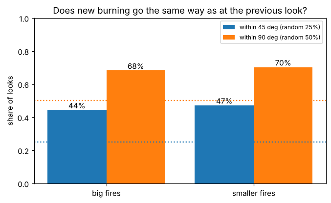
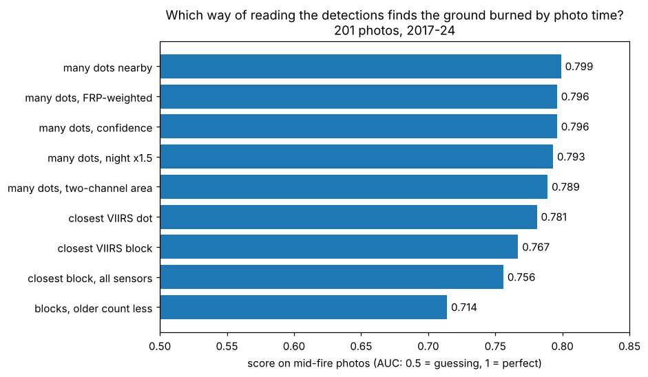

# Big fires with many detections: spread direction, speed and scar shape (16 Oct 2026)

Asked by Akkshay (16 Oct 17:38Z). He wanted the fires with large scars and many detections, to read the direction of spread
between consecutive detections and what the scar shape says. Later asks were folded in:
- every satellite's detections as real-size blocks (18:01Z),
- FRP as how much of a block is burning (18:06Z),
- every other alert field (18:07Z),
- crews putting fires out (17:57Z),
- a page per fire to check by eye (18:25Z).

Truth: **scar outlines v2 (2026-10-16)**. Independent check: the fuel thread's mid-fire Sentinel-2/Landsat photos, which never
touch the detection dots. Scripts are in `scripts/`, numbers in `results/`, pictures in `figures/`.

## Bottom line (plain words)
1. **146 big fires** were picked. Each has a scar of 200 ha or more, 4 or more VIIRS looks, 10 or more VIIRS alerts, and an outline not cut at the image edge. The median one is 451 ha with 20 alerts over 5 looks. One page per fire: [figures/big_fires_atlas.pdf](figures/big_fires_atlas.pdf).
2. **Big fires burn on several fronts at once.** The centre of one look jumps between fronts, so the line from one look's centre to the next zig-zags. Its direction does not carry on (random).
3. **Direction does work if you read it as "where is the new burning".** Take the burning that appears beyond everything seen before. The next look's new burning lies within 90° of the last one's **68%** of the time, against 50% for random. With the time order shuffled, the same test gives 50%. Adding MODIS and the Sentinel-2/Landsat hot pixels raises it to 73%. Big fires and smaller fires behave the same.
4. **Fires spread to one side of where they were first seen.** The first detection sits in the back third of the scar in 64% of big fires. About a quarter of the scar lies behind it, which is ground that burned before the first alert or burned backwards.
5. **Wind and slope don't steer them** (ERA5 daily wind: 50% within 90°, random is 50%). This agrees with the spread thread.
6. **Speed:** new burning appears a median 1.15 km beyond earlier burning per ~12.5 h look gap, which is about 74 m/h. This is an **upper bound**. A block is 375 m wide, and new fronts lit nearby count as spread. The photo-based 20-30 m/h from the spread review is the better number.
7. **The scar shape alone cannot tell which way a fire ran.** Testing "the narrow end is where it started" gives 49%, a coin flip.
8. **Extra sensors add a little time coverage and no better placement.**
   - MODIS and the hot pixels give 110 of 146 fires one extra look, mostly the ~10:30 IST morning look.
   - The longest gap between looks is unchanged (median 24.5 h).
   - On mid-fire photos, drawing detections as real-size blocks, or adding the other sensors' blocks, places burned ground slightly *worse* than plain VIIRS dots.
9. **FRP: only about 0.1-1% of a 375 m block is actually burning at the moment of the look**, which is a thin line of fire.
   - FRP agrees only loosely with same-morning hot pixels (0.34).
   - Weighting detections by FRP, by the two-channel burning area, by confidence or by day/night does not place the fire better on photos.
   - **The burning-fraction idea does not hold up as a placement tool.**
10. **Crews.** Big fires are only slightly more remote: a median 2.2 km from the nearest building, against 1.7-1.9 km for other fires. Big-fire scar edges touch roads no more than ground 300 m outside them (3.1% vs 2.8%). So the outlines show no clear firefighting edge. Satellite data cannot separate a crew stop from a fuel break.

## 1. Picking the big fires (`b1_build_fires.py`)
- In v2, an "event" is one day's alerts within 1 km, so a 3-day fire is 3 events with overlapping outlines. Events were joined into one fire when their dates were within 3 days and their outlines overlapped by 30% or more of the smaller one.
- Result: 5,669 events become 3,557 fires. The scar is the union of the events' outlines.
- Detections on a fire are every raw FIRMS alert inside the scar plus 200 m (the outline rule's own circle), from the day before the first event to 2 days after the last.
- Sensors: S-NPP, NOAA-20, NOAA-21, Terra/Aqua MODIS. A **look** is detections within 2 h of each other, because the three VIIRS satellites pass within ~50 min.

| cut | fires | median alerts |
|---|---|---|
| scar ≥100 ha, ≥3 looks | 362 | 13 |
| scar ≥200 ha, ≥3 looks | 237 | 16 |
| **scar ≥200 ha, ≥4 looks, ≥10 VIIRS alerts, not at chip edge (used)** | **146** | **20** |
| scar ≥500 ha, ≥4 looks | 69 | 32 |

**Atlas** ([figures/big_fires_atlas.pdf](figures/big_fires_atlas.pdf), list in `results/big_fires_list.csv`). Each page shows:
- the scar,
- every VIIRS and MODIS detection as its real block (scan × track),
- the Sentinel-2/Landsat hot pixels in red,
- each look numbered and coloured,
- a table with each sensor's count and time in IST.

**Selection bias (crews).** The many-alert fires are the ones not put out early. Partly they are more remote; partly they burned on busy days (three of the six examples in figure 1 started on 11 Mar 2026).

| group | fires | median km to road | median km to building | median scar ha |
|---|---|---|---|---|
| big | 146 | 1.18 | 2.19 | 451 |
| other multi-look | 818 | 1.22 | 1.94 | 122 |
| single-look | 2,593 | 1.05 | 1.72 | 25 |

So whatever is learned from big fires is learned from fires that crews did not stop early. It may not hold near villages.

## 2. Direction between consecutive looks (`b2_tracks.py`, `b3_growth_direction.py`, `b4b_sensors_added.py`)
Position noise: within the same look, two satellites' centres differ by a median of 370 m on big fires (306 m on others). On big fires this is partly real, because different satellites catch different fronts.

**Moves between look centres (big fires, moves over 500 m).** Random gives mean cosine 0, 25% within 45° and 50% within 90°.

| test | n | mean cos | within 45° | within 90° |
|---|---|---|---|---|
| move vs the move just before | 392 | −0.19 | 17% | 34% |
| move vs the move two steps before | 291 | 0.00 | 31% | 49% |
| move vs ERA5 daily wind | 404 | −0.03 | 25% | 50% |
| move vs upslope (slope ≥5°) | 326 | +0.03 | 25% | 53% |

The centres zig-zag and carry no direction (figure 1 shows why: several fronts burn at once).

**Growth direction**, the bearing from the centre of everything seen so far to the *new* burning (more than 400 m from every earlier detection):

| set | n | mean cos | within 45° | within 90° | shuffled order, mean cos 95% range |
|---|---|---|---|---|---|
| big fires, VIIRS | 457 | **+0.32** | 44% | 68% | −0.06 to +0.07 |
| big fires, all sensors | 528 | **+0.37** | 47% | 73% | −0.02 to +0.10 |
| smaller fires (≥3 looks), VIIRS | 468 | +0.34 | 47% | 70% | −0.06 to +0.08 |
| new burning vs the fire's heading so far (big) | 401 | +0.25 | 38% | 65% | −0.07 to +0.06 |

**One-sided growth.** Take the bearings from the first look to each later look's new burning. Their combined strength is 0.87, against 0.44 for random directions, and is above random in 93% of big fires. Big fires do not spread evenly in a ring. They run off to one side, and the side keeps roughly the same from look to look. This is the usable signal for a spread model: from the second look on, push the forecast toward the side the new burning came from. The spread thread's learned restart already does this.

**Speed** (new-burning distance divided by gap, gaps over 3 h): big fires median 74 m/h (IQR 49-115; night 80, day 70); other fires 57 m/h. This is an upper bound for the reasons in the bottom line, point 6.

## 3. What the scar shape says (`b2_tracks.py`)
| | big | other (≥50 ha) |
|---|---|---|
| length (long axis) km | 4.3 | 2.5 |
| long / short | 1.73 | 1.91 |
| scar long axis within 30° of the first→last look line (random 33%) | 65% | 71% |
| same, using only scar ground more than 600 m from every detection | 41% | 46% |
| first look in the back third of the scar | 64% | 74% |
| share of scar behind the first look (median) | 25% | 21% |
| "narrow end = start" correct (73 big / 146 other fires with a clear time order) | **49%** | **49%** |
| "heavier end = start" correct | 51% | 47% |

- The scar's long axis follows the detections, but that is partly built in, because the outline is grown from 200 m circles round the detections.
- Away from the detections the agreement drops to 41% against 33%, which is weak.
- **Which end the fire started at cannot be read from the outline.**

## 4. Every satellite as a real-size block (`b4b_sensors_added.py`, `b6b_photo_test.py`)
For the 146 big fires (medians): 20 VIIRS alerts, 1 MODIS alert, 43 Sentinel-2/Landsat hot pixels (on 112 fires); MODIS on 92 fires.

| | VIIRS only | all sensors |
|---|---|---|
| looks per fire | 5 | 6 |
| fires gaining a look | | 110 of 146 |
| looks at 08-12 IST | 0 | 1 |
| median gap between looks | 12.5 h | 12.3 h |
| longest gap | 24.5 h | 24.5 h |
| share of scar under at least one block | 51% | 61% |

**Mid-fire photo test** (independent truth). 201 photos, 2017-24 (140 on big fires). The question is which pixels of the final scar were already burned at photo time. Everything seen at least 1 h before the photo is used. The score is AUC (0.5 = guessing).

| method | all photos | big fires | new ground only (outside every earlier VIIRS block) |
|---|---|---|---|
| closest VIIRS dot | 0.781 | 0.798 | 0.742 |
| closest VIIRS block (real size) | 0.767 | 0.783 | 0.732 |
| closest block, all sensors | 0.756 | 0.771 | 0.722 |
| blocks, older ones count less | 0.714 | 0.715 | 0.693 |
| **many dots nearby** (sum of exp(−distance/400 m)) | **0.799** | **0.812** | **0.752** |
| many dots, FRP-weighted | 0.796 | 0.802 | 0.747 |

- Blocks minus dots, 95% range over fires: −0.024 to −0.004.
- All-sensor blocks minus dots: −0.039 to −0.009.
- FRP-weighted minus plain kernel: −0.018 to +0.010.

So blocks are slightly *worse*. A big MODIS block (1 km or more) marks a lot of ground as "burning" that isn't. The best simple reading is "ground near many dots burned first".

## 5. FRP and the other alert fields (`b6a_frp_vs_hotpix.py`, `b6c_alert_fields.py`)
Fields per detection:
- **VIIRS:** bright_ti4 (3.7 µm), bright_ti5 (11 µm), scan, track (pixel size, 0.32-0.80 km), confidence (l/n/h), frp, daynight, satellite.
- **MODIS:** brightness, bright_t31, scan, track, confidence 0-100, frp, daynight, Terra/Aqua.

**How much of a block is burning.** FRP = σ(Tf⁴ − Tb⁴) × burning area.

| estimate | result |
|---|---|
| FRP, Tf 800 K | median 0.08% of the block; about 250 m² by day, 64 m² by night |
| two-channel (Dozier) split of I4/I5 | solvable for 77% of detections (I4 saturates at 367 K in 4.6%); median 0.8% of the block at 537 K (smouldering) |
| agreement between the two | Spearman 0.33 |

Both say a 375 m block holds only a line of fire, not a burning block. They disagree tenfold on how much. Note that FIRMS gives no background temperature: the look's 10th percentile of bright_ti5 was used.

**Independent check.** Terra MODIS passes within ~30 min of Sentinel-2/Landsat, so 64 Terra detections have same-morning hot pixels inside their block.
- FRP vs hot pixels in the block: Spearman 0.34.
- The top quarter of FRP has about twice the hot pixels of the rest (median 207 vs 82-102).
- FRP is a rough rank of how active a fire is, not a measured burning area.

**Does any field place the fire better on photos?** Kernel of VIIRS dots, 203 photos.

| weight | AUC | vs unweighted, 95% range |
|---|---|---|
| none | 0.802 | |
| FRP | 0.799 | −0.019 to +0.010 |
| two-channel burning area | 0.789 | −0.031 to +0.004 |
| confidence (l 0.5 / n 1 / h 1.5) | 0.796 | −0.010 to −0.001 |
| night ×1.5 | 0.793 | −0.013 to −0.005 |
| smaller pixel (near nadir) counts more | 0.803 | −0.002 to +0.004 |

**Verdict:** no field helps. The burning-fraction idea does not hold up as a way to place the fire. So there is no how-to for other threads. This agrees with the spread thread's finding that first-alert FRP barely links to scar size.

## 6. Where big scars stop: crews, roads, streams (`b5_access_edges.py`)
- Each big outline was walked every 30 m and compared with a ring 300 m outside it.
- **Edge within 60 m of a road:** 3.1%, against 2.8% for the ring. **Stream:** 8.3% vs 6.5%. **Within 1 km of a building:** 13.9% vs 16.4%.
- **Straight stretches:** 600 m or more within 25 m of a line. There are 340 in 132 fires, listed with coordinates in `results/straight_edges.csv`.
  - 7% lie on a road and 10% on a stream.
  - 12% run exactly N-S or E-W, which may be image or cloud-mask edges, not fire.
- Big-fire edges do not visibly follow roads or villages. A crew line cut through forest would not be on our road map, so crew stops can't be ruled out, only not seen.
- The spread audit's finding stands: fires near roads and villages are mostly single-look and small. Read that as early suppression or early burnout, which can't be told apart here.

## 7. Limits
- The scar outline is built from circles round the detections, so any agreement between scar shape and detections is partly built in. The photo test is the independent check.
- The photos are mostly morning photos after a night look (6-12 h lead) on the raster burn labels.
- Fires were joined into big fires with hindsight (all events of the fire). This is fine for description, not for forecasting.
- The 2026 alerts are LANCE centroids from Earth Engine with partly missing scan/track; defaults of 375 m / 1 km were used.
- ERA5 wind is a daily mean over the whole area.

## 8. Next
- **ECOSTRESS 70 m** (lead from the Earth Engine thread): 81 passes in 2019-24 within ±3 h of a VIIRS fire, at hours VIIRS does not look.
  - First check: does it see litter fires at all?
  - It needs Earth Engine, which this session does not have, so it would run on Akkshay's PC.
- **For the spread threads:** use growth direction, not centre-to-centre moves. "New burning beyond everything seen so far" persists (68-73% within 90°) while look centres zig-zag. For placement use "many dots nearby", not blocks or FRP weights.

## 9. Tables for machine learning (19:49Z ask; `b9_ml_table.py`, `b10_ml_test.py`)
`results/ml/fires_ml.csv` (one row per fire, 964 fires, 146 big), `steps_ml.csv` (one row per look-to-look step) and
`sectors_ml.csv` (step x 8 directions, for learning direction). Every column, and the quick test, is in
[results/ml/COLUMNS.md](results/ml/COLUMNS.md).
- **Rate:** no column group predicts it. The best is 2% better than the median, and the strongest single link is terrain relief (+0.24).
- **Direction:** terrain + fuel get the right one of 8 sectors 20% of the time, as good as "same way as last step" (20%). Both together get 24% (random 12.5%). Fires lean slightly uphill and away from villages. The litter and grass maps alone carry almost nothing.

Note (16 Oct 20:05Z): the project folder hit its 10 GB limit, so two rebuildable intermediates were removed to let the
tables sync: `results/fire_scars.pkl` (re-run `b1_build_fires.py`, ~4 min) and `results/alert_fields.csv` (re-run
`b6c_alert_fields.py`, ~20 s). Re-run those first before any later script.

## 10. Every satellite pass on its own (20:06Z ask; `b11_passes.py`, `b12_front_speed.py`, `b8b_atlas_passes.py`)
Akkshay asked for every sensor's detections to be kept apart, not merged into looks. A pass is now one satellite within 15 min (S-NPP, NOAA-20, NOAA-21, Terra MODIS, Aqua MODIS, one Sentinel-2 or Landsat scene).
- **Files:** `results/detections.csv` has one row per detection (with its pass, exact time, real pixel size and FRP). `results/passes.csv` has one row per pass: 9,709 passes, and a big fire has a median of 11 passes against 5 merged looks.
- **Atlas** ([figures/big_fires_atlas.pdf](figures/big_fires_atlas.pdf), redrawn): every pass is numbered on its own, with a timed table and a front-distance plot.

**What a short gap can show** (3,740 consecutive-pass pairs under 3 h apart, all fires):

| gap between passes | pairs | median apparent move | real spread at 20-30 m/h | same-moment difference between two satellites |
|---|---|---|---|---|
| 0-30 min | 1,271 | 304 m | 0-15 m | 290-370 m |
| 30-60 min | 1,830 | 333 m | 10-30 m | |
| 60-90 min | 49 | 503 m (few pairs, mostly MODIS with 1 km+ pixels) | 20-45 m | |
| 90-180 min | 586 | 354 m | 30-90 m | |

**Direction of short-gap moves.** The move points the way the fire actually went next (new burning at the next pass 6 h+ later) in 52.2% of pairs (95% range 50.1-54.2; random 50%).

| pair type | same way as next growth |
|---|---|
| VIIRS to VIIRS | 53% |
| big fires only | 56% |
| pairs with MODIS | 51% |
| pairs with S2/Landsat | 48% |
| 12 h growth steps (section 2), for comparison | 68% |

A single short gap is mostly position noise. Real movement in under an hour is ten times smaller than the error.

**Using all passes together works.** Each fire's front distance from its start area was fitted against time through every pass (a robust line, so single-pass errors average out).
- Median front speed: **25 m/h** (IQR 16-36). This matches the independent mid-fire photo figure of 20-30 m/h.
- Adding MODIS and Sentinel-2/Landsat passes to VIIRS:
  - narrows the uncertainty in 71% of fires (median 95% range 48 → 38 m/h),
  - raises the share of fires with a speed clearly above zero from 51% to 61%.
- The columns are added to `results/ml/fires_ml.csv` as `front_*`.
- Caveat: a fire that may be two joined fires (page 40) shows a jump in front distance and a speed far too high. Those fires should be checked by eye.

## 11. Patterns found by machine learning (20:41Z ask; `b13_ml_patterns.py`)
Results: [results/ml/patterns.json](results/ml/patterns.json), figure [figures/4_ml_patterns.png](figures/4_ml_patterns.png).

**How it was done.** Small tree models (LightGBM, 6-8 leaves) and one readable logistic model. Every number is from seasons the model never saw (train on all other seasons, test on the held-out one). Baselines: "same speed for every fire" and "keep going the same way". A leak was found and removed first: the fuel-map `burn_count` counts the fire's own season, so it told the model where the fire went. Replaced by `burn_prior` (earlier seasons only). The leaky version scored 2 points higher on direction; the numbers below are leak-free.

**Speed** (380 fires with a usable front-speed fit, weighted by how sure the fit is; 134 big):

| columns given to the model | error vs "same speed for every fire" |
|---|---|
| terrain | 0.4% better |
| fuel / canopy / burn history | 2.4% worse |
| weather and date | 2.8% better |
| people / access | 0.4% better |
| first-look alert fields (FRP, brightness, confidence) | 2.6% worse |
| the fire so far (size, looks, night share) | 6.3% better |
| all columns | 4.2% better |

Single columns (Spearman, strongest first): grass share +0.23 (more grass, faster), distance from buildings +0.20, elevation +0.16, litter −0.16 and canopy −0.13 (more litter/canopy, slower), slope +0.12. These are weak. Rate of spread is mostly not predictable from what we have; the measurement itself (25 m/h with wide ranges) is the limit.

**Direction** (1,792 growth steps, which of 8 compass sectors gets the new burning):

| rule or model | right sector (random 12.5%) | within one sector (random 37.5%) |
|---|---|---|
| keep going the same way | 19.0% | 47.8% |
| away from the first detection | 16.8% | 45.0% |
| terrain only | 16.1% | 41.8% |
| fuel / canopy only | 15.7% | 42.0% |
| wind only | 12.3% | 36.6% |
| people only | 14.3% | 39.3% |
| everything except the fire's history | 19.0% | 49.2% |
| **everything, trees** | **22.8%** | **55.0%** |
| everything, logistic (readable) | 21.6% | 53.1% |
| everything, trees, big fires only (603 steps) | 21.4% | 57.2% |
| everything, trees, seasons 2025-26 only (439 steps) | 22.6% | 53.1% |

- The model's chances are honest: when it says 18% it is right 17%; 24% → 25%; 32% → 30%.
- The fire's own momentum (`cos_prev`) is by far the strongest column. Dropping it costs 4 points; dropping any single terrain or fuel column costs under 1 point.
- Terrain and fuel together, without history, equal "keep going the same way". Together with history they add about 4 points.

**The readable pattern** (logistic weights, standardised; all effects are small):
- goes the way it was going (+0.35);
- slightly uphill (slope +0.10, higher ground +0.09; rank test: chosen sector is the highest of 8 on average 4.17 vs 4.5 random);
- toward canopy (+0.14) and **away** from where the litter map is high (−0.22) and from grass (−0.11). Litter v3 mostly follows canopy, so this is canopy and litter pulling opposite ways once both are given; read it as "toward trees, not toward the fuel number";
- toward ground that burnt more often in earlier seasons (+0.10; rank 4.15 vs 4.5) and away from buildings (+0.06; rank 4.15);
- wind: no clear effect (downwind rank 4.51 ≈ random; the wind terms cancel each other);
- "already burnt this season" (+0.20) is suspect: the raster burn labels can include the fire's own earlier days and neighbouring active fires, so this is probably the fire's own trail, not a preference.

**What this means in plain words.** Where a big fire grows next is about 1/4 predictable: the best model picks the right one of 8 directions 23% of the time and is within one sector 55% of the time. Most of that comes from the fire's own momentum. Terrain and fuel add a little (slight uphill, toward tree cover, toward often-burnt ground, away from villages); wind adds nothing. For speed, nothing we have predicts it beyond a few percent.

**On neural networks.** With 1,792 steps and 380 speeds, a neural network cannot beat these small models honestly; it would fit noise. The way forward is more and better-timed data (the continuity thread's arrival-time maps, more seasons), not a bigger model.

## 12. All fires with 3+ timed passes, and a neural network (21:06Z ask; `b14_all_fires_nn.py`, `b14b_nn_test.py`)
Akkshay: widen from the 146 big fires to every fire with at least 3 separately timed passes, any sensor, any scar size, and try a neural network.
Results: [results/ml/all_fires_nn.json](results/ml/all_fires_nn.json), figure [figures/5_all_fires_nn.png](figures/5_all_fires_nn.png). Tables: `results/ml/all_fires_steps.csv` (one row per pass with new burning), `all_fires_sectors.csv` (step × 8 sectors), `all_fires_speed.csv` (one row per fire).

**The set.** 1,115 fires have 3 or more timed passes (146 of them are the old big set). Steps are now pass to pass, any sensor: 2,973 steps with new burning in 962 fires (S-NPP 1,139, NOAA-20 987, NOAA-21 315, Sentinel-2 218, Aqua MODIS 164, Terra MODIS 81, Landsat 69). Front speed could be fitted for 950 fires; 523 have a usable fit. Median speed 26 m/h; big fires 25, the rest 26. Small fires spread no differently from big ones.

**Direction, which of 8 sectors gets the new burning (random 12.5%; every number from a held-out season):**

| rule or model | right sector | within one sector |
|---|---|---|
| keep going the same way | 21.5% | 52.7% |
| uphill | 12.1% | 38.9% |
| downwind | 13.5% | 40.3% |
| fire history only (logistic) | 25.8% | 56.9% |
| ground only: terrain, fuel, people, wind (trees) | 19.0% | 48.6% |
| everything, logistic | 23.8% | 56.3% |
| **everything, trees** | **28.6%** | **60.4%** |
| everything, neural net 2×32 (first setting) | 18.1% | 47.7% |
| everything, neural net, best of 5 settings | 26.4% | |

The same trees model, by subset: big fires 27.6%, other fires 29.0%, 2025-26 only 28.8%, VIIRS steps 28.5%, MODIS steps 33.5%, Sentinel-2/Landsat steps 24.7%.

**A caution on the higher number.** The widened set scores 28.6% against 22.8% on the big fires, but the gain sits in the short gaps: steps under 3 h apart score 36.7%, steps 3 h or more apart 22.4%. The short-gap steps are predictable from the fire's history columns alone (37.7%), and section 10 showed that short gaps between sensors are mostly position noise and block geometry, not spread. So the honest spread number is still about **22-23% right out of 8, 55-60% within one sector**, and it is the same on big and small fires.

**The neural network.** Five settings were tried (one or two hidden layers, 8 to 64 units, weak to strong regularisation). The best reached 26.4%, below the trees at 28.6%, and the un-regularised ones fell to 18-19%, below "keep going the same way". The learning curve says why: with 10% of the fires the trees already reach 24%, and going from 50% to 100% of the fires adds under 1 point. More rows of the same kind of data will not lift this; the neural net has nothing extra to learn from.

**Speed** (523 fires): the same picture as before. The best tree model beats "same speed for every fire" by 3.8%; the neural net is 28% worse than the baseline. Grass share, distance from buildings and elevation go with faster fires (Spearman 0.13-0.16), canopy and litter with slower (−0.11).

**The readable pattern on the widened set** (logistic weights): momentum +0.53, then away from high litter-map values −0.24, toward canopy +0.17 and tree cover +0.09, slight uphill +0.09, toward often-burnt ground +0.08; wind small.

## 13. Neural net on map patches, richer input (07:03Z ask "use more data input then"; `b15_patches.py`, `b15b_cnn.py`)
Instead of summary columns, the net was given a **map patch** around each step: 3 km × 3 km at 60 m, 15 layers (height, slope, canopy, litter, grass, tree/open/non-fuel cover, earlier-season burns, this-season burns, the fire's own trail with recency, the latest pass, distance to buildings and roads). A small convolutional net (3 conv layers, ~90k weights) reads the patch and predicts which of 8 sectors the new burning goes to. Each patch was also rotated and mirrored (8 ways, sector turned with it), so the net trained on 8 times the rows. Same 2,973 steps as section 12, same season-held-out test. Results: [results/ml/cnn_patches.json](results/ml/cnn_patches.json), figure [figures/6_cnn_patches.png](figures/6_cnn_patches.png).

| input to the net | right sector | within one |
|---|---|---|
| random | 12.5% | 37.5% |
| **patch, all 15 layers** | **22.9%** | 54.3% |
| patch + previous direction as an extra input | 22.0% | 54.4% |
| ground layers only (no fire trail) | 17.1% | 44.6% |
| ground layers + previous direction | 21.3% | 52.1% |
| for comparison: trees on columns (section 12) | 28.6% | 60.4% |
| for comparison: keep going the same way, where a previous step exists (2,011 steps) | 25.9% | 59.5% |

By subset, the patch net scores 22% on gaps of 3 h or more, 25% on big fires, 23% on 2025-26. Its confidence is a little high (when it says 49% it is right 33%).

**Reading.** The image net, with 60 times more input per step and 8 times the training rows, lands **below** the tree model on summary columns and does not beat "keep going the same way". Ground layers alone give 17%, about what the column models gave for ground alone (16-19%). The map carries no hidden pattern that the summary columns missed. The limit is in the target (a direction measured from 375 m blocks with ~300 m error), not in how much the model is shown.

**Next, if anything:** the FSI thread's per-sensor noise table (static industrial sites: median 254 m, S-NPP vs NOAA-20 offset ~65 m) could narrow the speed intervals of section 10 by weighting passes; that is a refinement of the speed number, not a route to better direction.

## 14. ECOSTRESS, the 70 m thermal sensor (08:25Z ask; `b16_ecostress_fetch.py`)
ECOSTRESS rides on the space station and measures land-surface temperature at 70 m, at changing times of day, a few times a week. The NASA catalogue lists **1,234 passes over Ratapani from July 2018 to October 2026**, spread over all hours (most between 08:00 and 18:00 IST, a quarter at night).

Matched to our fires (pass time between the fire's first and last detection): **730 passes during 372 active fires; 84 of the 146 big fires have at least one**, several have 5-8. Median gap to the nearest VIIRS pass 2.9 h (a quarter within 40 min). List: [results/ecostress_matches.csv](results/ecostress_matches.csv). These are tile matches; whether the swath actually covered the fire is only known once the data is read.

**What it could give.** A 70 m pixel is 30 times smaller than a VIIRS block, so a fire line would sit within ~50 m instead of ~300 m. With two ECOSTRESS passes on one fire, or one pass plus a VIIRS pass an hour away, the front's movement becomes measurable at the scale of real spread (20-30 m/h). The checks planned: (1) does the hot line at 70 m sit inside the VIIRS blocks of the nearest pass, and where in the block; (2) front position vs the final scar edge; (3) movement between two passes of the same fire.

**Blocker.** The 70 m files need a NASA Earthdata login; the public quick-look pictures are colour-stretched and not usable for temperatures. The fetch script reads the token from the environment variable `EARTHDATA_TOKEN` and clips 2 km around each scar (204 granules). Nothing is fetched until the token is there.

**Note (17 Oct 08:29Z, from the FSI thread):** a fuller all-MP MODIS file now exists (`fire-alert-scars/alerts_mp/modis_2014..2026.csv`, Terra+Aqua). For Ratapani it holds 1,150 points on 636 fires against the 861 on 485 fires that `passes.csv` uses. Terra (10:30/22:30 IST) is the one that adds new times; Aqua duplicates VIIRS times. Their test: hidden-look error falls from 16.9 to 12.2 h where Terra sits in the gap, but Terra is present in only 32% of big fires. To fold it in: rerun `b1 -> b11 -> b12 -> b14` with the new file and MODIS as points, not 1 km blocks. Not done yet; it would sharpen the speed numbers a little and change none of the conclusions above.

### 14b. ECOSTRESS results (17 Oct, `b16_ecostress_fetch.py`, `b16b_ecostress_analysis.py`)
Fetched with Akkshay's Earthdata token (used for the run only, stored nowhere). 881 fire-pass clips (2 km around each scar; 520 distinct fire-passes once duplicate granule versions are merged; 348 fires). Results: [results/ecostress_summary.json](results/ecostress_summary.json), per pass [results/ecostress_pass_stats.csv](results/ecostress_pass_stats.csv), figure [figures/7_ecostress.png](figures/7_ecostress.png).

**Coverage is thinner than the catalogue says.** Of 520 fire-passes, the swath missed the fire in 242 (the tile matched, the strip did not), 16 were cloudy, **262 are usable** (240 fires, 64 big).

**The fire shows at 70 m in about 1 pass in 7 by day, never at night.**

| threshold above background | passes where the fire is visible | day | night (41 passes) | big fires |
|---|---|---|---|---|
| 6 K | 20% (53) | 24% | 2% | 22% |
| **10 K** | **12% (30)** | 14% | 0% | 15% |
| 15 K | 8% (22) | 10% | 0% | 11% |

Background noise is 1.9 K; the 99th-percentile anomaly inside the scar is 2.9 K in a typical pass. A creeping litter fire warms a 70 m pixel by only a few K unless a flaming line crosses it. When it does show, there are ~14 hot pixels (median) at up to 12 K and more.

**When it shows, it draws the front.** In the 30 visible passes:
- hot pixels sit **at the scar edge**: median 100 m inside the final outline, 60% within 150 m of it. They mark the active front, not the burnt interior;
- against VIIRS within 1 h (23 passes, median gap 21 min): 62% of hot pixels sit inside a VIIRS block, 85% within 500 m; the hot centre is 280 m from the VIIRS centre (median). So VIIRS blocks hold the fire, and the 70 m line tells where inside the block it burns;
- **the hot front points to where the fire grows next**: the bearing from everything seen so far to the hot pixels is within 45° of the next growth step in 56% of cases (72% within 90°), against 32% (52%) for "keep going the same way" on the same fires. 25 cases only, so the margin is suggestive, not firm;
- no fire has two visible ECOSTRESS passes, so no 70 m speed could be measured.

**Reading.** ECOSTRESS is the first thing that sharpens the picture: a 70 m front position that beats momentum for the next direction. The catch is availability: daytime only, about 1 usable pass in 7 shows the fire, and over 8 years that is 30 fire-passes, 11 on big fires. It cannot be a routine input, but it is the right kind of data. Each visible pass is a ground-truth-like snapshot for the arrival maps and the spread review.

### 14c. "With several blocks from one satellite, is the fire in the middle of them?" (Akkshay 10:54Z; `b16c_between_blocks.py`)
Checked with the fine hot pixels: ECOSTRESS 70 m within 1 h of a VIIRS pass (33 passes) and, as a larger sample, Sentinel-2/Landsat 30 m hot pixels within 3 h of a VIIRS pass (538 passes; the 3 h gap adds ~75 m of real movement). Results: [results/between_blocks.json](results/between_blocks.json), figure [figures/8_between_blocks.png](figures/8_between_blocks.png).

| VIIRS pass | passes (70 m / 30 m) | fine hot pixels to the nearest block centre | position in that block (0 centre, 1 edge, >1 outside) | share in the outer half | hot centre to the cluster centre |
|---|---|---|---|---|---|
| single block | 7 / 264 | 244 / 321 m | 0.77 / 1.31 | 78 / 88% | same |
| 2 blocks | 7 / 135 | 274 / 322 m | 1.19 / 1.22 | 86 / 82% | 665 / 347 m |
| 3+ blocks | 19 / 139 | 207 / 288 m | 0.88 / 1.12 | 81 / 88% | 334 / 453 m |
| if the fire were anywhere inside the block at random | | | 0.71 | 75% | |

Two-block passes in detail (30 m sample, 134 passes): the fine hot pixels lie between the two block centres in 59% of pixels (median), and in 51% of passes most pixels are between. But that splits by spacing: for **adjacent** blocks (<500 m apart, 80 passes) only **37%** of hot pixels lie between the centres; for blocks far apart (≥500 m, 54 passes) 88% do, because those are two fronts with the fire line running between them. Only 9-14% of hot pixels in 3+ block clusters are closer to the cluster centre than to any block centre.

**Verdict.** Partly true, with a correction. The fire is **not in the middle of a cluster**: it is a line that runs along one side of it, and most hot pixels sit at the edge of their block or just outside it, never near the centre. For two adjacent blocks the line usually crosses their shared boundary (so both light up from shared heat, as the FSI thread found for FRP), but it is at the boundary, not centred between the two. For blocks far apart, "between" holds because the fire line connects them.

**Other things the fine pixels say.**
- VIIRS places a fire about 250 m from where it burns (median hot pixel to nearest block centre 207-244 m at 70 m, 1 h). That is the position error measured directly, and it matches the 290 m same-look two-satellite figure from the spread review.
- The block footprint holds 62% of the hot pixels at 1 h and only 27% at 3 h: a block is a "within ~300 m" statement, not a boundary.
- A single VIIRS block hides a line of ~9 (70 m) to ~34 (30 m) hot pixels; 3+ blocks ~25 to ~134. The number of blocks grows with the length of the fire line, not with its intensity.

### 14d. Where sections 14b and 14c went (Akkshay 11:20Z "use this for further in project")
Sent through the coordinator to the threads that can act on them, each with one concrete test:
- **Research (FSI / sub-square rebuild):** use "hot pixels sit at the block edge or just outside, ~250 m from the centre" as the prior for where a fire sits inside a block.
- **Fire spread model:** seed the forecast from block or cluster edges instead of block centres, scored against the 0.477 "dots + 24 ha" rule.
- **Continuous fire growth:** seed arrival maps and stop rays at block edges, not centres.
- **Burn scars:** check that the scar search window covers block edge plus about 250 m, on a 2025 sample.
- **Field alerts:** the rule "look along the outer edges of a cluster, not in the middle" is in project memory; that thread is closed and was not reopened.
Nothing in this thread's own results changes; sections 14b and 14c stay the source. Pending refinements here (not asked for): refit with the fuller MODIS file; weight passes by the FSI static-site noise table.

## 15. The same test on all of Madhya Pradesh (Akkshay 11:46Z "do this on all-over MP fires"; `b17_mp_ecostress_count.py`, `b17b_mp_ecostress_blocks.py`)
Sections 14b-14c rest on 30 visible ECOSTRESS passes and 538 Sentinel-2/Landsat passes, all in Ratapani. Statewide the fine-pixel data have to come from the same two sources, and neither is on the shared folder yet.

**ECOSTRESS statewide, counted (no login needed; `results/mp_ecostress_count.json`, `results/mp_ecostress_pairs.csv`).** Every ECO_L2T_LSTE granule over the MP box in the 15 Feb-15 Jun season, 2018-25, matched to the all-MP forest fire events (fire-alert-scars/mp/out) by tile footprint and a VIIRS alert within 1 h:

| | Ratapani (14b/14c) | all MP |
|---|---|---|
| granules in season | 1,020 | 21,576 (76 tiles) |
| fire-passes within 1 h of a VIIRS alert | 33 visible-or-not | 7,130 on 4,868 fires (91% daytime) |
| expected usable (not swath-missed or cloudy, Ratapani rate 50%) | 262 | ~3,600 |
| expected passes that show the fire (Ratapani rate 11% of usable) | 30 | ~400 |

By year: 2019 353, 2020 385, 2021 3,295, 2022 974, 2023 1,010, 2024 86, 2025 1,027. So the statewide sample would be about 13x Ratapani's: enough to give the block-position shares to +-3 points instead of +-9, and to split them by satellite, block size (scan angle) and day/night.

**What is needed to run it.** `b17b_mp_ecostress_blocks.py` is written and syntax-checked. It fetches 3 layers for 1,210 granules (~1.8 GB, scratchpad only), clips 6 km around each fire's VIIRS cluster, finds hot pixels against a 1.5-3 km ring background (no scar outline needed, so it works for every MP fire), and repeats the 14c measures. It runs only with the Earthdata token in the environment variable `EARTHDATA_TOKEN` (Project settings, cloud environment, secrets). The token pasted in chat earlier was used for one session and is not kept anywhere, so a fresh session cannot fetch until that secret exists.

**Sentinel-2/Landsat 30 m statewide.** The Ratapani hot pixels came from Earth Engine, which only runs on Akkshay's PC. The statewide pull is the same `out/af/` method over the 4,868 fires above (or all events with 2+ VIIRS blocks in one pass), about one Earth Engine job. That goes through the PC session in the pipeline thread; it has not been started.

**Cross-check from the research thread (12:10Z, ratapani/fsi/scouting/squares_v2_*.md).** Used as a within-block prior for placement on the mid-fire photos, the 14c edge result gave no gain (-0.004); it was not tested on the hot pixels it was measured on. Their all-pass grid map (pixel grid rebuilt per pass, footprint likelihood with sensor offsets) puts the burning centre 347 m from the 30 m hot-pixel centre against 413 m for pass pixel centres, about 50 m better (CI -74 to -33): for placement, use that burning centre, not the block centre. Their pooled MP front speed (31 m/h day, 5 m/h night, 14:00 peak) brackets the 25 m/h multi-pass fit here. Their VNP14IMG fire-mask pull (3,657 passes) also waits on the `EARTHDATA_TOKEN` secret; its hot-pixel step runs on the ECOSTRESS clips unchanged.

**Second cross-check from the research thread (14:44Z, ratapani/fsi/scouting/squares_v3_*.md).** Independent of the ECOSTRESS scenes: the VIIRS centre sits about 120 m behind the 30 m front at the same moment (740 looks, 286 fires, CI 52-182 m), the same direction as 14c; direct 30 m front advance between scenes 1-6 days apart is 24 m/h (20-29), matching the 25 m/h multi-pass fit here (section 10); the front runs ~1.4x the active-centre speed. Block extent predicts hot-line length at ~140 m per block (held-out R2 0.21), consistent with "block count tracks line length" in 14c. Per-fire speed cannot be pinned (reliability 0.005), as sections 11-13 found. One correction to carry into any refit of section 10: Terra at the same minute sits +254 m ahead of the hot pixels (unexplained), so Terra needs its own offset in the front fits; it is a minority of passes, so the 25 m/h median is unlikely to move much, but the per-fire CIs would. Queued with the fuller-MODIS refit (section 14d).

### 15b. Statewide run, done (17 Oct 2026 ~19:30Z; `b17b_mp_ecostress_blocks.py` adapted to the proxy secret, `b17c_mp_between_detail.py`)
The Earthdata secret arrived as an agent-proxy header on `*.nasa.gov` (no `EARTHDATA_TOKEN` variable), so b17b now sends no header of its own when the variable is absent, takes the collection version from the granule id (the old scratch `mp_granules.csv` was gone), and writes clips to `/tmp/claude-0/mp_eco` (scratch, not shared). Results: [results/mp_between_blocks.json](results/mp_between_blocks.json), [results/mp_between_blocks_detail.json](results/mp_between_blocks_detail.json), per pass [results/mp_ecostress_passes.csv](results/mp_ecostress_passes.csv).

**Coverage.** 7,130 pairs, 6,927 fetched, 3,780 usable (clear enough), **626 passes show the fire (17% of usable; Ratapani 11%)**, 793 satellite-passes on 603 fires; 99% daytime, S-NPP and NOAA-20 only.

| VIIRS pass | passes | hot pixel to nearest block centre | share in the outer half (95% CI, by fire) | share inside the block | Ratapani 70 m / 30 m outer half |
|---|---|---|---|---|---|
| single block | 314 | 303 m | 85% (82-88) | 47% | 78 / 88% |
| 2 blocks | 223 | 260 m | 83% (80-86) | 56% | 86 / 82% |
| 3+ blocks | 256 | 210 m | 78% (75-81) | 63% | 81 / 88% |
| random inside the block | | | 75% | 100% | |

Two adjacent blocks (<500 m apart, 139 passes): 50% of hot pixels lie between the two centres (44-56); Ratapani 30 m said 37%. Two far blocks (>=500 m, 84 passes): 65% (57-73); Ratapani said 88%. By satellite the same (S-NPP 81%, NOAA-20 83% outer half). Edge-of-swath blocks (>0.6 km wide) 75% outer half, 72% inside: wider blocks hold more of the fire, as expected.

**Verdict, plainly.** The Ratapani numbers hold statewide as a description: hot pixels mostly sit in the outer half of the block or just outside it, ~210-300 m from the centre, and almost never at the centre. The far-pair "fire line joins them" figure does not hold (65%, not 88%). **But the edge pattern is what VIIRS's own spread of positions produces on its own** (corrected 18 Oct, see 15g "are you sure?" and section 16: that spread is mostly pixel size, with the fire anywhere inside a 375-800 m pixel, plus only ~75-150 m pointing error). If every fire burned exactly at its block centre and VIIRS placed it with the scatter measured here (median 210-300 m), the outer-half share would be 82-91% and the inside share 32-55% (simulation, 375-500 m blocks) — the same as observed. So these data cannot say the fire burns at the block edge rather than at the centre; they say the fire can be anywhere in the VIIRS pixel. Field rule stays "search ~300 m around every block, all sides", not "search the edges". Only a test that removes the position error (same-minute 30 m truth, or the VNP14IMG fire masks with true pixel geolocation, pulled 17 Oct by the "Earthdata pulls" thread into ratapani/fsi/scouting/code/squares_v2/tracking/results/) could separate the two.

**Time gap check (Akkshay 19:43Z "check the time stamps of VIIRS detection vs 70 m"; `b17d_mp_time_gap.py`).** Gap between the VIIRS look and the ECOSTRESS pass on the 793 satellite-passes: median 35 min (S-NPP 13, NOAA-20 37), all under 60 min; ECOSTRESS came after VIIRS in 43%. Distance from hot pixels to the nearest block centre does not grow with the gap (correlation 0.08):

| gap | passes | hot pixel to block centre | outer half | inside block |
|---|---|---|---|---|
| 0-5 min | 23 | 263 m | 78% | 73% |
| 5-15 min | 279 | 215 m | 82% | 56% |
| 15-30 min | 59 | 277 m | 81% | 53% |
| 30-45 min | 200 | 276 m | 79% | 59% |
| 45-60 min | 232 | 271 m | 85% | 47% |

At ~25-30 m/h front speed, an hour moves the fire ~30 m, a tenth of the ~250 m offset. So the offset is not fire movement between the two looks; it is the fire sitting anywhere inside the 375-800 m pixel, plus ~75-150 m pointing error (corrected 18 Oct, 15g and section 16: fixed offset 35-90 m per satellite, random ~100 m). The 0-5 min group (only 23 passes) has more pixels inside the block (73%), the one hint that the gap matters, but it is too small to rely on.

### 15a. Result: the 30 m test on all-MP fires (`b18_mp_hotpix_blocks.py`, 19:25Z)
The Ratapani hot pixels came from Planetary Computer, not Earth Engine, so the statewide pull ran from here with no PC and no login. Same hot-pixel rule as `af_scan.py`, read as a 4 km window around each VIIRS day-pass cluster. 167,812 VIIRS day passes on all-MP forest events 2017-25; 75,893 have a Sentinel-2 or Landsat 8/9 scene 0-3.5 h before the pass (scene ~05:00-05:30 UTC, VIIRS ~07:30-09:00 UTC, median gap 2.7 h, so the fire has moved ~60-90 m). A balanced sample of 5,581 passes was fetched (2,237 two-block, 2,160 three-plus, 1,184 single); 62% show 3+ hot pixels within 600 m of a block (fires confirmed burning by VIIRS a few hours later, so the high rate is expected). Files: [results/mp_hotpix_between_blocks.json](results/mp_hotpix_between_blocks.json), [results/mp_hotpix_passes.csv](results/mp_hotpix_passes.csv), [results/mp_hotpix_pairs.csv](results/mp_hotpix_pairs.csv), figure [figures/9_mp_between_blocks.png](figures/9_mp_between_blocks.png).

| | Ratapani 30 m (14c) | all MP 30 m (3,469 visible passes, 3,239 fires) |
|---|---|---|
| single block: passes / hot pixel to block centre / position (0 centre, 1 edge) / outer half | 264 / 321 m / 1.31 / 88% | 537 / 291 m / 1.14 / 85% |
| 2 blocks | 135 / 322 m / 1.22 / 82% | 1,363 / 265 m / 1.03 / 84% |
| 3+ blocks | 139 / 288 m / 1.12 / 88% | 1,569 / 243 m / 0.96 / 83% |
| random anywhere inside the block | 0.71 / 75% | 0.71 / 75% |
| share of hot pixels inside the block footprint | | 43-52% |
| 2 adjacent blocks (<500 m): share of hot pixels between the centres | 37% (80 passes) | 47% (884 passes) |
| 2 far blocks (>=500 m): between the centres | 88% (54) | 67% (479) |
| 3+ blocks: hot pixels closer to the cluster centre than to any block centre | 9-14% | 18% |
| S-NPP vs NOAA-20 | | 250 vs 269 m, both 83-85% outer half |

All-MP outer-half share 83.8% (95% CI 83.0-84.6) against 75% at random: the Ratapani finding holds statewide with 6x the passes. **What changes:** the far-pair "between" share drops from 88% to 67%, and the adjacent-pair share rises from 37% to 47%, so the split by spacing is real but softer than the 134-pass Ratapani sample suggested. The reading stays: hot pixels sit at the edge of their block or just outside, about 250-290 m from the nearest block centre, only half of them inside the footprint at all; for two adjacent blocks the fire is at their shared boundary, not centred between them; for blocks 500 m+ apart the line connects them two times in three. Satellite makes no difference. The right panel of figure 9 plots the stricter "closer to the cluster centre than to any block" measure, not the between-centres share in the table.

**Verdict on "the fire is in the middle of the blocks", statewide:** no for adjacent blocks (47% between, 84% at the edge or outside); roughly two thirds yes for well-separated blocks, because the line joins them. The field rule stands: look along the outer edges of the cluster, and for two blocks far apart, along the line between them.

### 15c. Reconciling 15a with the 70 m thread's 15b: the edge pattern is VIIRS placement error (`b18b_mp_null.py`, 20:15Z)
> **Corrected by 15g and 16 (18 Oct).** The "~290 m placement error" below is wrong: it is mostly the 375-800 m pixel size. VIIRS's own fixed offset is 35-90 m per satellite and its random pointing error about 100 m (section 16). The "westward lean" is fire movement between the photo and the VIIRS pass, not a satellite offset.

The 70 m thread showed that a random ~250 m VIIRS placement error, with every fire burning at its block centre, reproduces the "outer half" shares. The same null run on the 3,469 statewide 30 m passes (each pass's real hot pixels kept in their real shape, re-centred on the block or cluster centre, then shifted by a random isotropic error; [results/mp_hotpix_null.json](results/mp_hotpix_null.json)):

| | null, error median 150 m | null 250 m | null 350 m | observed |
|---|---|---|---|---|
| hot pixels in the outer half of the block | 75% | 82% | 87% | **84%** |
| position (0 centre, 1 edge) | 0.77 | 0.91 | 1.13 | **1.01** |
| hot pixels inside the footprint | 71% | 56% | 43% | **49%** |
| hot pixel to nearest block centre | 191 m | 229 m | 284 m | **259 m** |
| 2 adjacent blocks: share between the centres | 79% | 56% | 36% | **47%** |
| 2 far blocks: between the centres | 93% | 85% | 71% | **67%** |

Every observed number sits between the 250 m and 350 m nulls, the two-block shares included. So sections 14c and 15a measured VIIRS's placement error (~290 m median, matching the 290 m same-look two-satellite figure in the spread review and 15b's 250 m), not a tendency of fires to burn at block edges. The "edge" reading in 14c and 15a is withdrawn.

**Is the error correctable?** Mean offset vector (hot-pixel centroid minus nearest block centre): 53 m to the west-north-west over all passes (SE 5 m, so real), S-NPP 35 m, NOAA-20 79 m, growing with scan width (near nadir 46 m, 450-600 m 60 m, swath edge 114 m; NOAA-20 at the edge 150 m). Against a 241 m median random radius, removing a 35-80 m bias changes little (random part stays ~230 m). Along-scan vs along-track and the scan side (east or west of nadir) are not in the FIRMS fields, so this cannot be split further from this data; the 70 m thread holds the same question from Akkshay (19:57Z) and this table is its 30 m answer: a small westward lean that grows toward the swath edge, not a correctable offset.

**One verdict for sections 14c, 15a, 15b.** A VIIRS block says "the fire is within about 300 m of this point, in any direction". Adjacent blocks from one pass are the same fire seen through that error, not two positions. **One field rule:** search about 300 m around every block, on all sides; for blocks 500 m+ apart, the ground between them as well. "Look along the outer edges" is dropped.

### 15d. Can the offset be corrected, and can the travel direction be read? (Akkshay 19:54Z / 19:57Z; `b17e_mp_offset_direction.py`, results/mp_offset_direction.json, _rows.csv)
793 statewide 70 m satellite-passes (603 fires). Offset = hot-pixel centroid minus the satellite's block centroid.

**Fixed bias (correctable part).** [Superseded 18 Oct by section 16: measured on 26 fixed industrial heat sources, the fixed offsets are S-NPP 34 m S, NOAA-20 48 m N, NOAA-21 85 m SSE (+-40 m), random pointing ~100 m per axis; the westward lean below was fire movement (~30 m/h SE), not a satellite offset.] Mean offset 46 m west (CI 25-67) and 20 m north (-5 to 43) against a 291 m median offset length. S-NPP 31 m W, 30 m S; NOAA-20 59 m W, 64 m N; growing to ~90 m off-nadir (scan >0.45 km: 57 m W, 46-70 m N). Same as the 30 m result in 15c (53 m WNW) and the research thread's 50-95 m per-satellite offsets. Removing it is worth doing (it is free), but it shrinks a ~290 m error by ~15 m: it will not change any map.

**Travel direction.** Direction from earlier fire (any alert within 2 km, 3-48 h before) to the current blocks, on 457 passes: the hot pixels sit -8 m along it (CI -34 to +18), 50% ahead, median angle 95 deg (random 90). Shifting blocks 60/120/200 m "forward" makes the distance worse (340 m -> 346/357/382). So the offset has no relation to the way the fire is travelling; the "VIIRS ~120 m behind the front" (squares v3, 30 m, 2-3 h gaps) does not show at 70 m within 1 h.

**Does any direction predict where the next dots appear (3-24 h later)?** 277 passes, share within 45 deg of the true way to the next dots (random 25%): dots only 21%; 70 m hot pixels vs earlier dots 21%; burnt ground behind the hot line in the same 70 m image (3-10 K warm pixels) 26%. For next dots 700 m+ away (189): 19 / 20 / 23%. **None beats random.** This matches section 11 (direction 1 of 8 at ~22%).

**Verdict.** The bias is real but small (~50-90 m, per satellite and scan angle); correct it, expect no gain. The direction of travel cannot be read from one look, from VIIRS dots, or from a 70 m snapshot: next-day dots land at a random angle to every direction we can measure, partly because new fronts start away from the old ones (36% of next-day burn >1 km from any dot, spread README) and partly because the 375-800 m pixel (fire anywhere inside it) is larger than a day's front travel on most fires.

### 15e. Direction from one 30 m snapshot: scar edge + hot line (Akkshay 20:14Z "do this on my pc"; `b19_scar_edge_direction.py`, results/scar_edge_direction.json, _rows.csv)
No PC step was needed: the data were already in the shared folder (continuity/timing chips `fuel-map/ratapani/timing/chips/`, 20 m: final scar, burned-by-the-scene-minute from the NBR drop, and the scene's 30 m hot pixels; midscar.parquet for times). 188 mid-fire Sentinel-2/Landsat scenes on 184 Ratapani fires with burnt ground, 3+ hot pixels and 2+ ha still to burn.
Truth = direction from the burned-so-far patch to the part of the final scar not yet burned (mostly the next day's growth: fires burn ~87% of their scar within 24 h of first detection). No model is fitted.

| direction estimate | scenes | within 45 deg of where it burned next (95% CI) | median angle off |
|---|---|---|---|
| random | | 25% | 90 deg |
| random point on the burnt patch's edge (knows the patch, not the fire line) | 188 | 27% | |
| **scar edge + hot line** (burnt patch centre -> 30 m hot pixels) | 188 | **51% (44-58)** | **41 deg** |
| VIIRS dots only (earlier looks -> latest look before the scene) | 143 | 43% (35-51) | 69 deg |
| 30 m hot pixels vs earlier VIIRS dots | 165 | 47% (40-55) | 48 deg |
| same 143 scenes: scar edge + hot line vs dots only | 143 | 54% vs 43%, difference +11 points (CI +1 to +21) | |

By how much had burned at the scene: under 30% burned, hot line 42% vs dots 17%; 30-60%, 56 vs 39%; over 60%, 55 vs 43%.

**Verdict.** This is the first measure that reads the direction of travel at about twice chance: the live fire line sits on the side of the burnt patch where the fire goes next, in about half the scenes. It beats VIIRS dots by ~11 points (just significant), and by most early in a fire, when dots have only one or two looks. Limits: Ratapani only (188 scenes); a snapshot exists only when a clear S2/Landsat scene falls on a burning fire (~10:30 IST, every few days), so it is a research truth set and an occasional live hint, not a daily input. The truth is the final-scar remainder, which also contains spotting/new fronts. Next, if wanted: the same on the statewide 30 m passes of 15a (needs burned-by-scene patches from the pre/post NBR, same rule as midscar.py), and a check against the continuity thread's 20 m arrival maps.

### 15g (was a second "15d"). "VIIRS placement error about 300 m, are you sure?" (Akkshay 18 Oct 04:21Z; `b18c_mp_error_parts.py`)
Not as stated. The 300 m was the typical hot-pixel-to-block-centre distance, and most of it is pixel size, not pointing error. On the 3,469 statewide passes ([results/mp_hotpix_error_parts.json](results/mp_hotpix_error_parts.json)), nulls that keep each pass's real hot-pixel shape:

| | hot pixel to block centre | hot centroid to centre | inside the footprint | outer half | 2 adjacent blocks: between centres |
|---|---|---|---|---|---|
| fire exactly at the block centre (no error at all) | 216 m | 200 m | 61% | 79% | 74% |
| fire anywhere inside its pixel, no pointing error | 236 m | 202 m | 56% | 83% | 58% |
| + pointing error 75 m + 2.7 h movement at 25 m/h | 246 m | 206 m | 52% | 84% | 52% |
| + pointing error 150 m + movement | 267 m | 221 m | 47% | 86% | 37% |
| + pointing error 250 m + movement | 307 m | 255 m | 39% | 89% | 28% |
| **observed** | **259 m** | **241 m** | **49%** | **84%** | **47%** |

The observed numbers sit on the "anywhere inside the pixel + 75-150 m pointing error + movement" rows; a 250 m pointing error overshoots on every column. Three more checks:
- **Movement is real and the expected size:** hot-centroid distance grows 30 m per hour of gap (2.4 h 237 m, 3.3 h 288 m), the same as the 25 m/h front speed. Over the median 2.7 h gap that is ~70-80 m.
- **Pixel size drives it:** distance grows with pixel width (375-400 m pixels 230 m, 550-700 m 274 m), and as a share of the pixel width it falls from 0.61 near nadir to 0.47 at 550-700 m. A fixed 300 m error would not scale with the pixel; a fire anywhere in the pixel does (0.45 of the width), with a floor of order 100-150 m near nadir from pointing error, movement and fire extent.
- **Fire extent counts too:** the distance depends on how far out hot pixels are collected (400 m radius 210 m, 600 m 241 m, 800 m 254 m); a 30 m line of fire is often longer than one VIIRS pixel.

**So the honest statement is:** a VIIRS point is the centre of a 375-800 m pixel, the fire can be anywhere inside it, the satellite's own pointing error is small (consistent with 75-150 m here; the published VIIRS I-band geolocation accuracy is of order 70 m at nadir, from memory, not checked), and a 2-3 h gap adds ~75 m of real movement. Fires are not at the edge (15a withdrawn, 15c) and VIIRS is not 300 m off (15c overstated); the fire is simply somewhere in the pixel. The same reading applies to the 70 m thread's 250 m (15b), measured at 0-60 min gaps on a different sensor: pixel size plus ~100 m.

**Field rule, corrected:** search the whole pixel plus about 100 m, i.e. half the pixel size (FIRMS `scan`/`track`, 190-400 m) plus 100 m around the point, on all sides. Near nadir that is ~300 m, at the swath edge ~500 m. For two adjacent blocks the fire is as likely between them as anywhere in them (47% between vs 52-58% expected).

### 15f. Direction arrow across MP (18 Oct, Akkshay "so what next"; `b19b_statewide_direction.py`, results/statewide_direction.json, _rows.csv)

**Correction (20 Oct):** re-tested at the time the Sentinel-2 scene actually arrives (~5-6 h after the pass, after the afternoon VIIRS look), the arrow scores 58% within 45 deg against 56% for the VIIRS dots including that look (+2 points, CI -6 to +11). There is no live gain over the latest dots; the 65% vs 47% below gave the dots only the morning looks. See `results/arrow_at_arrival.md`.

Reuses the spread thread's statewide burnt patches and scar matching (spread unseen_validation README §12; burnt patch from the NBR drop between a before-fire and the mid-fire Sentinel-2/Landsat scene, no final scar used for the patch). Of the 3,469 MP 30 m passes, 235 were usable on 206 fires: 1,762 were the fire's first sighting and 1,470 had no statewide scar yet (2017-24 history still running).

| direction estimate | passes | within 45 deg of where the scar grew next (95% CI by fire) | median angle off |
|---|---|---|---|
| random | | 25% | 90 deg |
| random point on the burnt patch's edge | 234 | 28% | |
| random patch-edge point next to scar still to burn (knows the future scar; generous null) | 234 | 43% | |
| **burnt patch -> 30 m hot line** | 234 | **65% (58-72)** | **29 deg** |
| VIIRS dots only (earlier looks -> latest look) | 142 | 47% (37-56) | 48 deg |
| same 142 passes: arrow vs dots | 142 | 66% vs 47%, +19 points (CI +10 to +28) | |
| early fires (<=2 VIIRS looks): arrow vs dots | 160 / 68 | 63% vs 34% | |

Truth on the next 24 h of new burning (from the VIIRS-look timing map) gives the same: arrow 66%, dots 47%. Sentinel-2 63%, Landsat 71% (35 passes). On patches at least 80% inside the final scar (cleanest), 55-62%.

**Verdict:** the arrow holds statewide and is stronger than in Ratapani (65% vs 51%), beating dots by ~19 points, most early in a fire, and beating even a null that is told where the scar will grow.

**Map retest (because the statewide arrow is clearly stronger than Ratapani's; spread §10 found no gain there).** Leaning the scene rule's added 24 ha along the arrow (score = distance to dots/hot pixels minus lam x metres ahead):

| lam | 24 h map overlap (median) | change vs no lean (CI) | fires better / worse | new burning outside the patch caught |
|---|---|---|---|---|
| 0 (spread §12 scene rule) | 0.485 | | | 9.4% |
| 0.25 | 0.469 | -0.020 to -0.006 | 79 / 100 | 11.5% |
| 0.5 | 0.438 | -0.068 to -0.034 | 77 / 131 | 14.6% |

Leaning catches more of the new burning ahead (9% -> 12-15%) but loses more near the existing patch, so the overall map gets worse, as in Ratapani. **Use the arrow as a direction hint on the alert card ("fire heading NE, from the 30 m scene"), not to reshape the area map.**

## 16. VIIRS position offset, measured on fixed heat sources (Akkshay 18 Oct 04:32Z "re do this very deeply and scientifically"; `b20_static_truth.py`, `b20d_static_truth_peak.py`, `b20b_static_offsets.py`, `b20c_fire_movement_check.py`)
**Why a new method.** Every earlier number (14c, 15a-15g) compared VIIRS with fires. A fire moves, is wider than a point, and was photographed hours apart from the VIIRS pass, so offset, movement and fire size were mixed. Here the truth does not move: steel plants, kilns and coal fires that VIIRS flags as "static land source" (FIRMS `type` 2), located on Sentinel-2.

**Method.**
1. 134,686 type-2 VIIRS points in MP (2014-26, Jan-Jun) grouped into 62 sites (100+ points, 3+ years).
2. Each site: 30 clear Sentinel-2 scenes 2019-25, 20 m. True source = heat-weighted centre of the hottest group (2.2 um excess B12 - 1.15 x B11); also tried the single hottest pixel and the "often hot" area.
3. Clean sites only, chosen without looking at the offset: one dominant hot spot (under 30% of the heat elsewhere within 1 km), clear heat, VIIRS cluster not smeared. **26 sites, 29,059 VIIRS points** (98% at night, when industry stands out).
4. Offset = VIIRS point minus true source. Bias = mean over sites, 95% range by resampling sites. Split by satellite, day/night, pixel width, side of the ground track (from local solar time vs each satellite's nadir time), even vs odd years.
5. A truth-free check: S-NPP vs NOAA-20 points at the same site on the same night.

**Fixed offset per satellite (night; [results/static_offsets.json](results/static_offsets.json), figure [10_static_offsets.png](figures/10_static_offsets.png))**

| satellite | east (m) | north (m) | offset | direction |
|---|---|---|---|---|
| S-NPP | +3 (-50 to +61) | **-34** (-69 to 0) | ~35 m | south |
| NOAA-20 | -9 (-64 to +51) | **+48** (+9 to +84) | ~50 m | north |
| NOAA-21 | +31 (-34 to +102) | **-85** (-146 to -35) | ~90 m | south-south-east |
| all together | +3 | -9 | under 50 m either way | none |

Day passes see these sources only ~100-150 times per satellite: CIs of +/-60-120 m, so day offsets are not pinned down.

**Is this real? Four checks.**
- **Truth-free pair test** (5,128 same-night pairs): NOAA-20 sits **84 m north** and 23 m west of S-NPP. The table above predicts 82 m north, 12 m west.
- **Independent method** (research thread, site mean as reference, squares_v2_tracking 1a): NOAA-20 +51 m N, NOAA-21 -86 m N, S-NPP ~0. NOAA-20 minus NOAA-21 is 137 m there, 133 m here.
- **Even vs odd years** agree within ~15 m for every night group.
- **Truth definition:** hottest single pixel gives the same within ~20 m. The old "often hot" area (pulled toward the warm halo) and all 60 sites including messy ones keep the same directions with wider ranges.

**What one VIIRS point means on the ground (clean sites).** Median **230 m** from the true source, 90% within **440 m**. By pixel width: 219 m near nadir, 241 m at 420-520 m, 259 m at 520-650 m, 317 m at the swath edge. Split of the ~200 m scatter per axis:
- placement inside the 375-800 m pixel: ~130 m (the biggest part);
- size of the source itself: ~90 m;
- the satellite's random pointing error: **about 70-120 m per axis** from the pair test (0-120 m depending on how detection favours the pixel centre). The static scatter gives 90-170 m, an upper bound because a plant's hot spot moves between furnaces over the years.

**Swath edge (tentative).** For pixels wider than 650 m, sites west of the ground track sit ~230 m further west (away from nadir; 11 sites, 391 points), sites east of it only ~30 m. Too few sites to call; it agrees with 15c's "bigger offset at the edge".

**Fires, re-read with this.** The 30 m photos (~10:30 IST) put the fire 80-127 m west and 18-94 m north of the VIIRS day pass ~2.7 h later ([results/fire_bias_movement.json](results/fire_bias_movement.json), 5,593 passes). Take away each satellite's own offset, and what is left is ~70 m to the south-east in 2.7 h, **27-32 m/h**, the known front speed. So the "VIIRS leans west" of 15c/15d was the fire moving between the photo and the pass, not the satellite. Day offsets are uncertain, so treat the south-east direction as soft.

**Verdict (replaces 15b-15g where they differ).**
1. VIIRS geolocation is good. Fixed offset 35-90 m per satellite (S-NPP south, NOAA-20 north, NOAA-21 south), random pointing about 100 m. "VIIRS is 250-300 m off" was wrong.
2. The ~230-300 m distance anyone measures from a VIIRS point to a fire is **pixel size**: the fire can be anywhere in a 375-800 m pixel. No correction removes that.
3. Correcting the fixed offset is free but small: move S-NPP points 34 m north, NOAA-20 48 m south, NOAA-21 85 m north. It changes the median distance by under 10 m, so no map will change.
4. **Field rule stands:** search half the pixel (FIRMS `scan`/`track`) plus ~100 m around the point, all sides: ~300 m near nadir, ~500 m at the swath edge.

### 15h. How often the 30 m arrow is available in live use (`b19c_arrow_coverage.py`, 18 Oct 05:15Z)
Akkshay "yes" (05:00Z). Fires = all-MP VIIRS alerts 2017-25 linked within 750 m and 48 h (137,605 fires). Scene = low-cloud scene 0-3.5 h before a VIIRS day pass of the fire (b18 matching); chance it shows the hot line from the b18 sample (by sensor and block count). Results [results/arrow_coverage_s2.json](results/arrow_coverage_s2.json) (Sentinel-2 only) and [results/arrow_coverage.json](results/arrow_coverage.json) (+ Landsat).

| fire | fires | clear S2 scene while burning | arrow expected | median first alert -> scene |
|---|---|---|---|---|
| all | 137,605 | 18% | 12% | scene the same morning |
| 1-2 dots | 98,089 | 14% | 9% | same morning |
| 3-9 dots | 31,944 | 22% | 16% | same morning |
| 10-49 dots | 6,971 | 44% | 33% | 21 h |
| 50+ dots | 601 | 77% | 64% | 34 h |
| burning 4+ days | 1,416 | 69% | 54% | 45 h |

- About 3,500 arrows in 2025 statewide (~25-30 per day in season); more since Sentinel-2C (2024-25).
- Delivery: Sentinel-2 L2A is processed ~4.5-5 h after the ~10:30 IST scene (s2:generation_time, 600 MP scenes 2026), so ~15:00-15:30 IST, after the 13:30 VIIRS alert. Planetary Computer's own ingest delay is not in its metadata; live use should read Copernicus Data Space directly. Landsat L2 reaches Planetary Computer ~40 days late (created vs datetime, 300 scenes 2026): no live use, and it added nothing in 15f anyway.
- So the arrow is a same-evening update for one in ten fires, but for roughly two in three of the big multi-day fires, which is where direction matters.
- Assumed, not measured: a before-fire clear scene for the burnt patch (dry season, nearly always) and patch found when the hot line is (234 of 235 in 15f).
