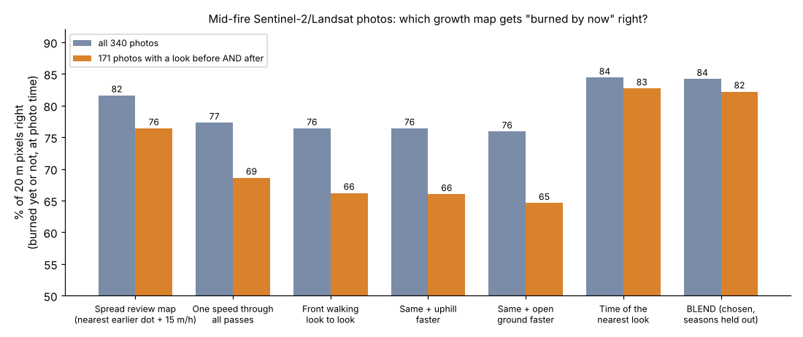
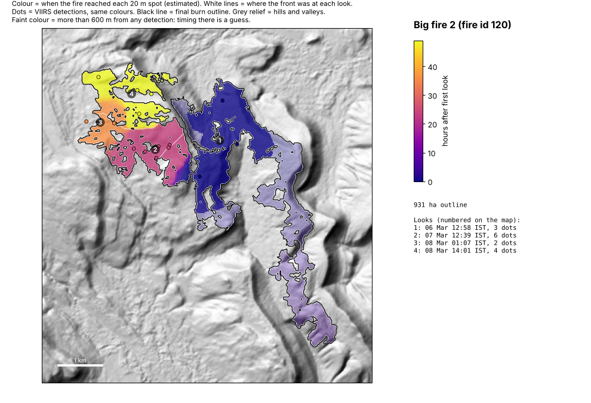
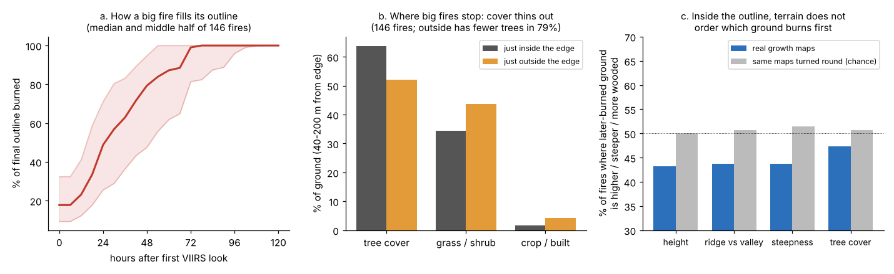
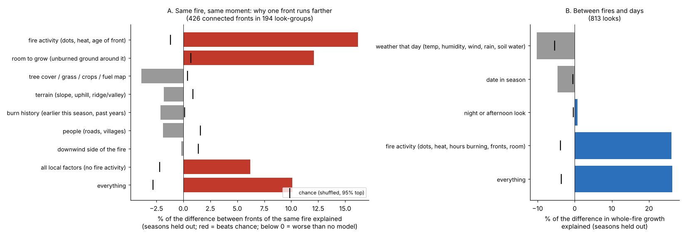

# Fire continuity: from separate dots to a continuous growth map (16 Oct 2026)

Asked by Akkshay (16 Oct 19:54Z): can the big-fire detections be turned into one continuous picture of how each fire grew, with terrain as the background?

**Truth used:** 340 mid-fire Sentinel-2/Landsat photos (288 fires, 2017-24, ~10:30 IST), each showing what had burned by that minute. None of the methods was fitted on them; the one choice made on photos was made with each season held out. Outlines: scar outlines v2. Terrain: 20 m SRTM grid (`ratapani/spread/data_shared/grid20.npz`). Scripts in `scripts/`, numbers in `results/`, pictures in `figures/`.

## Bottom line (plain words)
1. **Yes, every big fire now has a continuous "when did the fire reach this spot" map at 20 m**, drawn over the hills and valleys. All 146 big fires: [figures/growth_atlas.pdf](figures/growth_atlas.pdf), one page each, in the same order as the big-fires atlas.
2. **The best map is the simplest honest one.** Each satellite look "pulls" nearby ground towards its own time. Distance is walked inside the burn outline, and night counts for less than afternoon. We call it the **blend** map.
3. **It is better than the old map mainly when there is a look after the moment you ask about.**
   - All 340 photos: **84% of pixels right**, against 82% for the spread review's map. The gain is +2.6 points (95% range 0 to +5).
   - The 171 photos with a look before AND after: **82% against 76%**. The gain is +5.8 points (95% range +2 to +9).
   - The plain "time of the nearest look" rule scores the same (84% / 83%). The blend just turns it into a smooth surface instead of patches.
4. **Terrain does not help.** Making fire walk faster uphill, slower downhill, faster in open ground or slower across roads makes the map worse or changes nothing. This holds on photos and on hidden satellite looks. It agrees with every earlier test: in Ratapani, wind and slope don't steer these litter fires. **So terrain stays a background for reading the map, not an input.**
5. **"One expanding front at one speed" does not fit these fires.** Fitting one speed per fire through every pass (all satellites, as the big-fires thread suggested) gives 77% / 69%, worse than the old map. The fitted speed is a median 25 m/h, which matches the photos, but the fire does not grow as a single front. New burning appears in patches.
6. **Satellite looks alone cannot judge the timing between looks.** Hiding a look and predicting it from the others gives errors of ~12 h for every method, the size of the gap itself. Only the photos can tell the methods apart.
7. **How much of each map is informed.** On a median big fire, 96% of the outline lies within 600 m walk of a detection (worst fire 63%). Ground farther away is drawn faint in the atlas, because its time there is a guess.

## How to read an atlas page

- **Colour** = hours after the first VIIRS look when the fire reached each 20 m spot. Dark = early, yellow = late.
- **White lines** = where the front was at each look.
- **Numbered dots** = the VIIRS detections of each look. The table on the right gives each look's time in IST.
- **Faint colour** = more than 600 m from any detection.
- **Grey relief** = SRTM hillshade (light from the north-west).

## Methods compared (all 20 m, all inside the fire's final outline)
| method | idea | all photos | look before AND after | big fires |
|---|---|---|---|---|
| spread review map (baseline) | nearest earlier footprint + 15 m/h straight line | 82% | 76% | 79% |
| walking version of the baseline | same, but walking inside the outline | 82% | 78% | 80% |
| front walking, look to look | front walks from all seen so far to the far side of the next look's footprints, one speed per gap | 73-78% | 60-70% | 66-74% |
| + terrain cost (uphill ±, open ground ±, roads slow) | same, with walking cost by terrain | 76-77% | 65-67% | 71-73% |
| one speed through all passes | front distance vs time fitted through every sensor pass | 77% | 69% | 72-73% |
| time of the nearest look | step map, uses looks before and after | 84% | 83% | 83% |
| **blend (chosen)** | every look pulls the pixel's time, weight 1/(walking distance)^4, on the burning clock | **84%** | **82%** | **83%** |

- "Chosen" means it was picked on the other seasons' photos and scored on the held-out season. The pick was blend in 4 seasons and nearest-look in 4.
- Full table with ranking scores and burned-share errors: `results/photo_summary.csv`. Confidence ranges: `results/photo_choice.json`.
- **Why the front methods fail.** The front reaches the far edge of each 375 m block. That makes it run ahead, so the share burned at photo time comes out too high (+18 to +33 points when there is a look after the photo). The burning clock fixes part of this but not enough.

**Burning clock** (`results/diurnal.json`). It comes from MODIS detection counts in Ratapani, February to June: Terra about 11:00 and 22:30 IST, Aqua about 13:45 and 02:15 IST. Fire activity peaks around 15:00 IST and falls to about 8% of the peak late at night. Between the 01:30 and 13:30 looks, only about half of that gap's burning has happened by 10:30. The photos were never used to set it.

## Limits
- **Fire edges partly show where staff put fires out, not only where fuel ran out.** The map shows when fire reached a spot, not why it stopped.
- **The photos were taken at 10:15-10:50 IST.** So "right at photo time" mostly tests the night-to-afternoon gap.
- **The photo truth comes from the research thread's burn-label rasters.** These are smaller than the v2 outlines.
- **VIIRS only feeds the maps.** MODIS and the Sentinel-2/Landsat hot pixels made placement slightly worse in the big-fires thread, and here they only entered the one-speed fit.
- **The atlas is 2017-26 Ratapani only.** The 2026 alerts partly lack pixel sizes, so 375 m was assumed.

## Files
- `scripts/c0_lib.py`: grid, terrain, walking graph, burning clock, the front, one-speed and blend maps.
- `scripts/c0b_scars.py`: rebuilds each fire's outline from v2. The pickle is kept outside the shared folder.
- `scripts/c0c_diurnal.py`: the burning clock.
- `scripts/c1_photos.py`: scores every method on the photos.
- `scripts/c2_hidden_looks.py`: the hidden-look test.
- `scripts/c3_maps.py`: atlas and per-fire GeoTIFFs (band 1 = arrival hours, band 2 = bracket width). These are kept in the container to save shared space; rerun with `save` to write them to `results/maps/`.
- `scripts/c4_choose.py`: picks the method with seasons held out.
- `scripts/c5_summary.py`: chart and coverage table.
- Rerun: `FC_SCRATCH=<dir> python3 c0b_scars.py && python3 c0c_diurnal.py && python3 c1_photos.py && python3 c4_choose.py && python3 c3_maps.py '{"p":4,"clock":true}'`.

## Patterns in how big fires grow (16 Oct, 21:13Z ask; `scripts/c6_patterns.py`, `c7_pattern_fig.py`)
Read from the growth maps of the 146 big fires. Each 20 m pixel goes to the VIIRS look whose blocks are nearest by walking inside the outline. This step uses no speed and no day/night clock. Numbers: `results/patterns.json`, `patterns_fires.csv`, `patterns_looks.csv`. Direction and speed models are in the big-fires thread (README section 11) and are not repeated here.

| pattern | result | holds? |
|---|---|---|
| **The first look sees only a small part** | the first look's blocks cover a median 18% of the final outline (middle half 9-32%) | yes |
| **Fires grow in one or two big pushes, not evenly** | the two biggest looks hold half the outline in the median fire; the biggest single look holds 39% | yes |
| **Most ground burns in the first two days** | half the outline by ~24 h, 90% by ~71 h; day 1 25%, day 2 22%, day 3 17%, then little | yes |
| **The biggest push shows up at the afternoon look** | excluding fires whose biggest look is the first one: afternoon look (~13:30) 79 fires, night look (~01:30) 26. The looks themselves split 58:42, so afternoon is about 2x over-represented | yes, but ground per hour of gap is similar (4.5 vs 4.1 ha/h). Read as "big pushes become visible by afternoon", not proven daytime spread |
| **Growth is patchy: new fronts, not one ring** | 60% of big fires at some point show 2 or more new fronts more than 1 km apart in the same look (22% of looks). A median 40% of each look's new ground lies more than 600 m from anything burned before. This is highest at the 2nd look (60%) and falls to 18% by the 6th | yes. Matches the FSI finding that 1-2 km jumps are mostly separate starts by people |
| **Fires stop where tree cover thins** | just outside the edge: 52% trees vs 64% just inside; grass/shrub 44% vs 34%. Outside has fewer trees in 79% of fires. This holds at edges with no crop outside | yes (p < 10⁻¹¹). It may partly be the outline missing lighter burns in open ground |
| **Fires stop at slightly lower ground (drainage lines)** | just inside the edge sits 2.0 m above its surroundings, just outside 0.5 m below. 68% of fires | yes but small. Could be moister valley ground or streams; can't separate from suppression |
| **Roads at the edge** | 0.4% of ground just outside vs 0.1% just inside | small; crews and roads can't be separated |
| **Ground that burned earlier this season stops the fire** | 7% just outside vs 10% just inside, no difference (p 0.97) | **no** (the burn-label rasters undercount, so not a strong no) |
| **Inside the outline, terrain sets which ground burns first** | correlation of burn time with height, ridge/valley, steepness, tree cover: 43-47% of fires positive, against 50-51% when the same maps are turned round | **no** (p 0.2-0.75). A faint lean to burn higher ground first, not significant |
| **Season** | median 6 ha/h in March (111 fires) vs 7 ha/h in April (26) | too few April/May fires to say |

**What this adds up to, in plain words.**
- A big fire is not one front creeping evenly out of a start point.
- It shows up small, then makes one or two big pushes, mostly visible by an afternoon look, over its first two days.
- While it does this, it often has new fronts appearing a kilometre or more away.
- It runs through tree cover and stops where cover opens out or the ground drops into a drainage line.
- Within the burned area, hills, slopes and cover do not decide which part burns first.

The practical reading for field staff:
- The first night look shows a fifth of what will burn.
- Expect the main push by the next afternoon.
- Watch for new fronts 1-2 km away, not only the edge.
- Open ground and drainage lines are where these fires end on their own.

## Why some fronts run farther than others (17 Oct, 07:51Z ask; `scripts/c8_front_features.py`, `c9_front_drivers.py`)
**Fronts.** These are the spread thread's fronts (`ratapani/spread/multi_front/`): dots linked within 750 m. A front's **growth** is the ground newly burned within 1 km of it in the next 24 h, read from the blend map.
- 1,310 active fronts at 813 looks of the 146 big fires.
- **Separate starts are left out of the main test** (fronts that appear more than 750 m from anything earlier). The spread thread found most of these are new ignitions that later merged, so they are not spread.

**The ground around each front.** All ground within 1 km is measured, not only the final outline, so the outline can't leak the answer. Layers:
- tree, grass and crop share, and fuel map v3;
- slope, uphill (height around the front minus height at its dots), and ridge vs valley;
- burned earlier this season, and burned in past seasons;
- roads, and distance to villages;
- whether the front is on the downwind side of the fire (ERA5 06 UTC wind).

**Test.** Fronts are compared only with other fronts of the **same fire at the same look**. Weather, season and fire-wide suppression are then identical, so only local factors can explain the difference. Every score is on seasons held out. Each factor is checked against the same factor shuffled among the fronts of each look.

**Where the differences sit** (log growth, all fronts):

| level | share of the variation |
|---|---|
| between fires | 9% |
| between looks of the same fire (early vs late in its life) | 67% |
| between fronts of the same fire at the same look | 24% |

**Same fire, same moment** (426 connected fronts, 194 looks with 2 or more fronts):

| factor | share of front-to-front difference explained | chance (95% top) | verdict |
|---|---|---|---|
| fire activity now (dots at the latest look, heat (FRP), age of the front) | 14-16% | ~0% | **yes** |
| room to grow (unburned ground around it) | 10-12% | ~1% | **yes** |
| tree cover / grass / crops / fuel map | below 0 | 0% | no |
| terrain (slope, uphill, ridge/valley) | below 0 | 1% | no |
| burn history (earlier this season, past years) | below 0 | 0% | no |
| roads and villages | below 0 | 2% | no |
| downwind side of the fire | about 0 | 1% | no |
| all local ground factors together | 3-6% | 0% | mostly room to grow |
| everything | 6-10% | 0% | **~90% unexplained** |

**Single factors** (rank correlation within a look, connected fronts, 95% range by fires):
- dots at the latest look +0.41 (0.29 to 0.52);
- heat (FRP) +0.39 (0.28 to 0.51);
- room to grow +0.36 (0.24 to 0.47);
- age of front +0.16 (0.03 to 0.30);
- weak leans, all with ranges crossing 0: downwind side +0.16, fuel map +0.14, tree cover +0.10, slope +0.09, burned earlier this season −0.09.

**Between fires and days** (whole-fire growth, 813 looks):
- **Weather that day explains nothing** on held-out seasons (temperature, humidity, wind, 7-day rain, soil water). Single correlations are at most 0.07.
- **Date in season explains nothing.**
- **The fire's own state explains 26%.** The main part is hours burning: fires slow down as they age (−0.44). Then dots and heat at the latest look (+0.33, +0.25).
- Night vs afternoon look: nothing.

**In plain words.**
- **Which front runs farther is decided mostly by how actively it is burning now and how much open, unburned ground it has around it.** A front with many bright dots and plenty of unburned forest ahead keeps going. A front hemmed in by ground that has already burned stalls.
- **The ground itself barely matters once that is known.** Cover, fuel map, slope, uphill, ridges and valleys, burn history, roads, villages and the wind side each explain nothing beyond chance. This matches every earlier test: these litter fires creep through a fairly uniform fuel bed.
- **About 90% of the front-to-front difference stays unexplained.** The likely reasons are things we don't measure:
  - crews putting out some fronts and not others;
  - local wind and moisture at a scale far finer than ERA5's 9 km daily mean;
  - VIIRS missing a front for a whole pass (a leafy crown at a slant angle is seen about a third as often).
- **Weather sets how much heat a fire gives off** (heat thread) but **not how far its fronts run** in our data. Our weather is one number for the whole sanctuary per day, which is too coarse to test this properly.

**Limits.**
- "Fire activity now" partly describes the front rather than causing its growth: a front that is burning hard is the one that keeps burning.
- Growth comes from the blend map, so it is only as sharp as the looks allow.
- 9 of 10 fires happened in March, so the season range is narrow.

## Where fronts stop: pixel-level rays (Oct 17, redo after "not satisfied")

**Question.** When a front spreads out from where it was first seen, what does the ground look like at the exact 20 m spot where it stops? And can the ground tell us in advance which direction runs farthest?

**Why this method.** The earlier front-driver test averaged ground over a 1 km circle and used growth from the blend map. That blurred direction and leaned on our own reconstruction. Here the truth is the burn-scar edge itself (v2 outlines), read pixel by pixel.

**Method.**
- **Fronts:** 665 fronts from the 146 big fires. A front is a group of dots linked within 750 m: either the first look, or a later group more than 750 m from anything seen earlier.
- **Rays:** from every front, 36 rays (one every 10°), stepped out in 20 m steps up to 4 km.
- **Ownership:** each front owns only the ground closer to it than to any other front of the same fire.
- **Stop:** the first point where 60 m in a row is unburned.
- **Size:** 470,000 steps where the fire was still moving, with 17,760 stops.
- **What each step records:** what the next pixel is (cover, fuel map, grade along the ray, ridge or valley, road, village, past burns, ray direction against wind).

**Pattern-finding tools.**
1. **Matched stop odds (Mantel-Haenszel):** compare stops on ground X vs not X, only within the same front and the same distance band. This cancels fire size, weather, date and crews working the whole fire. The 95% range comes from resampling whole fires.
2. **Boosted-tree hazard model (LightGBM):** whole seasons held out. It is scored on where stops happen and on which of the 36 directions ran farthest.
3. **Decision-tree rules:** each rule's lift is checked separately in every season.
4. **Front shapes:** elongation axis compared with terrain grain (structure tensor of elevation) and with wind. Shape profiles are clustered with KMeans.

Scripts: `scripts/c10_rays.py`, `scripts/c11_ray_patterns.py`. Results: `results/ray_patterns.json`, `results/ray_origins.csv`. Figure: `figures/ray_patterns.png`.

### What stops a front (same front, same distance from start)
Overall, a moving front has a 17.5% chance of stopping in the next 100 m.

| ground the front runs into | stop odds vs other ground (95% range) | stop chance per 100 m |
|---|---|---|
| road within 40 m | **3.3x** (2.2-4.6) | 39% |
| leaving forest (trees behind, open ground ahead) | **2.1x** (1.9-2.3) | 31% |
| crop / built | 1.8x (1.2-2.8) | 22% |
| grass / shrub | 1.7x (1.5-1.8) | 21% |
| valley floor (10 m below surroundings) | 1.5x (1.3-1.7) | 22% |
| village within 1 km | 1.4x (1.1-1.7) | 28% |
| going downhill (>5%) | 1.3x (1.2-1.4) | 20% |
| downwind / upwind side | 1.06x / 0.92x (both cross 1) | no effect |
| going uphill (>5%) | 0.88x (0.78-0.97) | 16% |
| high fuel-map value (top quarter) | 0.88x (0.80-0.97) | 17% |
| ridge / upper slope | 0.77x (0.68-0.87) | 15% |
| ground burnt in most past seasons | **0.60x** (0.52-0.69) | 11% |
| tree cover | **0.59x** (0.53-0.66) | 15% |

The "burned earlier this season" row (0.27x) is **circular and dropped**. Scar outlines and old-burn labels come from the same burn map, so earlier-burnt patches get merged into the outline.

**The pattern in plain words:**
- **Fronts run through forest and stop where forest ends.** Under trees the teak litter carries the fire. Where the trees end (grass, crops, roads, village edges) the front is 2-3x likelier to die.
- **Fronts climb and stop in valleys.** They keep going uphill and along ridges. They die going downhill and on valley floors, which are moister and often hold streams and fields.
- **Ground that burns most years carries fire best.**
- **Wind side does not matter at all.** ERA5 wind is one value for the whole area, so local wind is not tested.

**Caveats:**
- Roads and village edges are also where crews stop fires, so part of that effect is suppression.
- "Often burnt" ground is also where the burn map sees burns most easily, so part of it may be detectability.

### Can the ground tell which way a front will run? (seasons held out)
| method | picks the farthest-running direction (+/-10°) | rank agreement across 36 directions (median) |
|---|---|---|
| chance | 8.8% | 0 |
| uphill only | 10.6% | +0.07 |
| tree cover only | 11.8% | +0.12 |
| ridge only | 11.9% | +0.09 |
| downwind only | 6.9% | -0.03 |
| **model with all ground layers** | **19.2%** (2.2x chance) | **+0.18** (positive for 66% of fronts) |

- **Where a stop happens:** distance and front state alone score AUC 0.57; adding ground raises it to 0.65 (same front and distance band: 0.57 to 0.65).
- **Biggest model inputs, in order:** past-burn frequency, distance already run, tree cover, ridge/valley position, front heat, grade.
- **The ground clearly matters, but it is a lean, not a map.** It picks the right direction about one time in five.

### Rules found by the decision tree (lift checked in every season)
- **Most stop-prone ground** (stop 38% per 100 m, 2.4x): rarely-burnt, valley, going downhill, no trees. Lift 1.5-3.0 in every season.
- **Also stop-prone:**
  - grass just past a forest edge: 1.8x;
  - valley going downhill even under trees: 1.6x.
- **Least stop-prone** (9% per 100 m, 0.5x): often-burnt ground, first 330 m, not grass. Lift 0.4-0.8 in every season.

### Shapes
- **Elongation:** fronts are mildly stretched; median long/short ratio 1.31, and 53% exceed 1.3.
- **Terrain grain:** where terrain has a clear grain, the long axis runs **along the ridges and valleys** in 50% of fronts. Chance is 33% (95% top of chance 39%).
- **Wind:** the long axis does not follow wind (27%, below chance).
- **Uphill:** the longest lobe points uphill slightly more often than chance (30% within 45° vs 25%).
- **Shape types:** clustering finds no real separate types (best silhouette 0.16). Fronts vary smoothly from round to one-sided.

**Net answer to "why do some fronts run farther":**
- **What carries a front and what stops it:** at the 20 m scale, ground does decide where fronts stop. Continuous forest, ridges and uphill, and often-burnt teak carry a front. Forest edges, roads, crops, valleys and downhill stop it. Wind side and the fuel map do not matter.
- **How far ground gets you in advance:** it explains where a front stops only modestly (AUC 0.65) and picks the farthest direction 2x better than chance.
- **What decides how far a front runs in total** is still mostly its own heat, the time it has and the room it has (previous section).

### Does it help predict the burn scar? (Oct 17, `scripts/c12_ray_outline.py`, `results/ray_outline.json`)
**Test.** For 571 fronts, the predicted scar edge on each of 36 rays is the expected distance before stopping. It comes from the hazard model trained on the other seasons. Overlap with the true scar is scored per front, with a fire bootstrap.

| outline | overlap with true scar |
|---|---|
| fixed circle (typical reach) | 0.347 |
| circle from front state only (no ground) | 0.343 |
| **ray model with ground** | **0.348** (+0.005, range -0.004 to +0.013) |
| true size, circle shape | 0.409 |
| true size, ray-model shape | 0.416 (+0.007, range +0.002 to +0.012; better for 55% of fronts) |

**Verdict: almost no help.**
- **Shape:** ground nudges the shape the right way, but the gain is about 1 point of overlap.
- **Size:** ground does not predict how far the whole fire goes. Size is what drives scar overlap, and it depends on fire activity, time and suppression.
- **Agreement:** this matches the spread thread, where barrier inputs lifted the learned outline 0.50 to 0.53.

### Seeding at block edges (Oct 17, big-fires 14c; `scripts/c13_edge_seed.py`, `results/edge_seed.json`)
**Prompt.** Big-fires found that hot pixels sit at the edge of their VIIRS block or just outside it. So I re-scored the chosen blend map on the same 340 photos with different seeds. The 95% ranges come from a fire bootstrap.

| seed | pixels right (all 340) | vs current | photos with looks before and after (171) |
|---|---|---|---|
| **whole block (current)** | **84.9%** | - | **83.6%** |
| outer 100 m ring of each look's cluster | 84.6% | -0.2 (-0.4 to -0.1) | 83.1% |
| dot centre only | 84.4% | -0.5 (-1.1 to +0.1) | 82.6% |
| block widened 125 m | 83.7% | -1.2 (-1.9 to -0.5) | 81.2% |
| block widened 250 m | 81.8% | -3.1 (-4.4 to -2.0) | 77.4% |
| ring of widened cluster | 82.6% | -2.3 | 79.1% |

**Verdict: no change.**
- **Why the current seed already is an edge seed:** the walking distance to a block is the distance to its nearest edge.
- **Ring:** dropping the cluster interior loses slightly.
- **Widening:** pushing seeds outward toward where hot pixels actually sit makes the map run ahead of the fire and loses 1-3 points.
- **Small block-only gain:** the whole block beats the dot centre by 0.5 points, which is consistent with the edge finding.
- **Stop rays:** not re-run. They already start where each ray first enters the burned outline, not at the cluster centre. Their inputs are properties of each 20 m pixel, so only the "distance run" input would shift.
- (The current block scores 84.9% here vs 84.2% in c1 only because the window margin is 900 m instead of 600 m.)

### Runway map test: does the "open side" really run farther? (Oct 17, `scripts/c14_runway.py`, `results/runway.json`)
**Setup.** Each front is split into 9 sectors of 40°.
- **"Open side":** the sector with the longest reach predicted by the ray model trained on other seasons.
- **"Stop side":** the sector with the shortest predicted reach.
- **Truth:** how far each sector actually burned to the scar edge.
- **Range:** 95% over fires (bootstrap). Chance is 50%.

| rule | open sector burned farther than stop sector | open half > other half | open sector burned past 500 m vs stop sector |
|---|---|---|---|
| ray model (all ground), 571 fronts | **61%** (57-66) | 57% (54-61) | 45% vs 25% |
| ray model, first-alert fronts (149) | 59% (51-68) | 56% (48-64) | 46% vs 30% |
| "side with most tree cover" only | 61% (57-66) | 58% (53-62) | 42% vs 34% |
| "uphill side" only | 57% (52-61) | 56% (51-60) | 38% vs 30% |

**Verdict: beats chance, but not by enough for a crew to act on alone.**
- **Hit rate:** it is right about 6 times in 10 (a coin flip is 5).
- **Practical difference:** the predicted open side ran past 500 m about twice as often as the stop side (45% vs 25%). That is real but loose.
- **A simple rule does as well:** "the side with the most continuous forest" matches the full model. The model adds nothing a forest guard doesn't already see on the map.
- **Use:** at most a tie-breaker hint on the alert card ("open forest to the N/NE; road 300 m to the S"), not a dispatch rule.

### Runway map, attempt 2: a model trained directly on "which way ran farther" (Oct 17 evening, `scripts/c15_runway2.py`, `results/runway2.json`)
**New inputs per direction**, all static and known at alert time:
- distance along the ray to the first road, forest edge, crop and valley floor;
- tree cover, grade, ridge/valley, how often it burnt in past seasons, fuel and slope over 0-300 m and 300-1000 m;
- ray vs wind;
- momentum (ray vs direction from the fire's earlier dots);
- "hot side" (FRP-weighted offset of the front's own dots) and the dots' long axis.

**Models:** LightGBM LambdaRank and a within-front regression, seasons held out.

**Leak found and removed.** The first run scored 72-74%. That was inflated because the features had been measured from where each ray enters the scar, and only up to where a neighbouring front cuts the ray. Both depend on the outcome.
- **Rebuilt:** features are now sampled from the dot centre along the full 2 km ray.
- **Scored on real stops only:** rays cut by a neighbour or the window are dropped from scoring.

| rule (real stops only, seasons held out) | open sector burned farther (95% range) | first-alert fronts | open sector past 500 m vs stop sector |
|---|---|---|---|
| chance | 50% | 50% | - |
| most tree cover | 59% (55-64) | 56% | 33% vs 23% |
| hazard model (c14) | 64% (60-68) | 60% | 39% vs 16% |
| **ranker, ground along the ray** | **63% (59-67)** | **63% (54-70)** | 34% vs 19% |
| **ground + dots, regression** | **66% (62-70)** | 62% | 38% vs 18% |
| dots only (momentum, hot side) | 58% | 59% | 33% vs 24% |

**Verdict: a small real gain, from about 6 in 10 to about 6.5 in 10.**
- **What helps:** distance to the first road or forest edge along the ray helps a little.
- **Momentum:** its apparent value in the first run was mostly geometry (rays pointing back toward earlier fronts were cut short).
- **First alerts:** the model stays about 63%, a few points above "most forest cover".
- **Bottom line:** still a hint for the alert card, not a dispatch rule. This is at the limit of what the scars and 375 m dots can say.

### VIIRS "looked, clear, no fire" pixels as a correction (Oct 17 night, `scripts/c16_nofire.py`, `results/nofire.json`)
**Data.** VNP14IMG/VJ114IMG mask tables from the VIIRS fire masks thread: classes 3 and 5, about 3.1 M clear no-fire pixels near 1,317 fires.

**Rule.** Where the growth map says a 20 m pixel was burning within D hours before a clear no-fire look, move that pixel's arrival to the next VIIRS fire look.

**Scoring.** Same 340 photos.

| D | pixels flagged as conflicting | pixels right (current 84.9%) | change (95% range) |
|---|---|---|---|
| 1.5 h | 25% | 82.9% | -2.0 (-3.2 to -0.8) |
| 3 h | 30% | 82.4% | -2.4 (-3.8 to -1.1) |
| 6 h | 35% | 82.0% | -2.8 (-4.4 to -1.4) |

**Verdict: it hurts.**
- **Pixels it touches:** on the flagged pixels the map was right 82% of the time before the change and 78% after.
- **Why:** a quarter of all burned ground sits under a "clear, no fire" pixel at the very look that should have seen it. VIIRS simply misses much of the burning, as the masks thread found: clear no-fire passes come before renewed fire 40% of the time.
- **Decision:** the masks give no usable "not burning here" constraint for 20 m timing. Keep the current maps.

## Fires that go dark between passes: put out and restarted, or burning too weakly to see? (18 Oct, c17)

Script `scripts/c17_dark_gaps.py` (scene list `scripts/c17a_scenes.py` -> `results/s2ls_scenes.csv`, 1,600+ S2/Landsat scenes, cloud < 80%; looks use < 30%). Results `results/dark_gaps.json`, per gap `results/dark_gaps.csv`. 1,317 fires, 28,173 VIIRS passes with masks. A "dark gap" = seen, then 1+ passes not seen, then seen again (1,518 gaps); "end" = never seen again within 36 h (1,300).

**Verdict: mostly the same fire still burning, too weak for VIIRS. Little sign of "put out, then a new fire".**

1. **Where it comes back.** Distance from the returning dots to the fire's earlier dots grows with the dark time just as normal spread does (270 m after < 3 h, 457 m after 8-14 h, 695 m after 14-26 h). Fires seen on two passes 8-14 h apart with nothing in between move 460 m, the same. Gaps seen "clear, no fire" and gaps hidden by cloud come back the same distance (jump > 1 km: clear minus cloud -2.5 pts, CI -10 to +6). If "clear" meant "out, then new fire", clear gaps would jump farther. Far returns are not nearer roads (1,181 m vs 1,200 m for all dots) and come back at the same hour mix.
2. **30 m look inside the gap** (hot pixels within 1 km of the fire's dots). Between two passes that both saw fire: 80% of scenes. Inside clear dark gaps that came back: 65%. 3-10 days after a fire ended (false-alarm floor): 8%. So the fire was still alive during **79% (65-97%)** of clear dark gaps, 66% (54-77%) of all dark gaps. Even after VIIRS sees a fire for the last time, it is still burning at 30 m in **39% (32-46%)** of scenes in the next 36 h.
3. **Who gets missed** (passes on fires seen within 24 h before and after). Day 65% seen, night 49%. Straight down 66%, slanted > 50 deg 51%. Night detections median 1.5 MW against 6.1 MW by day; 26% of all detections are < 2 MW, close to the VIIRS floor. By day the chance of being seen follows the heat of the last detection (54% after < 2 MW, 78% after > 8 MW). Fires before a dark gap are weaker (3.8 MW) than before a seen pass (4.8 MW).
4. **Null: random coin-flip misses on a fire that keeps burning** (shuffle seen/missed within day and within night passes, 200 runs). Observed: fewer 1-3 pass dark runs (556 vs 734 single misses) and twice as many 8+ pass runs (87 vs 40, range 34-48). Fires have real quiet spells lasting a day or more, beyond random misses. Tests 1-2 say those spells are low-heat burning in place, not a new start.

What satellites cannot tell: smouldering under the litter vs small creeping flames. Both are "too weak for a 375 m pixel"; the 30 m hot pixels at 10:30 IST show something hot and glowing is there. "Crews put it out" cannot be ruled out for the 1 in 5 clear gaps with no 30 m heat, nor for the ends. Use for the product: a VIIRS "no fire" does not mean out; keep a dark front alive for at least a day, more if the last dots were weak or at night.

## "Still burning" chance for a fire VIIRS has stopped seeing (18 Oct, c18)

Script `scripts/c18_still_burning.py`; results `results/still_burning.json`, rows `results/still_burning_rows.csv`. Truth: 1,505 S2/Landsat scenes (cloud < 30%) over 865 fires, each taken while the latest VIIRS pass had missed the fire. "Burning" = a 30 m hot pixel within 1 km of the fire's dots so far. Inputs use only what was known before the scene. Held out by season.

| hours since the last VIIRS dot | scenes | still burning |
|---|---|---|
| 6-12 h | 288 | 62% |
| 12-24 h | 456 | 33% |
| 24-48 h | 385 | 16% |
| 48 h+ | 376 | 9% (about the 8% false-alarm floor: other fires nearby) |

- Model (held out by season): LightGBM AUC 0.77 (0.75-0.80) against 0.74 for hours dark alone. Brier 0.160 vs 0.202 for a constant.
- Calibrated: said 26% -> real 29%, 42 -> 37, 57 -> 57, 72 -> 71.
- Hours dark carries almost all of it. The heat of the last dot adds little: at 6-12 h, a weak last dot gives 61% and a mid one 71%. "Last dot at night" reads 37% vs 22% only because night dots are fewer hours before the 10:30 scene.
- Rule of thumb: keep a dark fire "probably burning" until the next afternoon pass (about 24 h), and treat it as out after 48 h.
