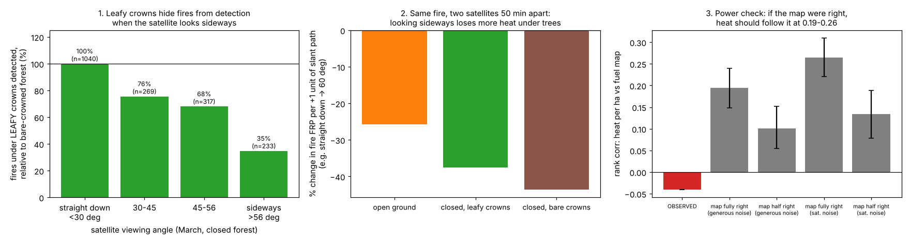
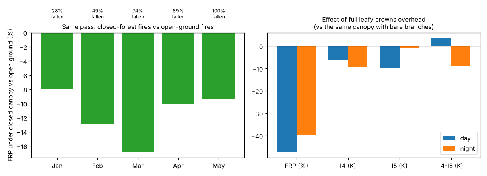
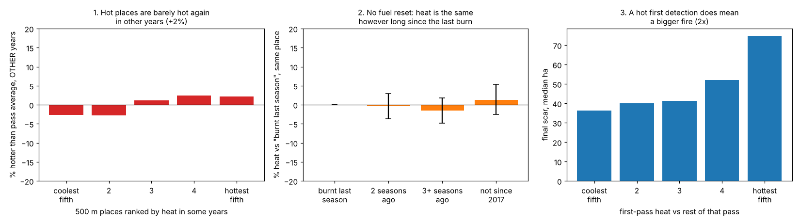
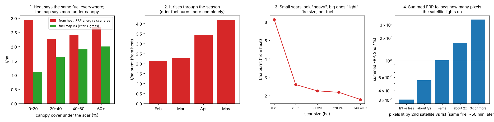

# Fuel from heat: can FRP and brightness on the final scar tell fuel load? (16 Oct 2026)

Asked by Akkshay (16 Oct 21:00Z): we know the final scar and the detection squares on it, so we know which part was burning and how much. Correlate that with FRP (and the brightness channels) and see if it gives fuel load, since heat released reflects fire intensity.

**Short answer: no usable fuel map comes out of it.** The heat does follow how much ground was burning. But once that is divided out, what is left follows the season, the weather, the fire's size and the satellite. It does not follow where the fuel is. One thing does hold: the total amount, about 2-2.5 t/ha burnt, matches the fuel map's level.

## Big-fire early warning from the first alert (17 Oct 2026, next step 1)

**Question.** At a fire's first satellite pass, what is the chance it ends as a big fire (final scar 200 ha or more; 15% of 2,640 Feb-Jun fires)? Does the heat of that pass add anything?
- Uses only what is known at that moment: the first pass's dots, the ground under those dots, last season's burns there, other fires within 10 km in the previous 3 days, and that day's weather.
- Tested honestly by holding out each season in turn (`scripts/h18_bigfire_warning.py`, results/bigfire_warning.csv/.json, figures/bigfire_warning.png).

| what the warning uses | AUC | flag 10% of new fires: big fires caught |
|---|---|---|
| date only | 0.51 | 7% |
| date, ground, weather, nearby fires (no heat) | 0.60 | 11% |
| number of dots in the first pass only | 0.61 | 27% |
| heat (dots, FRP, relative heat, pixel size) | 0.67 | 28% |
| everything | 0.69 | 27% |

**The useful part is the number of dots, not the FRP:**

| first pass | fires | became big (200 ha+) |
|---|---|---|
| 1 dot | 1,690 | 10% |
| 2 dots | 607 | 15% |
| 3-4 dots | 261 | 33% |
| 5+ dots | 82 | 62% |

- **Stable:** the order holds in every season, 2017-2026. With three satellites (2023+), 5+ dots gives 47% rather than 67%.
- **Heat adds little once dots are counted:**
  - Among 1-dot fires, cool / middle / hot-for-its-pass give 10 / 11 / 12% big.
  - Inside 1-dot fires, FRP gives AUC 0.51.
  - The earlier "hot first pass = 2x scar" finding (section "Second method") was mostly the extra dots that come with hot passes. It is corrected here.
- **The % is honest:** held-out "said" vs "happened" were 4/6, 7/10, 14/14, 24/22, 38/35 and 60/63%.

**For the field system:** "3+ dots at the first alert = about 1 in 3 becomes a big fire; 5+ dots = more than half" is a simple, calibrated flag. It covers 13% of alerts and catches 34% of the big fires.

## Geostationary heat: Meteosat every 15 minutes (17 Oct 2026, Akkshay: "try it")

**Data.** LSA SAF Meteosat Indian Ocean (IODC) FRP-PIXEL product, every 15 min, 1 Feb-30 Jun 2018-2026: 127,000 files, 256k fire pixels in the MP box. It needs a free login, which lives only in the session and is never stored. Kept in scratch, outside the shared folder. Meteosat sees Ratapani at 45 deg with pixels of about 4-5 km. `scripts/h17_seviri.py`, `h17b_seviri_vs_viirs.py`, figures/meteosat.png.

**1. Same-moment check: does Meteosat see what VIIRS sees?** For 19,832 VIIRS fire clusters, did Meteosat report a fire within 5 km in the same 15 minutes?

| fire's heat at the VIIRS pass | clusters | also seen by Meteosat | share of VIIRS heat |
|---|---|---|---|
| 0-5 MW | 9,327 | 0.6% | 8% |
| 5-20 MW | 7,566 | 1.2% | 29% |
| 20-80 MW | 2,479 | 4% | 33% |
| 80-160 MW | 292 | 18% | 12% |
| 160+ MW | 168 | 48% | 19% |
| **all** | 19,832 | **2.0%** (day 2.5, night 1.1) | 14% |

When both satellites see a fire, the rank correlation of their FRP is 0.42. Meteosat reads about 3x VIIRS, because only fires that happen to be bright get through its threshold.

**2. Per fire.** 188 of the scar fires got at least one Meteosat pixel. By scar size: under 30 ha 1.7%, 60-120 ha 6%, over 240 ha 36%. The median fire got only 2 slots of 15 minutes.
- Energy summed every 15 min = **0.24 t/ha**, against 2.6 t/ha from VIIRS on the same 158 fires. **Meteosat catches about 9% of the heat.**
- Night is invisible: night/day heat is 0.02, against 0.24 from VIIRS.
- Energy vs scar area: exponent 0.47 (0.30-0.64), no better than VIIRS.
- Fuel map: rho +0.07 (-0.07 to +0.24). Canopy -0.15. The power is low because so few fires are seen.

**Verdict.** The "constant watching" satellite cannot see Ratapani's fires. Teak-litter fires burn at 5-20 MW per 375 m block, and Meteosat's 4-5 km pixel needs about 100 MW or more. So it sees only the peak minutes of the biggest fires and misses most of the energy, which makes it a worse energy count than VIIRS. INSAT-3D/3DR has the same 4 km class of pixel and a noisier 4 um channel, so it would hit the same floor; not pursued. Geostationary heat can serve only as a "big fire flaring now" alarm. It cannot measure fuel, and it does not rescue FRP-based fuel load. Fuel map v3 stays.

## FRP fuel load re-analysed with everything learnt (17 Oct 2026, final)

**Corrected problem statement.** Fuel burnt per hectare = 0.368 kg/MJ x the fire's total radiated **energy** / the ground it burnt.
- **Energy per area, not FRP per pixel.** FRP in one pixel = fuel per area x spread speed x front length. A fast grass fire with little fuel can therefore look as "hot" as a slow litter fire. Only total energy divided by total burnt area cancels the speed. This is why the second method's "hot places" were grassy: it measured intensity, not fuel.
- **The satellite's view of that energy has four measured biases, now corrected** (`scripts/h16_corrected.py`):

| bias | correction |
|---|---|
| viewing angle (same-fire pairs, h13b) | each detection scaled to its straight-down value. Log-slope per unit slant: -0.30 on open ground to -0.57 in closed forest |
| leafy crowns hide fires (h13) | **clean set** uses only leaf-off fires (80% or more of leaves fallen) |
| night under-counted by the clock | burning clock refitted to FRP's own night/day ratio of 0.24 (was 0.13) |
| swath-edge overlap, missed weak pixels | **clean set**: 70% or more of the fire's energy from passes within 30 deg of straight down |

**Results** (1,470 fires Feb-Jun with 2+ VIIRS passes; clean set 209 fires). Figure: figures/corrected_fuel.png.

| canopy under scar | heat, raw (t/ha) | heat, corrected | heat, corrected, clean fires | fuel map v3 |
|---|---|---|---|---|
| 0-20% | 2.6 | 3.1 | 3.0 (28 fires) | 1.1 |
| 20-40% | 2.2 | 2.4 | 2.7 (54) | 1.7 |
| 40-60% | 2.4 | 2.7 | 3.6 (79) | 1.9 |
| 60%+ | 2.6 | 2.9 | 3.2 (48) | 2.0 |

| test: corrected heat per ha vs fuel map | all fires | clean fires |
|---|---|---|
| observed rank corr | **-0.03** (-0.09 to +0.03) | **+0.01** (-0.13 to +0.13) |
| expected if the map were right | 0.20-0.26 | 0.25-0.32 |
| same, within the same size class and month | -0.03 | +0.05 |
| held-out seasons: adding the ground to size, season and weather | 49.3% -> 49.1% (shuffled 48.7%) | 38.1% -> 30.1% (worse) |

**The deciding finding: the measured energy does not grow in step with the burnt ground** (`scripts/h16b_size_scaling.py`):

| scar size | heat-based t/ha | passes |
|---|---|---|
| under 30 ha | **6.7** | 2 |
| 30-60 ha | 3.0 | 2 |
| 60-120 ha | 2.4 | 3 |
| 120-240 ha | 2.2 | 4 |
| over 240 ha | **1.9** | 6 |

Energy rises only as **area^0.45** (95% range 0.42-0.48), with month and number of passes held fixed. Doubling the burnt ground gives just 1.4x the measured energy. A real fuel measure would need about area^1.0.
- **Small scars look heavy because the scar under-draws small fires.** The scar check found most of the burnt ground missed on fires under 20 ha.
- **Big fires look light because most of their burning is never seen.** Litter fronts creep at 20-30 m/h and give a few MW, often below what VIIRS can detect, and they burn between passes. The satellite catches the bright moments, not the long weak burning.
- **This scale error (about 3.5x from small to big fires) is far bigger than the fuel difference we look for** (about 1.8x open vs closed in the map). It swamps any fuel signal, and no correction available from polar satellites removes it.

**Final answer to the FRP fuel load question**
1. **With every measured bias corrected, the heat still does not follow fuel.** This holds in the cleanest subset (leaf-off, straight-down fires), where the test had enough power to see the map if it were right. A map-like fuel pattern would give a correlation of 0.25-0.32; we see 0.01.
2. **The reason is now concrete, not a guess.** Polar-orbiting satellites capture the fire's energy in proportion to area^0.45, not area. FRE / area is therefore mostly a measure of fire size and pass sampling.
3. **The average level holds.** About 2.4-3.2 t/ha burnt, which agrees with the fuel map's ~2 t/ha and published Indian litter values (2.3-4.5).
4. **What it would take to make heat work:**
   - continuous FRP from geostationary satellites, to catch the whole burn (INSAT-3D/3DR, 4 km, every 15-30 min; not tried yet);
   - finer fire pixels that see the weak creeping fronts (Sentinel-2/Landsat 30 m hot pixels, which the project already has but only ~10:30 IST; FireSat-class constellations later);
   - measured fuel plots to calibrate against (the FSI request).
   Until then, **fuel map v3 stays the fuel layer**.

## Crown blocking measured by viewing angle (17 Oct 2026, the rigorous version)

**Why a new test.** The leaf-fall test (next section) has a built-in confound: a leaf that leaves the crown also becomes litter on the floor. This test uses physics instead. A ground fire under trees is seen through the gaps between the crowns. When the satellite looks sideways, its line of sight crosses more crown before reaching the ground. The amount of crown crossed grows as 1/cos(view angle), the same Beer-Lambert law used to measure leaf cover from gaps. **So if crowns hide fires, the hiding must grow as the viewing angle grows. Fuel, litter, grass, site moisture and ground temperature do not depend on where the satellite happens to be.** Viewing angle is therefore a fuel-free handle on blocking.

**View angle per detection.** VIIRS pixel length along the track grows with distance to the ground: 375 m straight down, up to 780 m at the swath edge. Satellite geometry then gives the view angle at the ground: 0 to 68 degrees. Half of all detections are within 34 degrees of straight down; the top 5% are beyond 63 degrees. Script: `scripts/h13_view_angle.py`, `h13b_angle_checks.py`, `h13c_month_check.py`.

### Result 1: leafy crowns hide fires from DETECTION when the satellite looks sideways (strong, robust)
This uses closed forest only (canopy 50% or more), in March, when leafy and bare-crowned stands burn side by side. Among closed-forest detections, the share of fires under still-leafy crowns falls as the view tilts:

| view angle | closed-forest detections | share under leafy crowns | leafy-crown fires detected, relative to straight down |
|---|---|---|---|
| straight down (<30 deg) | 1,040 | 54% | 100% |
| 30-45 deg | 269 | 47% | 76% |
| 45-56 deg | 317 | 44% | 68% |
| sideways (>56 deg) | 233 | **29%** | **35%** |

- With month and year held fixed, the odds of a closed-forest detection being leafy-crowned fall to **x0.44 per unit of slant path** (95% range 0.34-0.58). This holds by day (x0.46) and at night (x0.42).
- Bare-crowned closed forest keeps the same share of detections against open ground at every angle (14% straight down, 15% sideways). **So stems and branches alone don't stop detection; the leaves do.**
- **Plain:** a fire under a leafy closed canopy is seen about 1 time in 3 when the satellite looks from the side, compared with straight down.

### Result 2: once a fire is detected, sideways views also record less of its heat under trees
This uses the same fire seen by two VIIRS satellites 20-100 min apart from different angles, so the fuel is identical (2,433 pairs, 1,244 fires). FRP change per +1 unit of slant path (for example, straight down to 60 degrees):

| ground | FRP change | n pairs |
|---|---|---|
| open ground (baseline: bigger pixels, higher detection limit) | -26% | 403 |
| closed, leafy crowns | -37% | 147 |
| closed, bare crowns | -44% | 338 |

- Bare closed vs open: extra -27% on the log scale (95% range -9 to -47%). Leafy closed vs open: extra -17% (+10 to -43%, n too small to be sure).
- **So stems and branches cut part of the heat at slant angles, even when they don't stop the detection.**
- **The plain FRP comparisons within a pass are distorted by censoring.** Oblique pixels need a stronger fire to trigger, so under-canopy fires that were weakened drop out. The ones that remain are the strong ones. This is why the closed-vs-open FRP gap does not grow neatly with angle (14% straight down, 25%, 19%, 11% sideways). **Missing detections are the real signal, and the count test above captures it.**

### Result 3: power check on the fuel conclusion
If fuel map v3 were the true fuel, how strongly should heat per hectare follow it, given the noise we measured? Simulated from the data (`scripts/h14_power.py`, results/power.json):

| scenario | expected rank corr | observed |
|---|---|---|
| map fully right | **0.19 to 0.26** | |
| map only half right | 0.10 to 0.13 | |
| **observed** | | **-0.04** |

The data had enough power to see the map if it were right. **But Results 1-2 show the heat is hidden exactly where the map puts more fuel (closed canopy).** That removes 20-45% of FRP at slant angles, plus missed passes. So the heat data can't decide between "the map's canopy-fuel pattern is wrong" and "the map is right but crowns hide the extra heat". Both are possible; heat alone can't confirm fuel.

### What this changes for the project
1. **The alerts are blind in a predictable way.** In Feb-March, a fire under leafy closed canopy is seen about 3 times less often from a sideways pass than from a straight-down pass. The FSI and FIRMS alerts we use as labels therefore under-count early-season, closed-forest fires on oblique passes. The scar-based labels (Sentinel-2) are not affected. This supports the decision to use scars as truth.
2. **"No detection" is weak evidence under leafy canopy on oblique passes.** The field system could weight "nothing seen" by view angle and leaf state.
3. **Any FRP-based measure (fuel, intensity, fire size) must allow for crowns x view angle and for missed detections.** Without that, closed forest always looks weaker than it is.
4. **The fuel conclusion stays.** Heat can't be used to map fuel here. Crown hiding is now a measured reason why.

## Crown effect on the infrared readings (leaf-fall test; superseded by the viewing-angle test above) (17 Oct 2026, Akkshay: "see concretely the crowns' effect and how much")

**Question.** Closed forest shows less heat from space than open ground. Do the tree crowns hide the fire's heat, and by how much?

**Test.** Teak and other deciduous crowns drop their leaves from December to April (Sentinel-2 leaf-fall map, per pixel). So the same closed forest has leafy crowns in January and bare branches in April. If the crowns block heat, the closed-forest deficit must shrink as the leaves fall. Every reading was compared only with other detections of the same satellite pass. That removes weather, sensor and time of day, and the comparison also allows for pixel size and the burnt share of the square. **Leafy crown now** = canopy cover x the share of leaves still on the trees that day. Readings used: FRP, I4 (3.7 um), I5 (11 um) and I4-I5, with day and night kept separate. 14,872 detections, Jan-May. Scripts: `scripts/h12_crown_effect.py`, `h12b_crown_same_place.py`.

| comparison | FRP | I4 (3.7 um, fire channel) | I5 (11 um, mostly background) |
|---|---|---|---|
| closed forest vs open ground, same pass (raw, by month) | Jan -8%, Feb -13%, Mar -17%, Apr -10%, May -9% | | |
| full leafy crown vs bare branches on the same canopy, **night** (no sun-heated background) | **x0.60** (0.39-0.93) | **-9.5 K** (-3 to -16) | -0.8 K (no change) |
| same, **day** | **x0.53** (0.37-0.74) | -6.3 K | **-9.7 K** (shaded ground is cooler) |
| bare-branch closed forest vs open ground, night | x1.14 (0.95-1.35): no deficit once the leaves are off | +1.7 K | +0.1 K |
| **same 500 m place on different dates**, full leafy vs bare, all passes | **x0.79** (0.68-0.91) | | |
| same place, night only | x0.71 (0.51-1.00) | | |

**What this says**
1. **Leaves overhead lower the fire's infrared signal.** At night only the fire channel (I4) drops with leafy crowns; the background channel (I5) does not move. That is the signature of something blocking the fire, not a changed background.
2. **How much.** A full leafy crown over a fire cuts its FRP by about **20%** when the same place is compared on different dates. Across different stands on the same night the cut is **40%**, but that number also mixes in differences between stands. **Once the leaves are off, closed forest shows no heat deficit** (x1.14 at night).
   - **Caveat:** the raw month-by-month gap (first row) does *not* shrink neatly as the leaves fall. It is largest in March. Different closed stands burn in different months, so the raw gap mixes the crown effect with which stands happen to burn. The modelled rows (same pass, per-pixel leaf state) and the same-place row are the ones to trust, and they all point the same way.
3. **In practice it is usually small**, because most fires come after most leaves have fallen. The average detection has about 10% leafy crown overhead, so roughly **2-5% of FRP is hidden**. Under closed canopy in January-February, with about half the leaves still on, it is about **10-18%**.
4. **By day, I5 mostly measures shade.** Leafy crowns make the 11 um reading about 10 K cooler. This explains why I5 and the two-channel split looked like a canopy signal in the first analysis. It is a background effect, not fuel.
5. **One thing this cannot separate.** A leaf that falls stops blocking and also becomes litter on the floor, so "crowns stop blocking" and "more litter to burn" happen together. The 20% is their combined effect. Night I4 dropping while I5 stays flat favours blocking, but does not prove it.
6. **For the fuel question.** Crown blocking explains part of why closed forest looked "cooler" from space (10-17% raw deficit), but not why heat failed to track fuel. That failure holds within the same place and across years (second method).

## Second method (17 Oct 2026, Akkshay asked for a different methodology and a sharper problem statement)

**Problem statement.** If fuel load controls how much heat a fire gives off, two things must be true. Neither one needs the fuel map to test:
1. **Place memory.** A spot that burns hot one year should burn hot again in other years. Fuel comes from things that last: canopy, species, and the leaves dropped every year. Weather and satellite viewing angle change with every pass, but the place stays the same.
2. **Fuel reset.** Right after a spot burns, its fuel is gone. So the next season's fire there should be weaker, and the heat should build back up with each year the spot stays unburnt.

**Method.** The fire is used as its own measuring stick.
- Each VIIRS detection is compared only with the other detections of the **same satellite pass**. That means the same minute, sensor, weather and time of day.
- The comparison also allows for the pixel's size and for how much of its square burnt that season.
- What is left is "how much hotter or cooler this spot burnt than the rest of that pass". This is called **relative heat**. One detection varies by about 1.6x.
- Data: 15,054 detections, 1,655 passes and 3,256 places (500 m squares), Ratapani 2017-26. Script: `scripts/h9_place_memory.py`, `h10_first_heat.py`.

**Results**
| question | result | baseline | verdict |
|---|---|---|---|
| 1. Does a place burn hot again in other years? | the two halves of each place's years agree at **0.08** (2,582 places) | 0.00 with places shuffled | real but tiny |
| | hottest fifth of places in some years is **+2%** in the other years; coolest fifth is -3% | 0% | a 5% gap against 1.6x noise per detection |
| | the place explains **6%** of the year-to-year spread | 0% | |
| 2. Is heat lower where the ground burnt last season? | 2 seasons since: 1.00x (0.96-1.03); 3+: 0.99x (0.95-1.02); not since 2017: 1.01x (0.98-1.05) | burnt last season = 1.00 | **no reset at all** |
| 3. What are the slightly hotter places? | less canopy (-0.25), more grass (+0.22), more teak (+0.21), flatter (-0.17), *less* mapped litter (-0.22) | | open, grassy teak ground |
| 4. Does a hot first detection mean a bigger fire? | hottest fifth of first passes: median scar **75 ha**; coolest fifth: **36 ha** (rank corr 0.30) | raw FRP 0.27; pixel count 0.36 | **yes, about 2x** |
| | seen again: 41% vs 32% | | |

**Concrete inferences**
1. **Satellite heat does not measure how much fuel a spot has.** If it did, the same spot would burn hot year after year. Instead it repeats only 2-3%, a 5% gap between the hottest and coolest places, while a single detection varies by 1.6x.
2. **Burning does not lower next year's heat.** Ground that burnt last season gives the same heat as ground unburnt for 3+ years, to within ±4%. **So the fuel that drives these fires grows back fully every year.** This fits annual teak leaf fall: each dry season's litter is new, so the burn history does not carry over into fuel. **It also means the fuel map's "burnt often -> less litter" adjustment is not supported by the heat data.**
3. **Open, grassy ground looks hotter from space than closed forest.** Two explanations fit, and this data cannot tell them apart: grass flames more strongly, or the tree crowns hide part of a litter fire's heat from the satellite. Either way, more canopy does not mean more satellite heat.
4. **Heat is useful for something else: early warning of a big fire.** A first detection that is hot compared with the rest of its pass ends, on average, in a scar twice as large. The best single sign is still the number of pixels lit at the first pass (rank corr 0.36). Pixel count plus relative heat could rank fresh alerts by "likely to grow big", which is a practical use for the alert system.
5. **The first method's conclusion stands.** Heat per hectare follows weather, the season and fire size, not a place's fuel. Its total level of about 2-2.5 t/ha agrees with the fuel map.

## The idea in physics terms
- FRP = how fast the fire is radiating heat (MW). Radiated energy relates to dry fuel burnt: **about 0.37 kg per MJ** (Wooster et al. 2005, lab burns).
- So **fuel burnt per hectare = 0.37 x (FRP added up over time) / burnt area**.
- "Which part is burning": the final scar outline v2, plus the 20 m arrival-time map from the fire-continuity thread (the blend map). For each look, the map says which pixels of the scar caught fire around that time.
- Between satellite passes we assume FRP follows the burning clock (the daily fire cycle from MODIS counts). Each satellite pass is used on its own; S-NPP, NOAA-20 and NOAA-21 are never merged.

## What was tested, in four sizes
| level | what | how many | baseline |
|---|---|---|---|
| whole fire | energy summed over all passes / scar area | 1,498 fires (Feb-Jun, 2+ VIIRS passes) | fuel map, shuffled ground |
| one look inside a big fire | that look's FRP x its time window / area the map says burnt then | 757 looks in 146 big fires | other looks of the same fire |
| one detection | FRP / brightness of a pixel vs the ground under its square | 11,415 detections | other pixels of the same pass, same fire |
| clusters | why many-pixel clusters carry more FRP | 31,777 clusters | lone pixels, a second satellite 50 min later |

## Results (plain words)

### 1. The absolute amount is believable
| | t/ha |
|---|---|
| **burnt, from heat, median fire** | **2.5** (middle half 1.5-4.6) |
| same, if fires burnt 3 h less / 12 h more around the first and last pass | 1.6 / 3.9 |
| same, per look inside big fires | 2.2 |
| fuel map v3, closed canopy (litter) | 2.1 |
| fuel map v3, forest median (litter + grass) | 1.8 |
| published Indian dry deciduous litter | 2.3-4.5 |

The heat gives the same order as the map and the literature, which is a useful sanity check on the map's absolute level. **It is not a measurement**, for three reasons. The answer moves 1.6-3.9 t/ha with one assumption about how long the fire burnt outside the passes. The burning clock under-counts night burning about 2x: night FRP is 24% of day FRP, while the clock says 13%. And polar satellites miss short, weak burning.

### 2. Heat does follow how much ground was burning, but only partly
Inside the same big fire, a look whose map window holds twice the burning ground carries about **1.45x the FRP** (rank correlation 0.55, day passes; slope 0.54, 95% range 0.45-0.63). So Akkshay's starting point is right: the scar plus the arrival map does explain part of the heat. Heat per area is what is left after that, and the next sections ask what drives it.

### 3. Heat per area does not follow fuel
| test | result | baseline |
|---|---|---|
| whole fires: heat per ha vs canopy | rank corr **0.006** | map litter vs canopy is strongly positive |
| whole fires: vs fuel map litter | **0.04** | |
| whole fires: model with seasons held out, add ground (canopy, litter, grass, teak, slope, burnt last season) | explains 59.1% | 58.6% with ground shuffled: **no gain** |
| looks inside a fire: vs canopy / litter of the newly burning ground | **0.06 / 0.08** | |
| looks inside a fire: model with fires held out, add ground | 51.5% | 51.7% shuffled: **no gain** |
| looks with more canopy than their fire's average | 1.12x the fire's heat per area | less canopy 0.96x: faint, not usable |
| pixels in the same pass: FRP vs canopy under the burnt part | **-0.06** (slightly LESS heat under canopy) | |
| pixels in the same pass: FRP vs how much of the square burnt | +0.13 | |

Panel 1 of the picture shows this. The map's fuel doubles from open ground to closed canopy, but the heat says the same amount burnt everywhere (2.3-2.9 t/ha). A likely reason, inferred and not checked: these are surface fires under trees, and the crowns block part of the heat from the satellite. That would cancel the extra litter.

### 4. What heat per area DOES follow
| driver | rank corr (whole fires) |
|---|---|
| scar size | **-0.46** (small scars look "heavy", big ones "light") |
| humidity / max temperature | -0.25 / +0.25 |
| day of year | +0.21 (Feb 2.1, Mar 2.3, Apr 3.4, May 4.2 t/ha) |
| burnt the season before | -0.23 (3.3 vs 2.2 t/ha), but it **disappears** once size and weather are in the model |
| pixel size (swath position) | 0.01 |

- **The season rise is real but ambiguous.** Later in the season, litter has piled up and is drier, so more of it burns. Heat can't separate the two. Either way, it says "how much is burning now" (fuel condition), not "where the fuel is".
- **The size effect is mostly measurement.** Small scars lose most of their burnt ground at the edge (the scar check found 88% of burnt ground missed on fires under 20 ha). Long fires burn many hours between passes that no satellite sees.
- **Repeatability:** S-NPP alone and NOAA-20 alone rank the same fires with correlation **0.52** (0.44 after removing size). The same look seen by two satellites about 50 min apart agrees at **0.51**, typically off by a factor of **1.9**. So any fuel signal would have to be larger than a 2x noise per pass. The map's canopy contrast is that large, and it still does not show up.

### 5. Brightness channels (3.7 um I4, 11 um I5)
| within the same pass, vs canopy under the pixel | rank corr |
|---|---|
| I4 (unsaturated) | -0.06 |
| I5 | **-0.24** |
| I4 minus I5 (fire contrast) | 0.01 |
| two-channel fire temperature | +0.18 |
| two-channel burning fraction | -0.19 |

- **I5 mostly reads the ground around the fire, not the fire.** Shaded forest floor is cooler than open ground in the afternoon. Per fire, I5 rises with day of year (+0.46) as the ground heats up.
- **The two-channel split is not reliable here.** It assumes one background temperature per pass, so canopy shows up as "hotter, smaller fire". That is a background artefact, not fuel.
- **I4 saturates on 3.8% of detections.** Those were left out. Fire contrast (I4-I5) shows nothing.
- **Conclusion:** brightness adds no fuel information beyond FRP, which is itself built from I4.

### 6. Why clusters of detections carry much more FRP (the 20:56Z question, now checked)
| cluster size (one satellite pass) | clusters | summed FRP | brightest pixel | per pixel |
|---|---|---|---|---|
| lone | 21,425 | 3.4 MW | 3.4 | 3.4 |
| 2 | 6,198 | 8.2 | 4.5 | 4.0 |
| 3-4 | 2,808 | 15.2 | 5.8 | 4.3 |
| 5-8 | 1,081 | 30.1 | 7.8 | 4.9 |
| 9+ | 265 | 108 | 16.2 | 7.7 |

Checking the four suggested reasons:
1. **More burning ground: yes, partly.** Both the pixel count and the per-pixel FRP rise. The neighbours of a bright pixel sit over the final scar as much as the bright pixel does (71% vs 70% of the square). Lone pixels sit over 56%. So the neighbours are not mostly heat smeared onto unburnt ground.
2. **Blur / shared heat: likely.** In 2-pixel clusters the weaker pixel has a median **88%** of the stronger one's FRP, with correlation **0.93**. Two separate lone fires in the same pass correlate 0.70, because they share the time and the viewing angle. Truly separate patches of burning would differ more, so adjacent pixels partly see the same heat.
3. **Overlapping pixels at the swath edge: yes, strong.** The share of pixels whose nearest same-pass neighbour is closer than 3/4 of a pixel goes from 14% near the satellite's track to 38%, 59% and **67% at the swath edge**. Average cluster size also doubles there (3.0 to 6.4 pixels), although bigger pixels should need fewer pixels to cover one fire. So the same ground gets counted twice.
4. **Same fire, two satellites about 50 min apart:** when the second satellite lights up twice as many pixels, its summed FRP is also about twice as large (slope 0.97, 95% range 0.94-1.01). Summed FRP is therefore not a stable property of the fire. It follows how the satellite happened to sample it.
5. **Fire split across a pixel border:** not tested directly.

**Plain:** a big cluster partly means a bigger fire. It also partly means the same heat counted in several overlapping, blurred pixels, most of all toward the swath edge. This is one reason heat per area can't be pinned down to better than about 2x.

## What this means for the project
- **Fuel map stays as it is:** "more fuel under more canopy" at about 1 ha, a relative map. Heat neither confirms nor improves its pattern. It only supports its absolute level of about 2 t/ha.
- **The heat signal is a "how hard is it burning this week" measure:** it rises with dryness and the season. That is fuel condition, which the 10-day dryness inputs already carry.
- **Don't use summed FRP of a cluster as a fire-size or intensity measure without correcting for pixel size and pixel count.** This fits the earlier finding that first-alert FRP barely relates to scar size.

## Limits
- Everything depends on the burning clock between passes. It is based on MODIS detection counts and under-counts night burning.
- Scar outlines v2 miss burnt ground at the edges, especially on small fires. The arrival map is accurate only to within a look (about 12 h).
- The fuel map is the only ground "truth" for fuel, and it is itself mostly canopy. No measured plots exist (the FSI plot request is still open). A real fuel signal that the map gets wrong could hide here. These tests can only say that heat does not agree with canopy or the map, and is no more repeatable than about 2x.
- Ratapani only, 2017-26, VIIRS only (MODIS 1 km is too coarse for this).

## Files
| file | what |
|---|---|
| scripts/h0_lib.py | constants (0.368 kg/MJ), burning clock, 20 m layers |
| scripts/h1_detections.py | results/viirs_det.csv: every Ratapani VIIRS detection with all FIRMS fields, fire and pass ids |
| scripts/h2_clusters.py, h2b_clusters_more.py | cluster tests: results/clusters.csv, cluster_tests.json, cluster_tests2.json |
| scripts/h3_fire_energy.py, h3b_fire_covariates.py | per fire: results/fire_fuel.csv (heat-based t/ha, per-satellite repeats), fire_cov.csv (ground and weather under each scar) |
| scripts/h4_fire_tests.py | results/fire_tests.json |
| scripts/h5_look_level.py, h6_look_tests.py, h6b_heat_vs_area.py | per look in big fires: results/look_fuel.csv, look_tests.json, heat_vs_area.json |
| scripts/h7_pixel_level.py | per detection, FRP and brightness: results/pixel_det.csv, pixel_tests.json |
| scripts/h8_figure.py | figures/fuel_from_heat.png |
| scripts/h18_bigfire_warning.py | big-fire warning from first pass: results/bigfire_warning.csv/.json, figures/bigfire_warning.png |
| scripts/h17_seviri.py, h17b_seviri_vs_viirs.py | Meteosat IODC 15-min FRP: results/seviri_det.csv, seviri_fire.csv, seviri_tests.json, seviri_vs_viirs.csv/json, figures/meteosat.png (raw lists in scratch; fetcher needs LSA_U/LSA_P env) |
| scripts/h16_corrected.py, h16b_size_scaling.py | corrected FRP fuel: results/corrected_fire_fuel.csv, corrected_tests.json, size_scaling.json, figures/corrected_fuel.png |
| scripts/h13_view_angle.py, h13b_angle_checks.py, h13c_month_check.py, h14_power.py, h15_figure3.py | viewing-angle crown test and power check: results/det_geom.csv, view_angle_tests.json, view_angle_checks.json, view_angle_month_check.json, power.json, figures/view_angle.png |
| scripts/h12_crown_effect.py, h12b_crown_same_place.py | crown effect: results/crown_tests.json, crown_same_place.json, figures/crown_effect.png |
| scripts/h9_place_memory.py, h10_first_heat.py, h11_figure2.py | second method: results/place_det.csv, place_tests.json, first_heat.json, figures/place_memory.png |

Rerun: `cd scripts; FC_SCRATCH=<dir> python3 ../../fire-continuity/scripts/c0b_scars.py; FH_SCRATCH=<dir> python3 h1_detections.py && python3 h2_clusters.py && python3 h2b_clusters_more.py && python3 h3_fire_energy.py && python3 h3b_fire_covariates.py && python3 h4_fire_tests.py && python3 h5_look_level.py && python3 h6_look_tests.py && python3 h6b_heat_vs_area.py && python3 h7_pixel_level.py && python3 h8_figure.py`. The scar pickle and the 20 m layers stay in scratch, outside the shared folder.
